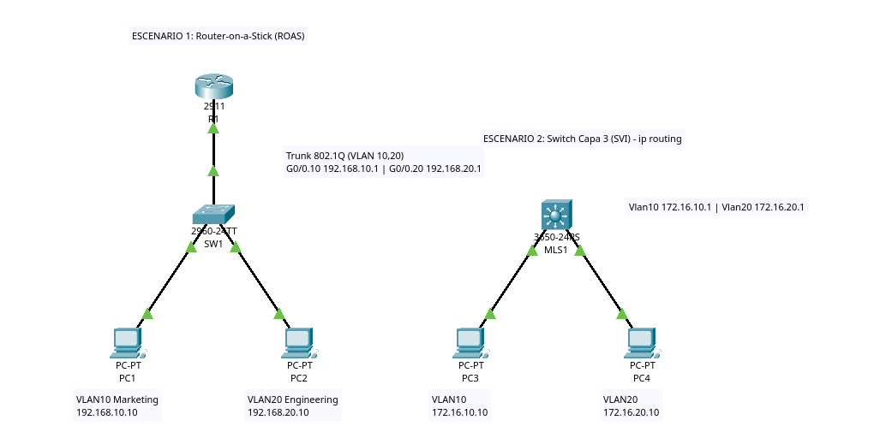
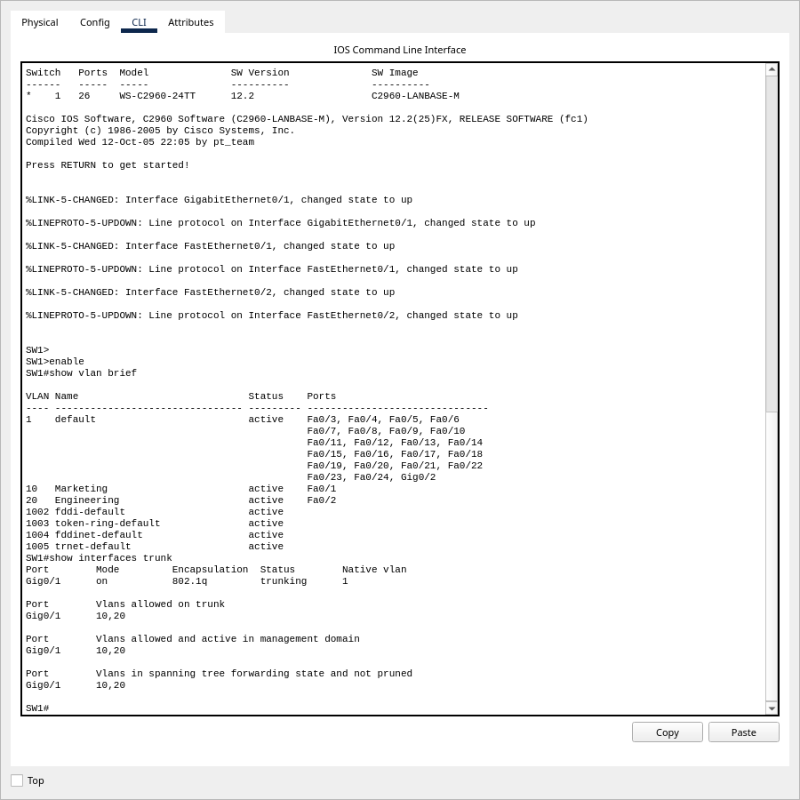
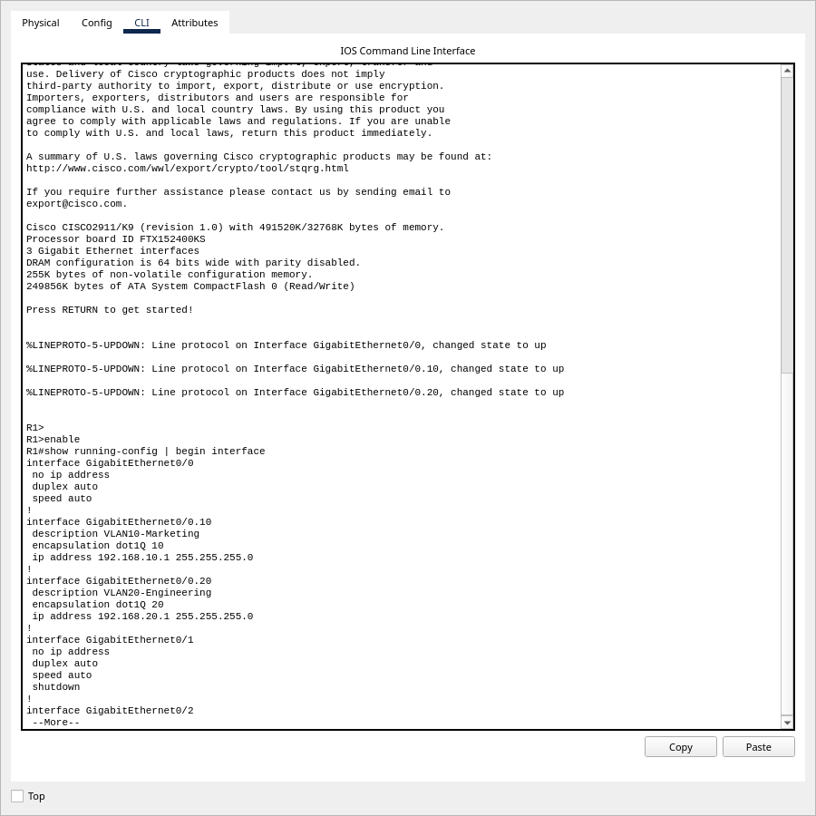
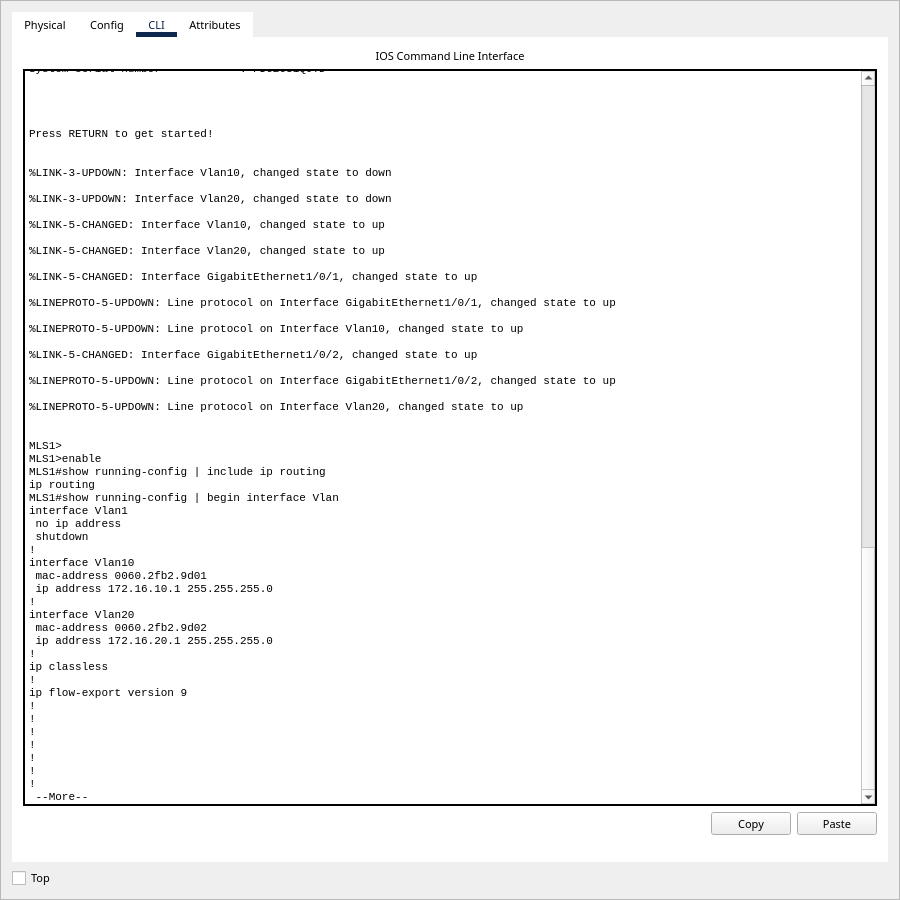
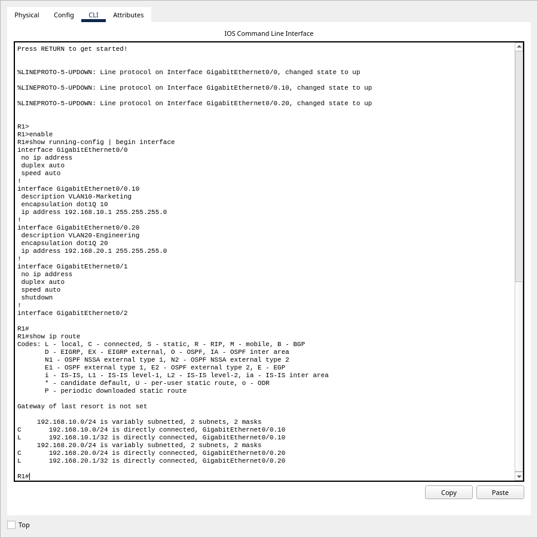
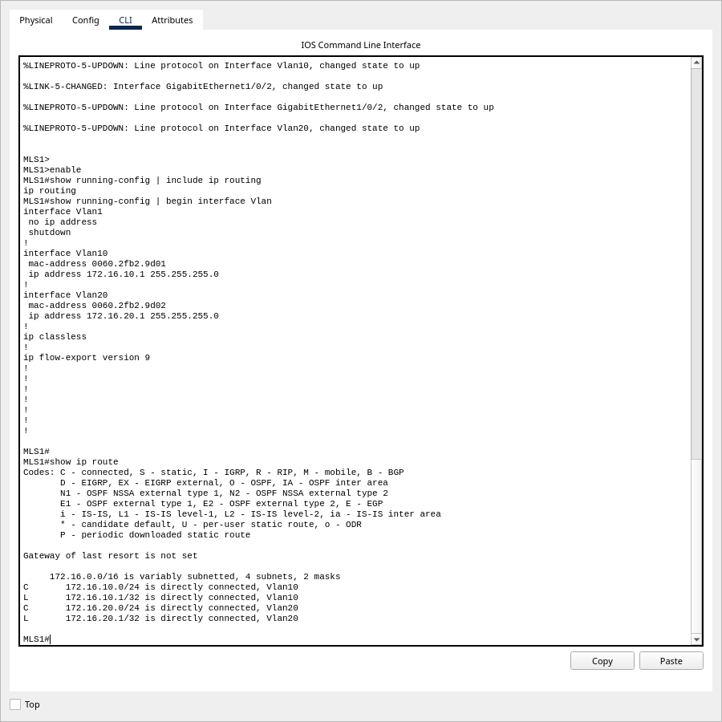
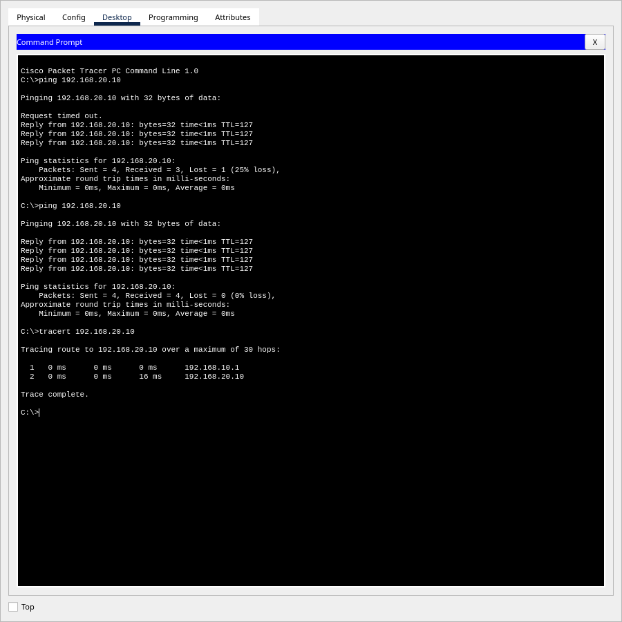
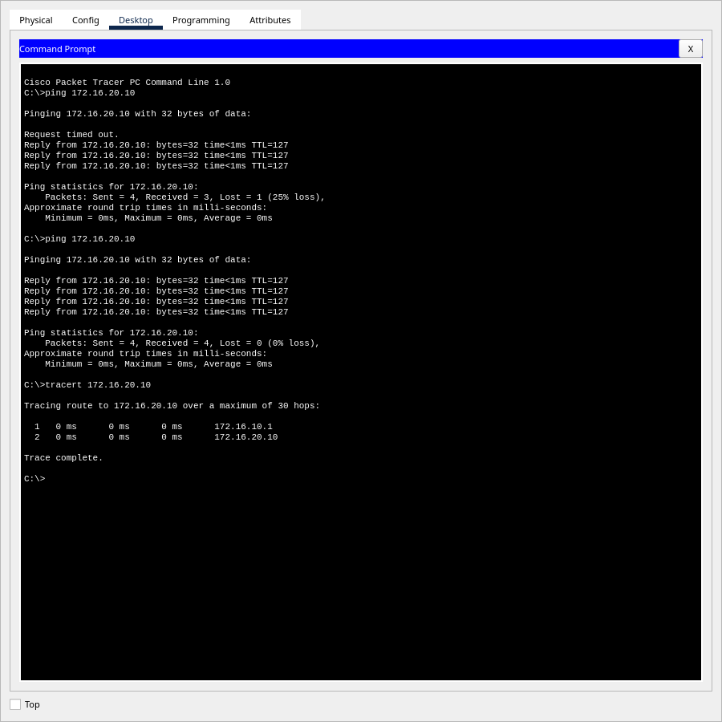

# Actividad 5 — Enrutamiento Inter-VLAN

**Manual Técnico**

Comparación de los dos métodos modernos de enrutamiento Inter-VLAN en Cisco Packet
Tracer: **Router-on-a-Stick (ROAS)**, con un router y subinterfaces 802.1Q, y
**Switch de Capa 3**, con interfaces virtuales (SVI) y `ip routing`.

| | |
|---|---|
| **Estudiante** | Alex Ricardo Castañeda Rodríguez |
| **Carné** | 202300476 |
| **Curso** | Redes de Computadoras 1 — Segundo Semestre 2026 |
| **Ponderación** | 1 pt |
| **Archivo de topología** | [`packet-tracer/Actividad5_202300476.pkt`](packet-tracer/Actividad5_202300476.pkt) |
| **Versión de Packet Tracer** | 9.0.1.0858 |
| **Enunciado** | [`docs/enunciado/Actividad_Practica_5.pdf`](docs/enunciado/Actividad_Practica_5.pdf) |

> Todas las salidas de comandos y capturas de este manual fueron tomadas de la
> topología en ejecución. Las configuraciones completas de cada equipo están en
> [`docs/configuraciones/`](docs/configuraciones/).

---

## Índice

1. [Topología](#1-topología)
2. [Inventario de equipos](#2-inventario-de-equipos)
3. [Direccionamiento IP y VLANs](#3-direccionamiento-ip-y-vlans)
4. [Escenario 1: Router-on-a-Stick](#4-escenario-1-router-on-a-stick)
5. [Escenario 2: Switch de Capa 3 (SVI)](#5-escenario-2-switch-de-capa-3-svi)
6. [Tablas de enrutamiento](#6-tablas-de-enrutamiento)
7. [Pruebas de conectividad](#7-pruebas-de-conectividad)
8. [Análisis técnico](#8-análisis-técnico)
9. [Conclusiones](#9-conclusiones)

---

## 1. Topología



La topología contiene los dos escenarios lado a lado y aislados entre sí:

- **Escenario 1 (izquierda):** R1 (2911) conectado por un enlace troncal a SW1
  (2960), que da acceso a PC1 (VLAN 10) y PC2 (VLAN 20).
- **Escenario 2 (derecha):** el switch multicapa MLS1 (3650) conecta directamente
  a PC3 (VLAN 10) y PC4 (VLAN 20) y enruta entre ellas.

## 2. Inventario de equipos

| Escenario | Equipo | Modelo | Función |
|---|---|---|---|
| ROAS | R1 | Cisco 2911 | Router Inter-VLAN con subinterfaces |
| ROAS | SW1 | Cisco 2960-24TT | Switch de acceso capa 2 |
| ROAS | PC1, PC2 | PC-PT | Hosts de VLAN 10 y VLAN 20 |
| SVI | MLS1 | Cisco 3650-24PS | Switch multicapa (capa 3) |
| SVI | PC3, PC4 | PC-PT | Hosts de VLAN 10 y VLAN 20 |

### Enlaces

| Origen | Destino | Cable | Modo del puerto |
|---|---|---|---|
| R1 G0/0 | SW1 G0/1 | Directo | Troncal 802.1Q (VLAN 10, 20) |
| PC1 Fa0 | SW1 Fa0/1 | Directo | Acceso VLAN 10 |
| PC2 Fa0 | SW1 Fa0/2 | Directo | Acceso VLAN 20 |
| PC3 Fa0 | MLS1 G1/0/1 | Directo | Acceso VLAN 10 |
| PC4 Fa0 | MLS1 G1/0/2 | Directo | Acceso VLAN 20 |

## 3. Direccionamiento IP y VLANs

| VLAN | Nombre | Red ROAS | Red SVI |
|---|---|---|---|
| 10 | Marketing | 192.168.10.0/24 | 172.16.10.0/24 |
| 20 | Engineering | 192.168.20.0/24 | 172.16.20.0/24 |

Uso redes distintas en cada escenario para que las tablas de enrutamiento y los
`tracert` muestren sin ambigüedad qué equipo actúa como gateway.

| Equipo | Interfaz | Dirección IP | VLAN | Gateway |
|---|---|---|---|---|
| R1 | G0/0 | sin IP (interfaz física del troncal) | — | — |
| R1 | G0/0.10 | 192.168.10.1/24 | 10 | — |
| R1 | G0/0.20 | 192.168.20.1/24 | 20 | — |
| PC1 | Fa0 | 192.168.10.10/24 | 10 | 192.168.10.1 |
| PC2 | Fa0 | 192.168.20.10/24 | 20 | 192.168.20.1 |
| MLS1 | Vlan10 | 172.16.10.1/24 | 10 | — |
| MLS1 | Vlan20 | 172.16.20.1/24 | 20 | — |
| PC3 | Fa0 | 172.16.10.10/24 | 10 | 172.16.10.1 |
| PC4 | Fa0 | 172.16.20.10/24 | 20 | 172.16.20.1 |

---

## 4. Escenario 1: Router-on-a-Stick

### 4.1 Switch SW1

Se crean las VLANs, se asignan los puertos de acceso a las PCs y el puerto hacia el
router se configura como troncal. En el troncal solo se permiten las VLANs 10 y 20.

```
SW1(config)# vlan 10
SW1(config-vlan)# name Marketing
SW1(config)# vlan 20
SW1(config-vlan)# name Engineering
SW1(config)# interface FastEthernet0/1
SW1(config-if)# switchport mode access
SW1(config-if)# switchport access vlan 10
SW1(config)# interface FastEthernet0/2
SW1(config-if)# switchport mode access
SW1(config-if)# switchport access vlan 20
SW1(config)# interface GigabitEthernet0/1
SW1(config-if)# switchport mode trunk
SW1(config-if)# switchport trunk allowed vlan 10,20
```



`show vlan brief` confirma Fa0/1 en la VLAN 10 y Fa0/2 en la VLAN 20.
`show interfaces trunk` muestra Gig0/1 en modo troncal 802.1q, con las VLANs 10 y 20
permitidas y en estado *forwarding*.

### 4.2 Router R1

La interfaz física `G0/0` se enciende **sin dirección IP**. Sobre ella se crea una
subinterfaz por VLAN. El comando `encapsulation dot1Q <vlan>` asocia cada
subinterfaz con la etiqueta 802.1Q de su VLAN, y así una sola interfaz física atiende
varias redes a la vez.

```
R1(config)# interface GigabitEthernet0/0
R1(config-if)# no ip address
R1(config-if)# no shutdown
R1(config)# interface GigabitEthernet0/0.10
R1(config-subif)# description VLAN10-Marketing
R1(config-subif)# encapsulation dot1Q 10
R1(config-subif)# ip address 192.168.10.1 255.255.255.0
R1(config)# interface GigabitEthernet0/0.20
R1(config-subif)# description VLAN20-Engineering
R1(config-subif)# encapsulation dot1Q 20
R1(config-subif)# ip address 192.168.20.1 255.255.255.0
```



---

## 5. Escenario 2: Switch de Capa 3 (SVI)

En el switch multicapa se crean las VLANs en su base de datos y se asignan los puertos
de acceso. Luego se crea una **interfaz virtual (SVI)** por VLAN, con la IP de
gateway de esa red. Por último, `ip routing` activa las funciones de capa 3. Sin ese
comando el switch solo conmuta en capa 2 y no enruta entre las SVIs.

```
MLS1(config)# ip routing
MLS1(config)# vlan 10
MLS1(config-vlan)# name Marketing
MLS1(config)# vlan 20
MLS1(config-vlan)# name Engineering
MLS1(config)# interface GigabitEthernet1/0/1
MLS1(config-if)# switchport mode access
MLS1(config-if)# switchport access vlan 10
MLS1(config)# interface GigabitEthernet1/0/2
MLS1(config-if)# switchport mode access
MLS1(config-if)# switchport access vlan 20
MLS1(config)# interface Vlan10
MLS1(config-if)# ip address 172.16.10.1 255.255.255.0
MLS1(config-if)# no shutdown
MLS1(config)# interface Vlan20
MLS1(config-if)# ip address 172.16.20.1 255.255.255.0
MLS1(config-if)# no shutdown
```



`show running-config | include ip routing` confirma que el enrutamiento está
habilitado. El bloque de `interface Vlan10` y `Vlan20` muestra las direcciones de
gateway de cada VLAN.

---

## 6. Tablas de enrutamiento

En los dos equipos, cada red aparece como **directamente conectada** (`C`), junto a la
dirección local de la interfaz (`L`). No hacen falta rutas estáticas ni protocolos
dinámicos, porque el equipo de capa 3 tiene una interfaz dentro de cada VLAN.

**R1 (ROAS):** las redes se alcanzan por las subinterfaces `G0/0.10` y `G0/0.20`.



**MLS1 (SVI):** las redes se alcanzan por las interfaces virtuales `Vlan10` y `Vlan20`.



---

## 7. Pruebas de conectividad

En cada escenario hice `ping` desde una PC de la VLAN 10 hacia una PC de la VLAN 20 y
luego `tracert` para verificar el camino.

| Escenario | Origen → Destino | Resultado | Primer salto (`tracert`) |
|---|---|---|---|
| ROAS | PC1 → 192.168.20.10 (PC2) | 4/4, 0 % de pérdida | 192.168.10.1 (R1 G0/0.10) |
| SVI | PC3 → 172.16.20.10 (PC4) | 4/4, 0 % de pérdida | 172.16.10.1 (MLS1 Vlan10) |

**Escenario 1: PC1 (VLAN 10) → PC2 (VLAN 20)**



**Escenario 2: PC3 (VLAN 10) → PC4 (VLAN 20)**



**Cómo leer las capturas:**

- En el **primer ping** se pierde un paquete (`Request timed out`). Es el tiempo de
  resolución ARP: la PC debe conocer la MAC de su gateway, y el gateway debe
  conocer la MAC de la PC destino. Con las tablas ARP ya pobladas, el
  **segundo ping** obtiene 4/4 respuestas.
- `TTL=127` en las respuestas (128 − 1) indica que el paquete cruzó exactamente
  un salto de capa 3.
- `tracert` confirma ese salto: primero el gateway (router o switch capa 3), luego
  el destino.

---

## 8. Análisis técnico

### 8.1 Comportamiento del tráfico

**Router-on-a-Stick.** Cuando PC1 envía un paquete a PC2, la trama entra a SW1 por el
puerto de acceso de la VLAN 10. De ahí sube por el troncal hacia R1 con la etiqueta
802.1Q `VID=10`. R1 la recibe en `G0/0.10`, quita la etiqueta, consulta su tabla de
enrutamiento y reenvía el paquete **por el mismo enlace físico**, ahora con la
etiqueta `VID=20`, a través de `G0/0.20`. SW1 finalmente lo entrega a PC2.

```
PC1 ──VLAN10──▶ SW1 ══troncal (VID 10)══▶ R1
                                        │ enruta
PC2 ◀──VLAN20── SW1 ◀══troncal (VID 20)══ R1
```

Cada paquete entre VLANs cruza el troncal **dos veces**, así que ese único enlace
transporta todo el tráfico entre VLANs de la red.

**Switch de Capa 3.** Cuando PC3 envía un paquete a PC4, la trama llega a MLS1 por el
puerto de la VLAN 10 y la recibe la SVI `Vlan10`. El switch toma la decisión de
enrutamiento **internamente** y entrega el paquete por la `Vlan20` hacia PC4. El
tráfico nunca sale del chasis hacia otro equipo.

```
PC3 ──VLAN10──▶ [ MLS1: Vlan10 ─ enruta ─▶ Vlan20 ] ──VLAN20──▶ PC4
```

### 8.2 Diferencia de hardware de enrutamiento

| Aspecto | Router-on-a-Stick | Switch de Capa 3 (SVI) |
|---|---|---|
| Motor de reenvío | CPU del router (enrutamiento por software) | ASICs dedicados (enrutamiento por hardware, CEF/TCAM) |
| Ancho de banda | Limitado por un único troncal compartido por todas las VLANs | Backplane interno de alta capacidad, a velocidad de línea |
| Latencia | Mayor: el paquete sale y regresa por el troncal | Menor: se enruta dentro del mismo switch |
| Punto único de falla | Sí: el troncal y el router | No depende de un enlace externo para enrutar |
| Escalabilidad | Se degrada al crecer el número de VLANs y el tráfico | Escala a muchas VLANs sin perder rendimiento |
| Costo | Bajo: aprovecha un router existente | Mayor: requiere un switch multicapa |

### 8.3 ¿Cuál es más eficiente para una red empresarial de alto tráfico?

> **El Switch de Capa 3 con SVIs.**
>
> En Router-on-a-Stick, todo el tráfico entre VLANs sube y baja por un único enlace
> troncal hacia el router. Ese enlace se vuelve un cuello de botella y un punto
> único de falla. Además, el router enruta por software (CPU), lo que añade latencia
> cuando el volumen de tráfico crece.
>
> El switch multicapa enruta internamente con hardware especializado (ASICs) a
> velocidad de línea, sin depender de un enlace externo. Por eso tiene menor
> latencia, mayor rendimiento y mejor escalabilidad a medida que aumentan las VLANs y
> los usuarios.
>
> Router-on-a-Stick sigue siendo una opción válida en redes pequeñas o con presupuesto
> limitado, donde el tráfico entre VLANs es bajo.

---

## 9. Conclusiones

1. Ambos métodos permitieron la comunicación entre la VLAN 10 y la VLAN 20. El ping
   alcanzó 0 % de pérdida y el `tracert` confirmó que el tráfico pasa por el gateway
   de cada escenario.
2. En ROAS, el encapsulamiento `dot1Q` de cada subinterfaz es lo que permite que una
   sola interfaz física del router atienda varias VLANs a través del troncal.
3. En el switch multicapa, `ip routing` es indispensable: sin ese comando las SVIs
   existen pero el switch no enruta entre ellas.
4. Para una red empresarial con alto tráfico entre VLANs, el switch de capa 3 ofrece
   mejor rendimiento, menor latencia y mayor escalabilidad que Router-on-a-Stick.

---

## Estructura de la carpeta

```
Actividad5/
├── README.md                     este manual técnico
├── packet-tracer/
│   └── Actividad5_202300476.pkt  topología funcional
└── docs/
    ├── enunciado/                enunciado de la actividad
    ├── configuraciones/          running-config de R1, SW1 y MLS1
    └── img/                      capturas de evidencia
```
