# Actividad 6 — HSRP básico

**Manual Técnico**

Configuración y análisis de **HSRP (Hot Standby Router Protocol)** en Cisco Packet
Tracer: dos routers comparten una IP virtual como gateway de la LAN inferior, de modo que
si el router activo falla, el router en standby toma su lugar sin que la PC tenga que
cambiar su configuración.

| | |
|---|---|
| **Estudiante** | Alex Ricardo Castañeda Rodríguez |
| **Carné** | 202300476 |
| **Curso** | Redes de Computadoras 1 — Segundo Semestre 2026 |
| **Ponderación** | 1 pt |
| **Archivo de topología** | [`packet-tracer/202300476_AlexCastaneda_HSRP.pkt`](packet-tracer/202300476_AlexCastaneda_HSRP.pkt) |
| **Documento de evidencias** | [`docs/202300476_AlexCastaneda_HSRP.pdf`](docs/202300476_AlexCastaneda_HSRP.pdf) |
| **Versión de Packet Tracer** | 9.0.1.0858 |
| **Enunciado** | [`docs/enunciado/Actividad_Practica_6.pdf`](docs/enunciado/Actividad_Practica_6.pdf) |

> Todas las salidas de comandos y capturas de este manual fueron tomadas de la
> topología en ejecución. Las configuraciones completas de cada equipo están en
> [`docs/configuraciones/`](docs/configuraciones/).

---

## Índice

1. [Topología](#1-topología)
2. [Inventario de equipos](#2-inventario-de-equipos)
3. [Direccionamiento IP](#3-direccionamiento-ip)
4. [Configuración de HSRP](#4-configuración-de-hsrp)
5. [Enrutamiento OSPF](#5-enrutamiento-ospf)
6. [Verificación antes de la falla](#6-verificación-antes-de-la-falla)
7. [Prueba de redundancia](#7-prueba-de-redundancia)
8. [Análisis técnico](#8-análisis-técnico)
9. [Conclusiones](#9-conclusiones)

---

## 1. Topología

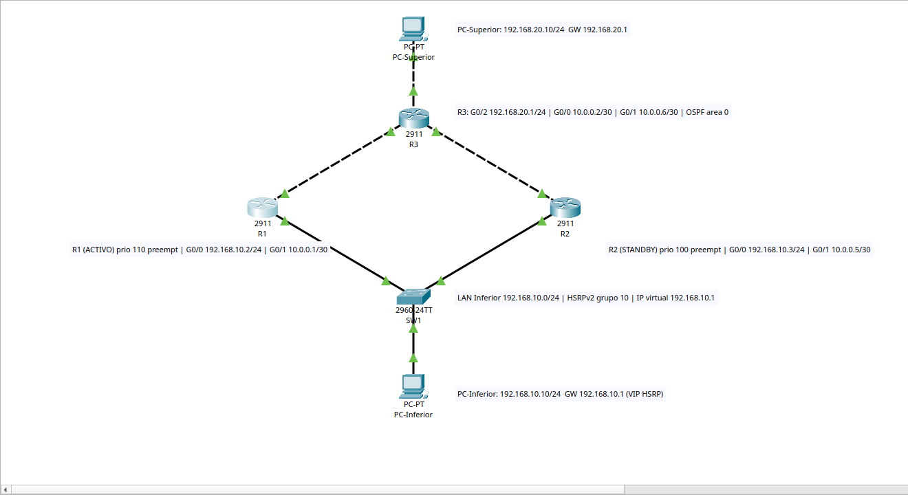

- **Red inferior:** R1 y R2 se conectan a la misma LAN (192.168.10.0/24) a través de
  SW1, donde también está la PC inferior. Ambos routers participan en el grupo HSRP 10.
- **Red superior:** R3 se enlaza con R1 y con R2 mediante dos enlaces punto a punto
  /30 y da servicio a la PC superior (192.168.20.0/24).

## 2. Inventario de equipos

| Equipo | Modelo | Función |
|---|---|---|
| R1 | Cisco 2911 | Router inferior, HSRP **activo** (prioridad 110) |
| R2 | Cisco 2911 | Router inferior, HSRP **standby** (prioridad 100) |
| R3 | Cisco 2911 | Router superior, gateway de la LAN superior |
| SW1 | Cisco 2960-24TT | Switch de la LAN inferior |
| PC-Inferior | PC-PT | Host de la LAN inferior |
| PC-Superior | PC-PT | Host de la LAN superior |

### Enlaces

| Origen | Destino | Cable |
|---|---|---|
| R1 G0/0 | SW1 Fa0/1 | Directo |
| R2 G0/0 | SW1 Fa0/2 | Directo |
| PC-Inferior Fa0 | SW1 Fa0/3 | Directo |
| R1 G0/1 | R3 G0/0 | Cruzado |
| R2 G0/1 | R3 G0/1 | Cruzado |
| R3 G0/2 | PC-Superior Fa0 | Cruzado |

## 3. Direccionamiento IP

| Red | Uso |
|---|---|
| 192.168.10.0/24 | LAN inferior (HSRP) |
| 10.0.0.0/30 | Enlace R1 ↔ R3 |
| 10.0.0.4/30 | Enlace R2 ↔ R3 |
| 192.168.20.0/24 | LAN superior |

| Equipo | Interfaz | Dirección IP | Gateway |
|---|---|---|---|
| R1 | G0/0 | 192.168.10.2/24 | — |
| R1 | G0/1 | 10.0.0.1/30 | — |
| R2 | G0/0 | 192.168.10.3/24 | — |
| R2 | G0/1 | 10.0.0.5/30 | — |
| R3 | G0/0 | 10.0.0.2/30 | — |
| R3 | G0/1 | 10.0.0.6/30 | — |
| R3 | G0/2 | 192.168.20.1/24 | — |
| **IP virtual HSRP** | grupo 10 | **192.168.10.1/24** | — |
| PC-Inferior | Fa0 | 192.168.10.10/24 | **192.168.10.1** (IP virtual) |
| PC-Superior | Fa0 | 192.168.20.10/24 | 192.168.20.1 |

La PC inferior no usa la IP real de ningún router como gateway, sino la **IP virtual**.
Así, el gateway sigue siendo el mismo sin importar qué router esté activo.

---

## 4. Configuración de HSRP

HSRP se configura en la interfaz de cada router que da hacia la LAN inferior. Los dos
routers comparten el mismo grupo (10) y la misma IP virtual. La **prioridad** decide
quién es el activo, y `preempt` le permite recuperar ese rol cuando vuelve.

**R1 — router activo:**

```
R1(config)# interface GigabitEthernet0/0
R1(config-if)# ip address 192.168.10.2 255.255.255.0
R1(config-if)# standby version 2
R1(config-if)# standby 10 ip 192.168.10.1
R1(config-if)# standby 10 priority 110
R1(config-if)# standby 10 preempt
R1(config-if)# no shutdown
```

**R2 — router standby:**

```
R2(config)# interface GigabitEthernet0/0
R2(config-if)# ip address 192.168.10.3 255.255.255.0
R2(config-if)# standby version 2
R2(config-if)# standby 10 ip 192.168.10.1
R2(config-if)# standby 10 priority 100
R2(config-if)# standby 10 preempt
R2(config-if)# no shutdown
```

La prioridad 100 es el valor por defecto de IOS, por eso no aparece en el
`running-config` de R2. `show standby` la reporta como `Priority 100 (default 100)`.

| Parámetro | Valor |
|---|---|
| Versión | HSRPv2 |
| Grupo | 10 |
| IP virtual | 192.168.10.1 |
| MAC virtual | 0000.0C9F.F00A |
| Hello / Hold | 3 s / 10 s (valores por defecto) |
| Prioridad R1 / R2 | 110 / 100 |
| Preempt | Habilitado en ambos |

---

## 5. Enrutamiento OSPF

Para la conectividad de capa 3 se usa **OSPF en el área 0**. Cada router anuncia sus
redes directamente conectadas.

```
R1(config)# router ospf 1
R1(config-router)# router-id 1.1.1.1
R1(config-router)# network 192.168.10.0 0.0.0.255 area 0
R1(config-router)# network 10.0.0.0 0.0.0.3 area 0

R2(config)# router ospf 1
R2(config-router)# router-id 2.2.2.2
R2(config-router)# network 192.168.10.0 0.0.0.255 area 0
R2(config-router)# network 10.0.0.4 0.0.0.3 area 0

R3(config)# router ospf 1
R3(config-router)# router-id 3.3.3.3
R3(config-router)# network 10.0.0.0 0.0.0.3 area 0
R3(config-router)# network 10.0.0.4 0.0.0.3 area 0
R3(config-router)# network 192.168.20.0 0.0.0.255 area 0
```

OSPF importa para el **tráfico de regreso**. R3 aprende 192.168.10.0/24 por dos caminos
de igual costo:

```
R3#show ip route ospf
O    192.168.10.0 [110/2] via 10.0.0.1, GigabitEthernet0/0
                  [110/2] via 10.0.0.5, GigabitEthernet0/1
```

Cuando R1 pierde su interfaz LAN, OSPF retira la ruta que pasa por él y R3 envía las
respuestas solo por R2. HSRP resuelve el camino de ida (gateway de la PC) y OSPF el de
regreso.

---

## 6. Verificación antes de la falla

### 6.1 Configuración IP de las PCs

**PC inferior:** el gateway es la IP virtual `192.168.10.1`.


**PC superior:**

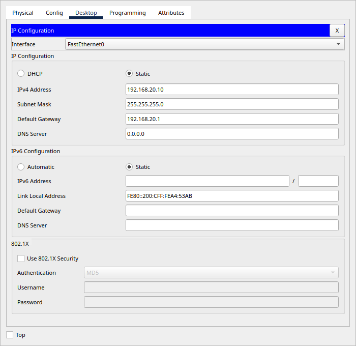

### 6.2 HSRP en el router activo (R1)

`State is Active`, prioridad 110, `Preemption enabled` y R2 (192.168.10.3) como standby.

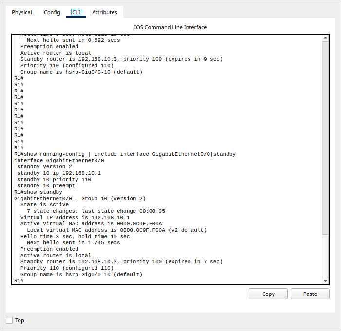

### 6.3 HSRP en el router standby (R2)

`State is Standby`, prioridad 100 y R1 (192.168.10.2) como activo.

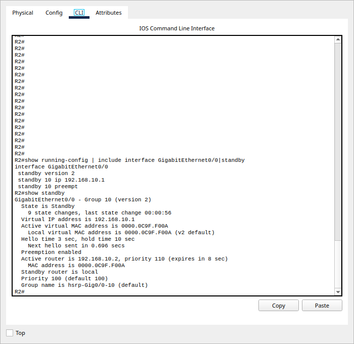

### 6.4 `show standby brief`

| Router | Pri | P | State | Active | Standby | Virtual IP |
|---|---|---|---|---|---|---|
| R1 | 110 | P | **Active** | local | 192.168.10.3 | 192.168.10.1 |
| R2 | 100 | P | **Standby** | 192.168.10.2 | local | 192.168.10.1 |

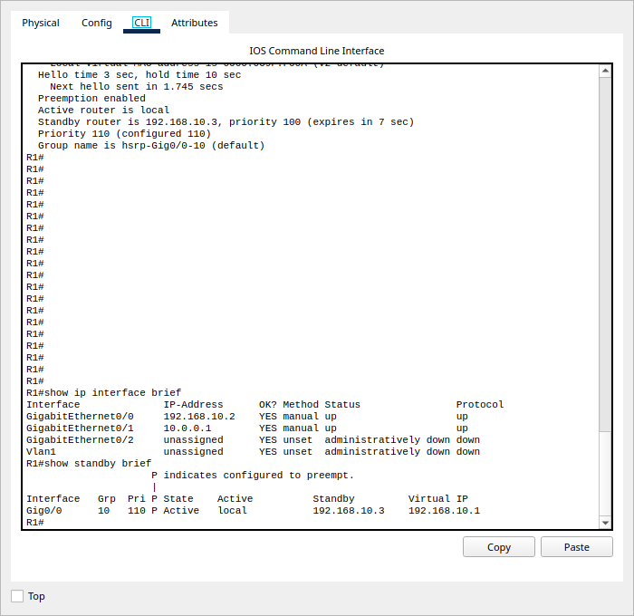

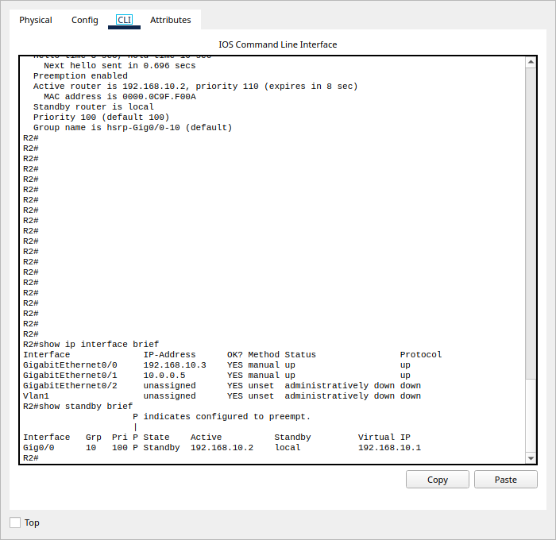

### 6.5 Ping continuo

Desde la PC inferior se ejecutó `ping -t 192.168.20.10`. Todas las respuestas llegan con
`TTL=126`: el paquete cruza dos routers (R1 y R3).

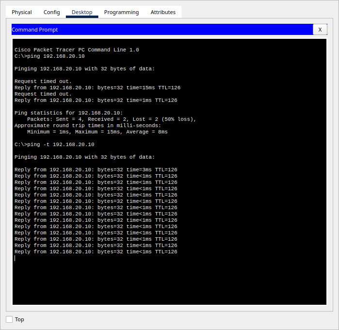

---

## 7. Prueba de redundancia

### 7.1 Falla simulada

Con el `ping -t` en ejecución, se apagó la interfaz LAN del router activo:

```
R1(config)# interface GigabitEthernet0/0
R1(config-if)# shutdown
```

R1 registra la caída y su estado HSRP pasa de **Active** a **Init**:

```
%HSRP-6-STATECHANGE: GigabitEthernet0/0 Grp 10 state Active -> Init
%LINK-5-CHANGED: Interface GigabitEthernet0/0, changed state to administratively down
```

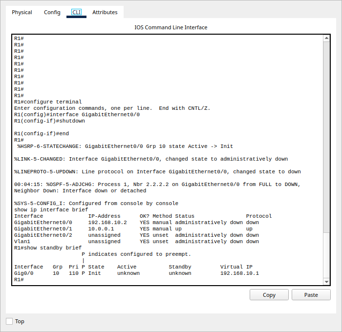

### 7.2 Efecto en el ping continuo

El ping perdió **7 respuestas** consecutivas (`Request timed out`) y luego se recuperó
por sí solo, sin tocar la configuración de la PC.

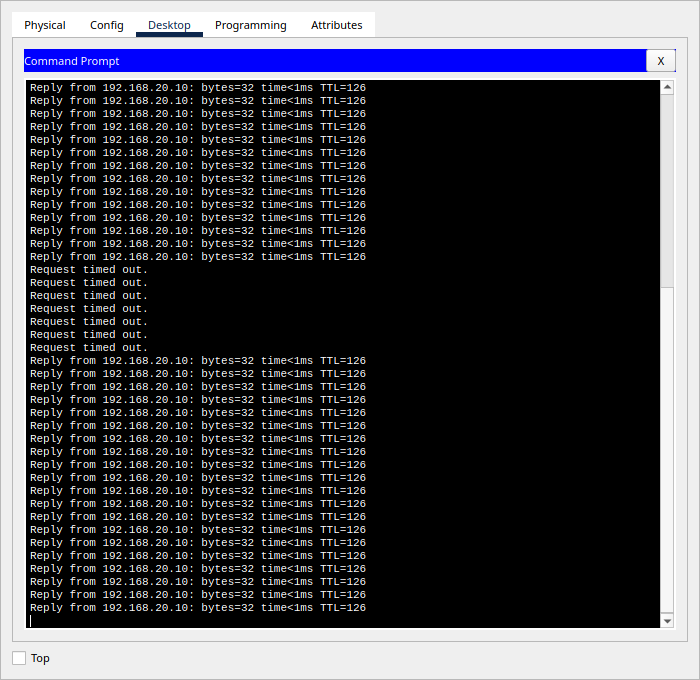

### 7.3 R2 asume el rol activo

Al no recibir hellos de R1 durante el *hold time*, R2 pasa de **Standby** a **Active**:

```
%HSRP-6-STATECHANGE: GigabitEthernet0/0 Grp 10 state Standby -> Active
```

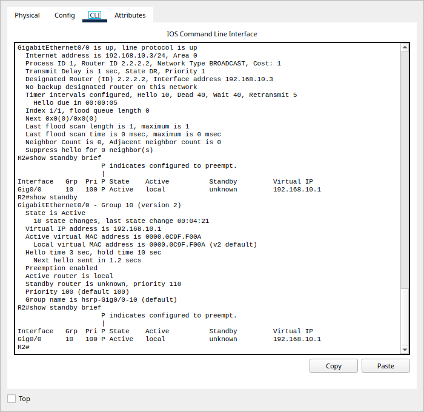

### 7.4 Recuperación con preempt

Al ejecutar `no shutdown` en `G0/0` de R1, este volvió a ser **Active** por tener mayor
prioridad (110) y `preempt` configurado, y R2 regresó a **Standby**.

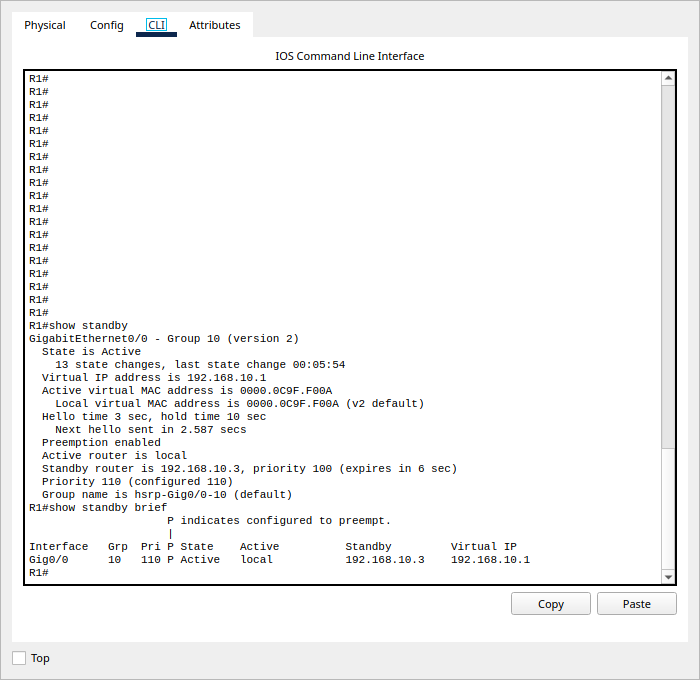

### Línea de tiempo

| Momento | R1 | R2 | Ping PC-Inferior → PC-Superior |
|---|---|---|---|
| Inicio | Active | Standby | Respuestas continuas |
| `shutdown` en R1 G0/0 | Init | Standby → Active | 7 × `Request timed out` |
| Tras la conmutación | Init | Active | Respuestas continuas |
| `no shutdown` en R1 G0/0 | Active (preempt) | Standby | Respuestas continuas |

---

## 8. Análisis técnico

**¿Qué IP virtual se utilizó como gateway?**
`192.168.10.1`, del grupo HSRP 10 (versión 2), con MAC virtual `0000.0C9F.F00A`. La PC
inferior la usa como gateway predeterminado.

**¿Qué router inició como activo y cuál como standby?**
R1 inició como **activo** por tener la prioridad más alta (110). R2, con prioridad 100,
quedó como **standby**.

**¿Qué ocurrió cuando falló el router activo?**
Al apagar `G0/0` de R1, este dejó de enviar hellos HSRP. R2 esperó a que venciera el
*hold time* (10 s) y pasó de Standby a Active. Desde ese momento R2 responde por la IP y
la MAC virtuales, y la PC inferior siguió enviando su tráfico a la misma dirección de
gateway sin enterarse del cambio. En paralelo, OSPF retiró la ruta hacia
192.168.10.0/24 que pasaba por R1, y R3 envió las respuestas por R2.

**¿Cuánto afectó la falla al ping continuo?**
Se perdieron 7 respuestas consecutivas. Esa interrupción corresponde al tiempo de
detección de HSRP (hold time de 10 s) más la reconvergencia de OSPF en R3. Después la
conectividad se restableció sola.

**¿Qué función cumple `preempt`?**
Permite que el router con mayor prioridad recupere el rol activo en cuanto vuelve a
estar disponible. Sin `preempt`, R2 se habría quedado como activo aun después de que R1
se recuperara, porque HSRP no reemplaza a un router activo que sigue funcionando. Con
`preempt`, el reparto de roles vuelve a ser el diseñado: R1 activo y R2 de respaldo.

---

## 9. Conclusiones

1. HSRP permitió que la PC inferior usara un único gateway (192.168.10.1) respaldado
   por dos routers físicos.
2. Ante la falla del router activo, R2 asumió el rol sin intervención manual. La
   interrupción se limitó a 7 pings perdidos.
3. HSRP solo cubre el primer salto: OSPF fue necesario para que el tráfico de regreso
   también evitara al router caído.
4. `preempt` garantiza que, al recuperarse, el router de mayor prioridad vuelva a ser el
   activo y la red regrese a su estado de diseño.

---

## Estructura de la carpeta

```
Actividad6/
├── README.md                              este manual técnico
├── packet-tracer/
│   └── 202300476_AlexCastaneda_HSRP.pkt   topología funcional
└── docs/
    ├── 202300476_AlexCastaneda_HSRP.pdf   documento de evidencias
    ├── enunciado/                         enunciado de la actividad
    ├── configuraciones/                   running-config de R1, R2, R3 y SW1
    └── img/                               capturas de evidencia
```
