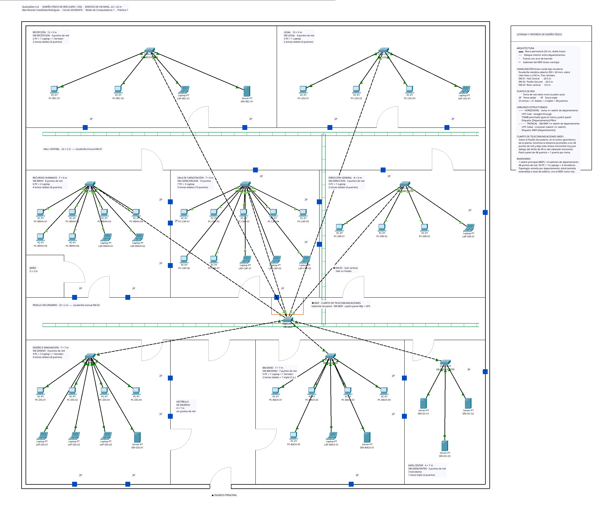

# Práctica 1 — QuetzalDev S.A.
### Diseño físico de red (Capa 1 del modelo OSI)

QuetzalDev S.A. inauguró un edificio corporativo de un nivel y necesita la infraestructura de
red planificada antes de comprar equipo. Diseñé el cableado estructurado completo sobre el
plano arquitectónico asignado: dónde va cada punto de red, qué cable lleva cada tramo, por
dónde corre y cuánto cuesta.

**Es un trabajo de diseño, no de configuración.** No hay direcciones IP, VLANs ni protocolos:
todo el alcance está en la Capa 1.

---

## El diseño



| Concepto | Valor |
|---|---|
| Edificio | 22 × 22 m (484 m²), un nivel, 8 departamentos con red |
| Puntos de red | 48 — 30 PC + 12 laptops + 6 servidores |
| Tomas | 23 (21 dobles + 2 triples) |
| Switches | 8 de acceso + 1 principal en el MDF |
| Cableado horizontal | 587.0 m de UTP Cat6 · straight-through |
| Cableado troncal | 147.2 m de UTP Cat6a · crossover |
| Canalización | 50 m de escalerilla metálica abierta |
| Enlace más largo | 15.0 m — 17 % del límite de 90 m |
| Presupuesto estimado | Q106,335.00 con IVA |

---

## Documentos

| Documento | Qué contiene |
|---|---|
| [**Manual Técnico**](docs/Manual_Tecnico.md) | Inventario, justificaciones de topología y medio, tablas de distancias y bobinas, pines T568A/B, etiquetado, comparación con TIA/EIA-606 y presupuesto |
| [**Informe de Desarrollo**](docs/Informe_de_Desarrollo.md) | Proceso de diseño, criterios de decisión y retos al interpretar el plano |
| [**Diagrama**](packet-tracer/quetzaldev-plano-fisico-202300476.png) | Plano físico con equipos, tomas, canalización y leyenda |
| [**Archivo editable**](packet-tracer/QuetzalDev_Practica1_Diseno_Fisico.pkt) | Proyecto de Packet Tracer |

---

## Estructura

```
Practica1/
├── README.md                     este archivo
├── docs/
│   ├── Manual_Tecnico.md
│   ├── Informe_de_Desarrollo.md
│   ├── enunciado/                enunciado de la práctica
│   └── planos/                   plano arquitectónico base
└── packet-tracer/
    ├── QuetzalDev_Practica1_Diseno_Fisico.pkt
    └── quetzaldev-plano-fisico-202300476.png
```

---

## Cómo leer el diagrama

| Símbolo | Significado |
|---|---|
| Línea negra gruesa doble | Muro perimetral |
| Línea gris | Tabique interior |
| Arco gris | Puerta con su barrido |
| Trazo verde tipo escalera | Escalerilla metálica (`EM-01`, `EM-02`, `EM-03`) |
| Rectángulo naranja | Gabinete del MDF |
| Cuadro azul `2P` / `3P` | Toma de red doble o triple |
| Línea continua | Cableado horizontal — straight-through |
| Línea punteada | Cableado troncal — crossover |

El plano está a escala: **100 unidades de lienzo = 1.00 m**. Todas las distancias del Manual
Técnico salen de esas coordenadas.
