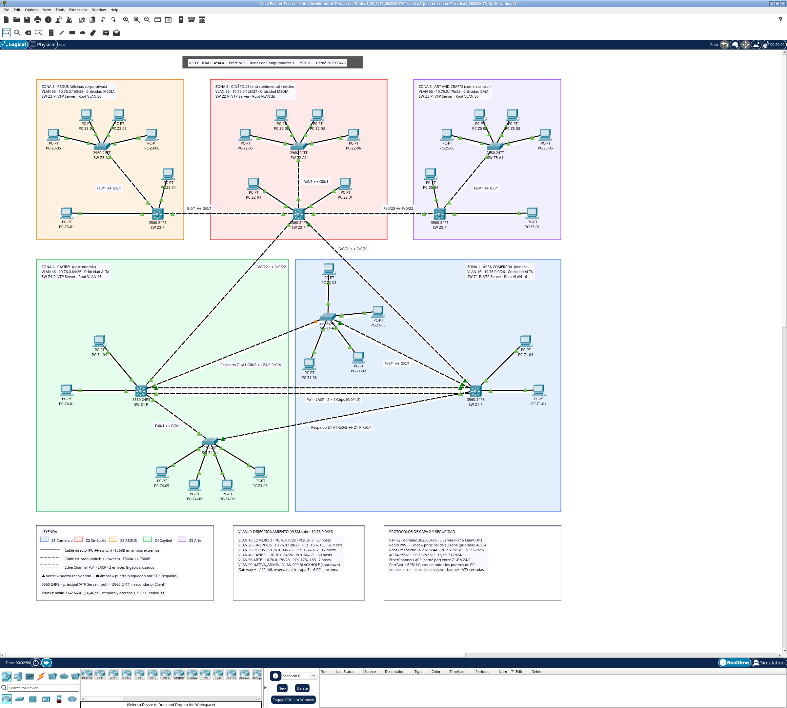

# Práctica 2 - Red de Ciudad Cayalá

Redes de Computadoras 1 · Segundo semestre 2026 · Carnet **202300476**.

Red de capa 2 con **30 PCs y 10 switches** distribuidos en cinco zonas. Cada zona tiene un switch principal, uno secundario y **seis PCs** (2 en el principal y 4 en el secundario). Se implementan VLANs 16/26/36/46/56, nativa 99, Blackhole 999, VTP v2, Rapid PVST+ y EtherChannel LACP.

## Archivos

| Entregable | Enlace |
|---|---|
| Proyecto de Packet Tracer | [Practica2_202300476.pkt](packet-tracer/Practica2_202300476.pkt) |
| Manual técnico | [Diseño y configuración](docs/Manual_Tecnico.md) |
| Informe de desarrollo | [Construcción, pruebas y resultados](docs/Informe_de_Desarrollo.md) |
| Configuración completa por switch | [Scripts CLI](docs/scripts/) |
| IPs y conexiones de los 30 PCs | [Manual técnico, tabla de hosts](docs/Manual_Tecnico.md#hosts-instalados) |
| Capturas de Packet Tracer (46) y salidas `show` | [Índice de evidencias](docs/evidencias/README.md) |

## Qué significan las cantidades de hosts

Hay **seis PCs reales por zona**. Las cantidades 60/28/12/50/7 son la demanda proyectada y se usan para calcular las subredes con VLSM. El modelo compacto permite leer la topología y demostrar todos los protocolos sin instalar los 157 hosts.

## Conectividad de capa 2

Según la aclaración del auxiliar en el foro del curso, no se implementa capa 3. Los pings dentro de una VLAN responden y los pings entre VLANs distintas fallan. Los gateways de los hosts son direcciones reservadas, sin un router o SVI que los atienda.

## Revisión rápida

Abrir el proyecto en Packet Tracer y esperar a que converja (o pulsar Fast Forward Time). Consola de los switches: `Cayala476Con`; enable: `Cayala476Enable`. Comprobar `show vlan brief`, `show vtp status`, `show interfaces trunk`, `show spanning-tree vlan 16` y `show etherchannel summary`. El canal debe indicar `Po1(SU)`, `LACP` y dos miembros `(P)`.
