# Práctica 2 — Red de Ciudad Cayalá

**Informe de Desarrollo**

Construcción, configuración y pruebas de la red en Cisco Packet Tracer, paso a paso y con las capturas de cada verificación.

| | |
|---|---|
| **Estudiante** | Alex Ricardo Castañeda Rodríguez |
| **Carné** | 202300476 |
| **Curso** | Redes de Computadoras 1 — Segundo Semestre 2026 |
| **Archivo de topología** | [`packet-tracer/Practica2_202300476.pkt`](../packet-tracer/Practica2_202300476.pkt) |
| **Versión de Packet Tracer** | 9.0.1 |
| **Diseño y justificación** | [Manual técnico](Manual_Tecnico.md) |

---

## Índice

- [Resultado](#resultado)
- [1. Planificación](#1-planificación)
- [2. Evolución del diseño](#2-evolución-del-diseño)
- [3. Construcción de la topología](#3-construcción-de-la-topología)
- [4. Configuración por CLI](#4-configuración-por-cli)
- [5. Diseño visual](#5-diseño-visual)
- [6. Pruebas](#6-pruebas)
- [7. Problemas encontrados y soluciones](#7-problemas-encontrados-y-soluciones)
- [8. Correspondencia con la hoja de calificación](#8-correspondencia-con-la-hoja-de-calificación)

---

## Resultado

Se implementó una red de **cinco zonas, diez switches y 30 PCs**, conectados mediante 43 enlaces Ethernet. La configuración incluye las VLANs 16, 26, 36, 46 y 56, la VLAN nativa 99, la VLAN Blackhole 999, VTP v2, Rapid PVST+ y un EtherChannel con LACP entre las dos zonas críticas. Cada switch principal actúa como puente raíz de la VLAN de su zona. Las pruebas verificaron la conectividad dentro de cada VLAN y el aislamiento entre VLANs.

| Verificación | Resultado |
|---|---|
| VTP v2, 5 Server y 5 Client con la misma revisión | ✅ |
| VLANs de zona, nativa 99 y Blackhole 999 | ✅ |
| Trunks con listas explícitas | ✅ |
| Un puente raíz por zona (Rapid PVST+) | ✅ |
| EtherChannel `Po1(SU)` con dos miembros LACP | ✅ |
| Pings dentro de la VLAN | ✅ 10/10 con 4/4 |
| Pings hacia otras VLANs | ✅ 6/6 sin respuesta (0/4), como se esperaba |
| Caída de un miembro de Po1 y de un enlace ascendente | ✅ Ping 4/4 por el camino de respaldo |

**Figura 1.** Topología final con 30 PCs. Las capturas de este informe se organizan en el [índice de evidencias](evidencias/README.md).

---

## 1. Planificación

1. Se identificaron los cinco establecimientos en el directorio de Cayalá y se definieron los usuarios, el tráfico estimado y la criticidad de cada zona, según la sección 2 del [manual técnico](Manual_Tecnico.md#2-investigación-y-análisis-de-las-zonas).
2. Se dimensionaron las subredes con VLSM dentro de 10.76.0.0/24, de la mayor demanda a la menor. En cada subred, la primera IP útil queda reservada como gateway.
3. Las VLANs se numeraron con el último dígito del carné: 16, 26, 36, 46 y 56. La 99 es la nativa y la 999 la Blackhole.
4. Como el carné termina en número par, el EtherChannel usa LACP.

| Orden | Zona | Demanda | Subred | VLAN |
|---:|---|---:|---|---:|
| 1 | 🟦 Z1 — Área comercial | 60 | 10.76.0.0/26 | 16 |
| 2 | 🟩 Z4 — Cayibel | 50 | 10.76.0.64/26 | 46 |
| 3 | 🟥 Z2 — Cinépolis | 28 | 10.76.0.128/27 | 26 |
| 4 | 🟧 Z3 — REGUS | 12 | 10.76.0.160/28 | 36 |
| 5 | 🟪 Z5 — Art and Crafts | 7 | 10.76.0.176/28 | 56 |

---

## 2. Evolución del diseño

<table>
  <tr>
    <th width="33%">Etapa 1 · 157 PCs</th>
    <th width="33%">Etapa 2 · 3 PCs por zona</th>
    <th width="33%">Etapa 3 · 6 PCs por zona</th>
  </tr>
  <tr>
    <td><a href="evidencias/capturas/01_etapa1_red_completa_157pcs.png">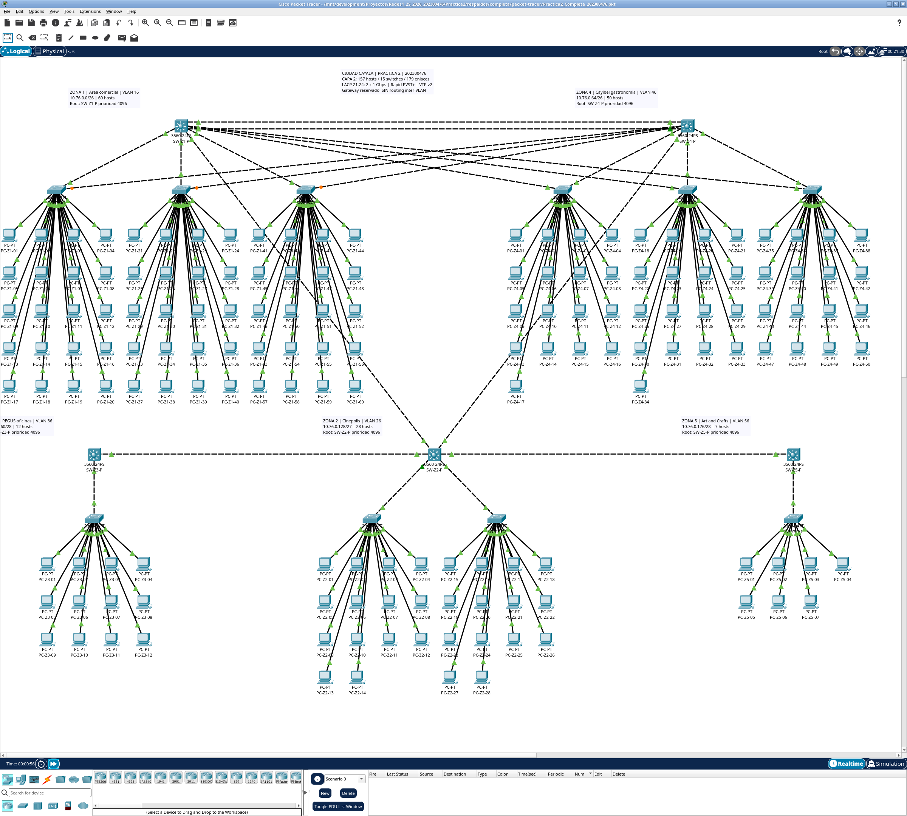</a></td>
    <td><a href="evidencias/capturas/02_etapa2_compacta_15pcs.png">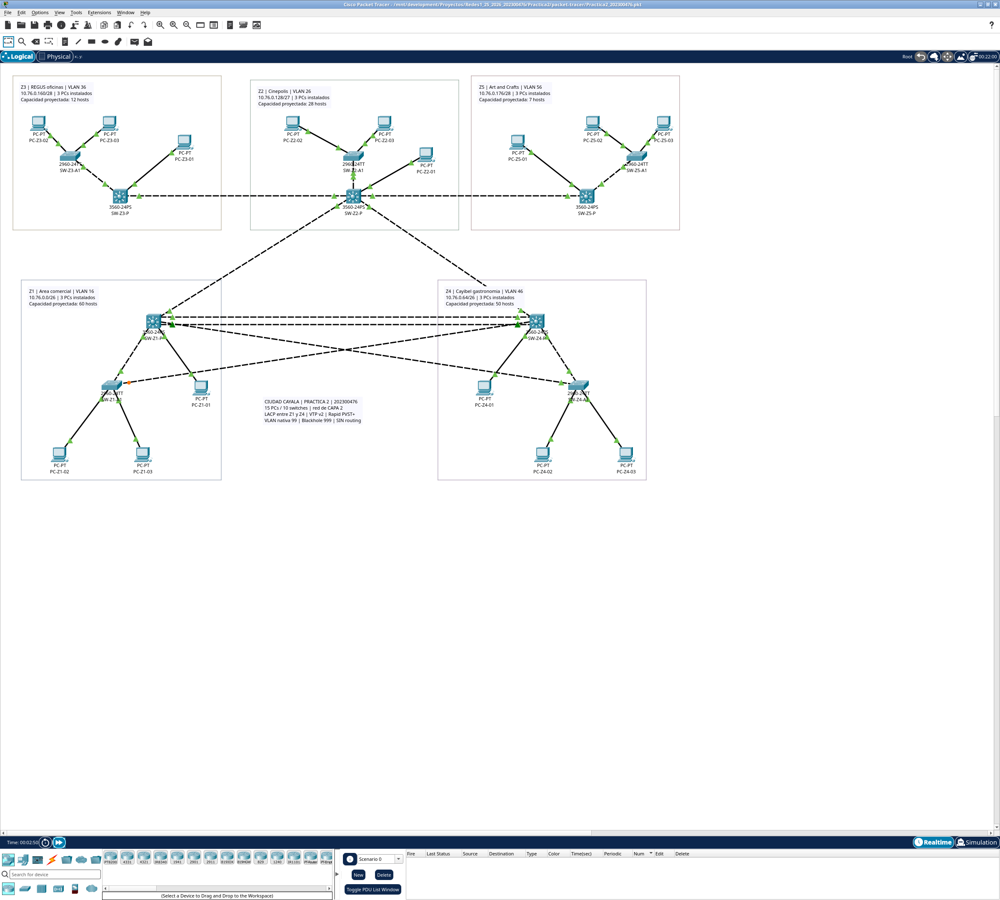</a></td>
    <td></td>
  </tr>
  <tr>
    <td>Primera red con los 157 hosts de la demanda proyectada y 15 switches</td>
    <td>Modelo intermedio con 3 PCs por zona</td>
    <td>Modelo final con 6 PCs por zona</td>
  </tr>
</table>

El diseño inicial incluía 157 PCs. Después se redujo a tres PCs por zona y, finalmente, se amplió a seis por zona para las pruebas. El cálculo de subredes conservó las cantidades del enunciado: 60, 28, 12, 50 y 7 hosts.

---

## 3. Construcción de la topología

1. Se colocó un switch principal **3560-24PS** y uno secundario **2960-24TT** en cada zona.
2. Se conectaron los PCs con **cable directo**: PC 01 y PC 04 al principal, en Fa0/10 y Fa0/11, y PC 02, 03, 05 y 06 al secundario, en Fa0/2 a Fa0/5.
3. Se conectaron los switches con **cable cruzado** para formar:
   - Un triángulo entre los principales de Z1, Z2 y Z4, con dos enlaces Gigabit agrupados en Po1 entre Z1 y Z4.
   - Dos ramales en estrella, de Z3 y Z5 hacia SW-Z2-P.
   - Enlaces de respaldo desde cada secundario de Z1 y Z4 hacia el principal de la otra zona crítica.
4. Se probó un enlace de fibra entre Z2 y Z3. Como los puertos disponibles del 3560 en el simulador no permitieron establecerlo, se utilizó cobre Gigabit.

El esquema lógico de los switches está en la [sección 3.2 del manual técnico](Manual_Tecnico.md#32-esquema-lógico-de-los-switches).

---

## 4. Configuración por CLI

Los switches se configuraron mediante CLI. Los comandos completos de cada equipo se encuentran en [`scripts/`](scripts/). La configuración se aplicó en este orden:

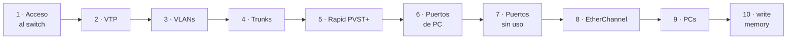

| Paso | Qué se configuró |
|---:|---|
| 1 | **Acceso al switch:** `hostname`, `enable secret`, contraseña y `exec-timeout` en la consola, VTY cerradas, `service password-encryption` y banner |
| 2 | **VTP:** dominio `202300476`, versión 2 y contraseña. Los cinco principales como servidores (Server) y los cinco secundarios como clientes (Client) |
| 3 | **VLANs:** se crearon las siete VLANs en SW-Z1-P y los demás switches las aprendieron por VTP |
| 4 | **Trunks:** 802.1Q con VLAN nativa 99 y listas explícitas de VLANs permitidas. El triángulo transporta `1,16,46,99`; los ramales y enlaces de acceso transportan la VLAN de su zona junto con la 1 y la 99 |
| 5 | **Rapid PVST+:** cada principal se estableció como puente raíz de su VLAN, con prioridad 4096, y se asignó prioridad 8192 al respaldo |
| 6 | **Puertos de PC:** modo access en la VLAN de la zona, con PortFast y BPDU Guard |
| 7 | **Puertos sin uso:** VLAN 999, descripción `UNUSED_BLACKHOLE` y `shutdown` |
| 8 | **EtherChannel:** `channel-group 1 mode active` en Gi0/1 y Gi0/2 de SW-Z1-P y SW-Z4-P. Los miembros y Po1 tienen los mismos parámetros de trunk |
| 9 | **PCs:** IP, máscara y gateway reservado según la [tabla de hosts](Manual_Tecnico.md#hosts-instalados) |
| 10 | **Guardado:** `write memory` en los diez switches |

Las siguientes capturas muestran el bloque de interfaces aplicado en SW-Z5-A1 y el `running-config` resultante.

<table>
  <tr>
    <td width="50%">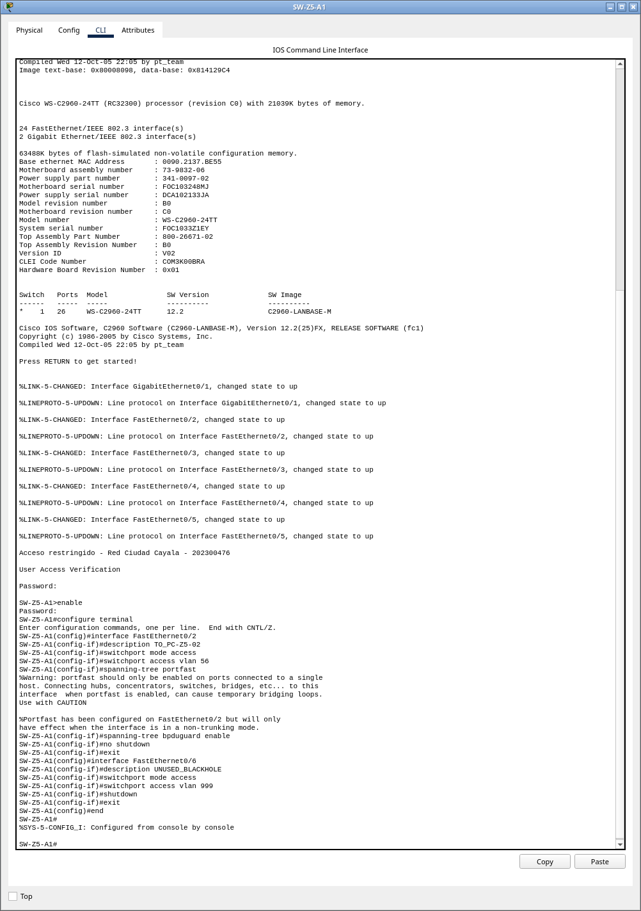</td>
    <td width="50%">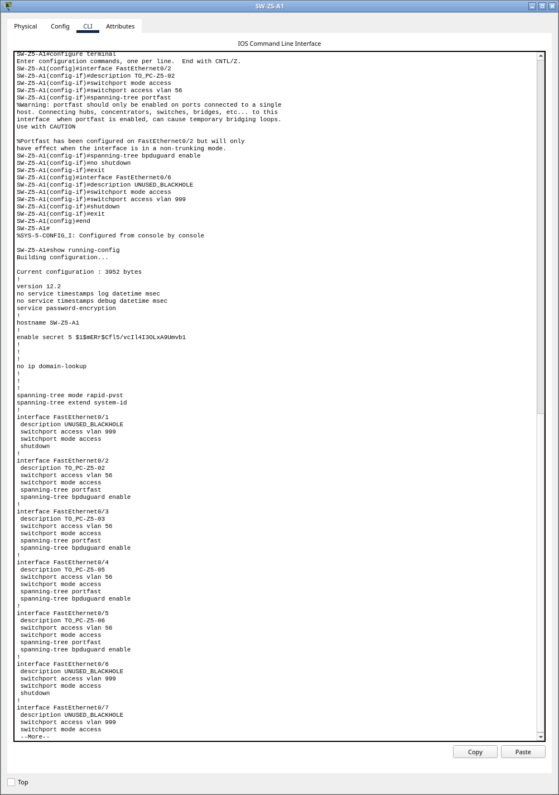</td>
  </tr>
  <tr>
    <td><b>Figura 2.</b> Bloque de interfaces aplicado por CLI en SW-Z5-A1</td>
    <td><b>Figura 3.</b> <code>running-config</code> resultante</td>
  </tr>
</table>

---

## 5. Diseño visual

| Elemento | Cómo se representa |
|---|---|
| Zonas | Fondo de color propio: 🟦 Z1, 🟥 Z2, 🟧 Z3, 🟩 Z4 y 🟪 Z5 |
| Rótulo de cada zona | VLAN, subred, criticidad y rol del switch principal |
| Enlaces entre switches | Puertos de cada extremo |
| Leyenda | Colores, tipos de cable y estados de puerto |
| Paneles inferiores | VLANs, direccionamiento, trunks y protocolos |

---

## 6. Pruebas

> [!TIP]
> Cada imagen se puede abrir a tamaño completo con un clic. Antes de probar, se esperó a que la red convergiera (o se utilizó **Fast Forward Time**).

### 6.1 VTP

Se verificó que los cinco principales estuvieran en modo Server y los secundarios en modo Client. Las capturas muestran el dominio `202300476`, la versión 2, 12 VLANs y la revisión 160 en todos los equipos revisados.

| Switch | Modo | Dominio | Versión | Revisión |
|---|---|---|---:|---:|
| SW-Z1-P | Server | 202300476 | 2 | 160 |
| SW-Z2-P | Server | 202300476 | 2 | 160 |
| SW-Z4-P | Server | 202300476 | 2 | 160 |
| SW-Z1-A1 | Client | 202300476 | 2 | 160 |

<table>
  <tr>
    <td width="50%"></td>
    <td width="50%"><a href="evidencias/capturas/11_vtp_servidor_SW-Z2-P.png">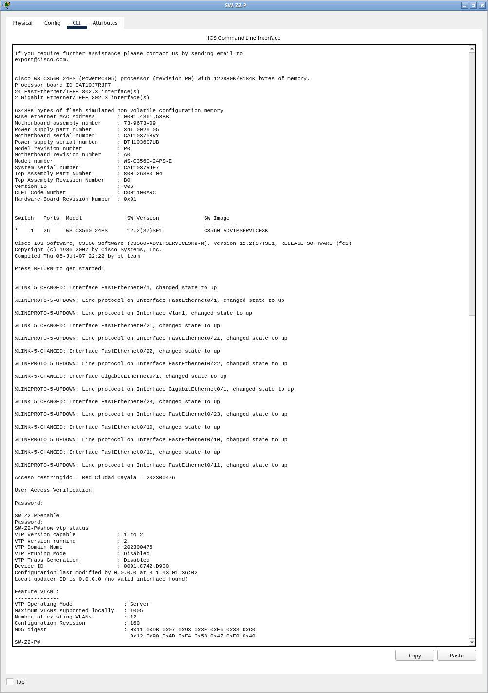</a></td>
  </tr>
  <tr>
    <td><b>Figura 4.</b> Servidor SW-Z1-P</td>
    <td><b>Figura 5.</b> Servidor SW-Z2-P</td>
  </tr>
  <tr>
    <td><a href="evidencias/capturas/12_vtp_servidor_SW-Z4-P.png">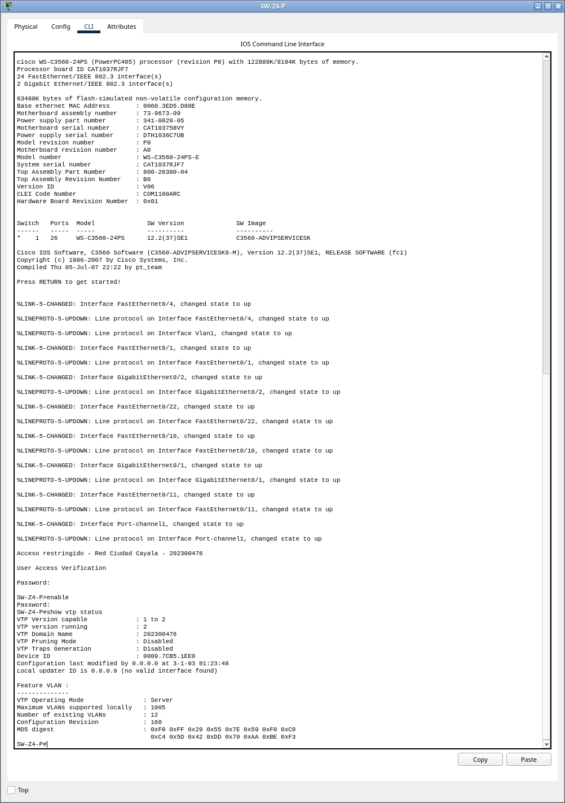</a></td>
    <td><a href="evidencias/capturas/13_vtp_cliente_SW-Z1-A1.png">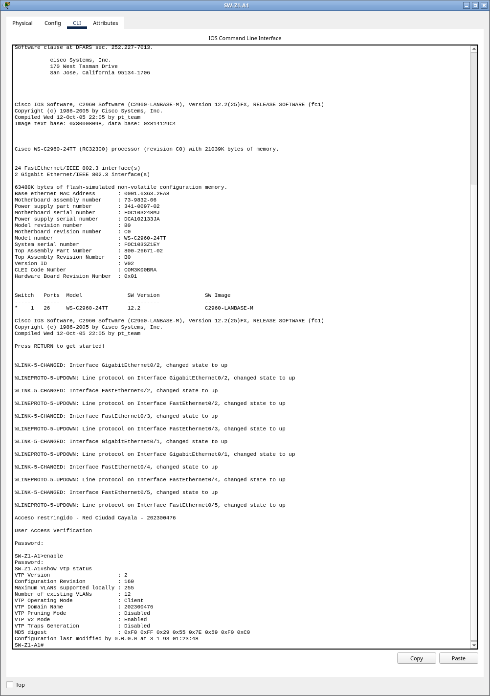</a></td>
  </tr>
  <tr>
    <td><b>Figura 6.</b> Servidor SW-Z4-P</td>
    <td><b>Figura 7.</b> Cliente SW-Z1-A1</td>
  </tr>
</table>

### 6.2 VLANs y Blackhole

En SW-Z1-P, los puertos Fa0/10 y Fa0/11 están asignados a la VLAN 16; los puertos de acceso no utilizados pertenecen a la VLAN 999. En SW-Z1-A1, los puertos sin uso muestran la descripción `UNUSED_BLACKHOLE` y el estado `disabled`. En toda la red se verificaron **204 puertos sin utilizar**, asignados a la VLAN 999 y deshabilitados.

<table>
  <tr>
    <td width="33%"><a href="evidencias/capturas/20_vlan_brief_SW-Z1-P.png">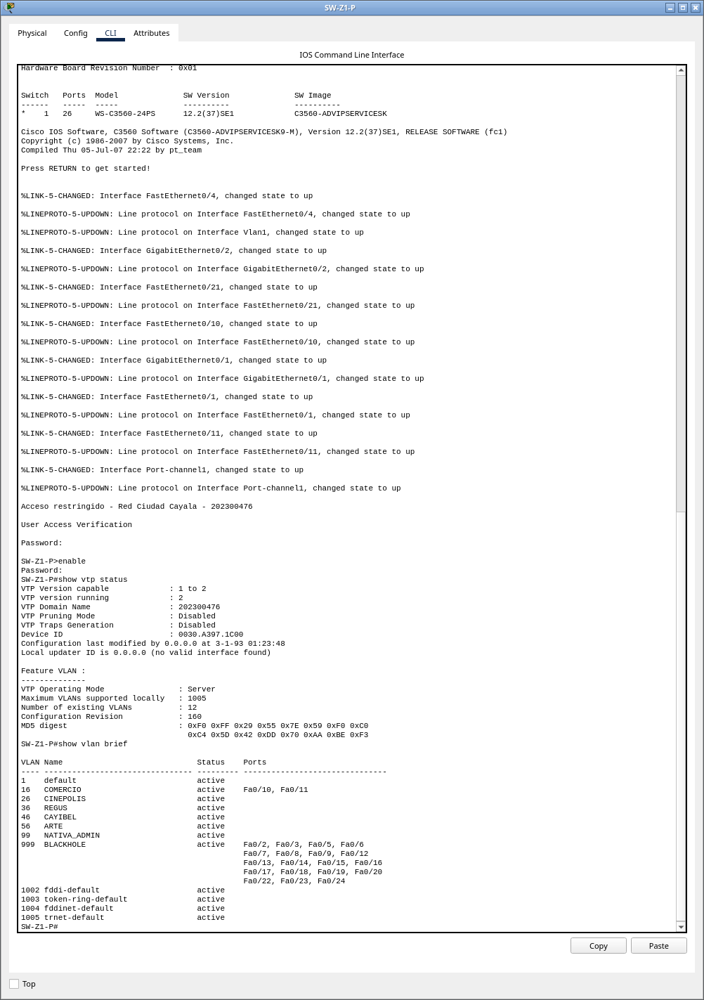</a></td>
    <td width="33%"><a href="evidencias/capturas/21_vlan_brief_SW-Z1-A1.png">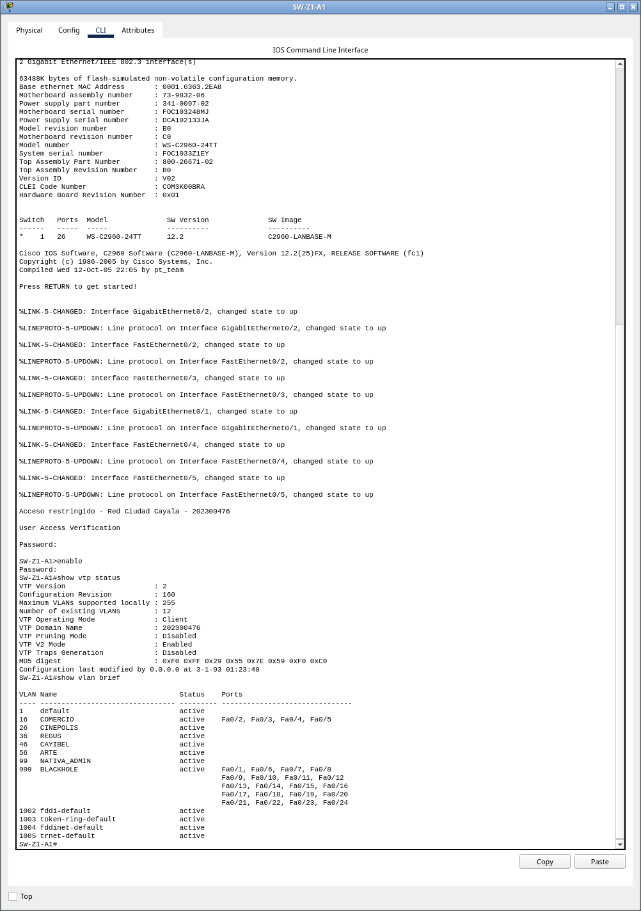</a></td>
    <td width="33%"><a href="evidencias/capturas/22_puertos_blackhole_SW-Z1-A1.png">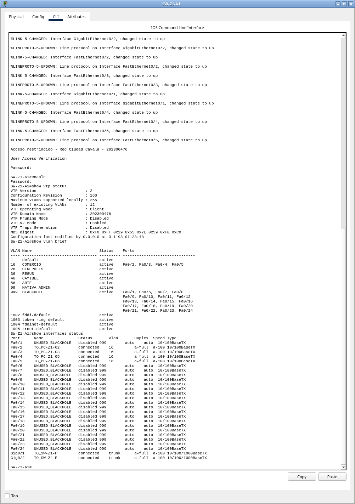</a></td>
  </tr>
  <tr>
    <td><b>Figura 8.</b> <code>show vlan brief</code> en SW-Z1-P</td>
    <td><b>Figura 9.</b> <code>show vlan brief</code> en SW-Z1-A1</td>
    <td><b>Figura 10.</b> Puertos Blackhole en SW-Z1-A1</td>
  </tr>
</table>

### 6.3 Trunks

Todos los trunks utilizan la VLAN nativa 99 y listas explícitas de VLANs permitidas. El triángulo Z1-Z2-Z4 transporta `1,16,46,99`. Los ramales y enlaces de acceso transportan la VLAN de su zona, además de la 1 y la 99.

<table>
  <tr>
    <td width="33%"><a href="evidencias/capturas/30_trunks_SW-Z1-P.png">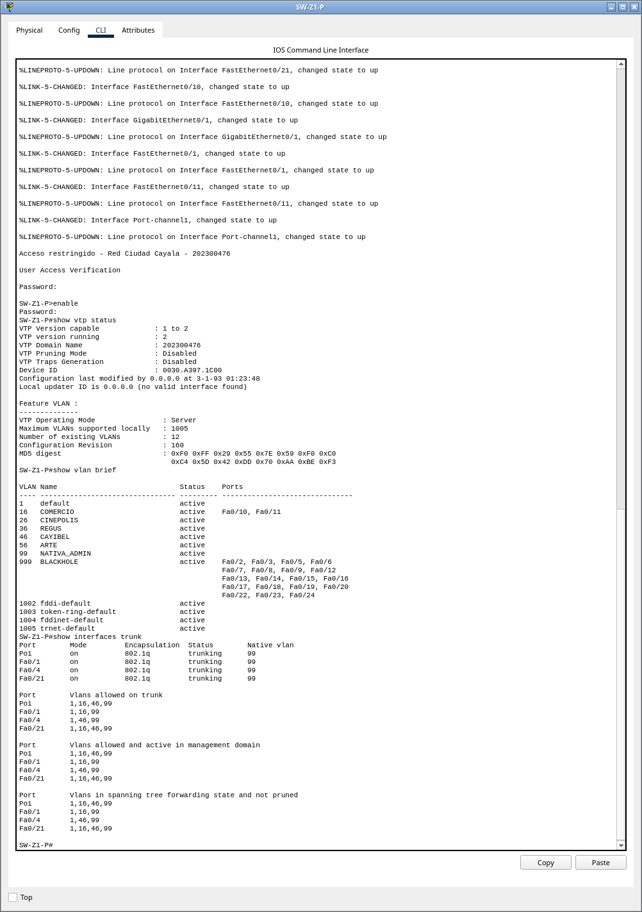</a></td>
    <td width="33%"><a href="evidencias/capturas/31_trunks_SW-Z1-A1.png">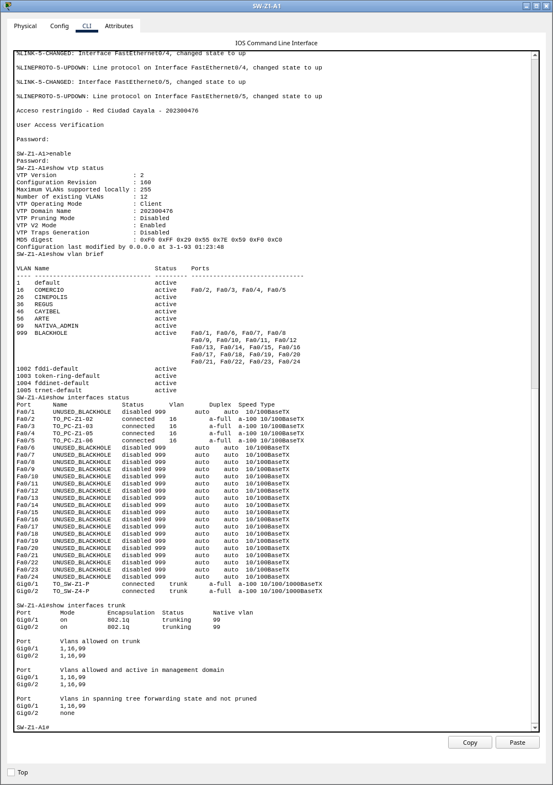</a></td>
    <td width="33%"><a href="evidencias/capturas/32_trunks_SW-Z2-P.png">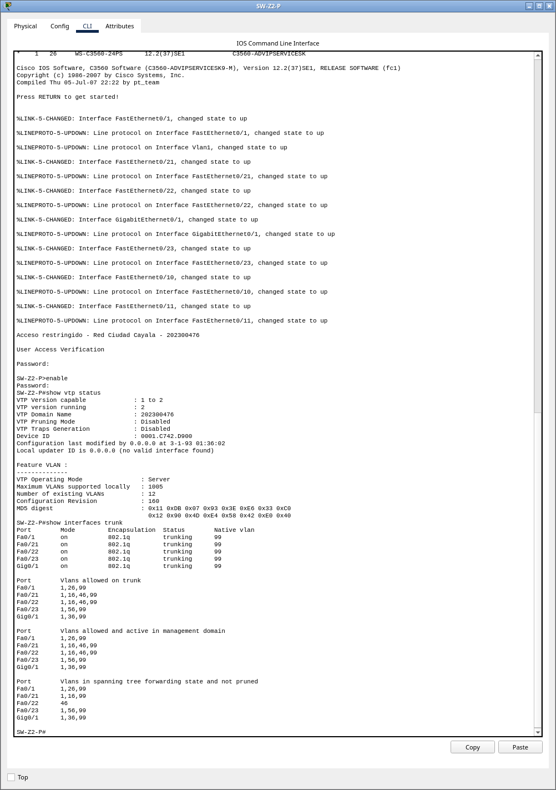</a></td>
  </tr>
  <tr>
    <td><b>Figura 11.</b> SW-Z1-P</td>
    <td><b>Figura 12.</b> SW-Z1-A1</td>
    <td><b>Figura 13.</b> SW-Z2-P (núcleo)</td>
  </tr>
  <tr>
    <td><a href="evidencias/capturas/33_trunks_SW-Z3-P.png">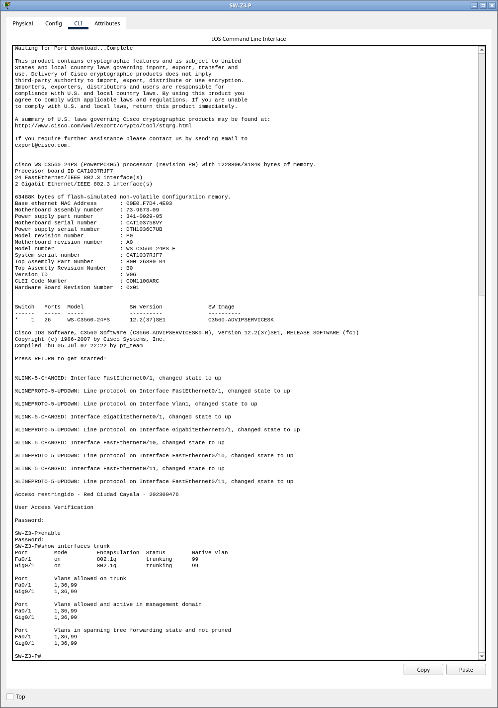</a></td>
    <td><a href="evidencias/capturas/34_trunks_SW-Z4-P.png">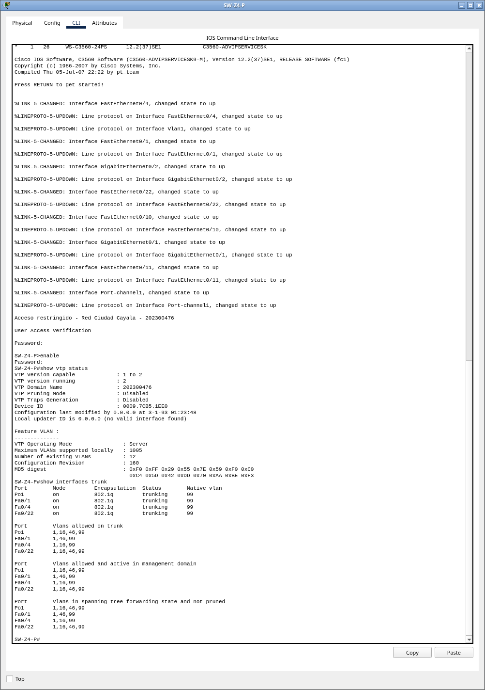</a></td>
    <td></td>
  </tr>
  <tr>
    <td><b>Figura 14.</b> SW-Z3-P</td>
    <td><b>Figura 15.</b> SW-Z4-P</td>
    <td><b>Figura 16.</b> SW-Z5-P</td>
  </tr>
</table>

### 6.4 Rapid PVST+ y puente raíz

Cada switch principal muestra `This bridge is the root` para la VLAN de su zona. La prioridad mostrada corresponde a 4096 más el ID de la VLAN.

| VLAN | Puente raíz | Prioridad mostrada | Resultado |
|---:|---|---:|:---:|
| 16 | SW-Z1-P | 4112 | ✅ |
| 26 | SW-Z2-P | 4122 | ✅ |
| 36 | SW-Z3-P | 4132 | ✅ |
| 46 | SW-Z4-P | 4142 | ✅ |
| 56 | SW-Z5-P | 4152 | ✅ |

En SW-Z1-A1, Gi0/1 aparece como `Root FWD` y Gi0/2, que proporciona el respaldo hacia Z4, como `Altn BLK`.

<table>
  <tr>
    <td width="33%"><a href="evidencias/capturas/40_stp_root_vlan16_SW-Z1-P.png">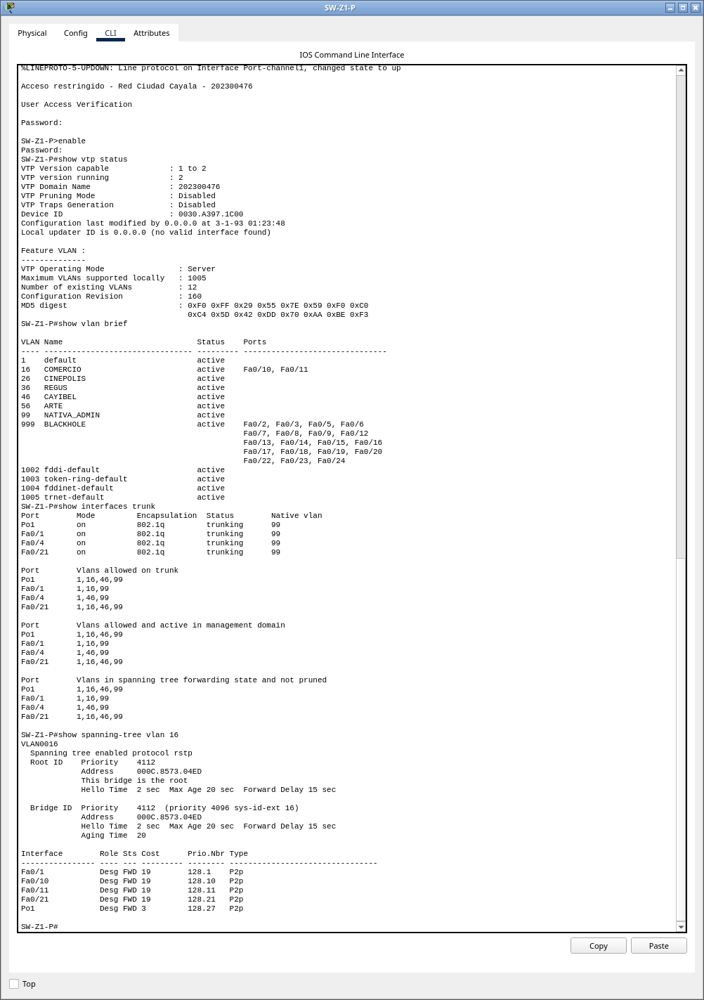</a></td>
    <td width="33%"><a href="evidencias/capturas/41_stp_root_vlan26_SW-Z2-P.png">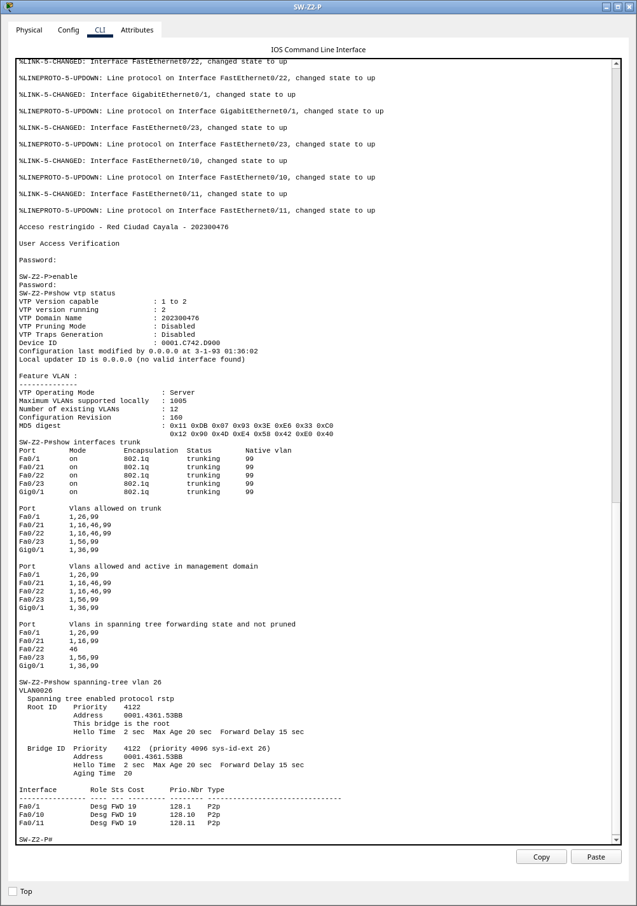</a></td>
    <td width="33%"></td>
  </tr>
  <tr>
    <td><b>Figura 17.</b> Raíz de la VLAN 16</td>
    <td><b>Figura 18.</b> Raíz de la VLAN 26</td>
    <td><b>Figura 19.</b> Raíz de la VLAN 36</td>
  </tr>
  <tr>
    <td><a href="evidencias/capturas/43_stp_root_vlan46_SW-Z4-P.png">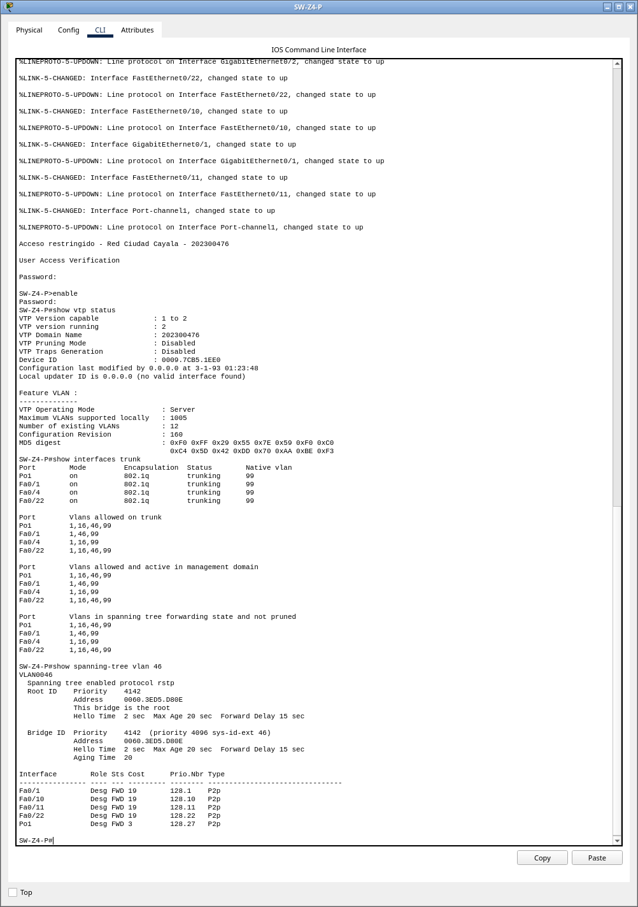</a></td>
    <td><a href="evidencias/capturas/44_stp_root_vlan56_SW-Z5-P.png">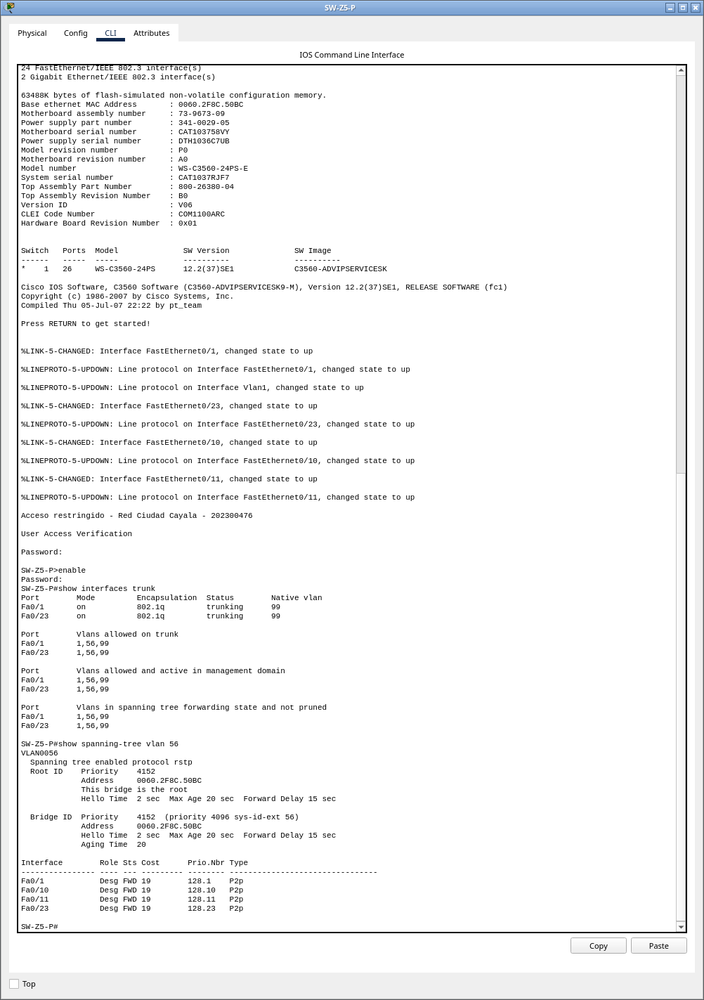</a></td>
    <td><a href="evidencias/capturas/45_stp_vlan16_SW-Z1-A1.png">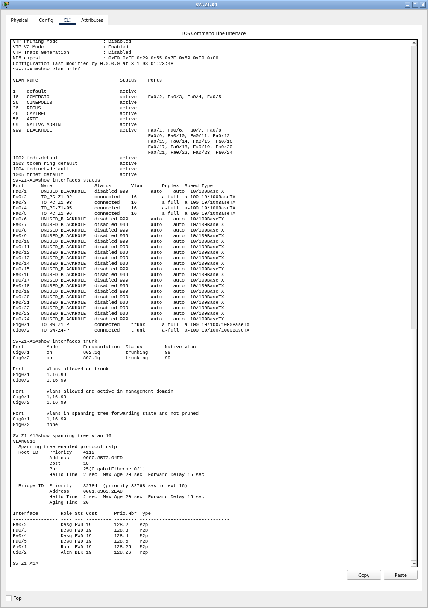</a></td>
  </tr>
  <tr>
    <td><b>Figura 20.</b> Raíz de la VLAN 46</td>
    <td><b>Figura 21.</b> Raíz de la VLAN 56</td>
    <td><b>Figura 22.</b> VLAN 16 en SW-Z1-A1: Gi0/2 en <code>Altn BLK</code></td>
  </tr>
  <tr>
    <td><a href="evidencias/capturas/46_stp_vlan16_SW-Z2-P.png">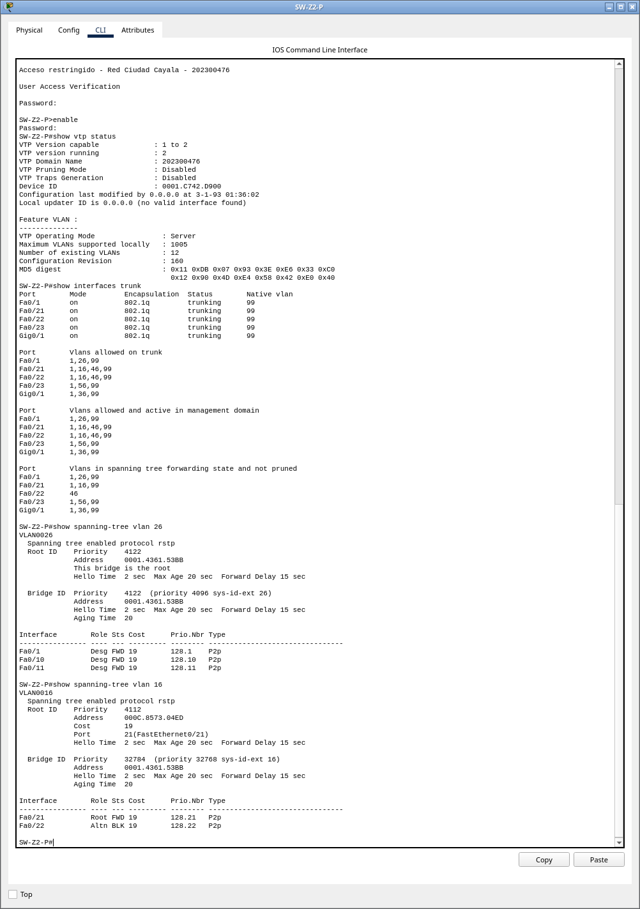</a></td>
    <td><a href="evidencias/capturas/47_stp_summary_SW-Z1-P.png">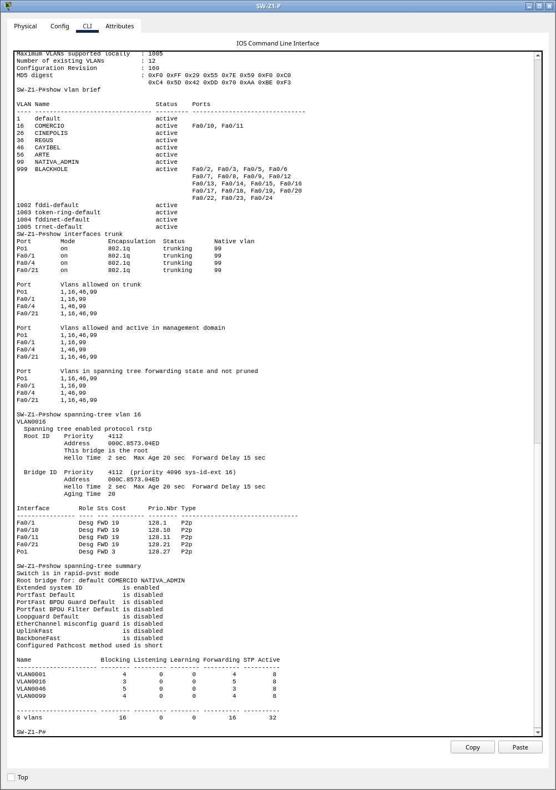</a></td>
    <td></td>
  </tr>
  <tr>
    <td><b>Figura 23.</b> VLAN 16 en SW-Z2-P</td>
    <td><b>Figura 24.</b> <code>show spanning-tree summary</code> en SW-Z1-P</td>
    <td></td>
  </tr>
</table>

### 6.5 EtherChannel LACP

En los dos extremos aparece `Po1(SU) LACP Gig0/1(P) Gig0/2(P)`.

<table>
  <tr>
    <td width="33%"><a href="evidencias/capturas/50_etherchannel_summary_SW-Z1-P.png">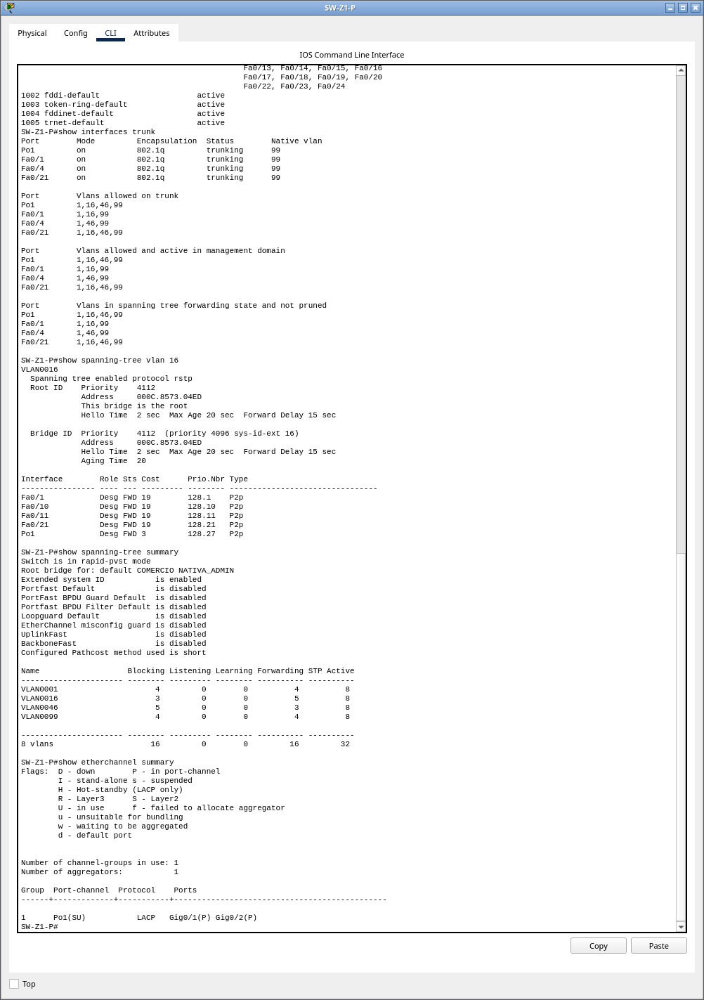</a></td>
    <td width="33%"><a href="evidencias/capturas/51_etherchannel_port-channel_SW-Z1-P.png">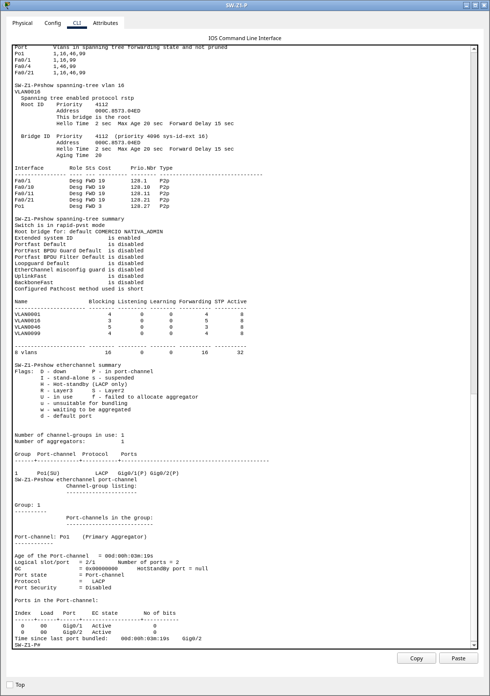</a></td>
    <td width="33%"><a href="evidencias/capturas/52_etherchannel_summary_SW-Z4-P.png">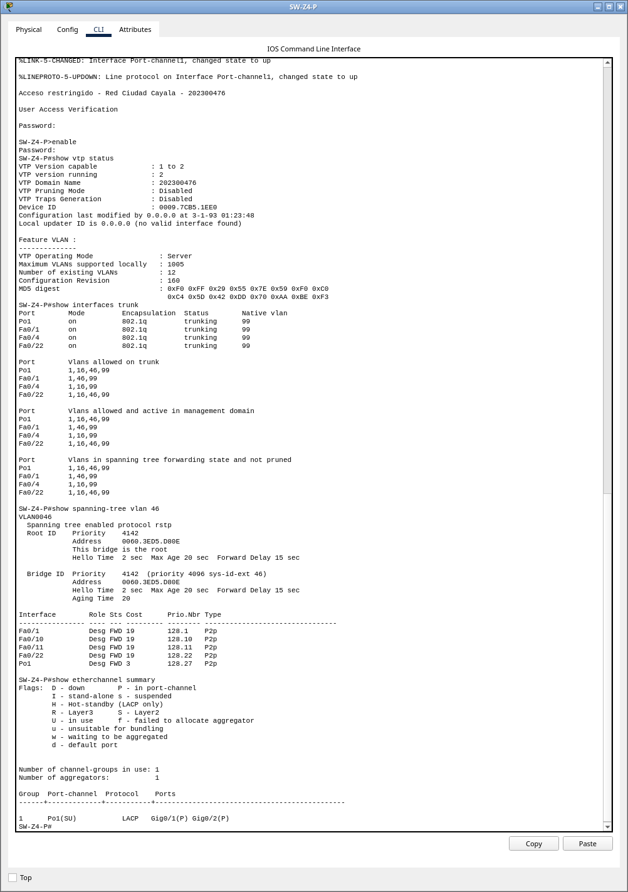</a></td>
  </tr>
  <tr>
    <td><b>Figura 25.</b> <code>show etherchannel summary</code> en SW-Z1-P</td>
    <td><b>Figura 26.</b> Detalle de Po1 en SW-Z1-P</td>
    <td><b>Figura 27.</b> <code>show etherchannel summary</code> en SW-Z4-P</td>
  </tr>
</table>

### 6.6 show ip route

Se registró la salida de `show ip route` de SW-Z1-P como parte de las verificaciones solicitadas.

  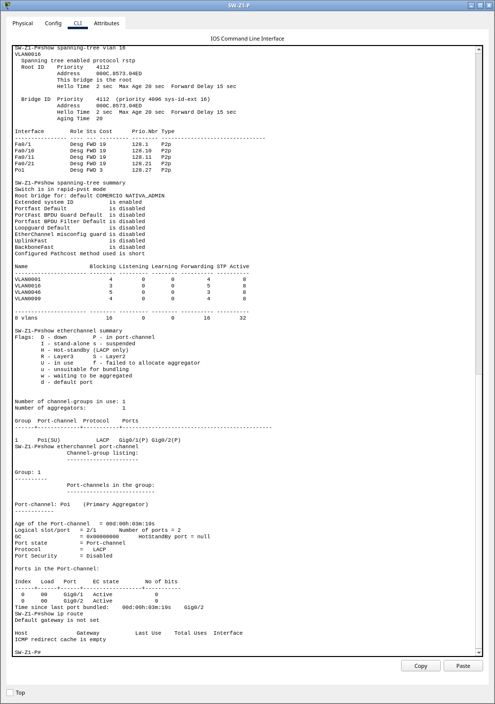

<b>Figura 28.</b> <code>show ip route</code> en SW-Z1-P

### 6.7 Pings desde los PCs

Se realizaron diez pruebas de ping dentro de la misma VLAN, dos por zona, y seis hacia otras VLANs. Las primeras recibieron cuatro respuestas de cuatro intentos (4/4); las segundas no recibieron respuestas (0/4).

| Origen | Misma VLAN (4/4) | Otra VLAN (0/4) |
|---|---|---|
| PC-Z1-04 | ✅ 10.76.0.3 · ✅ 10.76.0.6 | ❌ 10.76.0.130 · ❌ 10.76.0.66 |
| PC-Z2-04 | ✅ 10.76.0.130 · ✅ 10.76.0.135 | ❌ 10.76.0.2 |
| PC-Z3-05 | ✅ 10.76.0.162 · ✅ 10.76.0.167 | ❌ 10.76.0.178 |
| PC-Z4-01 | ✅ 10.76.0.67 · ✅ 10.76.0.70 | ❌ 10.76.0.162 |
| PC-Z5-01 | ✅ 10.76.0.179 · ✅ 10.76.0.183 | ❌ 10.76.0.66 |

✅ respondió 4/4 · ❌ sin respuesta (0/4), el resultado esperado entre VLANs distintas.

Ocho de las pruebas internas atravesaron el trunk entre el switch principal y el secundario. Las otras dos se realizaron entre PCs del mismo switch: PC-Z2-04 → 10.76.0.130, en SW-Z2-P, y PC-Z3-05 → 10.76.0.167, en SW-Z3-A1.

<table>
  <tr>
    <td width="33%"><a href="evidencias/capturas/60_ip_config_PC-Z1-01.png">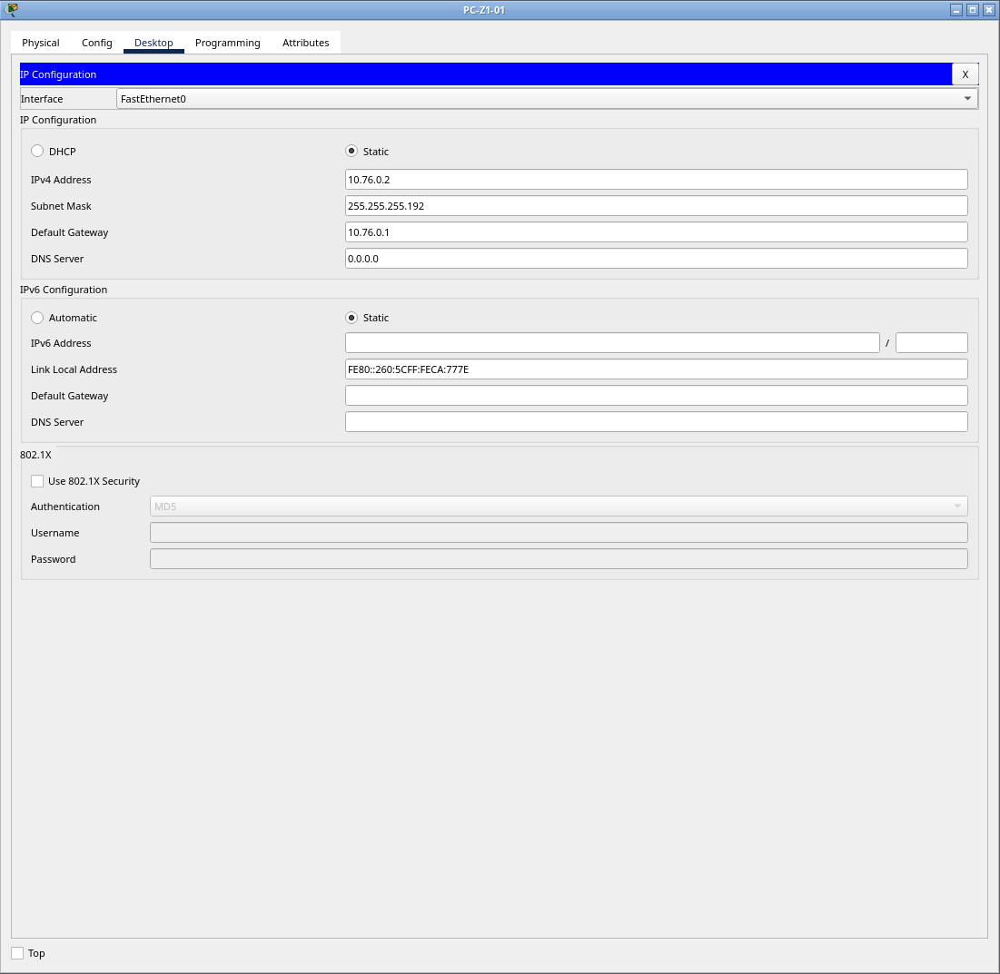</a></td>
    <td width="33%"><a href="evidencias/capturas/61_ipconfig_y_pings_PC-Z1-04.png">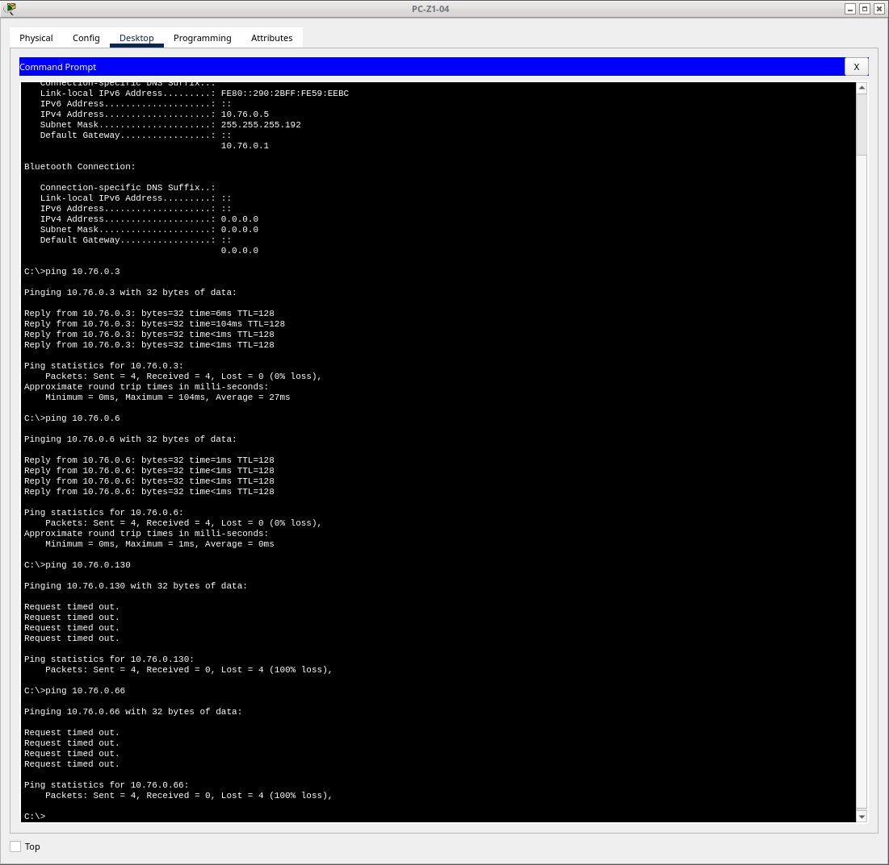</a></td>
    <td width="33%"><a href="evidencias/capturas/62_pings_PC-Z2-04.png">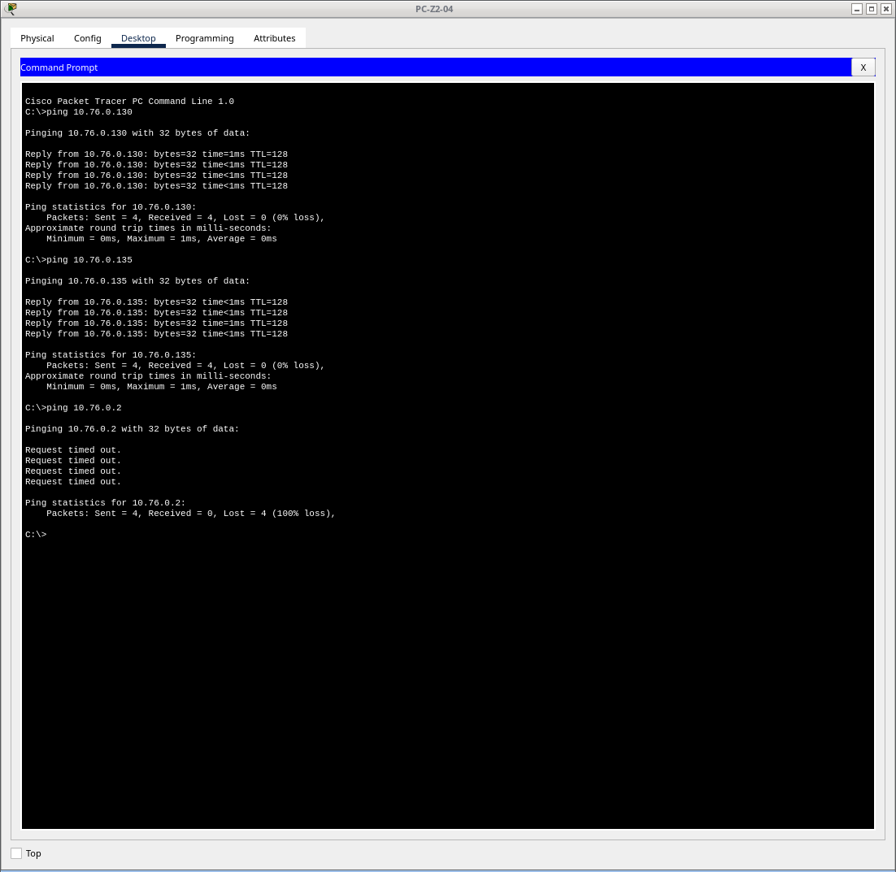</a></td>
  </tr>
  <tr>
    <td><b>Figura 29.</b> IP Configuration de PC-Z1-01</td>
    <td><b>Figura 30.</b> <code>ipconfig</code> y pings de PC-Z1-04</td>
    <td><b>Figura 31.</b> Pings de PC-Z2-04</td>
  </tr>
  <tr>
    <td></td>
    <td></td>
    <td></td>
  </tr>
  <tr>
    <td><b>Figura 32.</b> Pings de PC-Z3-05</td>
    <td><b>Figura 33.</b> Pings de PC-Z4-01</td>
    <td><b>Figura 34.</b> Pings de PC-Z5-01</td>
  </tr>
</table>

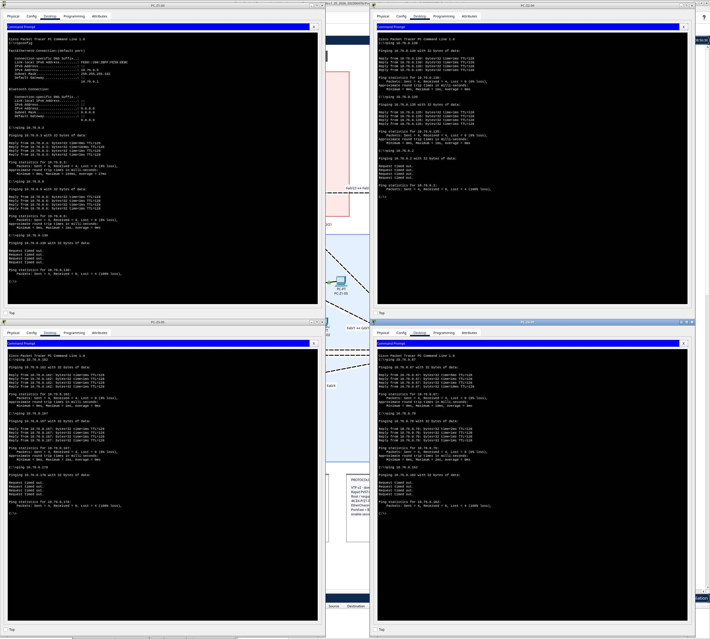

**Figura 35.** Pings de cuatro zonas en paralelo.

Los resultados se contrastaron con las asignaciones de puertos y las listas de VLANs permitidas en los trunks para verificar la segmentación.

### 6.8 Simulación de ARP e ICMP

En modo Simulation se activaron los filtros ARP e ICMP y se ejecutó un ping desde **PC-Z3-05** hacia **10.76.0.164** (PC-Z3-03). La dirección de destino no estaba en la caché ARP del equipo de origen.

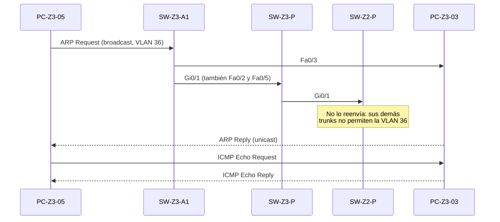

- SW-Z3-A1 recibió la solicitud ARP de broadcast por Fa0/4 y la reenvió por los demás puertos de la VLAN 36: Fa0/2, Fa0/3, Fa0/5 y Gi0/1.
- SW-Z3-P la reenvió por sus tres puertos de la VLAN 36 en estado de reenvío: Fa0/10, Fa0/11 y Gi0/1, este último hacia SW-Z2-P. El recorrido se observa en la columna *Last Device* de la lista de eventos.
- No se observaron reenvíos desde SW-Z2-P hacia otras zonas, ya que sus demás trunks no permiten la VLAN 36.
- Tras la respuesta ARP, se completó el intercambio de mensajes ICMP Echo Request y Echo Reply.

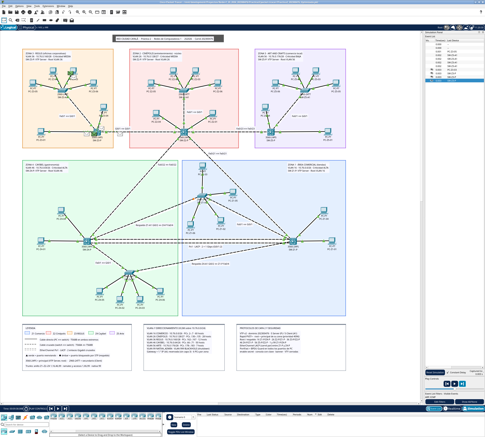

**Figura 36.** Broadcast ARP en curso en la zona 3.

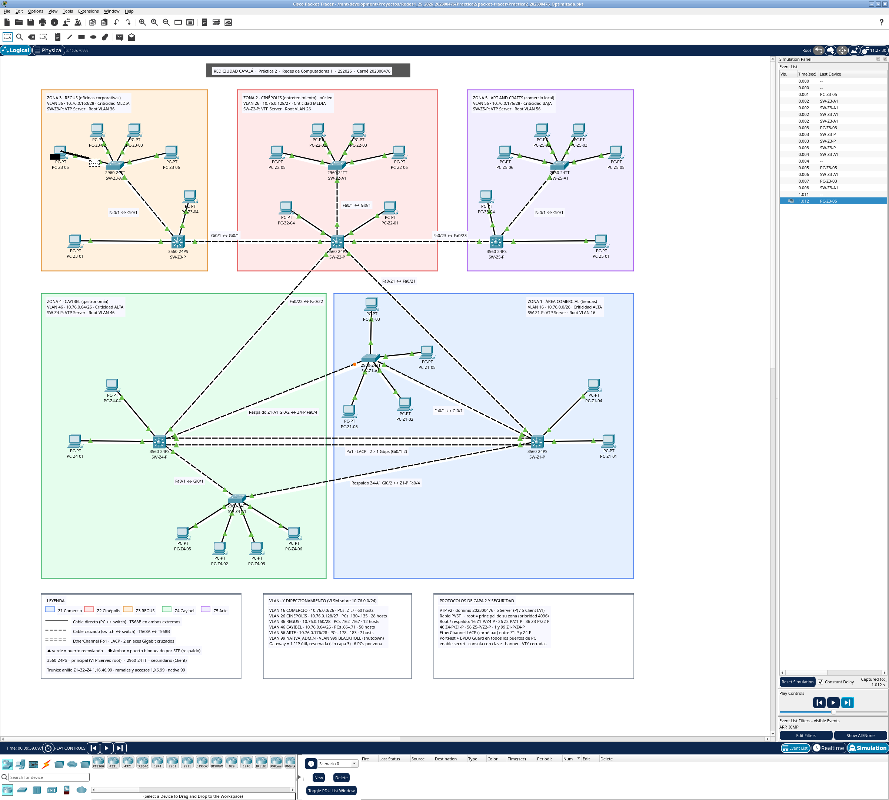

**Figura 37.** Lista de eventos ARP/ICMP completa.

  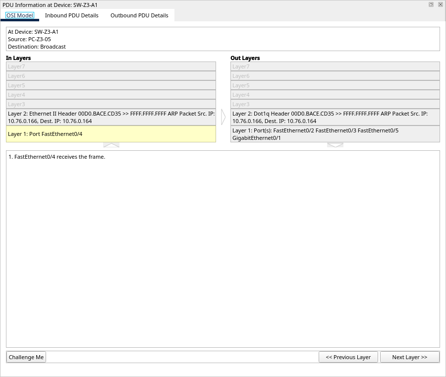

<b>Figura 38.</b> Detalle de la PDU ARP en SW-Z3-A1

### 6.9 Pruebas de fallo

| Paso | Acción | Resultado |
|---:|---|---|
| 1 | Se deshabilitó `Gi0/1` de SW-Z1-P, uno de los miembros de Po1 | ✅ El canal mantuvo `Po1(SU)`, con `Gig0/1(D)` y `Gig0/2(P)` |
| 2 | Con ese miembro aún deshabilitado, se desactivó `Fa0/1` de SW-Z1-P, que conecta con SW-Z1-A1 | ✅ En el secundario, Gi0/2 pasó a `Root FWD`, con costo 23. Camino de respaldo: Z1-A1 → Z4-P → Po1 → Z1-P |
| 3 | Desde PC-Z1-04 se ejecutaron pings hacia 10.76.0.3 y 10.76.0.7, PCs conectados a SW-Z1-A1 | ✅ Ambos respondieron 4/4 por el camino de respaldo |
| 4 | Se restablecieron las interfaces con `no shutdown` | ✅ Los dos miembros de Po1 volvieron a `(P)` y los trunks recuperaron su estado inicial |

En una prueba adicional se deshabilitaron simultáneamente Po1 y los enlaces ascendentes de acceso de Z1 y Z4. Los pings dentro de las VLANs 16 y 46 mantuvieron cuatro respuestas de cuatro a través de SW-Z2-P.

<table>
  <tr>
    <td width="33%"><a href="evidencias/capturas/80_fallo_miembro_po1_SW-Z1-P.png">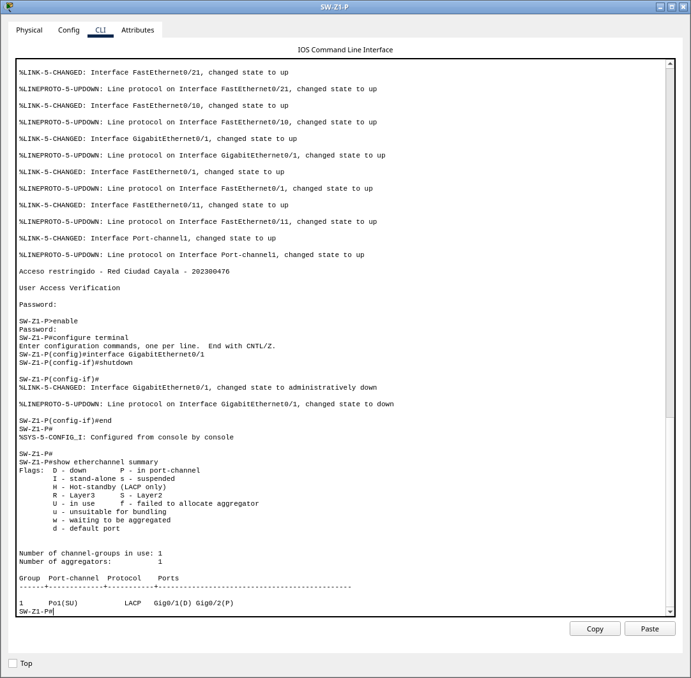</a></td>
    <td width="33%"><a href="evidencias/capturas/81_fallo_uplink_y_stp_SW-Z1-P.png">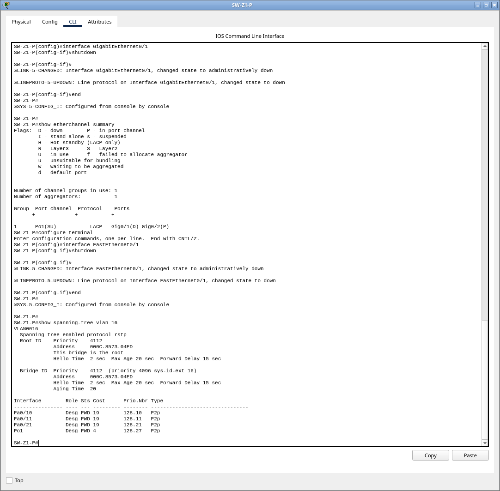</a></td>
    <td width="33%"><a href="evidencias/capturas/82_fallo_stp_root_por_gi0-2_SW-Z1-A1.png">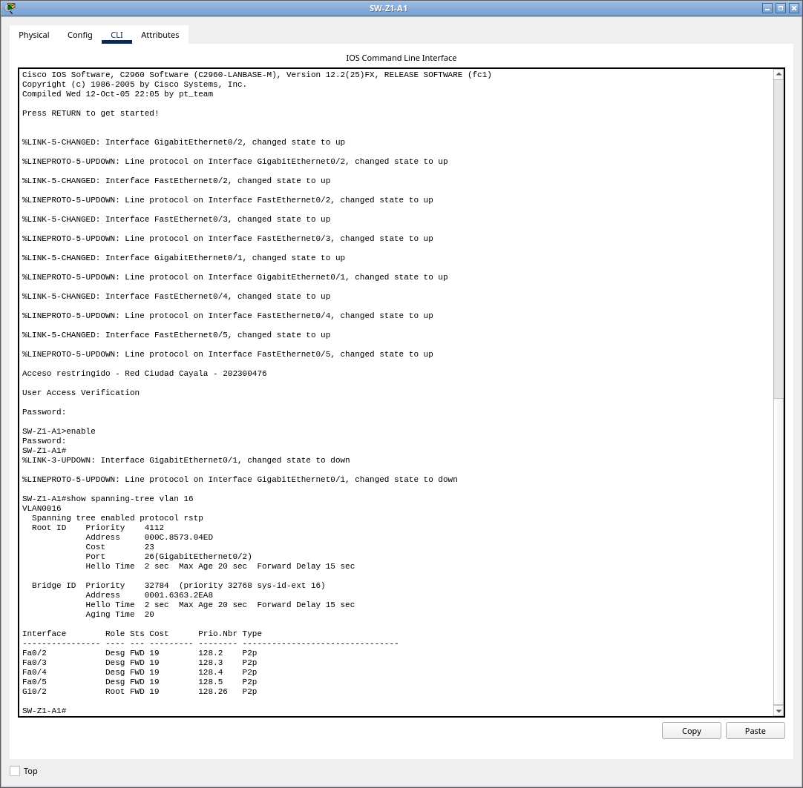</a></td>
  </tr>
  <tr>
    <td><b>Figura 39.</b> Paso 1: miembro Gi0/1 de Po1 caído</td>
    <td><b>Figura 40.</b> Paso 2: enlace ascendente Fa0/1 apagado</td>
    <td><b>Figura 41.</b> SW-Z1-A1 converge por Gi0/2</td>
  </tr>
  <tr>
    <td><a href="evidencias/capturas/83_fallo_ping_por_respaldo_PC-Z1-04.png">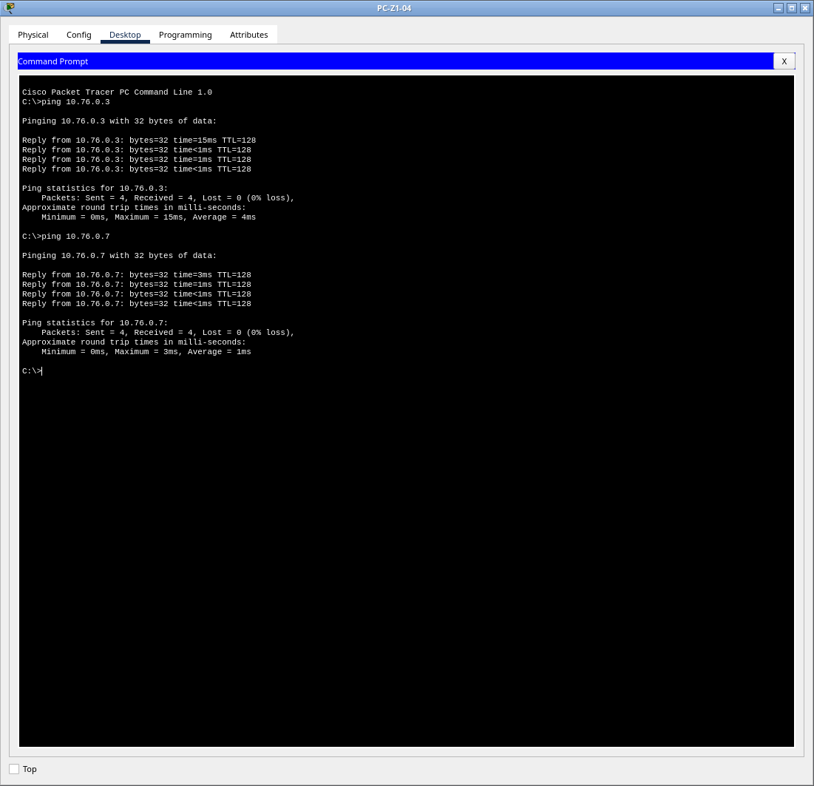</a></td>
    <td><a href="evidencias/capturas/85_restauracion_SW-Z1-P.png">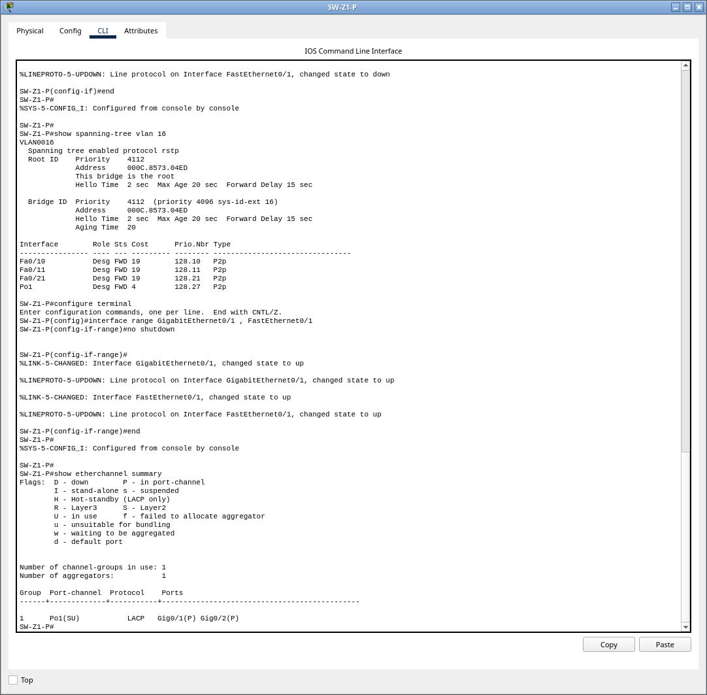</a></td>
    <td></td>
  </tr>
  <tr>
    <td><b>Figura 42.</b> Paso 3: ping 4/4 por el respaldo</td>
    <td><b>Figura 43.</b> Paso 4: restauración de Po1</td>
    <td></td>
  </tr>
</table>

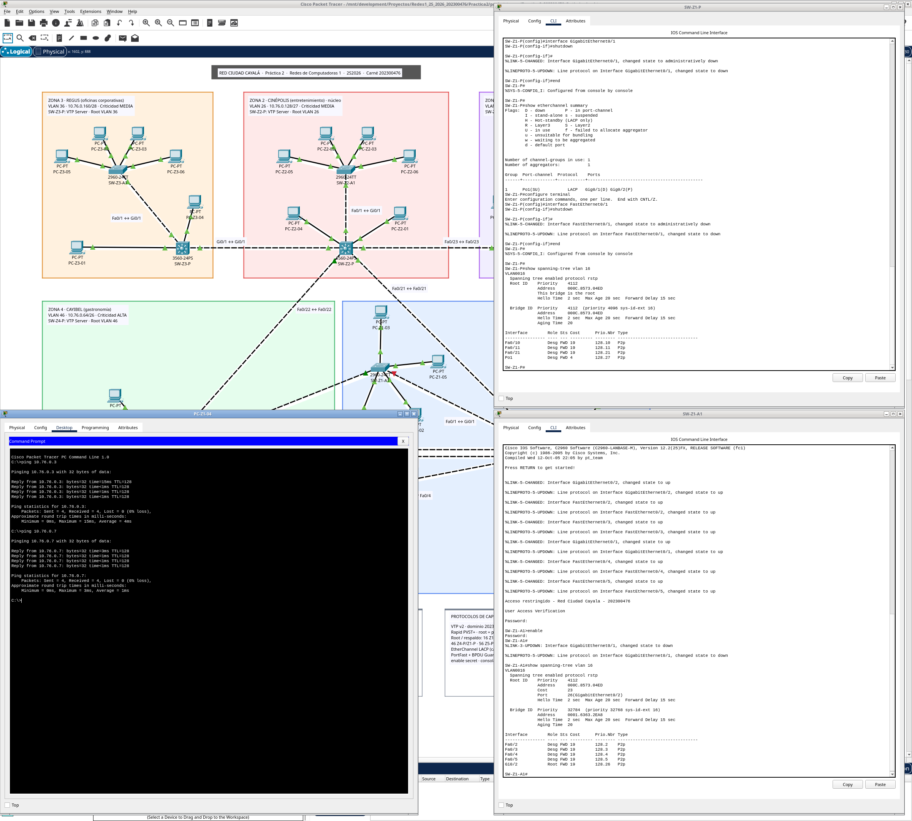

**Figura 44.** Pantalla completa durante el fallo: topología con los enlaces caídos y las ventanas de los equipos.

---

## 7. Problemas encontrados y soluciones

| Problema | Diagnóstico y solución |
|---|---|
| El enlace de fibra Z2-Z3 no se creaba | El 3560 no tiene puertos ópticos en Packet Tracer; se usó cobre Gigabit |
| Pérdidas de pings y BPDUs reenviados al quitar VLAN 1 de los trunks | En modo Simulation se vio que los 3560 no entregaban esos BPDUs al proceso STP. Permitir VLAN 1 en los trunks, con la 99 como nativa, eliminó el fallo |
| Miembros de LACP suspendidos o independientes | Los miembros y Po1 tenían parámetros de trunk distintos. Se igualaron y los dos quedaron `(P)` |
| Al abrir el archivo, los switches aparecían en VTP v1 | Se volvió a aplicar `vtp version 2` en los servidores y se guardó; la versión 2 se mantiene |
| La revisión VTP aumentaba al abrir el archivo | Se comprobó que la revisión coincidiera en los diez switches |
| Puertos de PC en LRN y pérdida de respuestas al abrir el archivo | La red aún no había convergido. Se utilizó Fast Forward Time y se repitieron los pings, con resultados de 4/4 |
| `terminal length 0` no existe en esta imagen IOS | Las salidas largas se recorren página por página con `--More--` |
| `show lacp neighbor` no está implementado | El estado del canal se comprueba con `show etherchannel summary` |

---

## 8. Correspondencia con la hoja de calificación

| Área | Criterio | Puntos | Evidencia o documento |
|---|---|---:|---|
| Habilidades | Topología híbrida, cinco zonas y cableado (TIA/EIA-568B) | 15 | [Topología](#2-evolución-del-diseño) y secciones 2, 3 y 5 del [manual](Manual_Tecnico.md) |
| Habilidades | VLANs, nativa 99, Blackhole 999 y trunks | 15 | [Scripts CLI](scripts/), [6.2](#62-vlans-y-blackhole) y [6.3](#63-trunks) |
| Habilidades | VTP | 10 | [6.1](#61-vtp): cinco Server y cinco Client, mismo dominio, versión y revisión |
| Habilidades | STP (Rapid PVST+ y Root Bridge) | 10 | [6.4](#64-rapid-pvst-y-puente-raíz): prioridades y salidas de los cinco roots |
| Habilidades | EtherChannel y conectividad extremo a extremo | 10 | [6.5](#65-etherchannel-lacp), [6.7](#67-pings-desde-los-pcs) y [6.9](#69-pruebas-de-fallo) |
| Conocimiento | Documentación técnica, informe y scripts CLI | 25 | [Manual técnico](Manual_Tecnico.md), este informe y [`scripts/`](scripts/) |
| Conocimiento | Diseño estético y profesional | 5 | [Sección 5](#5-diseño-visual): zonas identificadas, leyenda y nombres consistentes |
| Conocimiento | Comprensión teórico-práctica | 10 | [6.8](#68-simulación-de-arp-e-icmp): simulación ARP/ICMP en modo Simulation |

Las salidas `show` y el `running-config` de los diez switches se encuentran en [`evidencias/salidas_switches/`](evidencias/salidas_switches/). Para repetir la verificación, abrir el archivo `.pkt`, esperar a que la red converja o utilizar Fast Forward Time y ejecutar los comandos y pings descritos en este informe.
