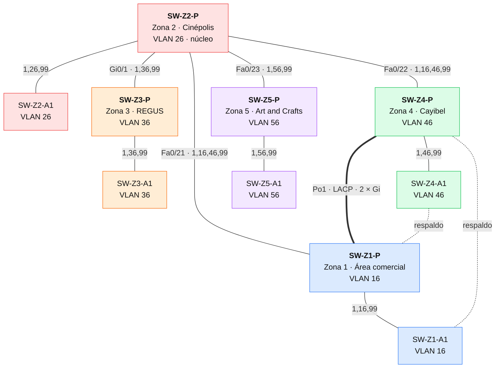

# Práctica 2 — Red de Ciudad Cayalá

**Manual Técnico**

Diseño de la red de cinco establecimientos de Ciudad Cayalá en Cisco Packet Tracer, con una topología híbrida de capa 1 y capa 2: segmentación con VLANs, administración centralizada con VTP, prevención de bucles con Rapid PVST+ y agregación de enlaces con EtherChannel LACP.

| | |
|---|---|
| **Estudiante** | Alex Ricardo Castañeda Rodríguez |
| **Carné** | 202300476 |
| **Curso** | Redes de Computadoras 1 — Segundo Semestre 2026 |
| **Ponderación** | 7 pts |
| **Archivo de topología** | [`packet-tracer/Practica2_202300476.pkt`](../packet-tracer/Practica2_202300476.pkt) |
| **Versión de Packet Tracer** | 9.0.1 |
| **Configuración** | Switches configurados por CLI ([scripts](scripts/)) |

> [!NOTE]
> Los perfiles de tráfico y criticidad de cada zona son **supuestos de ingeniería** para la práctica, no datos internos de los establecimientos. Las cifras de puertos, VLANs, prioridades y estados de STP se leyeron de la topología en ejecución.

---

## Índice

1. [Alcance](#1-alcance)
2. [Investigación y análisis de las zonas](#2-investigación-y-análisis-de-las-zonas)
3. [Topología híbrida y redundancia](#3-topología-híbrida-y-redundancia)
4. [VLANs y direccionamiento](#4-vlans-y-direccionamiento)
5. [Cableado y trunks](#5-cableado-y-trunks)
6. [VTP](#6-vtp)
7. [Rapid PVST+ y puente raíz](#7-rapid-pvst-y-puente-raíz)
8. [EtherChannel LACP](#8-etherchannel-lacp)
9. [Dominios de colisión y broadcast](#9-dominios-de-colisión-y-broadcast)
10. [Seguridad de acceso a los switches](#10-seguridad-de-acceso-a-los-switches)
11. [Verificación y reproducción](#11-verificación-y-reproducción)

---

## 1. Alcance

| Elemento | Cantidad |
|---|---:|
| Zonas | 5 |
| Switches principales (Catalyst 3560-24PS) | 5 |
| Switches secundarios (Catalyst 2960-24TT) | 5 |
| PCs (seis por zona) | 30 |
| Enlaces Ethernet | 43 |

Las subredes se dimensionaron para los **60, 28, 12, 50 y 7 hosts** que indica el enunciado, aunque el archivo final utiliza seis PCs por zona para las pruebas.

El diseño partió de una versión con 157 hosts, documentada en esta [captura inicial](evidencias/capturas/01_etapa1_red_completa_157pcs.png). Su evolución hasta la versión final se describe en el [informe de desarrollo](Informe_de_Desarrollo.md#2-evolución-del-diseño).

Las pruebas verifican la conectividad dentro de cada VLAN, el aislamiento entre VLANs y el funcionamiento de los trunks, VTP, STP y LACP entre switches.

---

## 2. Investigación y análisis de las zonas

Los establecimientos se identificaron en el [directorio oficial de Cayalá](https://cayala.com/directorio/); Cayibel tiene además [su página oficial](https://www.cayala.com/cayibel).

| Zona | Rol y usuarios | Demanda | Tráfico estimado de diseño | Criticidad y decisión |
|---|---|---:|---|---|
| **1 — Área comercial** | Personal de tiendas y operaciones comerciales | 60 hosts | Alto por cantidad; POS, inventario y aplicaciones web | **Alta:** dos caminos por el triángulo y LACP con Z4 |
| **2 — Cinépolis** | Personal de boletería y operación del cine | 28 hosts | Medio; transacciones y sistemas operativos, sin asumir streaming de películas | **Media:** nodo de distribución del triángulo |
| **3 — REGUS** | Personal y usuarios de oficinas | 12 hosts | Medio; documentos, reuniones y aplicaciones de oficina | **Media:** ramal en estrella, menor costo y complejidad |
| **4 — Cayibel** | Personal de establecimientos gastronómicos | 50 hosts | Alto por concurrencia de pedidos y pagos | **Alta:** LACP y caminos alternativos |
| **5 — Art and Crafts** | Personal y usuarios del establecimiento | 7 hosts | Bajo; operaciones administrativas y consultas web | **Baja:** ramal sencillo |

La demanda de las zonas comercial y gastronómica justifica una mayor capacidad entre sus switches principales. En las demás zonas se utilizan menos enlaces, de acuerdo con el tráfico y la disponibilidad estimados.

---

## 3. Topología híbrida y redundancia

La topología combina **dos esquemas**:

- **Estrella** en el acceso de cada zona y en los ramales de Z3 y Z5, que cuelgan de SW-Z2-P.
- **Triángulo redundante** entre los switches principales de Z1, Z2 y Z4. La conexión Z1-Z4 es un EtherChannel de dos enlaces Gigabit (Po1).

Los switches secundarios de Z1 y Z4 tienen, además, un trunk de respaldo hacia el principal de la otra zona crítica.

### 3.1 Vista en Packet Tracer


<sub>**Figura 1.** Topología final en Packet Tracer. Las zonas se identifican por color y por un rótulo con VLAN, subred, criticidad y rol VTP/STP. Los enlaces entre switches muestran sus puertos, y los paneles inferiores resumen las VLANs, los trunks y los protocolos.</sub>

### 3.2 Esquema lógico de los switches



<sub>**Figura 2.** Esquema lógico de los switches, sin los PCs; cada color corresponde a una zona. Línea continua: trunk; línea gruesa: EtherChannel Po1; línea punteada: trunk de respaldo. Las etiquetas indican el puerto en SW-Z2-P y las VLANs permitidas.</sub>

### 3.3 Distribución de los PCs

| Switch | Puertos | PCs |
|---|---|---|
| Principal (SW-Zn-P) | Fa0/10, Fa0/11 | PC-Zn-01, PC-Zn-04 |
| Secundario (SW-Zn-A1) | Fa0/2 a Fa0/5 | PC-Zn-02, 03, 05 y 06 |

Así, los pings entre un PC del principal y uno del secundario recorren un trunk.

### 3.4 Redundancia y sus límites

| Mecanismo | Qué protege |
|---|---|
| EtherChannel Po1 (LACP) | Mantiene el canal Z1-Z4 ante la pérdida de uno de sus miembros |
| Triángulo Z1-Z2-Z4 | Ofrece un camino alternativo por SW-Z2-P si cae Po1 |
| Trunks de respaldo de Z1-A1 y Z4-A1 | Mantienen conectados los secundarios si cae su enlace ascendente |
| Rapid PVST+ | Evita bucles y activa los caminos alternativos |

> [!IMPORTANT]
> Los ramales de Z3 y Z5 tienen **un único enlace ascendente**, por lo que dependen de esa conexión, en línea con su menor criticidad. La redundancia de enlaces no sustituye a la redundancia de equipos.

### 3.5 Inventario y crecimiento

| Concepto | Puertos |
|---|---:|
| Puertos físicos (10 switches × 26) | 260 |
| Conectados a PCs | 30 |
| Usados por los 13 enlaces entre switches | 26 |
| **Libres, en VLAN 999 y deshabilitados** | **204** |

Para instalar los 60 hosts de Z1 y los 50 de Z4 se requiere, como mínimo, un switch de acceso adicional en cada zona y una revisión de la distribución de puertos. La versión inicial de 157 PCs incluía esa ampliación.

---

## 4. VLANs y direccionamiento

El direccionamiento utiliza **VLSM dentro de 10.76.0.0/24**. La primera dirección utilizable de cada subred se reserva como gateway; las direcciones de los PCs se asignan a partir de la siguiente.

| Zona | VLAN / nombre | Subred | Máscara | Hosts proyectados | Gateway reservado |
|---|---|---|---|---:|---|
| Z1 | **16** / COMERCIO | 10.76.0.0/26 | 255.255.255.192 | 60 | 10.76.0.1 |
| Z2 | **26** / CINEPOLIS | 10.76.0.128/27 | 255.255.255.224 | 28 | 10.76.0.129 |
| Z3 | **36** / REGUS | 10.76.0.160/28 | 255.255.255.240 | 12 | 10.76.0.161 |
| Z4 | **46** / CAYIBEL | 10.76.0.64/26 | 255.255.255.192 | 50 | 10.76.0.65 |
| Z5 | **56** / ARTE | 10.76.0.176/28 | 255.255.255.240 | 7 | 10.76.0.177 |
| Administración de trunks | **99** / NATIVA_ADMIN | Sin subred configurada | No aplica | Sin hosts | No aplica |
| Puertos no utilizados | **999** / BLACKHOLE | Sin subred configurada | No aplica | Sin hosts activos | No aplica |

Las subredes /26, /27 y /28 admiten 62, 30 y 14 direcciones útiles, respectivamente. Su capacidad cubre la demanda definida, incluida la dirección reservada como gateway. La VLAN 99 se utiliza como nativa en todos los trunks.

### Mapa del bloque 10.76.0.0/24

| Rango | Subred | VLAN | Útiles |
|---|---|---|---:|
| .0 – .63 | 10.76.0.0/26 | 16 | 62 |
| .64 – .127 | 10.76.0.64/26 | 46 | 62 |
| .128 – .159 | 10.76.0.128/27 | 26 | 30 |
| .160 – .175 | 10.76.0.160/28 | 36 | 14 |
| .176 – .191 | 10.76.0.176/28 | 56 | 14 |
| .192 – .255 | Libre para crecimiento | — | — |

### Hosts instalados

<details open>
<summary><b>Tabla de los 30 PCs</b> (IP, máscara, gateway y puerto)</summary>

| Host | VLAN | IP | Máscara | Gateway reservado | Conexión |
|---|---|---|---|---|---|
| PC-Z1-01 | 16 | 10.76.0.2 | 255.255.255.192 | 10.76.0.1 | SW-Z1-P Fa0/10 |
| PC-Z1-02 | 16 | 10.76.0.3 | 255.255.255.192 | 10.76.0.1 | SW-Z1-A1 Fa0/2 |
| PC-Z1-03 | 16 | 10.76.0.4 | 255.255.255.192 | 10.76.0.1 | SW-Z1-A1 Fa0/3 |
| PC-Z1-04 | 16 | 10.76.0.5 | 255.255.255.192 | 10.76.0.1 | SW-Z1-P Fa0/11 |
| PC-Z1-05 | 16 | 10.76.0.6 | 255.255.255.192 | 10.76.0.1 | SW-Z1-A1 Fa0/4 |
| PC-Z1-06 | 16 | 10.76.0.7 | 255.255.255.192 | 10.76.0.1 | SW-Z1-A1 Fa0/5 |
| PC-Z2-01 | 26 | 10.76.0.130 | 255.255.255.224 | 10.76.0.129 | SW-Z2-P Fa0/10 |
| PC-Z2-02 | 26 | 10.76.0.131 | 255.255.255.224 | 10.76.0.129 | SW-Z2-A1 Fa0/2 |
| PC-Z2-03 | 26 | 10.76.0.132 | 255.255.255.224 | 10.76.0.129 | SW-Z2-A1 Fa0/3 |
| PC-Z2-04 | 26 | 10.76.0.133 | 255.255.255.224 | 10.76.0.129 | SW-Z2-P Fa0/11 |
| PC-Z2-05 | 26 | 10.76.0.134 | 255.255.255.224 | 10.76.0.129 | SW-Z2-A1 Fa0/4 |
| PC-Z2-06 | 26 | 10.76.0.135 | 255.255.255.224 | 10.76.0.129 | SW-Z2-A1 Fa0/5 |
| PC-Z3-01 | 36 | 10.76.0.162 | 255.255.255.240 | 10.76.0.161 | SW-Z3-P Fa0/10 |
| PC-Z3-02 | 36 | 10.76.0.163 | 255.255.255.240 | 10.76.0.161 | SW-Z3-A1 Fa0/2 |
| PC-Z3-03 | 36 | 10.76.0.164 | 255.255.255.240 | 10.76.0.161 | SW-Z3-A1 Fa0/3 |
| PC-Z3-04 | 36 | 10.76.0.165 | 255.255.255.240 | 10.76.0.161 | SW-Z3-P Fa0/11 |
| PC-Z3-05 | 36 | 10.76.0.166 | 255.255.255.240 | 10.76.0.161 | SW-Z3-A1 Fa0/4 |
| PC-Z3-06 | 36 | 10.76.0.167 | 255.255.255.240 | 10.76.0.161 | SW-Z3-A1 Fa0/5 |
| PC-Z4-01 | 46 | 10.76.0.66 | 255.255.255.192 | 10.76.0.65 | SW-Z4-P Fa0/10 |
| PC-Z4-02 | 46 | 10.76.0.67 | 255.255.255.192 | 10.76.0.65 | SW-Z4-A1 Fa0/2 |
| PC-Z4-03 | 46 | 10.76.0.68 | 255.255.255.192 | 10.76.0.65 | SW-Z4-A1 Fa0/3 |
| PC-Z4-04 | 46 | 10.76.0.69 | 255.255.255.192 | 10.76.0.65 | SW-Z4-P Fa0/11 |
| PC-Z4-05 | 46 | 10.76.0.70 | 255.255.255.192 | 10.76.0.65 | SW-Z4-A1 Fa0/4 |
| PC-Z4-06 | 46 | 10.76.0.71 | 255.255.255.192 | 10.76.0.65 | SW-Z4-A1 Fa0/5 |
| PC-Z5-01 | 56 | 10.76.0.178 | 255.255.255.240 | 10.76.0.177 | SW-Z5-P Fa0/10 |
| PC-Z5-02 | 56 | 10.76.0.179 | 255.255.255.240 | 10.76.0.177 | SW-Z5-A1 Fa0/2 |
| PC-Z5-03 | 56 | 10.76.0.180 | 255.255.255.240 | 10.76.0.177 | SW-Z5-A1 Fa0/3 |
| PC-Z5-04 | 56 | 10.76.0.181 | 255.255.255.240 | 10.76.0.177 | SW-Z5-P Fa0/11 |
| PC-Z5-05 | 56 | 10.76.0.182 | 255.255.255.240 | 10.76.0.177 | SW-Z5-A1 Fa0/4 |
| PC-Z5-06 | 56 | 10.76.0.183 | 255.255.255.240 | 10.76.0.177 | SW-Z5-A1 Fa0/5 |

</details>

---

## 5. Cableado y trunks

### 5.1 Tipos de cable (TIA/EIA-568B)

| Conexión | Cable | Norma |
|---|---|---|
| PC ↔ switch | Cobre directo (*straight-through*) | T568B en ambos extremos |
| Switch ↔ switch | Cobre cruzado (*crossover*) | T568A en un extremo y T568B en el otro |

Orden de colores T568B: blanco/naranja, naranja, blanco/verde, azul, blanco/azul, verde, blanco/café y café.

> [!NOTE]
> Durante la construcción se intentó conectar Z2 y Z3 mediante fibra, pero los puertos disponibles del 3560 en Packet Tracer no permitieron establecer el enlace. La ayuda local lo identifica como un equipo de configuración fija, sin módulos adicionales. Se utilizó cobre Gigabit como alternativa; el proyecto final no incluye enlaces de fibra óptica.

### 5.2 Trunks y VLANs permitidas

| Tipo | Extremo A | Extremo B | VLANs permitidas |
|---|---|---|---|
| Acceso Z1 | SW-Z1-P Fa0/1 | SW-Z1-A1 Gi0/1 | `1,16,99` |
| Respaldo Z1 | SW-Z4-P Fa0/4 | SW-Z1-A1 Gi0/2 | `1,16,99` |
| Acceso Z2 | SW-Z2-P Fa0/1 | SW-Z2-A1 Gi0/1 | `1,26,99` |
| Acceso Z3 | SW-Z3-P Fa0/1 | SW-Z3-A1 Gi0/1 | `1,36,99` |
| Acceso Z4 | SW-Z4-P Fa0/1 | SW-Z4-A1 Gi0/1 | `1,46,99` |
| Respaldo Z4 | SW-Z1-P Fa0/4 | SW-Z4-A1 Gi0/2 | `1,46,99` |
| Acceso Z5 | SW-Z5-P Fa0/1 | SW-Z5-A1 Gi0/1 | `1,56,99` |
| Po1 (miembro 1) | SW-Z1-P Gi0/1 | SW-Z4-P Gi0/1 | `1,16,46,99` |
| Po1 (miembro 2) | SW-Z1-P Gi0/2 | SW-Z4-P Gi0/2 | `1,16,46,99` |
| Triángulo | SW-Z1-P Fa0/21 | SW-Z2-P Fa0/21 | `1,16,46,99` |
| Triángulo | SW-Z2-P Fa0/22 | SW-Z4-P Fa0/22 | `1,16,46,99` |
| Ramal Z3 | SW-Z2-P Gi0/1 | SW-Z3-P Gi0/1 | `1,36,99` |
| Ramal Z5 | SW-Z2-P Fa0/23 | SW-Z5-P Fa0/23 | `1,56,99` |

Todos los trunks utilizan la **VLAN nativa 99** y una **lista explícita** de VLANs permitidas. La selección considera los hosts accesibles por cada enlace y sus caminos de respaldo:

- Los ramales de Z3 y Z5 transportan la VLAN de su zona, la 99 y la 1.
- El triángulo Z1-Z2-Z4 transporta las VLANs de usuarios 16 y 46, además de la 99 y la 1. Los enlaces de respaldo extienden la VLAN 16 hasta SW-Z4-P y la 46 hasta SW-Z1-P; SW-Z2-P proporciona un camino alternativo cuando Po1 no está disponible.
- La VLAN 26 permanece en Z2. Las VLANs 36 y 56 llegan a SW-Z2-P por sus respectivos ramales, pero no se propagan hacia Z1 ni Z4.
- La VLAN 1 se permite por compatibilidad con el tráfico de control de PVST+ en esta versión de Packet Tracer. No tiene PCs asignados ni se utiliza como nativa. La VLAN 999 se excluye de todos los trunks.

La simulación ARP de la VLAN 36 y las pruebas de fallo verifican esta distribución. Al deshabilitar Po1 y los dos enlaces ascendentes de acceso de Z1 y Z4, los pings de las VLANs 16 y 46 mantuvieron cuatro respuestas de cuatro a través de SW-Z2-P.

> [!WARNING]
> Los parámetros de trunk del Port-channel y de sus miembros deben coincidir; si no, LACP deja los miembros suspendidos o independientes.

> [!TIP]
> **¿Por qué se permite la VLAN 1?** Al excluirla durante las pruebas, se observaron reenvíos de BPDUs, pérdidas de cola y bloqueos en puertos de PCs. Permitirla explícitamente en los trunks resolvió el problema en el simulador. Este ajuste corresponde al comportamiento observado en Packet Tracer. Para la VLAN 1 se estableció SW-Z1-P como puente raíz, con prioridad 4096, y SW-Z4-P como respaldo, con 8192.

---

## 6. VTP

| Parámetro | Valor |
|---|---|
| Dominio | `202300476` |
| Versión | 2 (`vtp version 2` en los servidores; los clientes la aprenden) |
| Contraseña de laboratorio | `Cayala476Lab` |
| Servidores (Server) | SW-Z1-P, SW-Z2-P, SW-Z3-P, SW-Z4-P, SW-Z5-P |
| Clientes (Client) | SW-Z1-A1, SW-Z2-A1, SW-Z3-A1, SW-Z4-A1, SW-Z5-A1 |

Los diez switches comparten un mismo dominio VTP. Las VLANs se crean inicialmente en SW-Z1-P y su propagación a los clientes se verifica con `show vtp status` y `show vlan brief`.

Durante las verificaciones se observó que el número de revisión aumentaba al abrir el archivo, sin crear ni eliminar VLANs. Las capturas muestran la revisión 160. Al revisar el proyecto, se debe comprobar que los diez switches compartan la misma revisión.

En una de las aperturas, los diez switches aparecieron en VTP versión 1 (`VTP V2 Mode: Disabled`). Se volvió a aplicar `vtp version 2` en los servidores y se guardó la configuración con `write memory`. Las verificaciones posteriores confirmaron la versión 2 mediante `show vtp status`.

> [!CAUTION]
> Deben coincidir el dominio, la versión, la contraseña, el inventario de VLANs y la revisión. Antes de incorporar otro switch, se debe revisar su estado VTP para evitar que una base de VLANs no deseada, con una revisión superior, sustituya la vigente.

---

## 7. Rapid PVST+ y puente raíz

Todos los switches utilizan `spanning-tree mode rapid-pvst`. El switch principal de cada zona es el puente raíz (*root bridge*) de su VLAN, con prioridad base 4096.

| VLAN | Root principal | Prioridad base | Respaldo | Prioridad base | Prioridad mostrada por IOS |
|---|---|---:|---|---:|---:|
| 16 | SW-Z1-P | 4096 | SW-Z4-P | 8192 | 4112 |
| 26 | SW-Z2-P | 4096 | SW-Z1-P (sin efecto: VLAN 26 no sale de Z2) | 8192 | 4122 |
| 36 | SW-Z3-P | 4096 | SW-Z2-P | 8192 | 4132 |
| 46 | SW-Z4-P | 4096 | SW-Z1-P | 8192 | 4142 |
| 56 | SW-Z5-P | 4096 | SW-Z2-P | 8192 | 4152 |
| 99, 999 | SW-Z1-P | 4096 | SW-Z4-P | 8192 | — |

Los demás switches tienen prioridad base 32768 para esas VLANs. Por la extensión del identificador de sistema, IOS muestra la suma de la prioridad base y el ID de la VLAN; por ejemplo, 4112 para la VLAN 16.

| Tipo de puerto | Configuración STP |
|---|---|
| Puertos de PC | PortFast y BPDU Guard |
| Trunks y EtherChannel | Participan normalmente en STP |
| Puertos alternativos | Estado de descarte (*discarding*): evitan bucles y quedan disponibles ante un cambio de topología |

---

## 8. EtherChannel LACP

Se utiliza **LACP** porque el último dígito del carné es par. Cada miembro se configura así en SW-Z1-P y SW-Z4-P:

```text
interface GigabitEthernet0/1
 switchport trunk encapsulation dot1q
 switchport mode trunk
 switchport trunk native vlan 99
 switchport trunk allowed vlan 1,16,46,99
 channel-protocol lacp
 channel-group 1 mode active
```

El Port-channel y sus miembros comparten la VLAN nativa y la lista de VLANs permitidas.

| Característica | Valor |
|---|---|
| Miembros | Gi0/1 y Gi0/2 en ambos extremos |
| Modo | `active` en los dos lados |
| Capacidad agregada nominal | 2 Gbit/s por sentido, repartida entre flujos |
| Con un miembro caído | El canal continúa con 1 Gbit/s |

Un único flujo no obtiene automáticamente 2 Gbit/s: el reparto depende del algoritmo de balanceo del equipo.

El estado del canal se verifica con `show etherchannel summary`: debe aparecer `Po1(SU)`, el protocolo `LACP` y ambos miembros en estado `(P)`. La imagen IOS utilizada no admite `show lacp neighbor`.

---

## 9. Dominios de colisión y broadcast

### 9.1 Dominios de colisión

| Segmento | Cantidad |
|---|---:|
| PC ↔ switch | 30 |
| Switch ↔ switch (incluye los 2 miembros de Po1) | 13 |
| **Total de dominios de colisión** | **43** |

Con el criterio académico de un dominio de colisión por segmento Ethernet conmutado, se cuentan **43 dominios**. Los dos cables del EtherChannel cuentan por separado: STP los ve como un puerto lógico, pero siguen siendo dos segmentos físicos. Los switches delimitan los segmentos.

En enlaces full-duplex no se producen colisiones Ethernet; el conteo de dominios no significa que existan colisiones observadas.

### 9.2 Dominios de broadcast

| VLAN | Tipo | PCs |
|---|---|---:|
| 16, 26, 36, 46, 56 | Usuarios (una por zona) | 6 cada una |
| 99 | Nativa de los trunks | 0 |
| 999 | Blackhole | 0 |
| 1 | Predeterminada, solo plano de control | 0 |

En conjunto se consideran **ocho VLANs**: las cinco de usuarios, la 99, la 999 y la predeterminada 1. Las VLANs heredadas 1002-1005 permanecen en la base, pero no se utilizan en la práctica.

---

## 10. Seguridad de acceso a los switches

Los diez switches incorporan las siguientes medidas de protección de acceso:

| Medida | Comando | Motivo |
|---|---|---|
| Contraseña de modo privilegiado | `enable secret Cayala476Enable` | Se guarda con hash MD5 (tipo 5). `enable algorithm-type` no existe en estas imágenes 12.2. |
| Cifrado de contraseñas en claro | `service password-encryption` | La clave de consola aparece como tipo 7 |
| Consola protegida | `line console 0` → `password Cayala476Con`, `login`, `exec-timeout 15 0`, `logging synchronous` | Solicita contraseña y cierra la sesión tras 15 minutos de inactividad |
| VTY cerradas | `line vty 0 15` → `transport input none`, `login` | No hay IP de gestión; se cierra el acceso remoto explícitamente |
| Aviso legal | `banner motd #Acceso restringido - Red Ciudad Cayala - 202300476#` | Advertencia de acceso autorizado |

> [!TIP]
> **Para la evaluación:** al abrir el CLI de un switch, introducir `Cayala476Con` y, tras `enable`, `Cayala476Enable`. Son contraseñas de laboratorio; en una red real no se publicarían.

Como mejoras posibles quedan port-security en los puertos de PC, root guard en los trunks de ramal y una SVI de gestión con SSH.

---

## 11. Verificación y reproducción

Los [scripts CLI por switch](scripts/) contienen la configuración completa y se contrastaron con el `running-config` de los diez switches del archivo `.pkt`.

### 11.1 Reconstrucción del proyecto

1. Colocar los dispositivos y conectarlos según las tablas de las secciones 4 y 5.
2. Configurar el dominio VTP, los roles de los switches y los trunks.
3. Crear las siete VLANs en SW-Z1-P y esperar la sincronización VTP.
4. Aplicar las prioridades STP y configurar los puertos de acceso y el EtherChannel.
5. Asignar a los PCs las direcciones de la tabla de hosts.
6. Guardar la configuración de cada switch con `write memory`.

### 11.2 Comandos de verificación

| Comando | Qué se espera |
|---|---|
| `show vtp status` | Dominio `202300476`, versión 2 y la misma revisión en los diez switches |
| `show vlan brief` | VLANs 16/26/36/46/56/99/999 y puertos libres en la 999 |
| `show interfaces trunk` | Nativa 99 y las listas de la sección 5.2 |
| `show spanning-tree vlan <id>` | `This bridge is the root` en el principal de la zona |
| `show etherchannel summary` | `Po1(SU)`, `LACP`, `Gig0/1(P)` y `Gig0/2(P)` |

El [informe de desarrollo](Informe_de_Desarrollo.md) presenta los resultados de las pruebas y la simulación ARP/ICMP. Las salidas `show` y las 46 capturas de Packet Tracer se encuentran en el [índice de evidencias](evidencias/README.md). La salida de `show ip route` del 3560 se incluye en el informe y muestra el estado del gateway predeterminado y la caché de redirecciones ICMP.
