# Proyecto 1 — SmartCity Tech Park

**Manual Técnico**

Rediseño de la red del complejo *SmartCity Tech Park* a una topología jerárquica de
Capa 1 y Capa 2 en Cisco Packet Tracer, con segmentación por VLANs, administración
centralizada con VTP, prevención de bucles con STP (PVST) y agregación de enlaces
con EtherChannel (LACP).

| | |
|---|---|
| **Estudiante** | Alex Ricardo Castañeda Rodríguez |
| **Carné** | 202300476 |
| **Curso** | Redes de Computadoras 1 — Segundo Semestre 2026 |
| **Ponderación** | 22 pts |
| **Archivo de topología** | [`packet-tracer/Proyecto1_202300476.pkt`](packet-tracer/Proyecto1_202300476.pkt) |
| **Versión de Packet Tracer** | 9.0.1.0858 |

> **Sobre las cifras de este manual.** Todo número de puertos, enlaces, costos de
> STP, prioridades, direcciones MAC y salidas de comandos que aparece aquí fue leído
> de la topología en ejecución, no estimado. Lo que es una **suposición de diseño**
> (las distancias del campus, los precios) está marcado como tal en su sección.

---

## Índice

1. [Parámetros derivados de mi carné](#1-parámetros-derivados-de-mi-carné)
2. [El problema que resolví](#2-el-problema-que-resolví)
3. [Topología](#3-topología)
4. [Inventario de equipos](#4-inventario-de-equipos)
5. [Direccionamiento IP](#5-direccionamiento-ip)
6. [Diseño por área y justificación](#6-diseño-por-área-y-justificación)
7. [Medio de transmisión de cada enlace](#7-medio-de-transmisión-de-cada-enlace)
8. [VTP: dominio, modos y justificación](#8-vtp-dominio-modos-y-justificación)
9. [VLANs y enlaces troncales](#9-vlans-y-enlaces-troncales)
10. [EtherChannel (LACP)](#10-etherchannel-lacp)
11. [Spanning Tree (PVST) y Root Bridges](#11-spanning-tree-pvst-y-root-bridges)
12. [Segmento Legacy: impacto y contención](#12-segmento-legacy-impacto-y-contención)
13. [Tabla de dominios de colisión](#13-tabla-de-dominios-de-colisión)
14. [Tabla de dominios de broadcast](#14-tabla-de-dominios-de-broadcast)
15. [Seguridad básica](#15-seguridad-básica)
16. [Evidencias de pruebas](#16-evidencias-de-pruebas)
17. [Alcance opcional: análisis de tramas STP y VTP](#17-alcance-opcional-análisis-de-tramas-stp-y-vtp)
18. [Presupuesto estimado](#18-presupuesto-estimado)
19. [Diferencias entre el hardware real y el simulador](#19-diferencias-entre-el-hardware-real-y-el-simulador)
20. [Cómo abrir y verificar el proyecto](#20-cómo-abrir-y-verificar-el-proyecto)
21. [Parte física (laboratorio)](#21-parte-física-laboratorio)
22. [Estructura del repositorio](#22-estructura-del-repositorio)
23. [Referencias](#23-referencias)

---

## 1. Parámetros derivados de mi carné

Mi carné es **202300476**. De él salen todos los parámetros únicos del proyecto:

| Parámetro | Regla del enunciado | Valor que me corresponde |
|---|---|---|
| `X` (último dígito) | último dígito del carné | **6** |
| Penúltimo dígito | para el dominio VTP | **7** |
| Paridad del carné | …476 → par | **PAR** |
| VLAN Gerencia (Edificio Corporativo) | `1X` | **16 — GERENCIA** |
| VLAN Investigación (Centro de I+D) | `2X` | **26 — INVESTIGACION** |
| VLAN Producción (Planta) | `3X` | **36 — PRODUCCION** |
| VLAN Servidores (Centro de Datos) | `4X` | **46 — SERVIDORES** |
| VLAN Visitantes (Edificio Corporativo) | `5X` | **56 — VISITANTES** |
| VLAN nativa de los troncales | `9X` | **96 — NATIVA** |
| Dominio VTP | `Smart_#` (# = penúltimo dígito) | **Smart_7** |
| Contraseña VTP | fija | **proyecto12S2026** |
| Protocolo de agregación | LACP si es par | **LACP** |
| Modo de Spanning Tree | PVST si es par | **PVST** |
| Banner MOTD | `Acceso Restringido - TechPark_[Carné]` | **`Acceso Restringido - TechPark_202300476`** |

Los nombres de VLAN están en mayúsculas, tal como indica el ejemplo del enunciado
(*"El nombre configurado en el switch debe ser exactamente GERENCIA"*).

Además de las VLANs que pide el enunciado agregué una propia, la **VLAN 99
ADMINISTRACION**, que justifico en la sección 9.1.

---

## 2. El problema que resolví

El complejo operaba con una **red plana**: un solo dominio de broadcast para todo el
campus. El enunciado plantea cuatro problemas concretos y el rediseño ataca cada uno:

| Problema del enunciado | Cómo lo resolví |
|---|---|
| La maquinaria industrial comparte un dominio de colisión | Se conserva (no se puede migrar), pero queda **acotado**: el hub cuelga de un solo puerto de acceso con medidas de contención (sección 12) |
| Tráfico administrativo mezclado con el de visitantes | VLANs separadas, `SW-ACC-VIS` en **VTP transparente** y poda de VLANs en los troncales: la VLAN 56 no sale del Edificio Corporativo |
| Enlaces únicos en áreas críticas | **EtherChannel LACP** hacia I+D, hacia la granja de servidores y hacia el Corporativo; **anillo** de tres switches en I+D; **enlace inter-alas** de respaldo en el Corporativo |
| Concentración de tráfico en ciertos enlaces | Backbone dimensionado por demanda: 4 enlaces agregados a I+D, 2 a la granja, 2 al Corporativo y 1 a la Planta |

---

## 3. Topología

### 3.1 Vista general

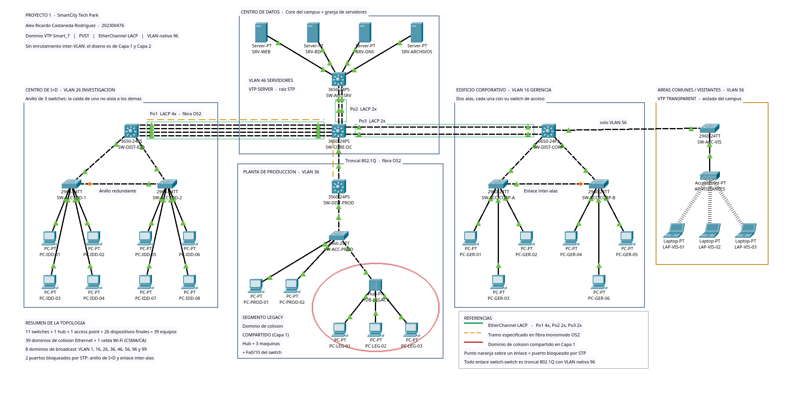

### 3.2 Vista con etiquetas de puerto

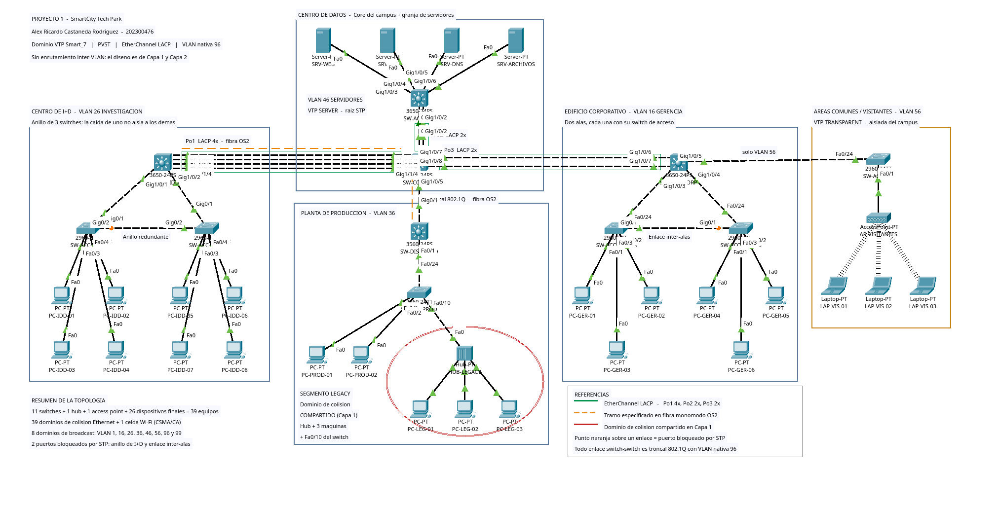

> Ambas imágenes se regeneraron desde la topología final. En la primera se aprecian
> los **dos puntos naranja** sobre los enlaces que STP mantiene bloqueados: el enlace
> inter-alas `SW-ACC-CORP-A ↔ SW-ACC-CORP-B` y el cierre del anillo de I+D
> `SW-ACC-IDD-1 ↔ SW-ACC-IDD-2` (sección 11.2).

### 3.3 Mapa de enlaces del backbone

| Desde | Puerto | Hacia | Puerto | Tipo | Enlaces físicos |
|---|---|---|---|---|---|
| SW-CORE-DC | Gi1/1/1 – Gi1/1/4 | SW-DIST-IDD | Gi1/1/1 – Gi1/1/4 | **Po1** — EtherChannel LACP | 4 |
| SW-CORE-DC | Gi1/0/1 – Gi1/0/2 | SW-ACC-SRV | Gi1/0/1 – Gi1/0/2 | **Po2** — EtherChannel LACP | 2 |
| SW-CORE-DC | Gi1/0/7 – Gi1/0/8 | SW-DIST-CORP | Gi1/0/6 – Gi1/0/7 | **Po3** — EtherChannel LACP | 2 |
| SW-CORE-DC | Gi1/0/5 | SW-DIST-PROD | Gi0/1 | Troncal simple | 1 |

### 3.4 Enlaces internos de cada área

| Área | Enlaces |
|---|---|
| Centro de I+D | `SW-DIST-IDD Gi1/0/1 ↔ SW-ACC-IDD-1 Gi0/1`, `SW-DIST-IDD Gi1/0/2 ↔ SW-ACC-IDD-2 Gi0/1`, `SW-ACC-IDD-1 Gi0/2 ↔ SW-ACC-IDD-2 Gi0/2` (cierra el anillo) |
| Edificio Corporativo | `SW-DIST-CORP Gi1/0/3 ↔ SW-ACC-CORP-A Fa0/24`, `SW-DIST-CORP Gi1/0/4 ↔ SW-ACC-CORP-B Fa0/24`, `SW-ACC-CORP-A Gi0/1 ↔ SW-ACC-CORP-B Gi0/1` (inter-alas) |
| Áreas Comunes | `SW-DIST-CORP Gi1/0/5 ↔ SW-ACC-VIS Fa0/24` (troncal aislado), `SW-ACC-VIS Fa0/1 → AP-VISITANTES` |
| Planta de Producción | `SW-DIST-PROD Fa0/1 ↔ SW-ACC-PROD Fa0/24`, `SW-ACC-PROD Fa0/10 → HUB-LEGACY Fa0` |

**Totales verificados en el archivo `.pkt`:** 39 dispositivos, **42 enlaces de cobre**
y **3 asociaciones inalámbricas** sobre la celda del Access Point. De los 42 cables,
**17 son enlaces entre switches** (los 17 son troncales 802.1Q), **21 van de un switch
a un dispositivo final** y **4 pertenecen al segmento del hub**.

---

## 4. Inventario de equipos

### 4.1 Equipo de red

| # | Nombre | Modelo | Capa | Área | Rol VTP |
|---|---|---|---|---|---|
| 1 | `SW-CORE-DC` | Catalyst 3650-24PS | Núcleo | Centro de Datos | **Server** |
| 2 | `SW-ACC-SRV` | Catalyst 3650-24PS | Acceso | Centro de Datos | Client |
| 3 | `SW-DIST-IDD` | Catalyst 3650-24PS | Distribución | Centro de I+D | Client |
| 4 | `SW-ACC-IDD-1` | Catalyst 2960-24TT | Acceso | Centro de I+D | Client |
| 5 | `SW-ACC-IDD-2` | Catalyst 2960-24TT | Acceso | Centro de I+D | Client |
| 6 | `SW-DIST-CORP` | Catalyst 3650-24PS | Distribución | Edificio Corporativo | Client |
| 7 | `SW-ACC-CORP-A` | Catalyst 2960-24TT | Acceso | Corporativo — Ala A | Client |
| 8 | `SW-ACC-CORP-B` | Catalyst 2960-24TT | Acceso | Corporativo — Ala B | Client |
| 9 | `SW-ACC-VIS` | Catalyst 2960-24TT | Acceso | Áreas Comunes | **Transparent** |
| 10 | `SW-DIST-PROD` | Catalyst 3560-24PS | Distribución | Planta de Producción | Client |
| 11 | `SW-ACC-PROD` | Catalyst 2960-24TT | Acceso | Planta de Producción | Client |
| 12 | `HUB-LEGACY` | Hub-PT | Capa 1 | Planta — segmento Legacy | — |
| 13 | `AP-VISITANTES` | AccessPoint-PT | Capa 1/2 | Áreas Comunes | — |

### 4.2 Dispositivos finales

| Cantidad | Dispositivos | VLAN | Ubicación |
|---|---|---|---|
| 4 | `SRV-WEB`, `SRV-BD`, `SRV-DNS`, `SRV-ARCHIVOS` | 46 | Granja del Centro de Datos |
| 8 | `PC-IDD-01` … `PC-IDD-08` | 26 | Centro de I+D (4 por switch de acceso) |
| 6 | `PC-GER-01` … `PC-GER-06` | 16 | Corporativo (3 por ala) |
| 3 | `LAP-VIS-01` … `LAP-VIS-03` | 56 | Áreas Comunes (inalámbricas) |
| 2 | `PC-PROD-01`, `PC-PROD-02` | 36 | Planta — estaciones modernas |
| 3 | `PC-LEG-01` … `PC-LEG-03` | 36 | Planta — máquinas Legacy tras el hub |

Las laptops de visitantes llevan la tarjeta `PT-LAPTOP-NM-1W`, así que su única
interfaz es `Wireless0` y se asocian al Access Point.

### 4.3 Ocupación de puertos

Contado sobre la topología en ejecución, sumando solo interfaces Ethernet
conmutables (no se cuentan `Vlan`, `Port-channel`, consola ni USB):

| Switch | Puertos Ethernet | En uso | Libres (apagados) |
|---|---:|---:|---:|
| `SW-CORE-DC` | 28 | 9 | 19 |
| `SW-ACC-SRV` | 28 | 6 | 22 |
| `SW-DIST-IDD` | 28 | 6 | 22 |
| `SW-DIST-CORP` | 28 | 5 | 23 |
| `SW-ACC-IDD-1` | 26 | 6 | 20 |
| `SW-ACC-IDD-2` | 26 | 6 | 20 |
| `SW-ACC-CORP-A` | 26 | 5 | 21 |
| `SW-ACC-CORP-B` | 26 | 5 | 21 |
| `SW-ACC-VIS` | 26 | 2 | 24 |
| `SW-DIST-PROD` | 26 | 2 | 24 |
| `SW-ACC-PROD` | 26 | 4 | 22 |
| **Total** | **294** | **56** | **238** |

Los **238** puertos libres están todos apagados con `shutdown` y llevan
`description NO USADO - deshabilitado por politica`. El conteo de puertos apagados
coincide exactamente con el de puertos sin cable, switch por switch.

---

## 5. Direccionamiento IP

El proyecto es de **Capa 1 y Capa 2**: no hay enrutamiento inter-VLAN. Cada VLAN es
una subred `/24` independiente y las direcciones son estáticas.

| VLAN | Nombre | Subred | Rango usado |
|---|---|---|---|
| 16 | GERENCIA | 192.168.16.0/24 | .11–.13 (Ala A), .21–.23 (Ala B) |
| 26 | INVESTIGACION | 192.168.26.0/24 | .11–.14 (`SW-ACC-IDD-1`), .21–.24 (`SW-ACC-IDD-2`) |
| 36 | PRODUCCION | 192.168.36.0/24 | .11–.12 (modernas), .101–.103 (Legacy) |
| 46 | SERVIDORES | 192.168.46.0/24 | .11–.14 |
| 56 | VISITANTES | 192.168.56.0/24 | .11–.13 |
| 96 | NATIVA | *sin direccionamiento* | ningún host |
| 99 | ADMINISTRACION | 192.168.99.0/24 | .1–.32 (SVI de switches) |

No hay gateway configurado en ningún host: sin router ni SVI enrutada, el tráfico
entre VLANs no tiene por dónde salir. Eso es deliberado y es lo que se comprueba en
las pruebas fallidas de la sección 16.

### 5.1 Interfaces de gestión (SVI en VLAN 99)

| Switch | IP de gestión |
|---|---|
| `SW-CORE-DC` | 192.168.99.1 |
| `SW-ACC-SRV` | 192.168.99.2 |
| `SW-DIST-IDD` | 192.168.99.11 |
| `SW-ACC-IDD-1` | 192.168.99.12 |
| `SW-ACC-IDD-2` | 192.168.99.13 |
| `SW-DIST-CORP` | 192.168.99.21 |
| `SW-ACC-CORP-A` | 192.168.99.22 |
| `SW-ACC-CORP-B` | 192.168.99.23 |
| `SW-DIST-PROD` | 192.168.99.31 |
| `SW-ACC-PROD` | 192.168.99.32 |
| `SW-ACC-VIS` | **ninguna, a propósito** (ver sección 6.3) |


---

## 6. Diseño por área y justificación

### 6.1 Centro de Datos (núcleo)

El enunciado pide que el núcleo *"garantice la administración centralizada del
dominio VTP"*, se interconecte por troncales con los otros tres edificios y dé
acceso a *"una granja de al menos 4 servidores críticos mediante un enlace que
concentra un alto volumen de tráfico hacia el Core, sin que estos dependan de una
única conexión física"*.

- **`SW-CORE-DC` es el único VTP Server** del dominio. Todas las VLANs se crean ahí
  y se propagan. La sección 8 explica por qué tener un solo servidor reduce, pero no
  elimina, el riesgo asociado al número de revisión.
- **Puse un switch intermedio (`SW-ACC-SRV`) para la granja** en lugar de colgar los
  servidores del núcleo. El enunciado deja esa decisión al estudiante. Lo hice así
  porque libera puertos del núcleo para el backbone, permite que la granja crezca sin
  tocar el núcleo, y hace posible el EtherChannel, que es la forma directa de cumplir
  *"sin que dependan de una única conexión física"*.
- **`Po2` = EtherChannel LACP de 2 enlaces** entre el núcleo y `SW-ACC-SRV`. Lo probé
  apagando uno de los dos miembros: el canal siguió en uso con un solo enlace y el
  tráfico de gestión no se interrumpió (evidencia 02).
- Los 4 servidores están en puertos de acceso con `portfast` y `bpduguard`.

### 6.2 Centro de I+D

El enunciado pide *"al menos 3 switches interconectados entre sí, de forma que la
caída de uno no aísle a los demás"*, una troncal al Centro de Datos que soporte *"una
mayor demanda de ancho de banda que el resto de los enlaces troncales"* y un mínimo
de 8 estaciones.

- **Anillo de 3 switches**: `SW-DIST-IDD` ↔ `SW-ACC-IDD-1` ↔ `SW-ACC-IDD-2` ↔
  `SW-DIST-IDD`. Cada switch tiene dos caminos posibles: si cae `SW-ACC-IDD-1`,
  `SW-ACC-IDD-2` sigue llegando al de distribución por su propio enlace; si cae el de
  distribución, los dos de acceso siguen viéndose entre sí. STP bloquea uno de los
  tres enlaces del anillo para evitar el bucle y lo reactiva ante una falla.
- **`Po1` = EtherChannel LACP de 4 enlaces**, el troncal más ancho del campus: el
  doble de miembros que `Po2` y `Po3`, y cuatro veces el troncal de la Planta. Se
  comprueba en `show etherchannel summary` y también en el costo de STP, que es **3**
  para `Po1` frente a **4** de un enlace Gigabit individual (sección 11.3).
- **8 estaciones**, 4 por cada switch de acceso.

### 6.3 Edificio Corporativo

El enunciado pide dos alas con switch propio, que *"la conectividad entre ambas se
mantenga activa incluso si la ruta hacia el switch de distribución más cercana queda
inhabilitada"*, y un segmento de visitantes que *"aísle completamente el tráfico y la
administración de VLANs del resto del campus"*, con Wi-Fi por Access Point.

- **Triángulo `SW-DIST-CORP` – `SW-ACC-CORP-A` – `SW-ACC-CORP-B`.** Cada ala sube al
  switch de distribución y además hay un enlace directo entre alas. En operación
  normal STP bloquea el enlace inter-alas; cuando cae el uplink de un ala lo
  desbloquea. **Lo probé apagando `Fa0/24` de `SW-ACC-CORP-B`**: `Gi0/1` pasó de
  `Altn BLK` a `Root FWD` y el ping entre alas volvió a 0 % de pérdida (evidencia 04).
- **`Po3` = EtherChannel LACP de 2 enlaces al núcleo.** El enunciado señala que este
  edificio concentra uno de los mayores volúmenes de tráfico, así que el enlace al
  núcleo agrega ancho de banda además de dar tolerancia a fallos.
- **El aislamiento de visitantes se apoya en tres medidas simultáneas:**
  1. **`SW-ACC-VIS` en VTP `transparent`.** Mantiene su propia base de datos de VLANs
     en la configuración local y no la sincroniza con el dominio. Se comprueba en
     `show vtp status`: revisión **0**, **7** VLANs locales y un MD5 digest distinto
     al del resto del campus.
  2. **Poda de VLANs.** El troncal `SW-DIST-CORP Gi1/0/5 ↔ SW-ACC-VIS Fa0/24` permite
     únicamente las VLAN **56 y 96**, y ningún troncal hacia el núcleo permite la 56.
     El tráfico de invitados no tiene por dónde salir del edificio.
  3. **Sin SVI de gestión en `SW-ACC-VIS`.** Es el único switch sin dirección en la
     VLAN 99: se administra por consola, de modo que el plano de gestión del campus
     no toca el segmento de invitados.

  > **Una tensión del enunciado, resuelta explícitamente.** La tabla oficial exige
  > crear la VLAN 56 en el switch servidor y propagarla por VTP, y al mismo tiempo
  > pide aislar la administración de VLANs de los visitantes. Ambas cosas conviven:
  > la VLAN 56 **sí** existe y se propagó a todo el dominio (aparece en el
  > `show vlan brief` del núcleo y de los clientes), pero el switch que realmente la
  > usa está en modo transparente y la define localmente. El aislamiento no se logra
  > escondiendo la VLAN, sino sacándola de los troncales del campus.

### 6.4 Planta de Producción

Detallada en la sección 12.

---

## 7. Medio de transmisión de cada enlace

### 7.1 Las distancias son una suposición de diseño

El enunciado **no proporciona un plano ni distancias**; pide que el estudiante
*"seleccione y justifique técnicamente el medio de transmisión (cobre o fibra óptica)
de cada enlace, considerando distancia, ancho de banda requerido y buenas prácticas
de diseño"*. Para poder justificar algo hay que partir de una planta física, así que
**definí una distribución del campus y la declaro aquí como suposición**. Las
distancias de la tabla siguiente son **distancias asumidas para el diseño**, no datos
del enunciado. Si el plano real fuera otro, cambiaría la elección del medio, y el
criterio que sigue es lo que permitiría rehacerla.

### 7.2 El límite de los 100 m, con precisión

La norma **ANSI/TIA-568** para cableado balanceado de par trenzado define dos
longitudes distintas que conviene no confundir:

- **Enlace permanente (*permanent link*): 90 m máximo.** Es el cableado fijo, de
  patch panel a roseta.
- **Canal (*channel*): 100 m máximo.** Es el enlace permanente **más** los patch
  cords de ambos extremos.

Es decir: el número de diseño con el que se decide si un tramo es viable en cobre es
**90 m**, no 100 m; los 10 m restantes son el presupuesto para los latiguillos.

### 7.3 Medio elegido por enlace

| Enlace | Distancia **asumida** | Medio especificado | Justificación |
|---|---|---|---|
| Núcleo ↔ `SW-ACC-SRV` (`Po2`, 2 enlaces) | 5 m | **UTP Cat6 — 1000BASE-T** | Mismo cuarto de equipos. A esa distancia la fibra solo agregaría costo y transceptores sin beneficio. |
| Núcleo ↔ `SW-DIST-IDD` (`Po1`, 4 enlaces) | **240 m** | **Fibra monomodo OS2 — 1000BASE-LX/LH** | Supera el enlace permanente de 90 m del cobre balanceado, así que el cobre no es una opción normativa. Es además el enlace de mayor demanda del campus y la fibra deja margen para subir de velocidad sin recablear. |
| Núcleo ↔ `SW-DIST-CORP` (`Po3`, 2 enlaces) | 85 m | **UTP Cat6 — 1000BASE-T** | Dentro de los 90 m del enlace permanente, con margen para los patch cords. Dos tendidos de cobre cuestan bastante menos que un tendido de fibra con sus transceptores. |
| Núcleo ↔ `SW-DIST-PROD` | **150 m** | **Fibra monomodo OS2 — 1000BASE-LX/LH** | Dos motivos: excede los 90 m, y el trayecto atraviesa un ambiente industrial con motores y variadores de frecuencia. La fibra es dieléctrica: inmune a interferencia electromagnética y sin lazos de tierra entre edificios. |
| Troncales internos (distribución ↔ acceso, anillo de I+D, inter-alas) | 15–60 m | **UTP Cat6 — 1000BASE-T** | Recorridos dentro de un mismo edificio, por debajo del límite. |
| Cableado horizontal (acceso ↔ hosts) | < 90 m | **UTP Cat6** | Cableado estructurado estándar. |

> **Cómo está implementado en el `.pkt`.** Los dos tramos que el diseño especifica en
> fibra **están cableados en cobre** dentro del archivo de Packet Tracer. La razón es
> una limitación del simulador, no del hardware: los modelos reales de estos switches
> **sí** aceptan fibra (el Catalyst 3650-24PS trae cuatro uplinks SFP de 1 G y el
> Catalyst 3560-24PS tiene dos puertos Gigabit basados en SFP, ambos compatibles con
> transceptores 1000BASE-LX/LH). La sección 19 detalla qué se intentó y qué devolvió
> Packet Tracer. El presupuesto de la sección 18 sí cotiza la fibra y los
> transceptores, porque es lo que costaría la instalación real.

---

## 8. VTP: dominio, modos y justificación

```
vtp domain Smart_7
vtp password proyecto12S2026
```

| Switch | Modo VTP | Por qué ese modo |
|---|---|---|
| `SW-CORE-DC` | **Server** | Es el núcleo. El enunciado le asigna la administración centralizada del dominio: es el punto donde se crean, renombran o borran VLANs. |
| `SW-ACC-SRV`, `SW-DIST-IDD`, `SW-ACC-IDD-1/2`, `SW-DIST-CORP`, `SW-ACC-CORP-A/B`, `SW-DIST-PROD`, `SW-ACC-PROD` | **Client** | Sincronizan la base de datos del dominio y no pueden crear ni borrar VLANs localmente. |
| `SW-ACC-VIS` | **Transparent** | El enunciado exige aislar *la administración de VLANs* del segmento de visitantes. Un switch transparente mantiene su base de datos en la configuración local y no la sincroniza con el dominio. |

### 8.1 Qué hace exactamente el modo transparente

Conviene ser preciso, porque es fácil describirlo mal:

- **No sincroniza** su base de datos de VLANs con la del dominio y **no origina**
  actualizaciones cuando el administrador crea o borra VLANs en él. Sus VLANs viven
  en la configuración local (por eso `vlan 56` y `vlan 96` aparecen en el
  `running-config` de `SW-ACC-VIS` y no en el de los clientes).
- **Sí reenvía** los anuncios VTP que recibe por sus troncales. La documentación de
  Cisco lo dice explícitamente para VTP versión 2: *"transparent switches do forward
  VTP advertisements that they receive out their trunk ports in VTP Version 2"*. En
  esta topología el dominio corre **VTP versión 1** (`show vtp status`), y de todos
  modos `SW-ACC-VIS` es un extremo de la red: no hay ningún switch detrás de él al
  que pudiera reenviar nada. Decir que "no propaga actualizaciones" sería incorrecto
  como afirmación general sobre el modo.

### 8.2 Cuándo anuncia VTP

Los anuncios no ocurren solo cuando cambia una VLAN. Según la documentación de Cisco,
un switch en modo Server o Client emite **Summary Advertisements de forma periódica,
cada 5 minutos por omisión**, y **además** emite un Summary seguido de uno o varios
*Subset Advertisements* **cada vez que la base de datos cambia**. El anuncio periódico
es el que mantiene sincronizado el dominio aunque nadie toque nada; el anuncio por
evento es el que propaga un cambio de inmediato.

### 8.3 El riesgo del Configuration Revision, sin minimizarlo

El *Configuration Revision Number* es el criterio con el que un switch decide si la
información que recibe es más reciente que la suya. Ese mismo mecanismo es el riesgo
clásico de VTP, y **tener un solo VTP Server no lo elimina**: la documentación de
Cisco advierte que un switch *"in VTP server or client mode that has a higher
configuration revision and matching VTP domain name and password […] can cause other
switches to replace their VLAN database"*. Un **cliente** con revisión más alta puede
sobrescribir el dominio; el modo cliente restringe la administración local, no la
capacidad de anunciar.

Lo que sí mitiga el riesgo, y está aplicado en este diseño:

| Medida | Efecto |
|---|---|
| Contraseña de dominio (`vtp password proyecto12S2026`) | Un switch sin la contraseña correcta produce un MD5 distinto y sus anuncios se descartan. |
| Un solo punto de administración | Reduce la probabilidad de cambios accidentales, aunque no impide un anuncio con revisión alta. |
| **Procedimiento de alta de equipos** | Antes de conectar cualquier switch al dominio hay que llevar su revisión a 0 (poniéndolo en `transparent` y devolviéndolo a `client`, o cambiándole el nombre de dominio y regresándolo). Es la recomendación explícita de Cisco y es la única medida que ataca la causa. |
| `SW-ACC-VIS` en transparente | Mientras esté en ese modo su revisión se mantiene en 0, así que sus anuncios no pueden imponerse sobre los del dominio. |

### 8.4 Estado verificado

Salida completa en [`docs/evidencias/01-vtp-status.txt`](docs/evidencias/01-vtp-status.txt).

---

## 9. VLANs y enlaces troncales

### 9.1 VLANs creadas en el servidor VTP

```
vlan 16   name GERENCIA
vlan 26   name INVESTIGACION
vlan 36   name PRODUCCION
vlan 46   name SERVIDORES
vlan 56   name VISITANTES
vlan 96   name NATIVA
vlan 99   name ADMINISTRACION
```

**Por qué agregué la VLAN 99.** El enunciado obliga a mover la VLAN nativa a la 96.
Usar esa misma VLAN 96 para administrar los switches sería mala práctica: la nativa
viaja **sin etiqueta** por los troncales y es el vector del *VLAN hopping* por doble
etiquetado. Por eso dejé la **96 como VLAN nativa sin un solo puerto de acceso ni
host asignado** y creé la **99 ADMINISTRACION** para las SVI de gestión. Separar VLAN
nativa, VLAN de gestión y VLAN 1 es una práctica de diseño estándar, y además me da
un plano de gestión con el que puedo demostrar que el backbone transporta tráfico real
de punta a punta (pruebas 7 a 9 de la sección 16).

### 9.2 Configuración de todos los troncales

Todos los troncales del campus llevan:

```
switchport mode trunk
switchport trunk native vlan 96
switchport trunk allowed vlan <lista podada>
```

En `SW-DIST-PROD` —el único Catalyst 3560 del diseño— hay un comando adicional,
`switchport trunk encapsulation dot1q`, porque esa plataforma soporta ISL además de
802.1Q y hay que declarar cuál se usa. En los 3650 y 2960 de Packet Tracer ese
comando devuelve *invalid input*: solo implementan 802.1Q.

### 9.3 Poda de VLANs por troncal

Cada edificio recibe únicamente su propia VLAN de datos, la nativa y la de gestión:

| Troncal | VLANs permitidas | Efecto |
|---|---|---|
| `Po1` Núcleo ↔ I+D | `26,96,99` | El broadcast de INVESTIGACION no sale del Centro de I+D |
| `Po2` Núcleo ↔ Granja | `46,96,99` | El broadcast de SERVIDORES no sale del Centro de Datos |
| `Po3` Núcleo ↔ Corporativo | `16,96,99` | El broadcast de GERENCIA no sale del Corporativo |
| `Gi1/0/5` Núcleo ↔ Planta | `36,96,99` | El broadcast de PRODUCCION no sale de la Planta |
| Troncales internos de I+D (2 de acceso + anillo) | `26,96,99` | Misma lógica hacia adentro |
| Troncales internos del Corporativo (2 alas + inter-alas) | `16,96,99` | Misma lógica hacia adentro |
| Troncal interno de la Planta | `36,96,99` | Misma lógica hacia adentro |
| `SW-DIST-CORP Gi1/0/5` ↔ `SW-ACC-VIS` | **`56,96`** | Único troncal que transporta la VLAN 56, y termina en `SW-ACC-VIS` |

Sin esta poda, un broadcast de cualquier VLAN inundaría los cuatro edificios aunque
no hubiera un solo host de esa VLAN al otro lado. Se verifica en
[`docs/evidencias/03-trunks.txt`](docs/evidencias/03-trunks.txt).

### 9.4 Por qué la VLAN 1 tampoco viaja por los troncales

Ninguna lista de VLANs permitidas incluye la VLAN 1. Vale la pena explicar el motivo,
porque hay una idea extendida —y equivocada— de que hay que dejar la VLAN 1 permitida
"para que funcionen VTP, CDP y DTP".

No es así: el tráfico del plano de control de Cisco (CDP, VTP, DTP, PAgP) se envía por
la VLAN 1 **independientemente de la lista de VLANs permitidas del troncal**; quitar
la VLAN 1 de un troncal no detiene esos protocolos. La recomendación de diseño va en
la dirección contraria: **no usar la VLAN 1 para datos ni para gestión y podarla de
los troncales**, que es exactamente lo que hace esta topología.

Y no es solo teoría: la poda de la VLAN 1 se aplicó a los 17 troncales y después se
comprobó que **VTP siguió propagando** (el cambio de nombre de la VLAN 99 llegó a los
clientes) y que **los tres EtherChannel siguieron agregados**. Las salidas están en
las evidencias 01 y 03.

Ningún puerto de acceso está asignado a la VLAN 1, y los 238 puertos sin usar están
apagados, por lo que la VLAN 1 no tiene un solo host activo en toda la red.

---

## 10. EtherChannel (LACP)

Como mi carné es par, el protocolo es **LACP** (`channel-group N mode active` en ambos
extremos).

| Canal | Extremos | Miembros | Requisito del enunciado que satisface |
|---|---|---|---|
| **Po1** | `SW-CORE-DC` ↔ `SW-DIST-IDD` | **4** | *"Su interconexión troncal hacia el Centro de Datos debe soportar una mayor demanda de ancho de banda que el resto de los enlaces troncales del campus"* |
| **Po2** | `SW-CORE-DC` ↔ `SW-ACC-SRV` | **2** | *"…mediante un enlace que concentra un alto volumen de tráfico hacia el Core, sin que estos dependan de una única conexión física"* |
| **Po3** | `SW-CORE-DC` ↔ `SW-DIST-CORP` | **2** | El Corporativo *"concentra uno de los mayores volúmenes de tráfico"*: el enlace al núcleo agrega ancho de banda y tolera la pérdida de un cable |

Configuración tipo, idéntica en los dos extremos:

```
interface Port-channel1
 description Po1 LACP 4x a SW-DIST-IDD (Centro de I+D)
 switchport trunk native vlan 96
 switchport trunk allowed vlan 26,96,99
 switchport mode trunk
!
interface GigabitEthernet1/1/1
 description Po1 LACP a SW-DIST-IDD
 switchport trunk native vlan 96
 switchport trunk allowed vlan 26,96,99
 switchport mode trunk
 channel-protocol lacp
 channel-group 1 mode active
```

### 10.1 Qué tiene que coincidir para que los puertos agrupen

La documentación de Cisco para el Catalyst 3650 enumera los parámetros que deben
coincidir entre los miembros: **misma velocidad, mismo modo dúplex, misma VLAN nativa,
mismo rango de VLANs permitidas y mismo estado y tipo de troncal**. Y sobre el rango de
VLANs es explícita: *"An EtherChannel supports the same allowed range of VLANs on all
the ports in a trunking Layer 2 EtherChannel. If the allowed range of VLANs is not the
same, the ports do not form an EtherChannel."*

Ese fue el punto que más costó durante la construcción: el IOS reportaba
`%EC-5-CANNOT_BUNDLE2: … (vlan mask is different)` porque la interfaz `Port-channel`
no llevaba la misma configuración de troncal que sus miembros. La solución es
configurar la interfaz lógica **y** cada miembro con la misma VLAN nativa y la misma
lista de VLANs permitidas.

Conviene precisar un punto que se malinterpreta a menudo: lo que la regla exige es que
la velocidad y el dúplex **coincidan** entre los miembros, no que se fijen a mano. No
hay una recomendación general de Cisco de desactivar la autonegociación para formar un
EtherChannel. En esta topología ningún miembro lleva `speed` ni `duplex` configurados y
los tres canales agregan sin problema; lo comprobé quitando esos comandos de miembros
que los tenían y confirmando en `show etherchannel summary` que seguían en `(P)`.
Fijarlos a mano sigue siendo válido —y necesario si un extremo negocia distinto—, pero
no es un requisito del protocolo.

### 10.2 Resultado verificado

```
SW-CORE-DC# show etherchannel summary
Group  Port-channel  Protocol    Ports
------+-------------+-----------+----------------------------------------------
1      Po1(SU)           LACP   Gig1/1/1(P) Gig1/1/2(P) Gig1/1/3(P) Gig1/1/4(P)
2      Po2(SU)           LACP   Gig1/0/1(P) Gig1/0/2(P)
3      Po3(SU)           LACP   Gig1/0/7(P) Gig1/0/8(P)
```

`(SU)` = canal de Capa 2 en uso; `(P)` = miembro efectivamente agregado. Los **8
miembros** están agregados, ninguno suspendido ni *stand-alone*.

**Prueba de pérdida de un miembro.** Apagué `Gi1/0/2` en el núcleo —uno de los dos
enlaces de la granja de servidores— con un ping de gestión en curso desde
`SW-ACC-SRV`. El canal quedó `Po2(SU)` con `Gig1/0/1(P) Gig1/0/2(D)` y el ping
terminó en **4/5**, perdiendo únicamente el primer paquete, que es el que resuelve
ARP. No hubo reconvergencia de STP porque para STP el canal es una sola interfaz
lógica que no dejó de existir. Traza en
[`docs/evidencias/02-etherchannel.txt`](docs/evidencias/02-etherchannel.txt).

---

## 11. Spanning Tree (PVST) y Root Bridges

Como mi carné es par, el modo es **PVST**: `spanning-tree mode pvst` en los once
switches. PVST corre una instancia de spanning tree por VLAN, lo que permite elegir
un Root Bridge distinto en cada una.

### 11.1 Elección de Root Bridge y justificación

| VLAN | Root primario | Prioridad configurada | Root secundario | Prioridad |
|---|---|---|---|---|
| 1, 96 NATIVA, 99 ADMINISTRACION | `SW-CORE-DC` | 24576 | — | — |
| 16 GERENCIA | `SW-CORE-DC` | 24576 | `SW-DIST-CORP` | 28672 |
| 26 INVESTIGACION | `SW-CORE-DC` | 24576 | `SW-DIST-IDD` | 28672 |
| 36 PRODUCCION | `SW-CORE-DC` | 24576 | `SW-DIST-PROD` | 28672 |
| 46 SERVIDORES | `SW-CORE-DC` | 24576 | `SW-ACC-SRV` | 28672 |
| 56 VISITANTES | `SW-ACC-VIS` | 24576 | — | — |

La prioridad que aparece en `show spanning-tree` es la configurada **más** el número
de VLAN (*system ID extension*): 24576 + 16 = **24592** para la VLAN 16, 24576 + 26 =
**24602** para la 26, y así con las demás.

**Por qué el núcleo es raíz de las VLANs del campus.** El Root Bridge define hacia
dónde converge el árbol: todos los caminos activos apuntan a él. Como el núcleo es el
punto por el que pasa el tráfico entre edificios y es el equipo con más capacidad del
campus, ponerlo como raíz evita que los flujos tomen caminos subóptimos. Con la
prioridad por omisión (32768) ganaría el switch de MAC más baja, que podría ser
perfectamente un 2960 de acceso escondido en un ala.

**Por qué el secundario es el switch de distribución dueño de cada VLAN.** Si el
núcleo cae, la raíz se traslada al equipo que concentra a los usuarios de esa VLAN, y
el árbol resultante sigue siendo corto para ese tráfico. Es una decisión distinta por
VLAN, que es justamente lo que PVST permite.

**Por qué la VLAN 56 es la excepción.** Su raíz es `SW-ACC-VIS`. Esa VLAN no cruza el
campus, así que su árbol también debe ser local. Verificado:

```
SW-ACC-VIS# show spanning-tree vlan 56
  Root ID    Priority    24632          <- 24576 + sys-id-ext 56
             Address     0006.2A06.E320
             This bridge is the root

SW-DIST-CORP# show spanning-tree vlan 56
  Root ID    Priority    24632
             Address     0006.2A06.E320  <- reconoce a SW-ACC-VIS como raiz
             Cost        19
             Port        5(GigabitEthernet1/0/5)
```

`show spanning-tree summary` en el núcleo confirma el reparto y **no** incluye
VISITANTES entre sus VLANs raíz:

```
SW-CORE-DC# show spanning-tree summary
Switch is in pvst mode
Root bridge for: default GERENCIA INVESTIGACION PRODUCCION SERVIDORES NATIVA ADMINISTRACION
Configured Pathcost method used is short
```

### 11.2 Puertos bloqueados en operación normal

| Switch | Puerto | Rol/Estado | Enlace que bloquea |
|---|---|---|---|
| `SW-ACC-CORP-B` | `Gi0/1` | `Altn BLK` | Enlace inter-alas A ↔ B |
| `SW-ACC-IDD-1` | `Gi0/2` | `Altn BLK` | Cierre del anillo de I+D |

Son los dos únicos bucles físicos de la topología, y STP deja exactamente un puerto
bloqueado en cada uno. El enlace al Edificio Corporativo ya no aporta un tercer bucle
porque sus dos cables forman el EtherChannel `Po3`, que para STP es **una sola
interfaz lógica**: por eso agregar el canal quitó un puerto bloqueado del árbol.

### 11.3 Costos observados y por qué

Con el método de costo `short` (el que reporta el propio switch), los valores que
aparecen en la topología son:

| Interfaz | Costo | Interpretación |
|---|---:|---|
| Enlace Gigabit individual (p. ej. `Gi1/0/5`, `Gi0/1` inter-alas) | 4 | Costo IEEE de 1 Gbps |
| Enlace a 100 Mbps (uplinks `Fa0/24` de los 2960) | 19 | Costo IEEE de 100 Mbps |
| **`Po1` (4 miembros)** | **3** | El canal agrega ancho de banda, y el costo baja por debajo del de un enlace individual |
| **`Po3` (2 miembros)** | **3** | Igual efecto de la agregación |

Ese costo 3 del EtherChannel es la comprobación, dentro del propio protocolo, de que
la agregación no es cosmética: STP la trata como un enlace más rápido que un Gigabit
suelto.

Encadenando esos costos se obtienen los costos al Root que reportan los switches:

- `SW-DIST-CORP` → núcleo: **3** (por `Po3`).
- `SW-ACC-CORP-B` → núcleo: **22** = 19 (`Fa0/24`) + 3 (`Po3`).
- `SW-ACC-IDD-1` y `SW-ACC-IDD-2` → núcleo: **7** = 4 (`Gi0/1`) + 3 (`Po1`).

### 11.4 Prueba de convergencia

Apagué `Fa0/24` en `SW-ACC-CORP-B` (su uplink al switch de distribución) y seguí la
transición completa:

| Momento | Estado de `Gi0/1` | Costo al Root |
|---|---|---|
| Operación normal | `Altn BLK` | 22 (por `Fa0/24`) |
| Tras el `shutdown` | `Root LIS` → `Root LRN` | 26 |
| Convergido | `Root FWD` | 26 = 4 + 19 + 3 |

Con el enlace ya en *forwarding*, el ping de `PC-GER-04` (Ala B) a `PC-GER-01` (Ala A)
devolvió **4/4, 0 % de pérdida**. Durante la transición el ping sí falla: STP tarda
dos veces el *forward delay* (15 s cada uno) en llevar el puerto de bloqueo a
reenvío, y ese intervalo es el precio de usar PVST en lugar de Rapid-PVST. Traza
completa en [`docs/evidencias/04-spanning-tree.txt`](docs/evidencias/04-spanning-tree.txt).

---

## 12. Segmento Legacy: impacto y contención

### 12.1 Diseño

Tres máquinas industriales antiguas (`PC-LEG-01/02/03`) cuelgan de `HUB-LEGACY`
(Hub-PT), y el hub entra a la red por un único puerto de acceso:
`SW-ACC-PROD Fa0/10`, en la VLAN 36.

### 12.2 Impacto sobre el rendimiento

Un hub es un repetidor de Capa 1: no lee direcciones MAC, no conmuta, repite cada bit
que recibe por todos los demás puertos. Las consecuencias:

1. **Un solo dominio de colisión para las tres máquinas más el enlace al switch.** En
   una red conmutada cada puerto es su propio dominio de colisión; aquí los cuatro
   cables del segmento comparten uno.
2. **Half-duplex y CSMA/CD.** Ninguna máquina transmite y recibe a la vez, y antes de
   transmitir debe escuchar el medio. El ancho de banda nominal se **reparte** entre
   las estaciones, no se multiplica.
3. **Colisiones y *backoff* exponencial.** Cuando dos máquinas transmiten a la vez la
   trama se destruye y ambas esperan un tiempo aleatorio creciente. A medida que sube
   la carga el rendimiento útil deja de crecer y empieza a caer.
4. **Sin aislamiento entre estaciones.** Cualquier equipo conectado al hub ve todo el
   tráfico del segmento; no hay conmutación que lo separe.
5. **Varias MAC aprendidas en un mismo puerto del switch:**

```
SW-ACC-PROD# show mac address-table interface FastEthernet0/10
  Vlan    Mac Address       Type        Ports
  ----    -----------       --------    -----
    36    0003.e48d.db25    STATIC      Fa0/10
    36    0060.3edb.90e4    STATIC      Fa0/10
    36    0060.707c.8e07    STATIC      Fa0/10
```

> **Precisión importante:** ver varias MAC en un puerto **no demuestra por sí solo**
> que haya un hub. Un switch no administrado, un servidor con varias máquinas
> virtuales o un teléfono IP con PC en cascada producen exactamente la misma tabla. Es
> un indicio **compatible** con un dominio compartido, no una prueba. Lo que sí
> demuestra que este segmento es un dominio de colisión compartido es la topología
> misma: un repetidor de Capa 1 con cuatro puertos activos, verificable en el archivo
> `.pkt` y en el diagrama de la sección 3.

### 12.3 Medidas de contención aplicadas en el switch de acceso

No se puede eliminar el segmento (el enunciado indica que la maquinaria no soporta
migración), pero sí evitar que su problema afecte al resto de la red:

```
interface FastEthernet0/10
 description SEGMENTO LEGACY - HUB (dominio de colision compartido)
 switchport mode access
 switchport access vlan 36
 switchport port-security
 switchport port-security maximum 4
 switchport port-security violation restrict
 spanning-tree portfast
 spanning-tree bpduguard enable
 storm-control broadcast level 20
```

| Medida | Qué hace realmente | Qué **no** hace |
|---|---|---|
| `switchport mode access` + `vlan 36` | Acota el dominio de colisión a este puerto: el switch no repite bits, conmuta tramas, así que las colisiones del hub no cruzan al resto de la red. Además confina el broadcast del segmento a la VLAN 36. | — |
| `storm-control broadcast level 20` | Vigila el tráfico **broadcast** que entra por el puerto hacia el bus de conmutación y lo bloquea mientras supere el 20 % del ancho de banda, hasta que baje del umbral. Evita que una tormenta originada en el segmento sature la Planta. | **No reduce las colisiones del hub.** Actúa sobre tramas que ya llegaron al switch; dentro del dominio compartido el medio sigue igual. Tampoco limita unicast ni multicast salvo que se configuren esos tipos por separado. |
| `switchport port-security maximum 4` + `violation restrict` | Limita a 4 el número de direcciones MAC de origen que el puerto acepta; el tráfico de MAC excedentes se descarta y se cuenta la violación sin apagar el puerto. | **No identifica ni autoriza equipos.** Es un filtro por cantidad de MAC, no una autenticación: el cuarto equipo que aparezca será aceptado sea cual sea. Para autorizar equipos concretos habría que fijar las MAC con `switchport port-security mac-address` (estáticas) o `sticky`, y para autenticar de verdad haría falta 802.1X. |
| `spanning-tree portfast` | El puerto pasa a *forwarding* de inmediato en lugar de esperar los 30 s de STP. | No protege contra bucles por sí solo: por eso va acompañado de BPDU Guard. |
| `spanning-tree bpduguard enable` | Si llega un BPDU por este puerto —señal de que alguien conectó un switch al hub— el puerto pasa a *err-disabled* antes de que altere el árbol del campus. | Es el complemento **recomendado** de PortFast, no un requisito del protocolo: PortFast funciona sin él, con más riesgo. |

Lo que estas medidas **no** arreglan: dentro del segmento sigue habiendo colisiones,
half-duplex y ancho de banda compartido. Eso solo se resuelve reemplazando el hub por
un switch, que es precisamente lo que el enunciado indica que todavía no es posible.

Evidencia en [`docs/evidencias/05-segmento-legacy.txt`](docs/evidencias/05-segmento-legacy.txt).

---

## 13. Tabla de dominios de colisión

En una red conmutada full-duplex cada enlace punto a punto es su propio dominio de
colisión. Un repetidor de Capa 1 (hub), en cambio, une todos sus puertos en **uno
solo**.

### 13.1 Dominios que genera cada equipo

Contado sobre los puertos con cable de la sección 4.3:

| Equipo | Puertos activos | Dominios de colisión que genera | Detalle |
|---|---:|---:|---|
| `SW-CORE-DC` | 9 | **9** | 4 (`Po1`) + 2 (`Po2`) + 2 (`Po3`) + 1 (Planta) |
| `SW-ACC-SRV` | 6 | **6** | 2 uplinks (`Po2`) + 4 servidores |
| `SW-DIST-IDD` | 6 | **6** | 4 uplinks (`Po1`) + 2 hacia acceso |
| `SW-ACC-IDD-1` | 6 | **6** | 2 troncales + 4 PC |
| `SW-ACC-IDD-2` | 6 | **6** | 2 troncales + 4 PC |
| `SW-DIST-CORP` | 5 | **5** | 2 al núcleo (`Po3`) + 2 a las alas + 1 a visitantes |
| `SW-ACC-CORP-A` | 5 | **5** | 2 troncales + 3 PC |
| `SW-ACC-CORP-B` | 5 | **5** | 2 troncales + 3 PC |
| `SW-ACC-VIS` | 2 | **2** | 1 troncal + 1 al Access Point |
| `SW-DIST-PROD` | 2 | **2** | 1 al núcleo + 1 al acceso |
| `SW-ACC-PROD` | 4 | **4** | 1 troncal + 2 PC + 1 al hub |
| **Subtotal** | **56** | **56** | cada extremo contado desde su propio switch |
| `HUB-LEGACY` | 4 | **1** | **Dominio compartido** entre `SW-ACC-PROD Fa0/10`, `HUB Fa0–Fa3` y `PC-LEG-01/02/03` |

### 13.2 Dominios de colisión reales de la red

La tabla anterior cuenta desde cada switch, así que un enlace entre dos switches
aparece dos veces. Contando **segmentos físicos únicos**:

| Tipo de segmento | Cantidad | Observación |
|---|---:|---|
| Enlaces switch ↔ switch | 17 | Cada cable es un dominio de colisión punto a punto |
| Enlaces switch ↔ dispositivo final | 21 | 4 servidores + 8 PC de I+D + 6 PC de Gerencia + 2 PC de Planta + 1 Access Point |
| **Segmento Legacy (hub)** | **1** | Agrupa 4 enlaces físicos en un único dominio compartido |
| **TOTAL de dominios de colisión Ethernet** | **39** | 17 + 21 + 1 |

Los 42 cables de la topología se reparten así: 17 + 21 + 4 (los del segmento del hub)
= 42. Los cuatro cables del hub colapsan en un solo dominio, y de ahí que 42 cables
produzcan 39 dominios.

**El dato que pide el enunciado:** el dominio de colisión compartido del segmento
Legacy está formado por `SW-ACC-PROD Fa0/10` + los cuatro puertos activos del
`HUB-LEGACY` + `PC-LEG-01`, `PC-LEG-02` y `PC-LEG-03`.

Si ese hub se reemplazara por un switch, esos 4 enlaces pasarían a ser 4 dominios
independientes y la red tendría 42 en vez de 39.

### 13.3 El Wi-Fi no es un dominio de colisión Ethernet

La celda del `AP-VISITANTES` con sus tres laptops es un **medio compartido**, pero
**no es un dominio de colisión Ethernet** y por eso no está en la cuenta de arriba:

- Ethernet compartida usa **CSMA/CD**: las estaciones detectan la colisión mientras
  transmiten y aplican *backoff*.
- 802.11 usa **CSMA/CA**: una estación de radio no puede escuchar mientras transmite,
  así que el estándar **evita** la colisión en lugar de detectarla, con espera aleatoria
  antes de transmitir, confirmaciones (ACK) por trama y, opcionalmente, RTS/CTS para el
  problema del nodo oculto.

Lo correcto es describirlo como **un dominio de contención inalámbrico (CSMA/CA)**: el
ancho de banda de la celda se reparte entre las tres laptops, pero el mecanismo y las
consecuencias no son los de un hub Ethernet. Contándolo aparte, la red tiene **39
dominios de colisión Ethernet + 1 dominio de contención inalámbrico**.

---

## 14. Tabla de dominios de broadcast

Cada VLAN activa es un dominio de broadcast. Como no hay enrutamiento inter-VLAN,
también son dominios estancos entre sí.

| # | VLAN | Nombre | Subred | Miembros | Alcance físico real |
|---|---|---|---|---|---|
| 1 | **16** | GERENCIA | 192.168.16.0/24 | 6 PC (3 por ala) | `SW-CORE-DC`, `SW-DIST-CORP`, `SW-ACC-CORP-A`, `SW-ACC-CORP-B` |
| 2 | **26** | INVESTIGACION | 192.168.26.0/24 | 8 estaciones | `SW-CORE-DC`, `SW-DIST-IDD`, `SW-ACC-IDD-1`, `SW-ACC-IDD-2` |
| 3 | **36** | PRODUCCION | 192.168.36.0/24 | 2 PC modernas + 3 máquinas Legacy | `SW-CORE-DC`, `SW-DIST-PROD`, `SW-ACC-PROD`, `HUB-LEGACY` |
| 4 | **46** | SERVIDORES | 192.168.46.0/24 | 4 servidores | `SW-CORE-DC`, `SW-ACC-SRV` |
| 5 | **56** | VISITANTES | 192.168.56.0/24 | 3 laptops por Wi-Fi | `SW-DIST-CORP` (solo su puerto `Gi1/0/5`) + `SW-ACC-VIS` + `AP-VISITANTES` |
| 6 | **99** | ADMINISTRACION | 192.168.99.0/24 | 10 SVI de switches | Todo el campus **excepto** `SW-ACC-VIS` |
| 7 | **96** | NATIVA | — | ninguno | VLAN nativa de los 17 troncales, sin puertos de acceso |
| 8 | **1** | default | — | ninguno | Podada de todos los troncales; solo quedan en ella los 238 puertos apagados |

**Total: 8 dominios de broadcast**, de los cuales **5 transportan datos de usuario**,
1 es de gestión y 2 (la 96 y la 1) están deliberadamente vacías.

> **Sobre el alcance de la VLAN 56.** La VLAN existe en la base de datos VTP de todo
> el dominio, pero eso no es lo mismo que estar activa en todos los switches. En
> `SW-DIST-CORP` la VLAN 56 **sí participa**: su puerto `Gi1/0/5` la transporta y el
> switch corre una instancia de PVST para ella con ese puerto como Root Port
> (sección 11.1). Lo que no ocurre es que la VLAN 56 llegue al núcleo ni a ningún
> otro edificio, porque `Po3` solo permite `16,96,99`. Decir que la VLAN 56 vive
> "solo en `SW-ACC-VIS`" sería inexacto: vive en el troncal aislado y en el switch de
> Áreas Comunes.

El contraste con la situación inicial es el resultado del proyecto: se pasó de **1
dominio de broadcast plano** para todo el complejo a **8 dominios acotados**, cada uno
confinado además a su edificio por la poda de VLANs de la sección 9.3.

---

## 15. Seguridad básica

| Medida | Alcance | Comando |
|---|---|---|
| Banner MOTD | Los 11 switches (el enunciado lo exige en los de distribución; lo apliqué en todos) | `banner motd #Acceso Restringido - TechPark_202300476#` |
| VLAN nativa cambiada a la 96 | Los 17 troncales del campus | `switchport trunk native vlan 96` |
| VLAN nativa sin hosts | VLAN 96 sin ningún puerto de acceso | — |
| VLAN 1 podada de los troncales | Los 17 troncales | `switchport trunk allowed vlan remove 1` |
| Poda de VLANs por edificio | Los 17 troncales | `switchport trunk allowed vlan …` |
| Puertos sin usar apagados | **238 puertos** | `description NO USADO …` + `shutdown` |
| PortFast + BPDU Guard | Puertos de acceso a hosts | `spanning-tree portfast` / `spanning-tree bpduguard enable` |
| Port-security | Puerto del hub Legacy | `switchport port-security maximum 4` / `violation restrict` |
| Storm control de broadcast | Puerto del hub Legacy | `storm-control broadcast level 20` |
| Sin negociación DTP | Troncal hacia visitantes | `switchport nonegotiate` |
| Contraseña de dominio VTP | Todo el dominio | `vtp password proyecto12S2026` |
| `interface Vlan1` sin dirección y apagada | Los 11 switches | `no ip address` + `shutdown` |

---

## 16. Evidencias de pruebas

Todas las salidas son verbatim de la topología en ejecución. Los archivos completos
están en [`docs/evidencias/`](docs/evidencias/):

| Archivo | Contenido |
|---|---|
| [`01-vtp-status.txt`](docs/evidencias/01-vtp-status.txt) | `show vtp status` en Server, Client y Transparent, más el estado de los 11 switches |
| [`02-etherchannel.txt`](docs/evidencias/02-etherchannel.txt) | `show etherchannel summary` en los cuatro switches con canales + **prueba de pérdida de un miembro** |
| [`03-trunks.txt`](docs/evidencias/03-trunks.txt) | `show interfaces trunk` — VLAN nativa 96, poda por edificio y VLAN 1 podada |
| [`04-spanning-tree.txt`](docs/evidencias/04-spanning-tree.txt) | `show spanning-tree` + **prueba de failover** del enlace inter-alas |
| [`05-segmento-legacy.txt`](docs/evidencias/05-segmento-legacy.txt) | `show port-security` y `show mac address-table` del puerto del hub |
| [`06-pruebas-ping.txt`](docs/evidencias/06-pruebas-ping.txt) | 15 pruebas de ping, exitosas y fallidas |
| [`07-analisis-tramas-simulacion.txt`](docs/evidencias/07-analisis-tramas-simulacion.txt) | **Alcance opcional:** BPDU y PDU de VTP capturadas en Modo Simulación |

### 16.1 Pings exitosos — conectividad intra-VLAN

| # | Origen → Destino | VLAN | Qué demuestra | Resultado |
|---|---|---|---|---|
| 1 | `PC-IDD-01` → `192.168.26.24` | 26 | Atraviesa el anillo de I+D y dos switches de acceso | **4/4 — 0 %**, avg 12 ms |
| 2 | `PC-GER-01` → `192.168.16.21` | 16 | Comunicación entre las dos alas del Corporativo | **4/4 — 0 %**, avg 70 ms |
| 3 | `SRV-WEB` → `192.168.46.14` | 46 | Granja de servidores | **4/4 — 0 %**, avg 47 ms |
| 4 | `PC-PROD-01` → `192.168.36.101` | 36 | Estación moderna alcanza una máquina Legacy tras el hub | **4/4 — 0 %**, avg 85 ms |
| 5 | `PC-LEG-01` → `192.168.36.103` | 36 | Dentro del dominio de colisión compartido | **3/4 — 25 %** (se pierde el primero, resolviendo ARP) |
| 6 | `PC-LEG-02` → `192.168.36.101` | 36 | Ídem, con el ARP ya resuelto | **4/4 — 0 %**, avg 10 ms |
| 7 | `LAP-VIS-01` → `192.168.56.13` | 56 | Wi-Fi de invitados a través del Access Point | **4/4 — 0 %**, avg 26 ms |

### 16.2 Pings exitosos — el backbone transporta tráfico real (VLAN 99)

| # | Origen → Destino | Camino | Resultado |
|---|---|---|---|
| 8 | `SW-ACC-IDD-1` → `192.168.99.1` | Cruza **`Po1`** (EtherChannel de 4 enlaces) | **4/5 — 80 %**, avg 62 ms |
| 9 | `SW-ACC-PROD` → `192.168.99.1` | Cruza el troncal simple de la Planta | **4/5 — 80 %**, avg 67 ms |
| 10 | `SW-ACC-CORP-A` → `192.168.99.1` | Cruza **`Po3`** | **5/5 — 100 %**, avg 79 ms |
| 11 | `SW-ACC-CORP-B` → `192.168.99.1` | Cruza **`Po3`** por el ala B | **4/5 — 80 %**, avg 135 ms |

> El paquete que falta en los resultados de 4/5 es siempre **el primero**: es el que se
> pierde mientras se resuelve ARP. Cuando la entrada ya está en caché, el resultado es
> 5/5, como en la prueba 10.

### 16.3 Pruebas de tolerancia a fallos

| # | Prueba | Resultado |
|---|---|---|
| 12 | **Falla de un miembro de EtherChannel.** `shutdown` en `Gi1/0/2` del núcleo (miembro de `Po2`) con un ping en curso desde `SW-ACC-SRV` | El canal queda `Po2(SU)` con `Gig1/0/2(D)` y el ping termina **4/5 — 80 %**. **Sin corte de servicio y sin reconvergencia de STP.** |
| 13 | **Falla del uplink de un ala.** `shutdown` en `Fa0/24` de `SW-ACC-CORP-B`, ping de `PC-GER-04` a `192.168.16.11` | Durante la transición (`Root LIS` → `Root LRN`) el ping da **100 % de pérdida**; una vez en `Root FWD`, **4/4 — 0 %**. El costo al Root sube de 22 a 26. |

El contraste entre las pruebas 12 y 13 es el argumento de diseño de la sección 10:
un EtherChannel absorbe la pérdida de un enlace **sin corte**, mientras que la
redundancia por STP funciona pero cuesta dos veces el *forward delay* (15 s + 15 s).

### 16.4 Pings fallidos — aislamiento inter-VLAN (resultado deseado)

| # | Origen → Destino | VLANs | Qué demuestra | Resultado |
|---|---|---|---|---|
| 14 | `PC-IDD-01` → `192.168.16.11` | 26 → 16 | Investigación no alcanza Gerencia | **0/4 — 100 % de pérdida** |
| 15 | `LAP-VIS-01` → `192.168.46.11` | 56 → 46 | **Un invitado no llega a los servidores críticos** | **0/4 — 100 % de pérdida** |
| 16 | `PC-LEG-03` → `192.168.46.12` | 36 → 46 | El segmento Legacy no alcanza la granja | **0/4 — 100 % de pérdida** |

### 16.5 Por qué un ping fallido no basta como prueba de segmentación

Conviene ser riguroso: **que un ping falle no demuestra, por sí solo, que la red esté
bien segmentada.** Un cable desconectado, una IP mal escrita, un host apagado o un
firewall producen exactamente el mismo resultado. El 100 % de pérdida es *consistente
con* la segmentación, no una prueba de ella.

Lo que sí constituye la prueba es la **combinación** de cuatro hechos verificables por
separado, y los tres primeros están documentados en otras evidencias:

1. **Los hosts están en VLANs distintas.** `show vlan brief` en cada switch de acceso
   muestra el puerto de cada host asignado a su VLAN (16, 26, 36, 46 o 56).
2. **Los troncales no transportan la VLAN del otro extremo.** `show interfaces trunk`
   (evidencia 03) muestra que `Po1` solo lleva `26,96,99`, `Po3` solo `16,96,99`, etc.
   El tráfico de la VLAN 26 no tiene por dónde llegar al Corporativo aunque quisiera.
3. **No existe enrutamiento inter-VLAN.** No hay router, ni router-on-a-stick, ni
   `ip routing` habilitado, ni SVI enrutadas: las únicas SVI son las de gestión en la
   VLAN 99 y la `Vlan1` apagada. Sin un salto de Capa 3, dos VLANs no pueden
   comunicarse por construcción.
4. **Los hosts no tienen gateway configurado**, así que ni siquiera intentan enrutar:
   descartan el destino por estar fuera de su subred `/24`.
5. **El control positivo funciona.** Los pings 1 a 11 demuestran que la red sí
   transporta tráfico cuando debe hacerlo. Sin esa contraparte, un 100 % de pérdida
   podría deberse simplemente a una red rota.

La prueba 15 es la más relevante para el enunciado: el aislamiento del segmento de
visitantes se apoya además en la poda de la VLAN 56 de todos los troncales del campus
(evidencia 03) y en que `SW-ACC-VIS` no tiene SVI de gestión.

### 16.6 Capturas de pantalla

Capturas de la GUI de Packet Tracer 9.0.1 con el `.pkt` entregado abierto. Están en
[`docs/img/evidencias/`](docs/img/evidencias/). Los tiempos de respuesta de los pings
varían entre corridas, así que no coinciden al milisegundo con las tablas 16.1 a 16.4;
el resultado de cada prueba (éxito o 100 % de pérdida) sí es el mismo.

#### `show spanning-tree` — `SW-CORE-DC`, Root Bridge de las VLANs 16, 26, 36, 46, 96 y 99

En todas las instancias el núcleo muestra *"This bridge is the root"* y todos sus
puertos en `Desg FWD`. La salida no cabe en una pantalla y va en dos partes.

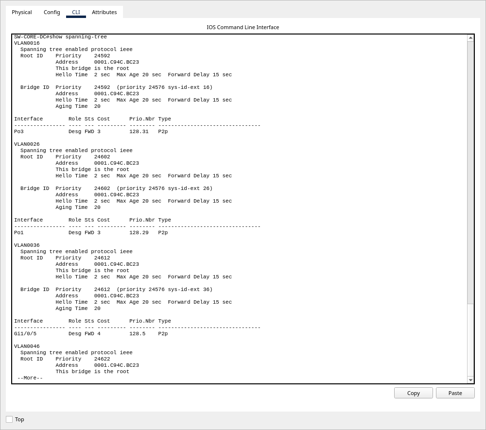

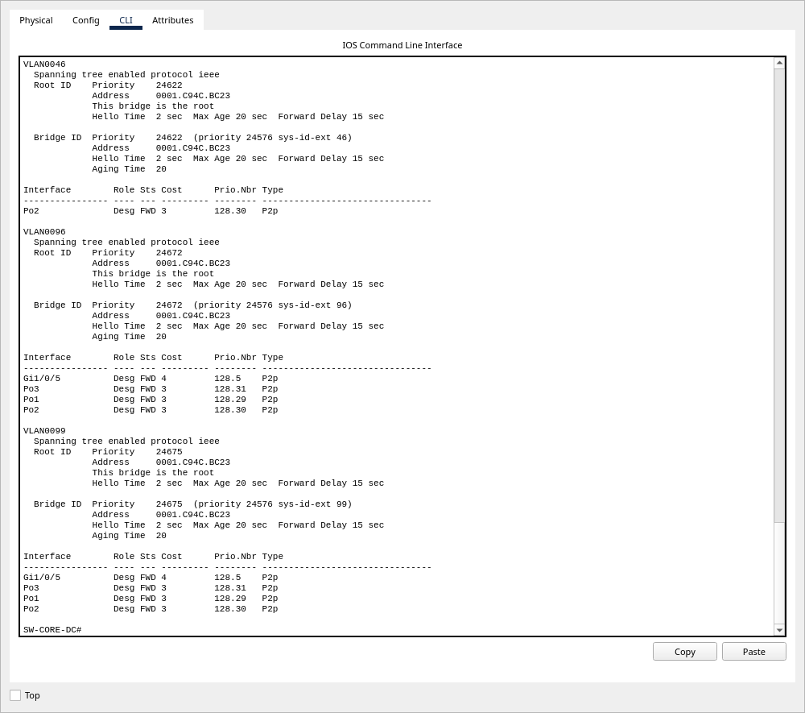

#### `show spanning-tree` — `SW-ACC-IDD-1`, puerto bloqueado del anillo de I+D

`Gi0/1` es el Root Port (costo 7 al Root) y `Gi0/2` queda en **`Altn BLK`**: es el
enlace del anillo que STP bloquea para evitar el bucle, y el que se activa si cae el
camino principal.

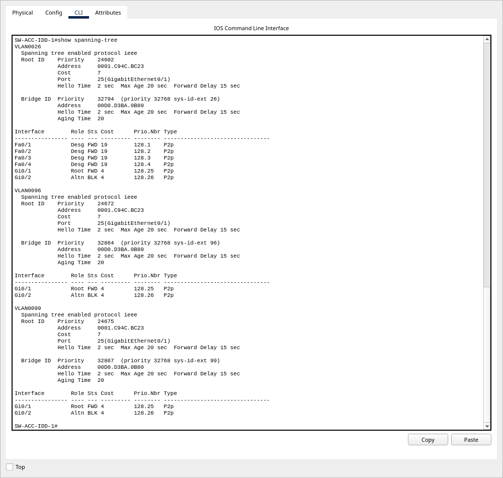

#### `show etherchannel summary` — `SW-CORE-DC`

Los tres canales LACP en `(SU)` (Layer 2, en uso) y todos sus miembros en `(P)`:
`Po1` con 4 enlaces hacia I+D, `Po2` y `Po3` con 2.

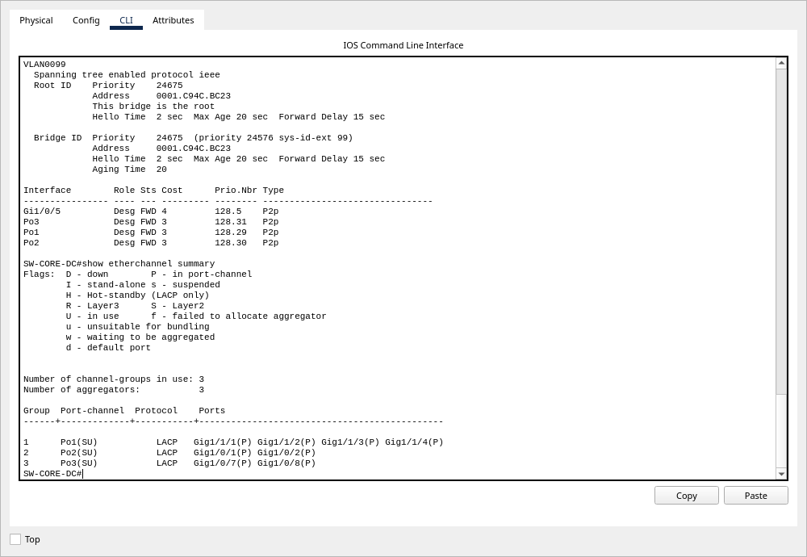

#### `show interfaces trunk` — `SW-CORE-DC`

VLAN nativa **96** en los cuatro troncales, sin la VLAN 1 y con una sola VLAN de datos
por edificio.

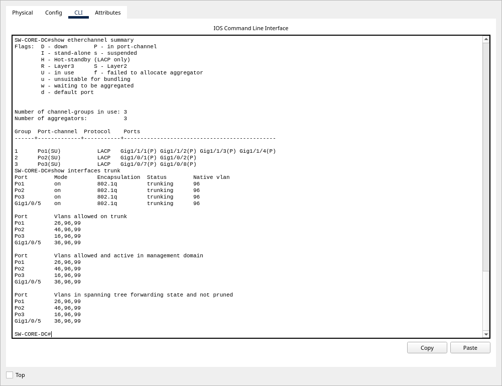

#### Pings exitosos y fallidos

**`PC-IDD-01` (192.168.26.11):** llega a otra estación de Investigación (prueba 1,
**4/4**) y no llega a Gerencia (prueba 14, **100 % de pérdida**).

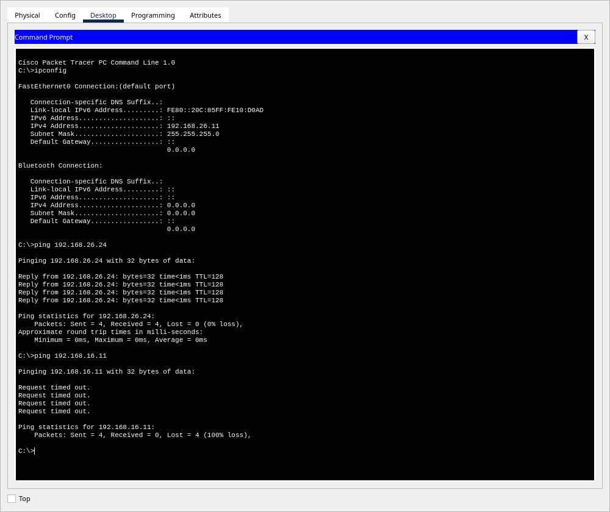

**`LAP-VIS-01` (192.168.56.11, Wi-Fi):** llega a otro invitado a través del Access
Point (prueba 7, **4/4**) y no llega a la granja de servidores (prueba 15, **100 % de
pérdida**).

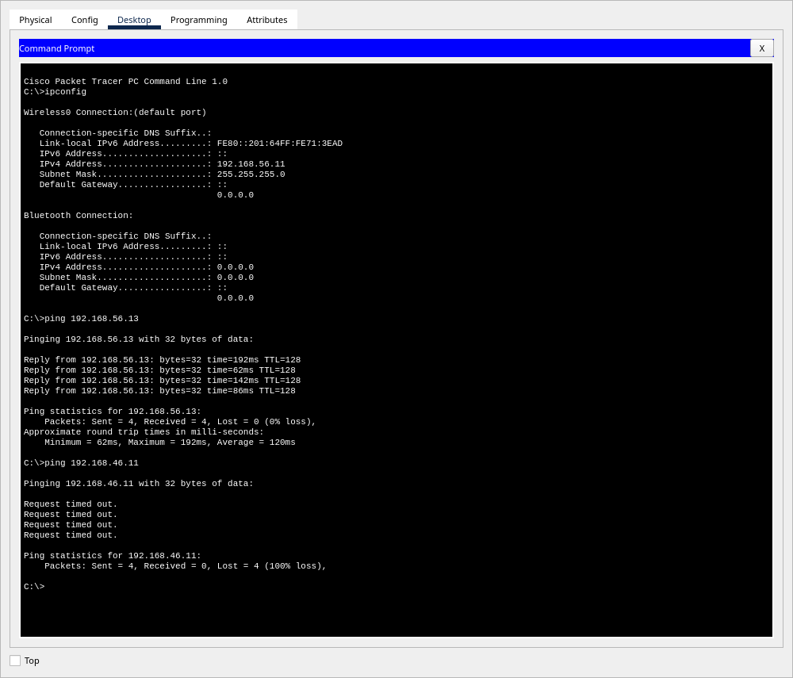

**`PC-GER-01` (192.168.16.11):** llega al ala B del Corporativo (prueba 2, **4/4**).


**`PC-PROD-01` (192.168.36.11):** llega a una máquina Legacy detrás del hub (prueba 4,
**4/4**).

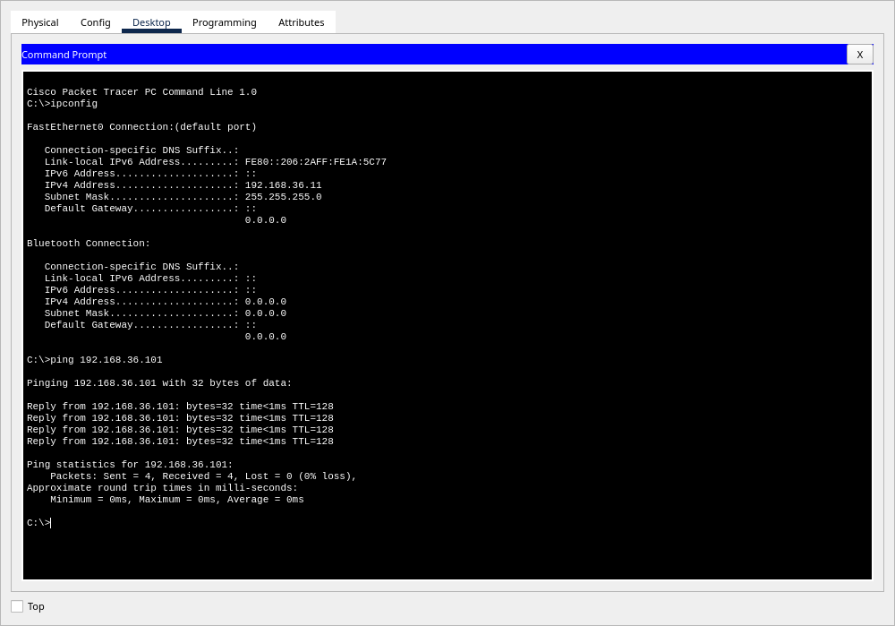

Las capturas de *PDU Details* del alcance opcional están en la sección 17. La sección 20
indica en qué equipo ejecutar cada comando para reproducir todas estas pruebas.

---

## 17. Alcance opcional: análisis de tramas STP y VTP

Realicé el alcance opcional: entré en **Modo Simulación**, dejé el filtro del *event
list* limitado a **STP y VTP** y avancé la simulación paso a paso. La captura completa,
con todos los campos de cada cabecera, está en
[`docs/evidencias/07-analisis-tramas-simulacion.txt`](docs/evidencias/07-analisis-tramas-simulacion.txt).

En la primera corrida (solo STP) se capturaron **126 tramas**, 112 de ellas BPDU. En la
segunda (STP + VTP), **829 tramas**: 250 *Summary Advertisements*, 78 *Subset
Advertisements* y 147 BPDU.

### 17.1 BPDU: dónde están el Root ID, el Bridge ID y el costo

Capturé **tres** BPDU de la **misma instancia** —la VLAN 16— en tres puntos distintos
del árbol. Compararlas es lo que explica el mecanismo:

| Campo de la BPDU | Emitida por el **Root Bridge** | Emitida por **SW-DIST-CORP** | Emitida por **SW-ACC-CORP-A** |
|---|---|---|---|
| MAC destino | `0100.0CCC.CCCD` | `0100.0CCC.CCCD` | `0100.0CCC.CCCD` |
| Etiqueta 802.1Q | VLAN **16** (TPID `0x8100`) | VLAN **16** | VLAN **16** |
| LLC — DSAP/SSAP | `0x42` / `0x42` | `0x42` / `0x42` | `0x42` / `0x42` |
| SNAP — orgCode / protocolId | `0x0C` / `0x010B` | `0x0C` / `0x010B` | `0x0C` / `0x010B` |
| **Root ID** | **24592** · `0001.C94C.BC23` | **24592** · `0001.C94C.BC23` | **24592** · `0001.C94C.BC23` |
| **Bridge ID** | **24592** · `0001.C94C.BC23` | **28688** · `0006.2AD1.C090` | **32784** · `0050.0F0A.7E56` |
| **Root Path Cost** | **0** | **3** | **22** |
| `portId` | `0x8007` | `0x8006` | `0x8019` |
| `messageAge` / `maxAge` / `helloTime` / `forwardDelay` | 0 / 20 / 2 / 15 | 0 / 20 / 2 / 15 | 0 / 20 / 2 / 15 |
| TLV de PVST+ | `type=0 length=2 value=16` | ídem | ídem |

**Capturas de la ventana *Inbound PDU Details*.** Las dos primeras columnas de la tabla,
vistas en Packet Tracer. En ambas, `TCI:0x0010` y el TLV `Value:16` identifican la
VLAN 16.

BPDU emitida por la raíz (`SW-CORE-DC`) y recibida por `SW-DIST-CORP`: **ROOT ID** y
**BRIDGE ID** son iguales (`24592 / 0001.C94C.BC23`) y el **ROOT PATH COST** es **0**.


BPDU reenviada por `SW-DIST-CORP` y recibida por `SW-ACC-CORP-A`: el **ROOT ID** no
cambia, el **BRIDGE ID** pasa a ser el del emisor (`28688 / 0006.2AD1.C090`) y el
**ROOT PATH COST** sube a **3**.

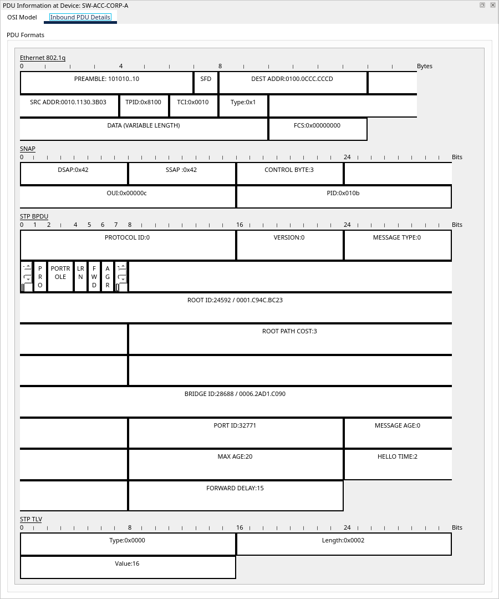

> El `PORT ID` de las capturas (32799 y 32771) no coincide con el `portId` de la tabla
> porque son tramas de otra corrida, enviadas por otros puertos. El `PORT ID` identifica
> el puerto de salida de cada trama: 32799 = 128.31, que es `Po3` en el núcleo según
> `show spanning-tree`. Root ID, Bridge ID y costo sí coinciden.

**Cómo se lee esto:**

- **Root ID** — Identifica al switch que todos reconocen como raíz, y es **idéntico en
  las tres**: el árbol convergió. Su prioridad, **24592**, no es arbitraria: sale de
  `24576` (la que fijé con `spanning-tree vlan 16 root primary`) **más 16**, el número
  de la VLAN, que en el campo se llama *system ID extension*. La MAC
  `0001.C94C.BC23` es la del bridge `SW-CORE-DC`.

- **Bridge ID** — Identifica a quien **emite** esa BPDU concreta. Cuando coincide con
  el Root ID, el emisor **es** la raíz: esa coincidencia es su firma. En la segunda
  vale `28688` = `28672` (*root secondary*) + 16, y en la tercera `32784` = `32768`
  (prioridad por omisión) + 16.

- **Root Path Cost** — Es el costo acumulado desde la raíz hasta el emisor, y la
  progresión **0 → 3 → 22** es el mecanismo en acción: la raíz anuncia **0** (está a
  distancia cero de sí misma); `SW-DIST-CORP` le suma el costo de su puerto de
  entrada, que es el EtherChannel `Po3` (**3**); y `SW-ACC-CORP-A` le suma el suyo,
  `Fa0/24` a 100 Mbps (**19**), llegando a **22**. Con ese número cada switch elige
  como Root Port el de menor costo y bloquea el resto: es exactamente lo que deja
  `Gi0/1` en `Altn BLK` en `SW-ACC-CORP-B`, porque por ahí el costo sería 26 y por
  `Fa0/24` es 22.

- **`messageAge`** — Vale **0 en las tres**, incluso en las que no emite la raíz. En
  STP real este campo se incrementa conforme la BPDU se aleja de la raíz, y es lo que
  hace que la información caduque al llegar a `maxAge` (20 s). Packet Tracer 9.0.1
  transmite el campo pero no lo incrementa por salto en esta topología. Lo anoto
  porque sería incorrecto atribuirle al protocolo un comportamiento que no observé.

- Como PVST corre **una instancia por VLAN**, cada BPDU va etiquetada con su VLAN y
  además lleva un **TLV** con ese mismo número. El patrón `24576 + n.º de VLAN` se
  confirmó en las ocho instancias: 24577 (VLAN 1), 24592 (16), 24602 (26), 24612 (36),
  24622 (46), 24632 (56, con raíz en `SW-ACC-VIS`), 24672 (96) y 24675 (99).

**La otra BPDU.** Junto a las de PVST+ apareció una trama distinta: MAC destino
`0180.C200.0000` (la dirección estándar IEEE 802.1D), **sin etiqueta 802.1Q**, con
encabezado `IEEE802Dot3Header` y **sin cabecera SNAP** (no lleva `orgCode` ni
`protocolId`). Es la BPDU estándar que Cisco envía sin etiquetar sobre la VLAN nativa
para interoperar con switches que no hablan PVST+.

### 17.2 PDU de VTP: Domain Name y Configuration Revision Number

VTP anuncia periódicamente cada 5 minutos y además cada vez que cambia la base de
datos. Para no esperar el temporizador forcé un cambio creando una VLAN temporal
(`vlan 100`) en el servidor, y la borré al terminar.

**Summary Advertisement** (`code = 1`), recibido por `SW-ACC-SRV` en `Port-channel2`:

| Campo | Valor |
|---|---|
| MAC destino | `0100.0CCC.CCCC` (multicast de Cisco para CDP/VTP) |
| Etiqueta 802.1Q | VLAN **1** |
| LLC — DSAP/SSAP | `0xAA` / `0xAA` |
| SNAP — orgCode / protocolId | `0x0C` / **`0x2003`** (VTP) |
| **VTP Domain Name** | **`Smart_7`** |
| **Configuration Revision** | **33** |
| `followers` | 1 (vienen *Subset Advertisements* detrás) |
| `updaterIp` | `192.168.99.1` (la SVI de gestión del servidor) |
| `md5` | `33B7BC56BEABD5DDD034A2AD438A6AB6` |

**Captura de la ventana *Inbound PDU Details*** de un Summary Advertisement recibido por
`SW-ACC-SRV`, provocado con el mismo procedimiento (crear la `vlan 100` en el servidor).
Se ven el **MANAGEMENT DOMAIN NAME: `Smart_7`** y el **CONFIGURATION REVISION NUMBER**,
además de `PID:0x2003` (VTP), `FOLLOWERS:1` y `UPDATER ID:192.168.99.1`.

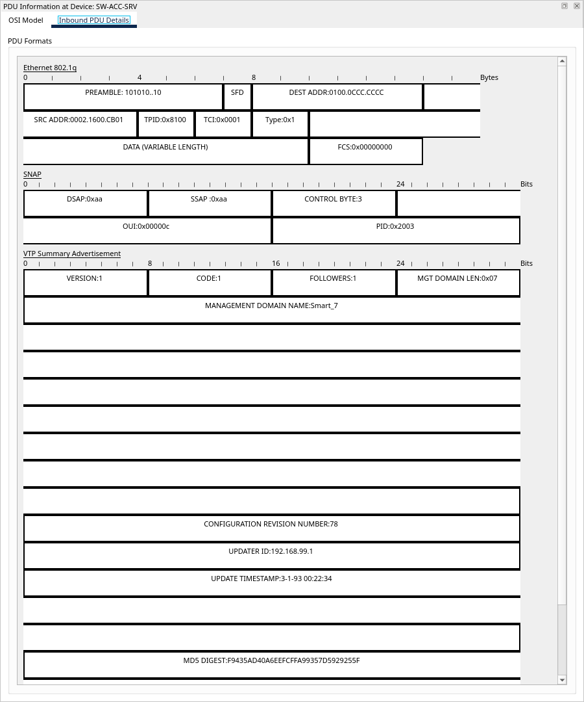

> La captura es de una corrida posterior a la de la tabla, así que la revisión es
> **78** y no 33, y el MD5 también cambia. Es el comportamiento esperado: cada cambio en
> la base de VLANs del servidor incrementa la revisión, y el MD5 se calcula sobre la
> configuración, que incluye ese número.

**Subset Advertisement** (`code = 2`), 348 bytes, misma revisión, `sequence = 1`, con
la base de datos completa viajando dentro de la trama:

```
vlanInfos (13 entradas):
   VLAN 1    "default"           VLAN 96   "NATIVA"          VLAN 1002 "fddi-default"
   VLAN 16   "GERENCIA"          VLAN 99   "ADMINISTRACION"  VLAN 1003 "token-ring-default"
   VLAN 26   "INVESTIGACION"     VLAN 100  "VLAN0100"        VLAN 1004 "fddinet-default"
   VLAN 36   "PRODUCCION"                                    VLAN 1005 "trnet-default"
   VLAN 46   "SERVIDORES"        VLAN 56   "VISITANTES"
```

La VLAN 100 viaja con el nombre por omisión `VLAN0100` porque el *Subset* se generó en
el instante de crearla, antes de aplicarle el comando `name`.

**Cómo se lee esto:**

- **VTP Domain Name = `Smart_7`** es el dominio que me corresponde por el penúltimo
  dígito de mi carné. Un switch descarta de entrada cualquier anuncio cuyo dominio no
  coincida con el suyo: es el primer filtro de VTP. El campo `md5` es el resumen del
  dominio junto con la contraseña `proyecto12S2026`; si no coincidiera, el receptor
  también descartaría el anuncio.

- **Configuration Revision = 33** es el número con el que VTP decide qué información es
  más reciente. El registro de decisiones de Packet Tracer para esa misma trama lo dice
  literalmente: *"The config revision in the Summary Advertisement is greater than the
  local config revision"*, y a continuación *"The Summary Advertisement indicates there
  are Subset Advertisements following it. The VTP process waits for the Subset
  Advertisements"*. Ese criterio es también el riesgo descrito en la sección 8.3.

- El reparto entre los dos tipos de anuncio queda claro: el **Summary** avisa *"tengo la
  revisión 33 y vienen datos detrás"*, y el **Subset** trae la lista de VLANs con sus
  nombres, que es lo que el cliente copia.

### 17.3 Un hallazgo de la captura: VTP cruza un troncal donde la VLAN 1 está podada

El `Port-channel2` por el que llegó esa trama tiene configurado
`switchport trunk allowed vlan 46,96,99`. La VLAN 1 **no** está en la lista y, sin
embargo, la trama VTP llegó **etiquetada con `vlanId = 1`** y fue procesada (el propio
registro de decisiones dice *"The VTP process receives a VTP frame on Port-channel2"*).

Es la comprobación directa, sobre el cable, de lo que afirma la sección 9.4: el tráfico
del plano de control de Cisco usa la VLAN 1 con independencia de la lista de VLANs
permitidas del troncal, y por tanto **no** hay que dejar la VLAN 1 permitida "para que
funcione VTP".

### 17.4 Limpieza posterior

Al terminar ejecuté `no vlan 100` y volví a Modo Realtime. Crear y borrar la VLAN
incrementó el *Configuration Revision* del dominio en dos unidades, de 33 a **35**.
La propagación del borrado hacia el nivel de acceso se completó aplicando en los
switches rezagados el procedimiento estándar de reinicio de revisión
(`vtp mode transparent` → `vtp mode client`), el mismo que describe la sección 8.3.
El estado final —los diez switches Server/Client en revisión 35 con MD5 idéntico— queda
registrado en [`docs/evidencias/01-vtp-status.txt`](docs/evidencias/01-vtp-status.txt).

---

## 18. Presupuesto estimado

### 18.1 Advertencia sobre el estado de los equipos y el origen de los precios

Los tres modelos de switch que usa esta topología **están fuera de venta y fuera de
soporte** (*End-of-Sale / End-of-Life*). No existe precio de lista vigente para
ninguno: lo que existe es un **mercado secundario de equipo reacondicionado
(*refurbished*)**, con precios que varían por proveedor, condición y disponibilidad.
Presentar un "precio de lista" para estos equipos sería inventar un dato.

| Modelo | Estado según Cisco |
|---|---|
| Catalyst 3650 (WS-C3650-24PS-S) | Anuncio de fin de venta y fin de vida; **último día para ordenar: 31-oct-2021** |
| Catalyst 3560 (WS-C3560-24PS-S) | La página de soporte del producto lo marca **End of Support: 31-may-2021** |
| Catalyst 2960 clásico (WS-C2960-24TT-L) | Fuera de venta y fuera de soporte. **No verifiqué la fecha exacta del boletín**, así que no la cito. |

**Cómo leer las tablas que siguen.** Están separadas en dos bloques a propósito:

- **Bloque A — precios consultados.** Cada renglón tiene un precio que consulté en un
  proveedor concreto el **5 de septiembre de 2026**, con el modelo exacto indicado.
  Son precios de mercado secundario, no de lista, y cambian.
- **Bloque B — estimaciones no verificadas.** Cableado, infraestructura pasiva y mano
  de obra. **No encontré una lista de precios publicada y verificable** para estos
  renglones en el mercado guatemalteco, así que son órdenes de magnitud para
  dimensionar el proyecto, no cotizaciones. Están marcados como tales.

Tipo de cambio **asumido**: **Q7.80 por US$1.00**. Es una suposición del ejercicio, no
un tipo de cambio verificado a la fecha.

### 18.2 Nota de ingeniería: los uplinks de fibra del núcleo no alcanzan

Al cotizar la fibra apareció una restricción real del hardware que vale la pena dejar
escrita. El **WS-C3650-24PS-S trae exactamente cuatro uplinks SFP de 1 G**; sus otros
24 puertos son de cobre 10/100/1000. En este diseño:

- `Po1` (núcleo ↔ I+D, fibra) consume **los cuatro** uplinks SFP del núcleo.
- El enlace núcleo ↔ Planta también está especificado en fibra por distancia, pero
  **ya no queda un puerto SFP libre en el núcleo**.

Hay dos formas de resolverlo y ninguna es gratis: (a) un **par de convertidores de
medio** cobre↔fibra en ese tramo, dejando el extremo del núcleo en un puerto de cobre;
o (b) elegir para el núcleo un chasis con más uplinks de fibra. El presupuesto asume la
opción (a) por ser la más barata, y por eso cotiza **9 SFP y un par de convertidores**
en lugar de 10 SFP. Es una decisión a confirmar con el proveedor.

### 18.3 Bloque A — equipo activo y óptica (precios consultados el 5-sep-2026)

| Ítem | Modelo exacto cotizado | Cant. | P.U. (US$) | Total (US$) | Fuente |
|---|---|---:|---:|---:|---|
| Switch núcleo, distribución I+D y Corporativo, acceso granja | WS-C3650-24PS-S *refurbished* | 4 | 291.99 | 1,167.96 | CablesAndKits |
| Switch de distribución de la Planta | WS-C3560-24PS-S *refurbished* | 1 | 188.99 | 188.99 | CablesAndKits |
| Switches de acceso | WS-C2960-24TT-L *renewed* | 6 | 199.99 | 1,199.94 | Listado de mercado secundario (Amazon Renewed) |
| Transceptor 1000BASE-LX/LH | GLC-LH-SMD (módulo compatible) | 9 | 33.59 | 302.31 | CablesAndKits |
| **Subtotal bloque A** | | | | **US$ 2,859.20** | ≈ **Q 22,301.76** |

> El precio del WS-C2960-24TT-L proviene de **un solo listado** del mercado secundario;
> en la misma búsqueda aparecieron listados del mismo modelo por encima de US$500. Es
> el renglón con más dispersión de todo el presupuesto.
>
> El GLC-LH-SMD cotizado es un **módulo compatible**, no original de Cisco; un módulo
> original cuesta varias veces más. Es una decisión de compra que cambia el total.

### 18.4 Bloque B — cableado, infraestructura pasiva y mano de obra (estimaciones **no verificadas**)

| Ítem | Cant. | P.U. (Q) | Total (Q) |
|---|---:|---:|---:|
| Access Point para Áreas Comunes | 1 | 3,900.00 | 3,900.00 |
| Convertidores de medio 1000BASE-LX (par, tramo a la Planta) | 2 | 1,200.00 | 2,400.00 |
| Fibra óptica OS2 12 hilos, tramo Núcleo–I+D (metro) | 240 | 28.00 | 6,720.00 |
| Fibra óptica OS2 6 hilos, tramo Núcleo–Planta (metro) | 150 | 22.00 | 3,300.00 |
| Pigtails LC + fusiones | 20 | 145.00 | 2,900.00 |
| Bandeja de empalme de fibra 1U | 2 | 950.00 | 1,900.00 |
| Caja de cable UTP Cat6 (305 m) | 5 | 1,450.00 | 7,250.00 |
| Patch cord Cat6 (1–3 m) | 40 | 45.00 | 1,800.00 |
| Patch panel Cat6 24 puertos | 6 | 780.00 | 4,680.00 |
| Rack abierto 42U + organizadores (Centro de Datos) | 1 | 6,500.00 | 6,500.00 |
| Gabinete de pared 12U (uno por edificio) | 4 | 2,100.00 | 8,400.00 |
| Tendido y certificación de fibra (metro) | 390 | 45.00 | 17,550.00 |
| Tendido y certificación de puntos de cobre (punto) | 45 | 220.00 | 9,900.00 |
| Configuración y puesta en marcha (hora) | 33 | 180.00 | 5,940.00 |
| Documentación, pruebas y entrega (hora) | 20 | 180.00 | 3,600.00 |
| **Subtotal bloque B** | | | **86,740.00** |

El hub del segmento Legacy aparece con costo **Q0.00**: es equipo ya instalado que el
enunciado indica conservar.

### 18.5 Total

| Concepto | Monto (Q) |
|---|---:|
| Bloque A — equipo activo y óptica (precios consultados) | 22,301.76 |
| Bloque B — cableado, pasivos y mano de obra (estimado) | 86,740.00 |
| **Subtotal** | **109,041.76** |
| IVA 12 % | 13,085.01 |
| **TOTAL estimado** | **Q 122,126.77** |

**Cómo cambia este número.** El renglón dominante no son los switches (20 % del total)
sino la **mano de obra y el tendido** (más del 30 %), lo cual es habitual en cableado
estructurado: el costo está en abrir canaletas y certificar, no en el vidrio ni en el
cobre. Comprar los switches nuevos —lo que hoy implicaría migrar a una familia vigente
como Catalyst 9200— multiplicaría varias veces el bloque A y sería la decisión correcta
para una instalación real, porque equipo fuera de soporte no recibe parches de
seguridad.

---

## 19. Diferencias entre el hardware real y el simulador

Esta sección separa dos cosas que conviene no mezclar: lo que **el equipo real hace**
y lo que **Packet Tracer 9.0.1 reprodujo**. Todo lo que sigue lo verifiqué contra la
documentación de Cisco o contra la topología en ejecución.

### 19.1 Fibra óptica

| | |
|---|---|
| **Hardware real** | El Catalyst 3650-24PS trae **cuatro uplinks SFP de 1 G** y admite transceptores 1000BASE-SX, -LX/LH, -ZX, -BX10, CWDM y DWDM con conector LC. El Catalyst 3560-24PS tiene **dos puertos Gigabit basados en SFP** que aceptan, entre otros, 1000BASE-LX. Es decir: **ambos modelos soportan fibra**. |
| **Packet Tracer** | El cable de fibra es rechazado tanto en los uplinks `Gi1/1/x` del 3650 como en los `Gi0/1-0/2` del 3560. El 3650 declara el SFP `GLC-LH-SMD` como módulo compatible, pero no se pudo insertar por la API de la extensión (se probaron los identificadores de slot del chasis y todos devolvieron `false`); el 3560 reporta cero módulos soportados. |
| **Consecuencia** | El `.pkt` implementa **en cobre** los dos tramos que el diseño especifica en fibra. La sección 7 documenta cuál es el medio correcto y el presupuesto lo cotiza. |

### 19.2 Velocidad de los enlaces del backbone

Los puertos del backbone reportan `BW 1000000 Kbit`, y los EtherChannel suman el
ancho de banda de sus miembros (`Po1` reporta `BW 4000000 Kbit` y `Po3`
`BW 2000000 Kbit`). Sin embargo, **los enlaces operan a `100Mb/s`** en el simulador.
No es consecuencia de la configuración: lo comprobé en `Gi1/0/5` del núcleo —un
troncal simple que **no tiene ningún comando `speed`**— y también negocia 100 Mb/s,
igual que el enlace inter-alas entre los dos 2960.

STP sí trata estos puertos como Gigabit (costo **4**) y al canal `Po1` como algo más
rápido todavía (costo **3**), de modo que la jerarquía de ancho de banda que exige el
enunciado —I+D por encima del resto— se sostiene y es verificable en
`show spanning-tree`. Lo que no puede afirmarse es que en el `.pkt` circulen 4 Gbps.

### 19.3 Otras diferencias observadas

| Tema | Hardware / IOS real | Packet Tracer 9.0.1 |
|---|---|---|
| Número de EtherChannel | La guía de configuración del 3650 indica interfaces `Port-channel` numeradas **de 1 a 128**, con un máximo de **128** canales. | En esta topología el núcleo sostiene **tres** canales simultáneos sin problema (`Po1`, `Po2`, `Po3`). El IOS simulado ofrece el rango `<1-48>` al borrar un `Port-channel`, y aceptó crear un `channel-group 0` que después **no** permitía borrar por CLI, por quedar fuera de su propio rango válido. |
| `interface range` | Existe y funciona en equipos Cisco reales. | En el 3650 simulado los subcomandos posteriores a `interface range` devuelven *invalid input*, así que la topología se configuró interfaz por interfaz. Es una limitación del IOS simulado, **no** una propiedad del comando. |
| `show spanning-tree` con EtherChannel | Muestra únicamente la interfaz lógica `PoN`. | Lista además los miembros físicos (`Gi1/0/6`, `Gi1/0/7`) junto a `Po3`, aunque estén agregados. Es una diferencia de presentación del simulador. |
| `switchport trunk encapsulation dot1q` | Necesario en plataformas que soportan ISL y 802.1Q. | Válido en el 3560; el 3650 y el 2960 simulados lo rechazan porque solo implementan 802.1Q. |
| `storm-control` | Permite `broadcast`, `multicast` y `unicast`. | En el 2960 simulado solo está implementado `storm-control broadcast level`. |
| Tiempo de agregación de LACP | Segundos. | Los canales tardan entre 45 y 90 segundos de reloj en pasar a `(P)`. Consultar `show etherchannel summary` inmediatamente después de configurar muestra los miembros suspendidos, lo cual no indica un error. |
| Reloj de simulación | — | Con la ventana de Packet Tracer en segundo plano, el reloj corre mucho más lento que el real: en esta sesión medí **≈3 segundos simulados por cada 60 segundos reales**. Una transición de STP de 30 s puede tardar 10 minutos de reloj. Conviene dejar la ventana en primer plano al reproducir las pruebas. |

---

## 20. Cómo abrir y verificar el proyecto

1. Abrir [`packet-tracer/Proyecto1_202300476.pkt`](packet-tracer/Proyecto1_202300476.pkt)
   en Packet Tracer 8.0 o superior (fue creado en 9.0.1).
2. **Dejar la ventana de Packet Tracer en primer plano** y esperar entre 1 y 2 minutos:
   STP y LACP necesitan converger tras la carga (ver 19.3).
3. Ejecutar estas comprobaciones:

| Qué verificar | Equipo | Comando | Resultado esperado |
|---|---|---|---|
| Dominio VTP y modo Server | `SW-CORE-DC` | `show vtp status` | Dominio `Smart_7`, modo Server, 12 VLANs |
| Propagación a un cliente | `SW-ACC-IDD-1` | `show vtp status` · `show vlan brief` | Mismas VLANs sin haberlas creado ahí |
| Aislamiento de la administración de VLANs | `SW-ACC-VIS` | `show vtp status` | Transparent, revisión 0, 7 VLANs, MD5 distinto |
| Los tres EtherChannel | `SW-CORE-DC` | `show etherchannel summary` | `Po1` 4×(P), `Po2` 2×(P), `Po3` 2×(P) |
| Troncales, VLAN nativa y poda | `SW-CORE-DC` | `show interfaces trunk` | Nativa 96; sin VLAN 1; una VLAN de datos por edificio |
| Root Bridge por VLAN | `SW-CORE-DC` | `show spanning-tree summary` | Raíz de todas menos VISITANTES |
| Raíz local de la VLAN 56 | `SW-ACC-VIS` | `show spanning-tree vlan 56` | `This bridge is the root`, prioridad 24632 |
| Puertos bloqueados por STP | `SW-ACC-CORP-B` · `SW-ACC-IDD-1` | `show spanning-tree vlan 16` · `vlan 26` | `Gi0/1 Altn BLK` · `Gi0/2 Altn BLK` |
| Contención del segmento Legacy | `SW-ACC-PROD` | `show port-security interface Fa0/10` | Secure-up, máximo 4, modo Restrict |
| Banner MOTD | cualquier switch | abrir la pestaña CLI | Aparece al conectarse |
| Ping intra-VLAN | `PC-IDD-01` | `ping 192.168.26.24` | 4/4 |
| Ping inter-VLAN (debe fallar) | `PC-IDD-01` | `ping 192.168.16.11` | 100 % de pérdida |
| Aislamiento de invitados (debe fallar) | `LAP-VIS-01` | `ping 192.168.46.11` | 100 % de pérdida |
| Failover entre alas | `SW-ACC-CORP-B` | `shutdown` en `Fa0/24`, esperar la convergencia, ping desde `PC-GER-04` a `192.168.16.11` | `Gi0/1` pasa a `Root FWD` y el ping vuelve a 4/4 |
| Pérdida de un miembro de EtherChannel | `SW-CORE-DC` | `shutdown` en `Gi1/0/2`, ping desde `SW-ACC-SRV` a `192.168.99.1` | `Po2(SU)` sigue en uso con un miembro `(D)` y el ping no se corta |

> Al terminar las dos últimas pruebas, restaurar los puertos con `no shutdown`.

### 20.1 Regenerar las imágenes de la topología

Las capturas de la sección 3 se toman desde el propio Packet Tracer con
**File → Print / Export** o con una captura de la ventana del *Logical Workspace*. La
segunda imagen usa **Options → Preferences → Interface → Always Show Port Labels**.

### 20.2 Reproducir la captura de tramas del alcance opcional

1. Botón **Simulation** (esquina inferior derecha).
2. **Edit Filters** → **Show All/None** para desmarcar todo, y marcar solo **STP** y
   **VTP**.
3. **Capture / Forward** varias veces: aparecen las BPDU. Doble clic sobre el sobre de
   cualquiera → pestaña **Inbound PDU Details**. Ahí están `Root ID`, `Bridge ID` y
   `Root Path Cost`; en **OSI Model** está el registro de decisiones del switch.
4. Para las tramas de VTP hay que provocar un anuncio (o esperar el periódico de 5
   minutos). En la CLI de `SW-CORE-DC`:

   ```
   configure terminal
    vlan 100
     name TEMP-CAPTURA-VTP
    exit
   ```

   Avanzar la simulación: aparecen primero el **Summary Advertisement** (con
   `Domain Name` y `Configuration Revision`) y después los **Subset Advertisements**
   (con la lista de VLANs). Al terminar, `no vlan 100`.
5. **Realtime** para volver al modo normal y esperar a que reconverjan STP y LACP.

> Crear y borrar esa VLAN incrementa el *Configuration Revision Number* del dominio en
> dos unidades. Es esperado: es exactamente el mecanismo que la sección 17 muestra
> viajando dentro de la trama.

---

## 21. Parte física (laboratorio)

Configuración a replicar en los dos switches físicos por pareja:

**Switch 1 — modo Server (simula el Centro de Datos):**

```
enable
configure terminal
 hostname SW-CORE-DC
 banner motd #Acceso Restringido - TechPark_202300476#
 vtp domain Smart_7
 vtp password proyecto12S2026
 vtp mode server
 vlan 16
  name GERENCIA
 vlan 26
  name INVESTIGACION
 vlan 36
  name PRODUCCION
 vlan 46
  name SERVIDORES
 vlan 56
  name VISITANTES
 vlan 96
  name NATIVA
 exit
 interface GigabitEthernet0/1
  switchport mode trunk
  switchport trunk native vlan 96
  switchport trunk allowed vlan 16,26,36,46,56,96
 end
write memory
```

**Switch 2 — modo Client (simula un edificio):**

```
enable
configure terminal
 hostname SW-DIST-CORP
 banner motd #Acceso Restringido - TechPark_202300476#
 vtp domain Smart_7
 vtp password proyecto12S2026
 vtp mode client
 interface GigabitEthernet0/1
  switchport mode trunk
  switchport trunk native vlan 96
  switchport trunk allowed vlan 16,26,36,46,56,96
 exit
 interface range FastEthernet0/1 - 5
  switchport mode access
  switchport access vlan 16
 end
write memory
```

**Verificación en el switch cliente:** `show vlan brief` debe listar las seis VLANs
sin haberlas creado ahí, y `show vtp status` debe mostrar la misma revisión y el mismo
MD5 digest que el servidor.

> Antes de conectar el switch cliente al dominio conviene llevar su *configuration
> revision* a 0 (ponerlo en `vtp mode transparent` y devolverlo a `client`, o cambiarle
> el nombre de dominio y regresarlo). Es la precaución que describe la sección 8.3.

---

## 22. Estructura del repositorio

```
Proyecto1/
├── README.md                              <- este Manual Técnico
├── packet-tracer/
│   └── Proyecto1_202300476.pkt            <- topología funcional
└── docs/
    ├── enunciado/
    │   └── 0972_Proyecto_1_2S2026.pdf
    ├── img/
    │   ├── proyecto1-topologia-202300476.png
    │   ├── proyecto1-topologia-puertos-202300476.png
    │   └── evidencias/                    <- 12 capturas de la GUI (secciones 16.6 y 17)
    ├── evidencias/
    │   ├── 01-vtp-status.txt
    │   ├── 02-etherchannel.txt
    │   ├── 03-trunks.txt
    │   ├── 04-spanning-tree.txt
    │   ├── 05-segmento-legacy.txt
    │   ├── 06-pruebas-ping.txt
    │   └── 07-analisis-tramas-simulacion.txt
    └── configuraciones/
        ├── SW-CORE-DC.txt
        ├── SW-ACC-SRV.txt
        ├── SW-DIST-IDD.txt
        ├── SW-DIST-CORP.txt
        ├── SW-ACC-VIS.txt
        ├── SW-DIST-PROD.txt
        ├── SW-ACC-PROD.txt
        └── switches-de-acceso.txt
```

---

## 23. Referencias

Documentación de Cisco consultada para este manual:

- **VTP** — *Understand VLAN Trunk Protocol (VTP)*, Cisco, documento 10558.
  <https://www.cisco.com/c/en/us/support/docs/lan-switching/vtp/10558-21.html>
  (modos Server/Client/Transparent, reenvío de anuncios en modo transparente,
  Summary Advertisements cada 5 minutos, *configuration revision number*).
- **VTP — riesgo de revisión** — *VLAN Configuration*, Cisco, documento 98154.
  <https://www.cisco.com/c/en/us/support/docs/lan-switching/vtp/98154-conf-vlan.html>
  (un switch en modo servidor **o cliente** con revisión más alta puede reemplazar la
  base de datos de VLANs del dominio).
- **EtherChannel** — *Layer 2 and Layer 3 Configuration Guide, Cisco IOS XE Everest
  16.8.x (Catalyst 3650 Switches) — Configuring EtherChannels*.
  <https://www.cisco.com/c/en/us/td/docs/switches/lan/catalyst3650/software/release/16-8/configuration_guide/lyr2_lyr3/b_168_lyr2_lyr3_3650_cg/b_168_lyr2_lyr3_3650_cg_chapter_011.html>
  (rango 1–128 de `Port-channel`; requisitos de compatibilidad: velocidad, dúplex,
  VLAN nativa, rango de VLANs permitidas y estado de troncal).
- **PortFast y BPDU Guard** — *Understand Spanning Tree PortFast and BPDU Guard
  Features*, Cisco, documento 10586.
  <https://www.cisco.com/c/en/us/support/docs/lan-switching/spanning-tree-protocol/10586-65.html>
  (BPDU Guard como complemento recomendado de PortFast).
- **Storm control y port security** — *Catalyst 2960 Software Configuration Guide —
  Configuring Port-Based Traffic Control*.
  <https://www.cisco.com/c/en/us/td/docs/switches/lan/catalyst2960/software/release/15-0_2_se/configuration/guide/scg2960/swtrafc.html>
  (storm control sobre unicast/multicast/broadcast y umbrales; `port-security maximum`
  como límite de direcciones seguras).
- **Catalyst 3650 — hoja de datos.**
  <https://www.cisco.com/c/en/us/products/collateral/switches/catalyst-3650-series-switches/data_sheet-c78-729449.html>
  (opciones de uplink, transceptores SFP de fibra soportados, modelo WS-C3650-24PS).
- **Catalyst 3650 — fin de venta y fin de vida.**
  <https://www.cisco.com/site/us/en/products/collateral/switches/catalyst-3650-series-switches/eos-eol-notice-c51-744426.html>
  (último día para ordenar: 31 de octubre de 2021).
- **Catalyst 3560 — guía de instalación de hardware / puertos SFP.**
  <https://www.cisco.com/c/en/us/td/docs/switches/lan/catalyst3560/hardware/installation/guide/3560hig/higoverview.html>
  (dos puertos Gigabit basados en SFP en el 3560-24PS).

Normas:

- **ANSI/TIA-568** — cableado estructurado de par trenzado balanceado: enlace
  permanente de **90 m** y canal de **100 m**.
- **IEEE 802.1Q** — *Virtual Bridged Local Area Networks* (etiquetado y VLAN nativa).
- **IEEE 802.1D** — *Media Access Control Bridges* (Spanning Tree, costos de puerto).
- **IEEE 802.3ad / 802.1AX** — *Link Aggregation* (LACP).
- **IEEE 802.11** — CSMA/CA y acceso al medio inalámbrico.
