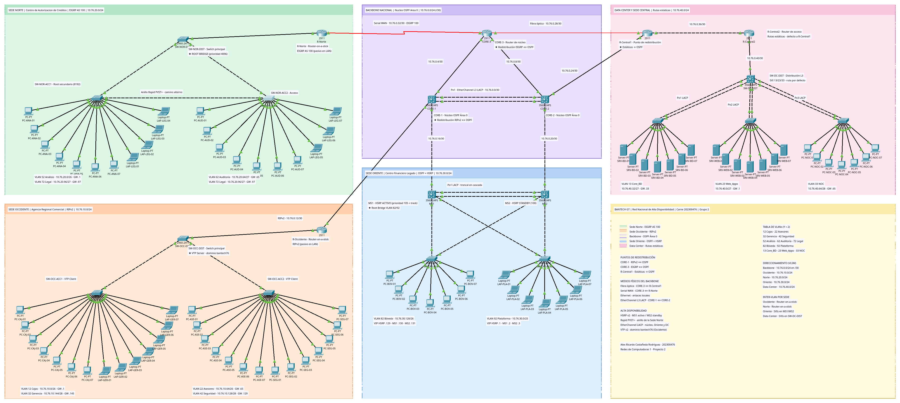
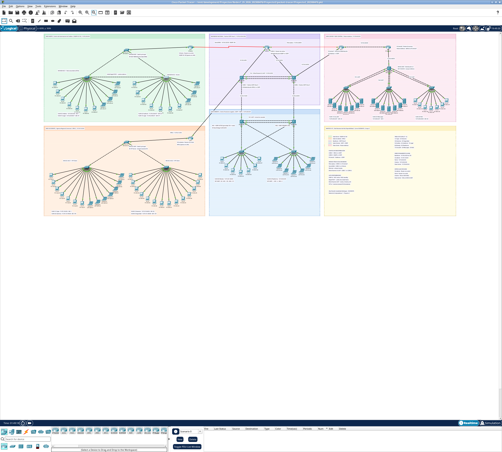
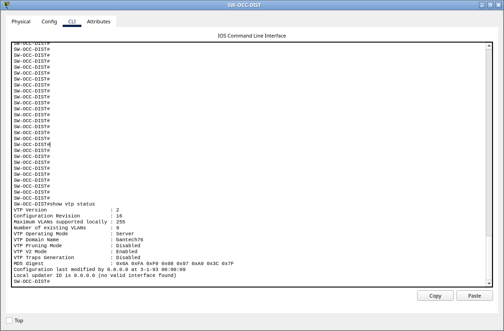
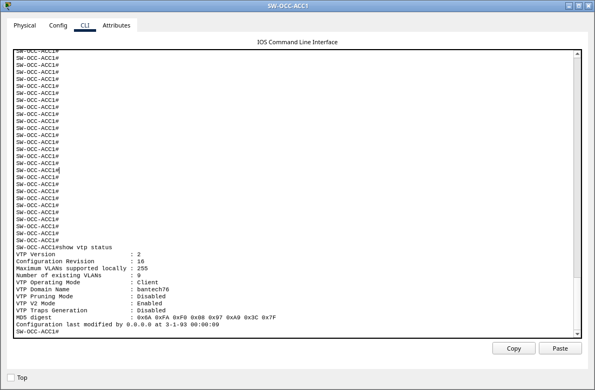
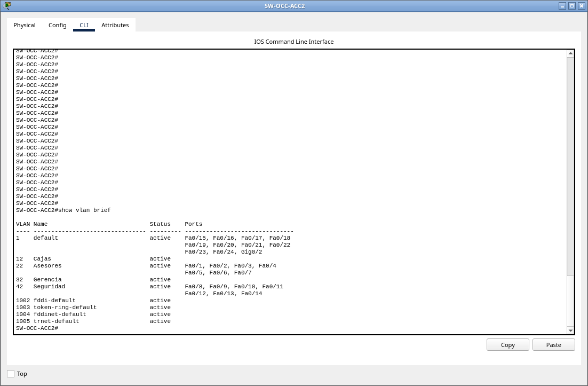

# Proyecto 2 — Infraestructura Financiera y Alta Disponibilidad BanTech GT

**Manual Técnico**

Diseño e implementación en Cisco Packet Tracer de la red nacional de *BanTech GT*. La red tiene un
backbone redundante que une cuatro dominios de enrutamiento (OSPF, EIGRP, RIPv2 y rutas estáticas)
y cuatro sedes diseñadas desde cero. En las sedes se aplicaron VLANs con VLSM, enrutamiento
inter-VLAN, VTP, Rapid PVST+, EtherChannel LACP y HSRP.

| | |
|---|---|
| **Estudiante** | Alex Ricardo Castañeda Rodríguez |
| **Carné** | 202300476 |
| **Curso** | Redes de Computadoras 1 — Segundo Semestre 2026 |
| **Grupo** | 2 (coordinador) |
| **Ponderación** | 33 pts |
| **Archivo de topología** | [`packet-tracer/Proyecto2_202300476.pkt`](packet-tracer/Proyecto2_202300476.pkt) |
| **Versión de Packet Tracer** | 9.0.1 |

> Todas las salidas de comandos, tablas de rutas y resultados de ping de este manual se tomaron de la
> topología en ejecución. Las capturas completas están en [`docs/img/evidencias/`](docs/img/evidencias/)
> y el texto de cada salida está en [`docs/evidencias/salidas/`](docs/evidencias/salidas/).

---

## Índice

1. [Parámetros de identificación](#1-parámetros-de-identificación)
2. [Resumen de la solución](#2-resumen-de-la-solución)
3. [Topología](#3-topología)
4. [Inventario de equipos](#4-inventario-de-equipos)
5. [Backbone nacional](#5-backbone-nacional)
6. [Direccionamiento IP y subneteo](#6-direccionamiento-ip-y-subneteo)
7. [Tabla de VLANs](#7-tabla-de-vlans)
8. [Sede Occidente — Agencia Regional Comercial](#8-sede-occidente--agencia-regional-comercial)
9. [Sede Norte — Centro de Autorización de Créditos](#9-sede-norte--centro-de-autorización-de-créditos)
10. [Sede Oriente — Centro Financiero Legado](#10-sede-oriente--centro-financiero-legado)
11. [Data Center y Sede Central](#11-data-center-y-sede-central)
12. [Configuración común a todos los equipos](#12-configuración-común-a-todos-los-equipos)
13. [Pruebas de convergencia y conectividad](#13-pruebas-de-convergencia-y-conectividad)
14. [Tablas de enrutamiento de los routers frontera](#14-tablas-de-enrutamiento-de-los-routers-frontera)
15. [Pruebas de conmutación por error](#15-pruebas-de-conmutación-por-error)
16. [Cumplimiento de los requerimientos](#16-cumplimiento-de-los-requerimientos)
17. [Problemas técnicos durante la construcción](#17-problemas-técnicos-durante-la-construcción)
18. [Cómo abrir y verificar el proyecto](#18-cómo-abrir-y-verificar-el-proyecto)
19. [Estructura de la entrega](#19-estructura-de-la-entrega)
20. [Referencias](#20-referencias)

---

## 1. Parámetros de identificación

El enunciado liga los parámetros de red al carné del coordinador y al número de grupo:

| Parámetro | Regla del enunciado | Valor aplicado |
|---|---|---|
| `XX` | Dos últimos dígitos del carné del coordinador (202300476) | **76** |
| `Y` | Último dígito del número de grupo (grupo 2) | **2** |
| Dominio VTP | `bantechXX` | **bantech76** |
| Contraseña VTP | fija | **cisco** |
| Bloque de direcciones | propuesto por el estudiante, ligado a `XX` | **10.76.0.0/16** |

Con `Y = 2`, los ID de VLAN quedan así. En el Data Center, `1Y+1` se interpreta como el número `1Y`
más uno: 12 + 1 = **13**.

| Sede | VLAN | Regla | ID |
|---|---|---|---:|
| Occidente | Cajas | `1Y` | **12** |
| Occidente | Asesores | `2Y` | **22** |
| Occidente | Gerencia | `3Y` | **32** |
| Occidente | Seguridad | `4Y` | **42** |
| Norte | Análisis | `5Y` | **52** |
| Norte | Auditoría | `6Y` | **62** |
| Norte | Legal | `7Y` | **72** |
| Oriente | Bóveda | `8Y` | **82** |
| Oriente | Plataforma | `9Y` | **92** |
| Data Center | Core_BD | `1Y+1` | **13** |
| Data Center | Web_Apps | `2Y+1` | **23** |
| Data Center | NOC | `3Y+1` | **33** |

---

## 2. Resumen de la solución

| Dominio | Protocolo | Red base | Inter-VLAN | Alta disponibilidad |
|---|---|---|---|---|
| Backbone nacional | OSPF área 0 | 10.76.0.0/24 (enlaces /30) | — | Triángulo de núcleo con 3 equipos de capa 3 y EtherChannel L3 LACP entre CORE-1 y CORE-2 |
| Sede Occidente | RIPv2 | 10.76.10.0/24 | Router-on-a-Stick en R-Occidente | VTP v2 (servidor y clientes) |
| Sede Norte | EIGRP AS 100 | 10.76.20.0/24 | Router-on-a-Stick en R-Norte | Triángulo de switches con Rapid PVST+ y Root Bridge forzado |
| Sede Oriente | OSPF área 0 | 10.76.30.0/24 | SVIs en MS1 y MS2 | HSRP v2 con preempt y track, acceso con doble conexión y EtherChannel LACP |
| Data Center y Sede Central | Rutas estáticas | 10.76.40.0/24 | SVIs en SW-DC-DIST | EtherChannel LACP de 2 cables hacia cada switch de acceso |

Hay **tres puntos de redistribución**, uno más que el mínimo de dos que pide el enunciado:

| Punto | Equipo | Dominios que une |
|---|---|---|
| 1 | **CORE-1** | RIPv2 (Occidente) ↔ OSPF |
| 2 | **CORE-3** | EIGRP 100 (Norte) ↔ OSPF |
| 3 | **R-Central1** | Rutas estáticas (Data Center) → OSPF |

**Totales:** 21 equipos de red, 84 dispositivos finales (7 por VLAN), 12 VLANs y 12 subredes punto a
punto /30.

---

## 3. Topología

### 3.1 Vista del lienzo completo



### 3.2 Vista en la ventana de Packet Tracer



### 3.3 Identificación de áreas y protocolos en el simulador

Para cumplir con el requisito de *"identificar en la topología dentro del simulador el área donde se
aplicó cada protocolo de enrutamiento"*, el lienzo se organizó en zonas de color. Cada zona tiene un
encabezado con el nombre de la sede, el protocolo y la red base.

| Zona | Color | Encabezado en el lienzo |
|---|---|---|
| Sede Norte | Verde menta | `SEDE NORTE \| Centro de Autorizacion de Creditos \| EIGRP AS 100 \| 10.76.20.0/24` |
| Backbone | Lavanda | `BACKBONE NACIONAL \| Nucleo OSPF Area 0 \| 10.76.0.0/24 (/30)` |
| Data Center | Rosa | `DATA CENTER Y SEDE CENTRAL \| Rutas estaticas \| 10.76.40.0/24` |
| Sede Occidente | Durazno | `SEDE OCCIDENTE \| Agencia Regional Comercial \| RIPv2 \| 10.76.10.0/24` |
| Sede Oriente | Azul | `SEDE ORIENTE \| Centro Financiero Legado \| OSPF + HSRP \| 10.76.30.0/24` |
| Leyenda | Crema | Colores de zona, puntos de redistribución, medios físicos, alta disponibilidad, tabla de VLANs, VLSM e inter-VLAN por sede |

Sobre el lienzo también hay notas con:

- la función de cada equipo de red, con una ★ en los puntos de redistribución, el Root Bridge y el servidor VTP;
- la subred /30 de cada enlace del backbone y los EtherChannel;
- la VLAN, la red y el gateway de cada grupo de hosts.

---

## 4. Inventario de equipos

### 4.1 Equipos de red

| Equipo | Modelo | Módulos | Zona | Función |
|---|---|---|---|---|
| `CORE-1` | Catalyst 3560-24PS | — | Backbone | Núcleo OSPF; **redistribución RIPv2 ↔ OSPF** |
| `CORE-2` | Catalyst 3560-24PS | — | Backbone | Núcleo OSPF |
| `CORE-3` | Cisco 2911 | HWIC-1GE-SFP (0/0), HWIC-2T (0/1) | Backbone | Núcleo OSPF; **redistribución EIGRP ↔ OSPF**; extremo de la fibra y del serial |
| `R-Occidente` | Cisco 2911 | — | Occidente | Router de borde; Router-on-a-Stick; RIPv2 |
| `SW-OCC-DIST` | Catalyst 2960-24TT | — | Occidente | Switch principal; **servidor VTP** |
| `SW-OCC-ACC1` | Catalyst 2960-24TT | — | Occidente | Acceso (Cajas y Gerencia); cliente VTP |
| `SW-OCC-ACC2` | Catalyst 2960-24TT | — | Occidente | Acceso (Asesores y Seguridad); cliente VTP |
| `R-Norte` | Cisco 2911 | HWIC-2T (0/0) | Norte | Router de borde; Router-on-a-Stick; EIGRP 100 |
| `SW-NOR-DIST` | Catalyst 2960-24TT | — | Norte | Switch principal; **Root Bridge** (prioridad 4096) |
| `SW-NOR-ACC1` | Catalyst 2960-24TT | — | Norte | Acceso (Análisis y Legal); root secundario (8192) |
| `SW-NOR-ACC2` | Catalyst 2960-24TT | — | Norte | Acceso (Auditoría y Legal) |
| `MS1` | Catalyst 3560-24PS | — | Oriente | Multicapa; **HSRP activo**; Root Bridge VLAN 82 y 92 |
| `MS2` | Catalyst 3560-24PS | — | Oriente | Multicapa; HSRP en espera (standby) |
| `SW-ORI-ACC1` | Catalyst 2960-24TT | — | Oriente | Acceso (Bóveda), con conexión a MS1 y MS2 |
| `SW-ORI-ACC2` | Catalyst 2960-24TT | — | Oriente | Acceso (Plataforma), con conexión a MS1 y MS2 |
| `R-Central1` | Cisco 2911 | HWIC-1GE-SFP (0/0) | Data Center | Router de borde; **redistribución de estáticas a OSPF** |
| `R-Central2` | Cisco 2911 | — | Data Center | Router de acceso al segmento estático |
| `SW-DC-DIST` | Catalyst 3560-24PS | — | Data Center | Distribución de capa 3; SVIs de las VLANs 13, 23 y 33 |
| `SW-DC-ACC1` | Catalyst 2960-24TT | — | Data Center | Acceso a servidores Core_BD |
| `SW-DC-ACC2` | Catalyst 2960-24TT | — | Data Center | Acceso a servidores Web_Apps |
| `SW-DC-ACC3` | Catalyst 2960-24TT | — | Data Center | Acceso a estaciones del NOC |

### 4.2 Dispositivos finales

El enunciado pide un mínimo de 7 dispositivos finales por área. Se colocaron **7 por cada VLAN**, 84 en total:

| Sede | Dispositivos | Tipo | VLAN | Switch | Puertos |
|---|---|---|---:|---|---|
| Occidente | `PC-CAJ-01` … `07` | PC | 12 | SW-OCC-ACC1 | Fa0/1–7 |
| Occidente | `LAP-GER-01` … `07` | Laptop | 32 | SW-OCC-ACC1 | Fa0/8–14 |
| Occidente | `PC-ASE-01` … `07` | PC | 22 | SW-OCC-ACC2 | Fa0/1–7 |
| Occidente | `PC-SEG-01` … `07` | PC | 42 | SW-OCC-ACC2 | Fa0/8–14 |
| Norte | `PC-ANA-01` … `07` | PC | 52 | SW-NOR-ACC1 | Fa0/1–7 |
| Norte | `LAP-LEG-01` … `04` | Laptop | 72 | SW-NOR-ACC1 | Fa0/8–11 |
| Norte | `PC-AUD-01` … `07` | PC | 62 | SW-NOR-ACC2 | Fa0/1–7 |
| Norte | `LAP-LEG-05` … `07` | Laptop | 72 | SW-NOR-ACC2 | Fa0/8–10 |
| Oriente | `PC-BOV-01` … `07` | PC | 82 | SW-ORI-ACC1 | Fa0/1–7 |
| Oriente | `LAP-PLA-01` … `07` | Laptop | 92 | SW-ORI-ACC2 | Fa0/1–7 |
| Data Center | `SRV-BD-01` … `07` | Servidor | 13 | SW-DC-ACC1 | Fa0/1–7 |
| Data Center | `SRV-WEB-01` … `07` | Servidor | 23 | SW-DC-ACC2 | Fa0/1–7 |
| Data Center | `PC-NOC-01` … `07` | PC | 33 | SW-DC-ACC3 | Fa0/1–7 |

El área *Legal* (VLAN 72) tiene usuarios en los dos switches de acceso de la Sede Norte. Así se
demuestra que una misma VLAN atraviesa el anillo por los troncales.

---

## 5. Backbone nacional

### 5.1 Equipos e interconexión

El núcleo está formado por **tres equipos de capa 3**: `CORE-1`, `CORE-2` y `CORE-3`. Se conectan en
**triángulo**, así que cada uno tiene dos caminos hacia los otros dos. Si se cae cualquier enlace del
núcleo, OSPF recalcula por el lado opuesto del triángulo.

- **CORE-1 ↔ CORE-2:** canal principal de transporte, un **EtherChannel de capa 3 con LACP** (`Port-channel1`)
  formado por `Gi0/1` y `Gi0/2` en ambos extremos. Suma dos enlaces Gigabit bajo una sola IP
  (10.76.0.0/30) y sigue operando aunque se corte uno de los dos cables.
- **CORE-1 ↔ CORE-3** y **CORE-2 ↔ CORE-3:** enlaces Ethernet punto a punto.
- **CORE-3 ↔ R-Central1:** **fibra óptica** sobre módulos `HWIC-1GE-SFP`.
- **CORE-3 ↔ R-Norte:** **serial WAN**. CORE-3 es el extremo DCE (`clock rate 2000000`).

Los routers de borde se conectan así:

| Sede | Router de borde | Se conecta a | Protocolo en el enlace |
|---|---|---|---|
| Occidente | R-Occidente | CORE-1 | RIPv2 |
| Norte | R-Norte | CORE-3 (serial) | EIGRP 100 |
| Oriente | MS1 y MS2 | CORE-1 y CORE-2 (uno cada uno) | OSPF |
| Data Center | R-Central1 | CORE-2 (Ethernet) y CORE-3 (fibra) | OSPF |

R-Central1 y la pareja MS1/MS2 tienen **doble conexión** al núcleo. Si cae un equipo del núcleo, el
Data Center y la Sede Oriente siguen alcanzables por el otro.

### 5.2 Medios físicos del backbone

| Medio | Enlace | Puertos | Cable en Packet Tracer |
|---|---|---|---|
| **Fibra óptica** | CORE-3 ↔ R-Central1 | Gi0/0/0 ↔ Gi0/0/0 | Fiber |
| **Serial WAN** | CORE-3 ↔ R-Norte | Se0/1/0 (DCE) ↔ Se0/0/0 | Serial DCE |
| **EtherChannel L3 (Ethernet)** | CORE-1 ↔ CORE-2 | Gi0/1–2 ↔ Gi0/1–2 | Cobre cruzado ×2 |
| **Ethernet local** | CORE-1 ↔ CORE-3, CORE-2 ↔ CORE-3, núcleo ↔ sedes, R-Central1 ↔ R-Central2 | ver tabla 6.1 | Cobre directo o cruzado |

### 5.3 Dominios de enrutamiento y función de cada uno

| Dominio | Dónde opera | Función dentro de BanTech GT |
|---|---|---|
| **OSPF (proceso 1, área 0)** | CORE-1, CORE-2, CORE-3, R-Central1, MS1, MS2 | Protocolo del núcleo. Converge rápido por estado de enlace, elige rutas por costo y balancea entre caminos de igual costo (se ve en las tablas: varias rutas con dos *next-hop*). Todas las demás rutas se inyectan aquí. |
| **EIGRP (AS 100)** | CORE-3 (Se0/1/0) y R-Norte | Dominio de expansión regional. Corre sobre el enlace WAN serial hacia la Sede Norte. |
| **RIPv2** | CORE-1 (Fa0/2) y R-Occidente | Dominio de red legada. Una agencia pequeña con un solo camino hacia el núcleo. |
| **Rutas estáticas** | R-Central1, R-Central2 y SW-DC-DIST | Segmento de alta seguridad del Data Center. No intercambia rutas con nadie: se integra al backbone solo cuando R-Central1 redistribuye sus estáticas. |

Router-ID de OSPF:

| Equipo | Router-ID |
|---|---|
| CORE-1 | 1.1.1.1 |
| CORE-2 | 2.2.2.2 |
| CORE-3 | 3.3.3.3 |
| R-Central1 | 4.4.4.4 |
| MS1 | 5.5.5.5 |
| MS2 | 6.6.6.6 |

### 5.4 Asignación de protocolos a las sedes

El Data Center ya tenía asignadas las rutas estáticas. Las otras tres sedes se asignaron así:

- **Occidente → RIPv2.** La agencia comercial tiene un único router de borde con cuatro LAN detrás y un
  solo enlace al núcleo. No hay caminos alternos que elegir, así que la métrica por saltos de RIP es
  suficiente. RIPv2 es el protocolo más sencillo de administrar, que es justo lo que pide la necesidad
  operativa (*"fácilmente administrable"*). Además, envía la máscara en sus actualizaciones, lo que
  permite usar VLSM.
- **Norte → EIGRP.** La sede llega al núcleo por el enlace WAN serial, que representa la conectividad
  regional. Corresponde al *"dominio de expansión regional con EIGRP"*. EIGRP tiene en cuenta el ancho
  de banda y el retardo del enlace serial en su métrica y converge rápido gracias a DUAL. Eso conviene
  en una sede cuya caída detiene la aprobación de créditos a nivel nacional.
- **Oriente → OSPF.** El enunciado indica que *"el diseño del backbone ya incluyó dos switches multicapa
  (MS1 y MS2)"* para esta sede, así que MS1 y MS2 forman parte del núcleo y hablan su mismo protocolo.
  Cada uno sube a un equipo distinto del núcleo (MS1 a CORE-1 y MS2 a CORE-2). OSPF converge en
  segundos ante la caída de cualquiera de los dos. Con RIP o con redistribución adicional se perdería
  parte de la ventaja que da HSRP en esa sede.

### 5.5 Puntos de redistribución

**CORE-1: RIPv2 ↔ OSPF.** Las redes de Occidente entran a OSPF como externas tipo 2 (`O E2`). Hacia
Occidente, todo el backbone se anuncia por RIP con métrica semilla de 2 saltos.

```
router ospf 1
 router-id 1.1.1.1
 redistribute rip subnets
 passive-interface FastEthernet0/2
 network 10.76.0.0 0.0.0.3 area 0
 network 10.76.0.4 0.0.0.3 area 0
 network 10.76.0.12 0.0.0.3 area 0
 network 10.76.0.16 0.0.0.3 area 0
!
router rip
 version 2
 redistribute ospf 1 metric 2
 passive-interface default
 no passive-interface FastEthernet0/2
 network 10.0.0.0
 no auto-summary
```

**CORE-3: EIGRP ↔ OSPF.** Las redes de Norte entran a OSPF como `O E2`. Hacia Norte, el backbone se
anuncia como `D EX` con métrica semilla `1544 20000 255 1 1500`: ancho de banda de 1544 kbps, retardo
de 20000 decenas de µs, confiabilidad 255, carga 1 y MTU de 1500.

```
router eigrp 100
 redistribute ospf 1 metric 1544 20000 255 1 1500
 network 10.76.0.32 0.0.0.3
!
router ospf 1
 router-id 3.3.3.3
 redistribute eigrp 100 subnets
 passive-interface Serial0/1/0
 network 10.76.0.4 0.0.0.3 area 0
 network 10.76.0.8 0.0.0.3 area 0
 network 10.76.0.28 0.0.0.3 area 0
 network 10.76.0.32 0.0.0.3 area 0
```

**R-Central1: estáticas → OSPF.** R-Central1 conoce las VLANs del Data Center por rutas estáticas hacia
R-Central2 y las publica en OSPF. El resto de las sedes alcanza el Data Center sin que el segmento
estático participe en ningún protocolo dinámico. Es la *"integración controlada"* que pide el enunciado.

```
ip route 10.76.40.0  255.255.255.224 10.76.0.38
ip route 10.76.40.32 255.255.255.224 10.76.0.38
ip route 10.76.40.64 255.255.255.240 10.76.0.38
ip route 10.76.0.40  255.255.255.252 10.76.0.38
!
router ospf 1
 router-id 4.4.4.4
 redistribute static subnets
 passive-interface GigabitEthernet0/1
 network 10.76.0.24 0.0.0.3 area 0
 network 10.76.0.28 0.0.0.3 area 0
 network 10.76.0.36 0.0.0.3 area 0
```

La palabra clave `subnets` es necesaria en OSPF. Sin ella solo se redistribuirían redes con clase
completa y se perderían todas las subredes VLSM.

---

## 6. Direccionamiento IP y subneteo

### 6.1 Plan general

Se tomó el bloque **10.76.0.0/16** (`XX = 76`) y se reservó un /24 por dominio. Así, el segundo y el
tercer octeto de una dirección indican de inmediato a qué parte de la red pertenece:

| Bloque | Uso |
|---|---|
| 10.76.0.0/24 | Backbone: enlaces punto a punto /30 |
| 10.76.10.0/24 | Sede Occidente |
| 10.76.20.0/24 | Sede Norte |
| 10.76.30.0/24 | Sede Oriente |
| 10.76.40.0/24 | Data Center y Sede Central |

### 6.2 Enlaces punto a punto del backbone (FLSM /30)

Todos los enlaces entre routers usan **/30** (2 hosts útiles), el tamaño exacto para un enlace punto a
punto. Como todos son del mismo tamaño, se aplicó FLSM dentro de 10.76.0.0/24.

| # | Subred | Extremo A | IP A | Extremo B | IP B | Medio |
|---:|---|---|---|---|---|---|
| 1 | 10.76.0.0/30 | CORE-1 Po1 | 10.76.0.1 | CORE-2 Po1 | 10.76.0.2 | EtherChannel L3 LACP |
| 2 | 10.76.0.4/30 | CORE-1 Fa0/1 | 10.76.0.5 | CORE-3 Gi0/0 | 10.76.0.6 | Ethernet |
| 3 | 10.76.0.8/30 | CORE-2 Fa0/1 | 10.76.0.9 | CORE-3 Gi0/1 | 10.76.0.10 | Ethernet |
| 4 | 10.76.0.12/30 | CORE-1 Fa0/2 | 10.76.0.13 | R-Occidente Gi0/0 | 10.76.0.14 | Ethernet (RIPv2) |
| 5 | 10.76.0.16/30 | CORE-1 Fa0/3 | 10.76.0.17 | MS1 Gi0/1 | 10.76.0.18 | Ethernet |
| 6 | 10.76.0.20/30 | CORE-2 Fa0/3 | 10.76.0.21 | MS2 Gi0/1 | 10.76.0.22 | Ethernet |
| 7 | 10.76.0.24/30 | CORE-2 Fa0/2 | 10.76.0.25 | R-Central1 Gi0/0 | 10.76.0.26 | Ethernet |
| 8 | 10.76.0.28/30 | CORE-3 Gi0/0/0 | 10.76.0.29 | R-Central1 Gi0/0/0 | 10.76.0.30 | **Fibra óptica** |
| 9 | 10.76.0.32/30 | CORE-3 Se0/1/0 | 10.76.0.33 | R-Norte Se0/0/0 | 10.76.0.34 | **Serial WAN** (EIGRP) |
| 10 | 10.76.0.36/30 | R-Central1 Gi0/1 | 10.76.0.37 | R-Central2 Gi0/0 | 10.76.0.38 | Ethernet (segmento estático) |
| 11 | 10.76.0.40/30 | R-Central2 Gi0/1 | 10.76.0.41 | SW-DC-DIST Gi0/1 | 10.76.0.42 | Ethernet (segmento estático) |

De las 64 subredes /30 que caben en el /24 se usan 11. El resto (10.76.0.44 en adelante) queda libre
para crecer.

### 6.3 Subneteo de las sedes (VLSM)

En cada sede se aplicó **VLSM**: las VLANs se ordenaron de mayor a menor demanda y a cada una se le dio
el prefijo más pequeño que cubre los hosts requeridos **más las direcciones de gateway**. Esa suma es la
que define el prefijo en varios casos:

- **Asesores (30 hosts):** un /27 da 30 direcciones utilizables, pero el gateway ocupa una, así que
  quedarían 29. Por eso se usó **/26**.
- **Legal (14) y Core_BD (14):** un /28 da 14 utilizables; con el gateway harían falta 15. Por eso se
  usó **/27**.
- **Plataforma (60):** con HSRP se necesitan tres direcciones de gateway (IP virtual, MS1 y MS2). Son 63
  en total, más que las 62 de un /26, así que se usó **/25**.
- **Bóveda (40):** 40 + 3 = 43 caben en un /26.

#### Occidente

| VLAN | Nombre | Hosts req. | Prefijo | Red | Máscara | Utilizables | Rango utilizable | Broadcast | Gateway | Hosts asignados (7) |
|---:|---|---:|---:|---|---|---:|---|---|---|---|
| 12 | Cajas | 45 | /26 | 10.76.10.0 | 255.255.255.192 | 62 | 10.76.10.1 – 10.76.10.62 | 10.76.10.63 | 10.76.10.1 | 10.76.10.2 – 8 |
| 22 | Asesores | 30 | /26 | 10.76.10.64 | 255.255.255.192 | 62 | 10.76.10.65 – 10.76.10.126 | 10.76.10.127 | 10.76.10.65 | 10.76.10.66 – 72 |
| 42 | Seguridad | 12 | /28 | 10.76.10.128 | 255.255.255.240 | 14 | 10.76.10.129 – 10.76.10.142 | 10.76.10.143 | 10.76.10.129 | 10.76.10.130 – 136 |
| 32 | Gerencia | 10 | /28 | 10.76.10.144 | 255.255.255.240 | 14 | 10.76.10.145 – 10.76.10.158 | 10.76.10.159 | 10.76.10.145 | 10.76.10.146 – 152 |

#### Norte

| VLAN | Nombre | Hosts req. | Prefijo | Red | Máscara | Utilizables | Rango utilizable | Broadcast | Gateway | Hosts asignados (7) |
|---:|---|---:|---:|---|---|---:|---|---|---|---|
| 52 | Analisis | 50 | /26 | 10.76.20.0 | 255.255.255.192 | 62 | 10.76.20.1 – 10.76.20.62 | 10.76.20.63 | 10.76.20.1 | 10.76.20.2 – 8 |
| 62 | Auditoria | 25 | /27 | 10.76.20.64 | 255.255.255.224 | 30 | 10.76.20.65 – 10.76.20.94 | 10.76.20.95 | 10.76.20.65 | 10.76.20.66 – 72 |
| 72 | Legal | 14 | /27 | 10.76.20.96 | 255.255.255.224 | 30 | 10.76.20.97 – 10.76.20.126 | 10.76.20.127 | 10.76.20.97 | 10.76.20.98 – 104 |

#### Oriente

| VLAN | Nombre | Hosts req. | Prefijo | Red | Máscara | Utilizables | Rango utilizable | Broadcast | Gateway | Hosts asignados (7) |
|---:|---|---:|---:|---|---|---:|---|---|---|---|
| 92 | Plataforma | 60 | /25 | 10.76.30.0 | 255.255.255.128 | 126 | 10.76.30.1 – 10.76.30.126 | 10.76.30.127 | VIP .1 · MS1 .2 · MS2 .3 | 10.76.30.4 – 10 |
| 82 | Boveda | 40 | /26 | 10.76.30.128 | 255.255.255.192 | 62 | 10.76.30.129 – 10.76.30.190 | 10.76.30.191 | VIP .129 · MS1 .130 · MS2 .131 | 10.76.30.132 – 138 |

#### Data Center

| VLAN | Nombre | Hosts req. | Prefijo | Red | Máscara | Utilizables | Rango utilizable | Broadcast | Gateway | Hosts asignados (7) |
|---:|---|---:|---:|---|---|---:|---|---|---|---|
| 23 | Web_Apps | 28 | /27 | 10.76.40.0 | 255.255.255.224 | 30 | 10.76.40.1 – 10.76.40.30 | 10.76.40.31 | 10.76.40.1 | 10.76.40.2 – 8 |
| 13 | Core_BD | 14 | /27 | 10.76.40.32 | 255.255.255.224 | 30 | 10.76.40.33 – 10.76.40.62 | 10.76.40.63 | 10.76.40.33 | 10.76.40.34 – 40 |
| 33 | NOC | 10 | /28 | 10.76.40.64 | 255.255.255.240 | 14 | 10.76.40.65 – 10.76.40.78 | 10.76.40.79 | 10.76.40.65 | 10.76.40.66 – 72 |

En la Sede Oriente las tres direcciones de gateway son la **IP virtual de HSRP**, que es la que se
configura como gateway en los hosts, y las direcciones reales de MS1 y MS2. Por eso los hosts empiezan
en la cuarta dirección utilizable (.4 y .132).

### 6.4 Direcciones de cada dispositivo final

Todos los hosts tienen dirección estática, numerada desde la segunda dirección utilizable de su VLAN (la
primera es el gateway).

<details><summary>Listado completo de los 84 dispositivos finales</summary>

| Host | Tipo | Switch | Puerto | VLAN | IP | Máscara | Gateway |
|---|---|---|---|---:|---|---|---|
| PC-ANA-01 | PC-PT | SW-NOR-ACC1 | Fa0/1 | 52 | 10.76.20.2 | 255.255.255.192 | 10.76.20.1 |
| PC-ANA-02 | PC-PT | SW-NOR-ACC1 | Fa0/2 | 52 | 10.76.20.3 | 255.255.255.192 | 10.76.20.1 |
| PC-ANA-03 | PC-PT | SW-NOR-ACC1 | Fa0/3 | 52 | 10.76.20.4 | 255.255.255.192 | 10.76.20.1 |
| PC-ANA-04 | PC-PT | SW-NOR-ACC1 | Fa0/4 | 52 | 10.76.20.5 | 255.255.255.192 | 10.76.20.1 |
| PC-ANA-05 | PC-PT | SW-NOR-ACC1 | Fa0/5 | 52 | 10.76.20.6 | 255.255.255.192 | 10.76.20.1 |
| PC-ANA-06 | PC-PT | SW-NOR-ACC1 | Fa0/6 | 52 | 10.76.20.7 | 255.255.255.192 | 10.76.20.1 |
| PC-ANA-07 | PC-PT | SW-NOR-ACC1 | Fa0/7 | 52 | 10.76.20.8 | 255.255.255.192 | 10.76.20.1 |
| LAP-LEG-01 | Laptop-PT | SW-NOR-ACC1 | Fa0/8 | 72 | 10.76.20.98 | 255.255.255.224 | 10.76.20.97 |
| LAP-LEG-02 | Laptop-PT | SW-NOR-ACC1 | Fa0/9 | 72 | 10.76.20.99 | 255.255.255.224 | 10.76.20.97 |
| LAP-LEG-03 | Laptop-PT | SW-NOR-ACC1 | Fa0/10 | 72 | 10.76.20.100 | 255.255.255.224 | 10.76.20.97 |
| LAP-LEG-04 | Laptop-PT | SW-NOR-ACC1 | Fa0/11 | 72 | 10.76.20.101 | 255.255.255.224 | 10.76.20.97 |
| PC-AUD-01 | PC-PT | SW-NOR-ACC2 | Fa0/1 | 62 | 10.76.20.66 | 255.255.255.224 | 10.76.20.65 |
| PC-AUD-02 | PC-PT | SW-NOR-ACC2 | Fa0/2 | 62 | 10.76.20.67 | 255.255.255.224 | 10.76.20.65 |
| PC-AUD-03 | PC-PT | SW-NOR-ACC2 | Fa0/3 | 62 | 10.76.20.68 | 255.255.255.224 | 10.76.20.65 |
| PC-AUD-04 | PC-PT | SW-NOR-ACC2 | Fa0/4 | 62 | 10.76.20.69 | 255.255.255.224 | 10.76.20.65 |
| PC-AUD-05 | PC-PT | SW-NOR-ACC2 | Fa0/5 | 62 | 10.76.20.70 | 255.255.255.224 | 10.76.20.65 |
| PC-AUD-06 | PC-PT | SW-NOR-ACC2 | Fa0/6 | 62 | 10.76.20.71 | 255.255.255.224 | 10.76.20.65 |
| PC-AUD-07 | PC-PT | SW-NOR-ACC2 | Fa0/7 | 62 | 10.76.20.72 | 255.255.255.224 | 10.76.20.65 |
| LAP-LEG-05 | Laptop-PT | SW-NOR-ACC2 | Fa0/8 | 72 | 10.76.20.102 | 255.255.255.224 | 10.76.20.97 |
| LAP-LEG-06 | Laptop-PT | SW-NOR-ACC2 | Fa0/9 | 72 | 10.76.20.103 | 255.255.255.224 | 10.76.20.97 |
| LAP-LEG-07 | Laptop-PT | SW-NOR-ACC2 | Fa0/10 | 72 | 10.76.20.104 | 255.255.255.224 | 10.76.20.97 |
| PC-CAJ-01 | PC-PT | SW-OCC-ACC1 | Fa0/1 | 12 | 10.76.10.2 | 255.255.255.192 | 10.76.10.1 |
| PC-CAJ-02 | PC-PT | SW-OCC-ACC1 | Fa0/2 | 12 | 10.76.10.3 | 255.255.255.192 | 10.76.10.1 |
| PC-CAJ-03 | PC-PT | SW-OCC-ACC1 | Fa0/3 | 12 | 10.76.10.4 | 255.255.255.192 | 10.76.10.1 |
| PC-CAJ-04 | PC-PT | SW-OCC-ACC1 | Fa0/4 | 12 | 10.76.10.5 | 255.255.255.192 | 10.76.10.1 |
| PC-CAJ-05 | PC-PT | SW-OCC-ACC1 | Fa0/5 | 12 | 10.76.10.6 | 255.255.255.192 | 10.76.10.1 |
| PC-CAJ-06 | PC-PT | SW-OCC-ACC1 | Fa0/6 | 12 | 10.76.10.7 | 255.255.255.192 | 10.76.10.1 |
| PC-CAJ-07 | PC-PT | SW-OCC-ACC1 | Fa0/7 | 12 | 10.76.10.8 | 255.255.255.192 | 10.76.10.1 |
| LAP-GER-01 | Laptop-PT | SW-OCC-ACC1 | Fa0/8 | 32 | 10.76.10.146 | 255.255.255.240 | 10.76.10.145 |
| LAP-GER-02 | Laptop-PT | SW-OCC-ACC1 | Fa0/9 | 32 | 10.76.10.147 | 255.255.255.240 | 10.76.10.145 |
| LAP-GER-03 | Laptop-PT | SW-OCC-ACC1 | Fa0/10 | 32 | 10.76.10.148 | 255.255.255.240 | 10.76.10.145 |
| LAP-GER-04 | Laptop-PT | SW-OCC-ACC1 | Fa0/11 | 32 | 10.76.10.149 | 255.255.255.240 | 10.76.10.145 |
| LAP-GER-05 | Laptop-PT | SW-OCC-ACC1 | Fa0/12 | 32 | 10.76.10.150 | 255.255.255.240 | 10.76.10.145 |
| LAP-GER-06 | Laptop-PT | SW-OCC-ACC1 | Fa0/13 | 32 | 10.76.10.151 | 255.255.255.240 | 10.76.10.145 |
| LAP-GER-07 | Laptop-PT | SW-OCC-ACC1 | Fa0/14 | 32 | 10.76.10.152 | 255.255.255.240 | 10.76.10.145 |
| PC-ASE-01 | PC-PT | SW-OCC-ACC2 | Fa0/1 | 22 | 10.76.10.66 | 255.255.255.192 | 10.76.10.65 |
| PC-ASE-02 | PC-PT | SW-OCC-ACC2 | Fa0/2 | 22 | 10.76.10.67 | 255.255.255.192 | 10.76.10.65 |
| PC-ASE-03 | PC-PT | SW-OCC-ACC2 | Fa0/3 | 22 | 10.76.10.68 | 255.255.255.192 | 10.76.10.65 |
| PC-ASE-04 | PC-PT | SW-OCC-ACC2 | Fa0/4 | 22 | 10.76.10.69 | 255.255.255.192 | 10.76.10.65 |
| PC-ASE-05 | PC-PT | SW-OCC-ACC2 | Fa0/5 | 22 | 10.76.10.70 | 255.255.255.192 | 10.76.10.65 |
| PC-ASE-06 | PC-PT | SW-OCC-ACC2 | Fa0/6 | 22 | 10.76.10.71 | 255.255.255.192 | 10.76.10.65 |
| PC-ASE-07 | PC-PT | SW-OCC-ACC2 | Fa0/7 | 22 | 10.76.10.72 | 255.255.255.192 | 10.76.10.65 |
| PC-SEG-01 | PC-PT | SW-OCC-ACC2 | Fa0/8 | 42 | 10.76.10.130 | 255.255.255.240 | 10.76.10.129 |
| PC-SEG-02 | PC-PT | SW-OCC-ACC2 | Fa0/9 | 42 | 10.76.10.131 | 255.255.255.240 | 10.76.10.129 |
| PC-SEG-03 | PC-PT | SW-OCC-ACC2 | Fa0/10 | 42 | 10.76.10.132 | 255.255.255.240 | 10.76.10.129 |
| PC-SEG-04 | PC-PT | SW-OCC-ACC2 | Fa0/11 | 42 | 10.76.10.133 | 255.255.255.240 | 10.76.10.129 |
| PC-SEG-05 | PC-PT | SW-OCC-ACC2 | Fa0/12 | 42 | 10.76.10.134 | 255.255.255.240 | 10.76.10.129 |
| PC-SEG-06 | PC-PT | SW-OCC-ACC2 | Fa0/13 | 42 | 10.76.10.135 | 255.255.255.240 | 10.76.10.129 |
| PC-SEG-07 | PC-PT | SW-OCC-ACC2 | Fa0/14 | 42 | 10.76.10.136 | 255.255.255.240 | 10.76.10.129 |
| PC-BOV-01 | PC-PT | SW-ORI-ACC1 | Fa0/1 | 82 | 10.76.30.132 | 255.255.255.192 | 10.76.30.129 |
| PC-BOV-02 | PC-PT | SW-ORI-ACC1 | Fa0/2 | 82 | 10.76.30.133 | 255.255.255.192 | 10.76.30.129 |
| PC-BOV-03 | PC-PT | SW-ORI-ACC1 | Fa0/3 | 82 | 10.76.30.134 | 255.255.255.192 | 10.76.30.129 |
| PC-BOV-04 | PC-PT | SW-ORI-ACC1 | Fa0/4 | 82 | 10.76.30.135 | 255.255.255.192 | 10.76.30.129 |
| PC-BOV-05 | PC-PT | SW-ORI-ACC1 | Fa0/5 | 82 | 10.76.30.136 | 255.255.255.192 | 10.76.30.129 |
| PC-BOV-06 | PC-PT | SW-ORI-ACC1 | Fa0/6 | 82 | 10.76.30.137 | 255.255.255.192 | 10.76.30.129 |
| PC-BOV-07 | PC-PT | SW-ORI-ACC1 | Fa0/7 | 82 | 10.76.30.138 | 255.255.255.192 | 10.76.30.129 |
| LAP-PLA-01 | Laptop-PT | SW-ORI-ACC2 | Fa0/1 | 92 | 10.76.30.4 | 255.255.255.128 | 10.76.30.1 |
| LAP-PLA-02 | Laptop-PT | SW-ORI-ACC2 | Fa0/2 | 92 | 10.76.30.5 | 255.255.255.128 | 10.76.30.1 |
| LAP-PLA-03 | Laptop-PT | SW-ORI-ACC2 | Fa0/3 | 92 | 10.76.30.6 | 255.255.255.128 | 10.76.30.1 |
| LAP-PLA-04 | Laptop-PT | SW-ORI-ACC2 | Fa0/4 | 92 | 10.76.30.7 | 255.255.255.128 | 10.76.30.1 |
| LAP-PLA-05 | Laptop-PT | SW-ORI-ACC2 | Fa0/5 | 92 | 10.76.30.8 | 255.255.255.128 | 10.76.30.1 |
| LAP-PLA-06 | Laptop-PT | SW-ORI-ACC2 | Fa0/6 | 92 | 10.76.30.9 | 255.255.255.128 | 10.76.30.1 |
| LAP-PLA-07 | Laptop-PT | SW-ORI-ACC2 | Fa0/7 | 92 | 10.76.30.10 | 255.255.255.128 | 10.76.30.1 |
| SRV-BD-01 | Server-PT | SW-DC-ACC1 | Fa0/1 | 13 | 10.76.40.34 | 255.255.255.224 | 10.76.40.33 |
| SRV-BD-02 | Server-PT | SW-DC-ACC1 | Fa0/2 | 13 | 10.76.40.35 | 255.255.255.224 | 10.76.40.33 |
| SRV-BD-03 | Server-PT | SW-DC-ACC1 | Fa0/3 | 13 | 10.76.40.36 | 255.255.255.224 | 10.76.40.33 |
| SRV-BD-04 | Server-PT | SW-DC-ACC1 | Fa0/4 | 13 | 10.76.40.37 | 255.255.255.224 | 10.76.40.33 |
| SRV-BD-05 | Server-PT | SW-DC-ACC1 | Fa0/5 | 13 | 10.76.40.38 | 255.255.255.224 | 10.76.40.33 |
| SRV-BD-06 | Server-PT | SW-DC-ACC1 | Fa0/6 | 13 | 10.76.40.39 | 255.255.255.224 | 10.76.40.33 |
| SRV-BD-07 | Server-PT | SW-DC-ACC1 | Fa0/7 | 13 | 10.76.40.40 | 255.255.255.224 | 10.76.40.33 |
| SRV-WEB-01 | Server-PT | SW-DC-ACC2 | Fa0/1 | 23 | 10.76.40.2 | 255.255.255.224 | 10.76.40.1 |
| SRV-WEB-02 | Server-PT | SW-DC-ACC2 | Fa0/2 | 23 | 10.76.40.3 | 255.255.255.224 | 10.76.40.1 |
| SRV-WEB-03 | Server-PT | SW-DC-ACC2 | Fa0/3 | 23 | 10.76.40.4 | 255.255.255.224 | 10.76.40.1 |
| SRV-WEB-04 | Server-PT | SW-DC-ACC2 | Fa0/4 | 23 | 10.76.40.5 | 255.255.255.224 | 10.76.40.1 |
| SRV-WEB-05 | Server-PT | SW-DC-ACC2 | Fa0/5 | 23 | 10.76.40.6 | 255.255.255.224 | 10.76.40.1 |
| SRV-WEB-06 | Server-PT | SW-DC-ACC2 | Fa0/6 | 23 | 10.76.40.7 | 255.255.255.224 | 10.76.40.1 |
| SRV-WEB-07 | Server-PT | SW-DC-ACC2 | Fa0/7 | 23 | 10.76.40.8 | 255.255.255.224 | 10.76.40.1 |
| PC-NOC-01 | PC-PT | SW-DC-ACC3 | Fa0/1 | 33 | 10.76.40.66 | 255.255.255.240 | 10.76.40.65 |
| PC-NOC-02 | PC-PT | SW-DC-ACC3 | Fa0/2 | 33 | 10.76.40.67 | 255.255.255.240 | 10.76.40.65 |
| PC-NOC-03 | PC-PT | SW-DC-ACC3 | Fa0/3 | 33 | 10.76.40.68 | 255.255.255.240 | 10.76.40.65 |
| PC-NOC-04 | PC-PT | SW-DC-ACC3 | Fa0/4 | 33 | 10.76.40.69 | 255.255.255.240 | 10.76.40.65 |
| PC-NOC-05 | PC-PT | SW-DC-ACC3 | Fa0/5 | 33 | 10.76.40.70 | 255.255.255.240 | 10.76.40.65 |
| PC-NOC-06 | PC-PT | SW-DC-ACC3 | Fa0/6 | 33 | 10.76.40.71 | 255.255.255.240 | 10.76.40.65 |
| PC-NOC-07 | PC-PT | SW-DC-ACC3 | Fa0/7 | 33 | 10.76.40.72 | 255.255.255.240 | 10.76.40.65 |

</details>

---

## 7. Tabla de VLANs

Cada VLAN tiene su nombre configurado con `name`, como pide la *nomenclatura estricta* del enunciado.
Los nombres se escribieron sin tildes (por ejemplo, `Analisis`) para evitar problemas de codificación en
la CLI.

| ID | Nombre | Sede | Red | Gateway | Inter-VLAN en | Switches donde existe |
|---:|---|---|---|---|---|---|
| 12 | Cajas | Occidente | 10.76.10.0/26 | 10.76.10.1 | R-Occidente Gi0/1.12 | SW-OCC-DIST (servidor VTP), ACC1 y ACC2 (aprendida por VTP) |
| 22 | Asesores | Occidente | 10.76.10.64/26 | 10.76.10.65 | R-Occidente Gi0/1.22 | ídem |
| 32 | Gerencia | Occidente | 10.76.10.144/28 | 10.76.10.145 | R-Occidente Gi0/1.32 | ídem |
| 42 | Seguridad | Occidente | 10.76.10.128/28 | 10.76.10.129 | R-Occidente Gi0/1.42 | ídem |
| 52 | Analisis | Norte | 10.76.20.0/26 | 10.76.20.1 | R-Norte Gi0/0.52 | SW-NOR-DIST, ACC1 y ACC2 |
| 62 | Auditoria | Norte | 10.76.20.64/27 | 10.76.20.65 | R-Norte Gi0/0.62 | ídem |
| 72 | Legal | Norte | 10.76.20.96/27 | 10.76.20.97 | R-Norte Gi0/0.72 | ídem |
| 82 | Boveda | Oriente | 10.76.30.128/26 | 10.76.30.129 (VIP) | SVI Vlan82 en MS1 y MS2 | MS1, MS2, SW-ORI-ACC1 y ACC2 |
| 92 | Plataforma | Oriente | 10.76.30.0/25 | 10.76.30.1 (VIP) | SVI Vlan92 en MS1 y MS2 | ídem |
| 13 | Core_BD | Data Center | 10.76.40.32/27 | 10.76.40.33 | SVI Vlan13 en SW-DC-DIST | SW-DC-DIST y los tres switches de acceso |
| 23 | Web_Apps | Data Center | 10.76.40.0/27 | 10.76.40.1 | SVI Vlan23 en SW-DC-DIST | ídem |
| 33 | NOC | Data Center | 10.76.40.64/28 | 10.76.40.65 | SVI Vlan33 en SW-DC-DIST | ídem |

---

## 8. Sede Occidente — Agencia Regional Comercial

### 8.1 Topología

```
                 CORE-1 (Fa0/2)
                    │  10.76.0.12/30 · RIPv2
               R-Occidente  Gi0/1 ── subinterfaces .12 .22 .32 .42
                    │  troncal 802.1Q
              SW-OCC-DIST  (switch principal · servidor VTP)
               Gi0/1 │         │ Gi0/2
          SW-OCC-ACC1           SW-OCC-ACC2       (clientes VTP)
        Cajas · Gerencia        Asesores · Seguridad
```

### 8.2 Mapeo lógico

| Equipo | Rol | Troncales 802.1Q | Puertos de acceso |
|---|---|---|---|
| R-Occidente | Router de borde, Router-on-a-Stick | Gi0/1 (subinterfaces 12, 22, 32 y 42) | — |
| **SW-OCC-DIST** | **Switch principal / distribución**, servidor VTP | Fa0/24 → R-Occidente, Gi0/1 → ACC1, Gi0/2 → ACC2 | — |
| SW-OCC-ACC1 | Acceso, cliente VTP | Gi0/1 → SW-OCC-DIST | Fa0/1–7 VLAN 12 Cajas; Fa0/8–14 VLAN 32 Gerencia |
| SW-OCC-ACC2 | Acceso, cliente VTP | Gi0/1 → SW-OCC-DIST | Fa0/1–7 VLAN 22 Asesores; Fa0/8–14 VLAN 42 Seguridad |

### 8.3 Justificación de la arquitectura

**Topología física.** Se eligió una **estrella jerárquica de dos niveles**: un switch principal que
concentra el troncal hacia el router y dos switches de acceso, uno por par de áreas. Es la forma más
simple de crecer en una agencia. Agregar una caja o un asesor solo requiere un puerto de acceso, y
agregar un piso solo requiere otro switch de acceso colgado del principal. Las cuatro áreas viven en
VLANs separadas, así que **un problema en Asesores (VLAN 22), como una tormenta de broadcast o un
equipo infectado, no llega a la VLAN 12 de Cajas**. Cada VLAN es su propio dominio de broadcast y
solo se comunica con las demás pasando por el router, donde el tráfico puede controlarse.

**Tolerancia a fallos.** Al separar Cajas y Asesores en switches de acceso distintos, una falla física
en el switch de Asesores no deja a las cajas sin servicio. La sede no pide redundancia de capa 2, así
que se priorizó la sencillez. VTP también evita errores de configuración: las VLANs se crean una sola
vez en el servidor y los clientes no pueden modificarlas, lo que elimina el riesgo de VLANs con nombre
o ID distintos entre switches.

**Respuesta a la necesidad operativa.** *"Fácilmente administrable"*: Router-on-a-Stick con una sola
interfaz física, VTP con un único punto de administración de VLANs y RIPv2, que no requiere diseño de
áreas ni métricas. *"Altamente segmentada"*: cuatro VLANs dimensionadas con VLSM.

### 8.4 Extractos de configuración

**R-Occidente: Router-on-a-Stick y RIPv2**

```
interface GigabitEthernet0/1
 description Troncal 802.1Q hacia el switch principal
 no shutdown
interface GigabitEthernet0/1.12
 description Gateway VLAN 12 Cajas
 encapsulation dot1Q 12
 ip address 10.76.10.1 255.255.255.192
interface GigabitEthernet0/1.22
 description Gateway VLAN 22 Asesores
 encapsulation dot1Q 22
 ip address 10.76.10.65 255.255.255.192
interface GigabitEthernet0/1.32
 description Gateway VLAN 32 Gerencia
 encapsulation dot1Q 32
 ip address 10.76.10.145 255.255.255.240
interface GigabitEthernet0/1.42
 description Gateway VLAN 42 Seguridad
 encapsulation dot1Q 42
 ip address 10.76.10.129 255.255.255.240
!
router rip
 version 2
 passive-interface GigabitEthernet0/1.12
 passive-interface GigabitEthernet0/1.22
 passive-interface GigabitEthernet0/1.32
 passive-interface GigabitEthernet0/1.42
 network 10.0.0.0
 no auto-summary
```

Las subinterfaces de las LAN quedan **pasivas**: RIP anuncia esas redes, pero no envía actualizaciones
hacia los hosts.

**SW-OCC-DIST: servidor VTP, VLANs y troncales**

```
vtp mode server
vtp domain bantech76
vtp password cisco
vtp version 2
vlan 12
 name Cajas
vlan 22
 name Asesores
vlan 32
 name Gerencia
vlan 42
 name Seguridad
spanning-tree mode rapid-pvst
spanning-tree vlan 12,22,32,42 priority 4096
interface FastEthernet0/24
 description Troncal hacia R-Occidente (router-on-a-stick)
 switchport mode trunk
interface GigabitEthernet0/1
 description Troncal hacia SW-OCC-ACC1
 switchport mode trunk
interface GigabitEthernet0/2
 description Troncal hacia SW-OCC-ACC2
 switchport mode trunk
```

**SW-OCC-ACC1: cliente VTP y puertos de acceso**

```
vtp mode client
vtp domain bantech76
vtp password cisco
interface range FastEthernet0/1 - 7
 description Hosts VLAN 12 Cajas
 switchport mode access
 switchport access vlan 12
 spanning-tree portfast
interface range FastEthernet0/8 - 14
 description Hosts VLAN 32 Gerencia
 switchport mode access
 switchport access vlan 32
 spanning-tree portfast
interface GigabitEthernet0/1
 description Troncal hacia SW-OCC-DIST
 switchport mode trunk
```

### 8.5 Evidencias de la sede

| Evidencia | Captura |
|---|---|
| Subinterfaces del Router-on-a-Stick (`show ip interface brief`) | [20_rocc_subinterfaces.png](docs/img/evidencias/20_rocc_subinterfaces.png) |
| Servidor VTP: dominio `bantech76`, versión 2, modo Server | [22_swoccdist_vtp_server.png](docs/img/evidencias/22_swoccdist_vtp_server.png) |
| Cliente VTP con el mismo número de revisión (16) que el servidor | [23_swoccacc1_vtp_client.png](docs/img/evidencias/23_swoccacc1_vtp_client.png) |
| VLANs aprendidas por VTP en SW-OCC-ACC2 | [24_swoccacc2_vlan_brief.png](docs/img/evidencias/24_swoccacc2_vlan_brief.png) |
| Troncales 802.1Q del switch principal | [25_swoccdist_trunks.png](docs/img/evidencias/25_swoccdist_trunks.png) |







---
