# Proyecto 2 — Infraestructura Financiera y Alta Disponibilidad BanTech GT

**Manual Técnico**

Diseño e implementación en Cisco Packet Tracer de la red nacional de *BanTech GT*. La red tiene un
backbone redundante que une cuatro dominios de enrutamiento (OSPF, EIGRP, RIPv2 y rutas estáticas)
y cuatro sedes diseñadas desde cero. En las sedes se aplicaron VLANs con VLSM, enrutamiento
inter-VLAN, VTP, Rapid PVST+, EtherChannel LACP y HSRP.

| | |
|---|---|
| **Estudiante** | Alex Ricardo Castañeda Rodríguez |
| **Carné** | 202300476 |
| **Curso** | Redes de Computadoras 1 — Segundo Semestre 2026 |
| **Grupo** | 2 (coordinador) |
| **Ponderación** | 33 pts |
| **Archivo de topología** | [`packet-tracer/Proyecto2_202300476.pkt`](packet-tracer/Proyecto2_202300476.pkt) |
| **Versión de Packet Tracer** | 9.0.1 |

> Todas las salidas de comandos, tablas de rutas y resultados de ping de este manual se tomaron de la
> topología en ejecución. Las capturas completas están en [`docs/img/evidencias/`](docs/img/evidencias/)
> y el texto de cada salida está en [`docs/evidencias/salidas/`](docs/evidencias/salidas/).

---

## Índice

1. [Parámetros de identificación](#1-parámetros-de-identificación)
2. [Resumen de la solución](#2-resumen-de-la-solución)
3. [Topología](#3-topología)
4. [Inventario de equipos](#4-inventario-de-equipos)
5. [Backbone nacional](#5-backbone-nacional)
6. [Direccionamiento IP y subneteo](#6-direccionamiento-ip-y-subneteo)
7. [Tabla de VLANs](#7-tabla-de-vlans)
8. [Sede Occidente — Agencia Regional Comercial](#8-sede-occidente--agencia-regional-comercial)
9. [Sede Norte — Centro de Autorización de Créditos](#9-sede-norte--centro-de-autorización-de-créditos)
10. [Sede Oriente — Centro Financiero Legado](#10-sede-oriente--centro-financiero-legado)
11. [Data Center y Sede Central](#11-data-center-y-sede-central)
12. [Configuración común a todos los equipos](#12-configuración-común-a-todos-los-equipos)
13. [Pruebas de convergencia y conectividad](#13-pruebas-de-convergencia-y-conectividad)
14. [Tablas de enrutamiento de los routers frontera](#14-tablas-de-enrutamiento-de-los-routers-frontera)
15. [Pruebas de conmutación por error](#15-pruebas-de-conmutación-por-error)
16. [Cumplimiento de los requerimientos](#16-cumplimiento-de-los-requerimientos)
17. [Problemas técnicos durante la construcción](#17-problemas-técnicos-durante-la-construcción)
18. [Cómo abrir y verificar el proyecto](#18-cómo-abrir-y-verificar-el-proyecto)
19. [Estructura de la entrega](#19-estructura-de-la-entrega)
20. [Referencias](#20-referencias)

---

## 1. Parámetros de identificación

El enunciado liga los parámetros de red al carné del coordinador y al número de grupo:

| Parámetro | Regla del enunciado | Valor aplicado |
|---|---|---|
| `XX` | Dos últimos dígitos del carné del coordinador (202300476) | **76** |
| `Y` | Último dígito del número de grupo (grupo 2) | **2** |
| Dominio VTP | `bantechXX` | **bantech76** |
| Contraseña VTP | fija | **cisco** |
| Bloque de direcciones | propuesto por el estudiante, ligado a `XX` | **10.76.0.0/16** |

Con `Y = 2`, los ID de VLAN quedan así. En el Data Center, `1Y+1` se interpreta como el número `1Y`
más uno: 12 + 1 = **13**.

| Sede | VLAN | Regla | ID |
|---|---|---|---:|
| Occidente | Cajas | `1Y` | **12** |
| Occidente | Asesores | `2Y` | **22** |
| Occidente | Gerencia | `3Y` | **32** |
| Occidente | Seguridad | `4Y` | **42** |
| Norte | Análisis | `5Y` | **52** |
| Norte | Auditoría | `6Y` | **62** |
| Norte | Legal | `7Y` | **72** |
| Oriente | Bóveda | `8Y` | **82** |
| Oriente | Plataforma | `9Y` | **92** |
| Data Center | Core_BD | `1Y+1` | **13** |
| Data Center | Web_Apps | `2Y+1` | **23** |
| Data Center | NOC | `3Y+1` | **33** |

---

## 2. Resumen de la solución

| Dominio | Protocolo | Red base | Inter-VLAN | Alta disponibilidad |
|---|---|---|---|---|
| Backbone nacional | OSPF área 0 | 10.76.0.0/24 (enlaces /30) | — | Triángulo de núcleo con 3 equipos de capa 3 y EtherChannel L3 LACP entre CORE-1 y CORE-2 |
| Sede Occidente | RIPv2 | 10.76.10.0/24 | Router-on-a-Stick en R-Occidente | VTP v2 (servidor y clientes) |
| Sede Norte | EIGRP AS 100 | 10.76.20.0/24 | Router-on-a-Stick en R-Norte | Triángulo de switches con Rapid PVST+ y Root Bridge forzado |
| Sede Oriente | OSPF área 0 | 10.76.30.0/24 | SVIs en MS1 y MS2 | HSRP v2 con preempt y track, acceso con doble conexión y EtherChannel LACP |
| Data Center y Sede Central | Rutas estáticas | 10.76.40.0/24 | SVIs en SW-DC-DIST | EtherChannel LACP de 2 cables hacia cada switch de acceso |

Hay **tres puntos de redistribución**, uno más que el mínimo de dos que pide el enunciado:

| Punto | Equipo | Dominios que une |
|---|---|---|
| 1 | **CORE-1** | RIPv2 (Occidente) ↔ OSPF |
| 2 | **CORE-3** | EIGRP 100 (Norte) ↔ OSPF |
| 3 | **R-Central1** | Rutas estáticas (Data Center) → OSPF |

**Totales:** 21 equipos de red, 84 dispositivos finales (7 por VLAN), 12 VLANs y 12 subredes punto a
punto /30.

---

## 3. Topología

### 3.1 Vista del lienzo completo


### 3.2 Vista en la ventana de Packet Tracer


### 3.3 Identificación de áreas y protocolos en el simulador

Para cumplir con el requisito de *"identificar en la topología dentro del simulador el área donde se
aplicó cada protocolo de enrutamiento"*, el lienzo se organizó en zonas de color. Cada zona tiene un
encabezado con el nombre de la sede, el protocolo y la red base.

| Zona | Color | Encabezado en el lienzo |
|---|---|---|
| Sede Norte | Verde menta | `SEDE NORTE \| Centro de Autorizacion de Creditos \| EIGRP AS 100 \| 10.76.20.0/24` |
| Backbone | Lavanda | `BACKBONE NACIONAL \| Nucleo OSPF Area 0 \| 10.76.0.0/24 (/30)` |
| Data Center | Rosa | `DATA CENTER Y SEDE CENTRAL \| Rutas estaticas \| 10.76.40.0/24` |
| Sede Occidente | Durazno | `SEDE OCCIDENTE \| Agencia Regional Comercial \| RIPv2 \| 10.76.10.0/24` |
| Sede Oriente | Azul | `SEDE ORIENTE \| Centro Financiero Legado \| OSPF + HSRP \| 10.76.30.0/24` |
| Leyenda | Crema | Colores de zona, puntos de redistribución, medios físicos, alta disponibilidad, tabla de VLANs, VLSM e inter-VLAN por sede |

Sobre el lienzo también hay notas con:

- la función de cada equipo de red, con una ★ en los puntos de redistribución, el Root Bridge y el servidor VTP;
- la subred /30 de cada enlace del backbone y los EtherChannel;
- la VLAN, la red y el gateway de cada grupo de hosts.

---

## 4. Inventario de equipos

### 4.1 Equipos de red

| Equipo | Modelo | Módulos | Zona | Función |
|---|---|---|---|---|
| `CORE-1` | Catalyst 3560-24PS | — | Backbone | Núcleo OSPF; **redistribución RIPv2 ↔ OSPF** |
| `CORE-2` | Catalyst 3560-24PS | — | Backbone | Núcleo OSPF |
| `CORE-3` | Cisco 2911 | HWIC-1GE-SFP (0/0), HWIC-2T (0/1) | Backbone | Núcleo OSPF; **redistribución EIGRP ↔ OSPF**; extremo de la fibra y del serial |
| `R-Occidente` | Cisco 2911 | — | Occidente | Router de borde; Router-on-a-Stick; RIPv2 |
| `SW-OCC-DIST` | Catalyst 2960-24TT | — | Occidente | Switch principal; **servidor VTP** |
| `SW-OCC-ACC1` | Catalyst 2960-24TT | — | Occidente | Acceso (Cajas y Gerencia); cliente VTP |
| `SW-OCC-ACC2` | Catalyst 2960-24TT | — | Occidente | Acceso (Asesores y Seguridad); cliente VTP |
| `R-Norte` | Cisco 2911 | HWIC-2T (0/0) | Norte | Router de borde; Router-on-a-Stick; EIGRP 100 |
| `SW-NOR-DIST` | Catalyst 2960-24TT | — | Norte | Switch principal; **Root Bridge** (prioridad 4096) |
| `SW-NOR-ACC1` | Catalyst 2960-24TT | — | Norte | Acceso (Análisis y Legal); root secundario (8192) |
| `SW-NOR-ACC2` | Catalyst 2960-24TT | — | Norte | Acceso (Auditoría y Legal) |
| `MS1` | Catalyst 3560-24PS | — | Oriente | Multicapa; **HSRP activo**; Root Bridge VLAN 82 y 92 |
| `MS2` | Catalyst 3560-24PS | — | Oriente | Multicapa; HSRP en espera (standby) |
| `SW-ORI-ACC1` | Catalyst 2960-24TT | — | Oriente | Acceso (Bóveda), con conexión a MS1 y MS2 |
| `SW-ORI-ACC2` | Catalyst 2960-24TT | — | Oriente | Acceso (Plataforma), con conexión a MS1 y MS2 |
| `R-Central1` | Cisco 2911 | HWIC-1GE-SFP (0/0) | Data Center | Router de borde; **redistribución de estáticas a OSPF** |
| `R-Central2` | Cisco 2911 | — | Data Center | Router de acceso al segmento estático |
| `SW-DC-DIST` | Catalyst 3560-24PS | — | Data Center | Distribución de capa 3; SVIs de las VLANs 13, 23 y 33 |
| `SW-DC-ACC1` | Catalyst 2960-24TT | — | Data Center | Acceso a servidores Core_BD |
| `SW-DC-ACC2` | Catalyst 2960-24TT | — | Data Center | Acceso a servidores Web_Apps |
| `SW-DC-ACC3` | Catalyst 2960-24TT | — | Data Center | Acceso a estaciones del NOC |

### 4.2 Dispositivos finales

El enunciado pide un mínimo de 7 dispositivos finales por área. Se colocaron **7 por cada VLAN**, 84 en total:

| Sede | Dispositivos | Tipo | VLAN | Switch | Puertos |
|---|---|---|---:|---|---|
| Occidente | `PC-CAJ-01` … `07` | PC | 12 | SW-OCC-ACC1 | Fa0/1–7 |
| Occidente | `LAP-GER-01` … `07` | Laptop | 32 | SW-OCC-ACC1 | Fa0/8–14 |
| Occidente | `PC-ASE-01` … `07` | PC | 22 | SW-OCC-ACC2 | Fa0/1–7 |
| Occidente | `PC-SEG-01` … `07` | PC | 42 | SW-OCC-ACC2 | Fa0/8–14 |
| Norte | `PC-ANA-01` … `07` | PC | 52 | SW-NOR-ACC1 | Fa0/1–7 |
| Norte | `LAP-LEG-01` … `04` | Laptop | 72 | SW-NOR-ACC1 | Fa0/8–11 |
| Norte | `PC-AUD-01` … `07` | PC | 62 | SW-NOR-ACC2 | Fa0/1–7 |
| Norte | `LAP-LEG-05` … `07` | Laptop | 72 | SW-NOR-ACC2 | Fa0/8–10 |
| Oriente | `PC-BOV-01` … `07` | PC | 82 | SW-ORI-ACC1 | Fa0/1–7 |
| Oriente | `LAP-PLA-01` … `07` | Laptop | 92 | SW-ORI-ACC2 | Fa0/1–7 |
| Data Center | `SRV-BD-01` … `07` | Servidor | 13 | SW-DC-ACC1 | Fa0/1–7 |
| Data Center | `SRV-WEB-01` … `07` | Servidor | 23 | SW-DC-ACC2 | Fa0/1–7 |
| Data Center | `PC-NOC-01` … `07` | PC | 33 | SW-DC-ACC3 | Fa0/1–7 |

El área *Legal* (VLAN 72) tiene usuarios en los dos switches de acceso de la Sede Norte. Así se
demuestra que una misma VLAN atraviesa el anillo por los troncales.

---

## 5. Backbone nacional

### 5.1 Equipos e interconexión

El núcleo está formado por **tres equipos de capa 3**: `CORE-1`, `CORE-2` y `CORE-3`. Se conectan en
**triángulo**, así que cada uno tiene dos caminos hacia los otros dos. Si se cae cualquier enlace del
núcleo, OSPF recalcula por el lado opuesto del triángulo.

- **CORE-1 ↔ CORE-2:** canal principal de transporte, un **EtherChannel de capa 3 con LACP** (`Port-channel1`)
  formado por `Gi0/1` y `Gi0/2` en ambos extremos. Suma dos enlaces Gigabit bajo una sola IP
  (10.76.0.0/30) y sigue operando aunque se corte uno de los dos cables.
- **CORE-1 ↔ CORE-3** y **CORE-2 ↔ CORE-3:** enlaces Ethernet punto a punto.
- **CORE-3 ↔ R-Central1:** **fibra óptica** sobre módulos `HWIC-1GE-SFP`.
- **CORE-3 ↔ R-Norte:** **serial WAN**. CORE-3 es el extremo DCE (`clock rate 2000000`).

Los routers de borde se conectan así:

| Sede | Router de borde | Se conecta a | Protocolo en el enlace |
|---|---|---|---|
| Occidente | R-Occidente | CORE-1 | RIPv2 |
| Norte | R-Norte | CORE-3 (serial) | EIGRP 100 |
| Oriente | MS1 y MS2 | CORE-1 y CORE-2 (uno cada uno) | OSPF |
| Data Center | R-Central1 | CORE-2 (Ethernet) y CORE-3 (fibra) | OSPF |

R-Central1 y la pareja MS1/MS2 tienen **doble conexión** al núcleo. Si cae un equipo del núcleo, el
Data Center y la Sede Oriente siguen alcanzables por el otro.

### 5.2 Medios físicos del backbone

| Medio | Enlace | Puertos | Cable en Packet Tracer |
|---|---|---|---|
| **Fibra óptica** | CORE-3 ↔ R-Central1 | Gi0/0/0 ↔ Gi0/0/0 | Fiber |
| **Serial WAN** | CORE-3 ↔ R-Norte | Se0/1/0 (DCE) ↔ Se0/0/0 | Serial DCE |
| **EtherChannel L3 (Ethernet)** | CORE-1 ↔ CORE-2 | Gi0/1–2 ↔ Gi0/1–2 | Cobre cruzado ×2 |
| **Ethernet local** | CORE-1 ↔ CORE-3, CORE-2 ↔ CORE-3, núcleo ↔ sedes, R-Central1 ↔ R-Central2 | ver tabla 6.1 | Cobre directo o cruzado |

### 5.3 Dominios de enrutamiento y función de cada uno

| Dominio | Dónde opera | Función dentro de BanTech GT |
|---|---|---|
| **OSPF (proceso 1, área 0)** | CORE-1, CORE-2, CORE-3, R-Central1, MS1, MS2 | Protocolo del núcleo. Converge rápido por estado de enlace, elige rutas por costo y balancea entre caminos de igual costo (se ve en las tablas: varias rutas con dos *next-hop*). Todas las demás rutas se inyectan aquí. |
| **EIGRP (AS 100)** | CORE-3 (Se0/1/0) y R-Norte | Dominio de expansión regional. Corre sobre el enlace WAN serial hacia la Sede Norte. |
| **RIPv2** | CORE-1 (Fa0/2) y R-Occidente | Dominio de red legada. Una agencia pequeña con un solo camino hacia el núcleo. |
| **Rutas estáticas** | R-Central1, R-Central2 y SW-DC-DIST | Segmento de alta seguridad del Data Center. No intercambia rutas con nadie: se integra al backbone solo cuando R-Central1 redistribuye sus estáticas. |

Router-ID de OSPF:

| Equipo | Router-ID |
|---|---|
| CORE-1 | 1.1.1.1 |
| CORE-2 | 2.2.2.2 |
| CORE-3 | 3.3.3.3 |
| R-Central1 | 4.4.4.4 |
| MS1 | 5.5.5.5 |
| MS2 | 6.6.6.6 |

### 5.4 Asignación de protocolos a las sedes

El Data Center ya tenía asignadas las rutas estáticas. Las otras tres sedes se asignaron así:

- **Occidente → RIPv2.** La agencia comercial tiene un único router de borde con cuatro LAN detrás y un
  solo enlace al núcleo. No hay caminos alternos que elegir, así que la métrica por saltos de RIP es
  suficiente. RIPv2 es el protocolo más sencillo de administrar, que es justo lo que pide la necesidad
  operativa (*"fácilmente administrable"*). Además, envía la máscara en sus actualizaciones, lo que
  permite usar VLSM.
- **Norte → EIGRP.** La sede llega al núcleo por el enlace WAN serial, que representa la conectividad
  regional. Corresponde al *"dominio de expansión regional con EIGRP"*. EIGRP tiene en cuenta el ancho
  de banda y el retardo del enlace serial en su métrica y converge rápido gracias a DUAL. Eso conviene
  en una sede cuya caída detiene la aprobación de créditos a nivel nacional.
- **Oriente → OSPF.** El enunciado indica que *"el diseño del backbone ya incluyó dos switches multicapa
  (MS1 y MS2)"* para esta sede, así que MS1 y MS2 forman parte del núcleo y hablan su mismo protocolo.
  Cada uno sube a un equipo distinto del núcleo (MS1 a CORE-1 y MS2 a CORE-2). OSPF converge en
  segundos ante la caída de cualquiera de los dos. Con RIP o con redistribución adicional se perdería
  parte de la ventaja que da HSRP en esa sede.

### 5.5 Puntos de redistribución

**CORE-1: RIPv2 ↔ OSPF.** Las redes de Occidente entran a OSPF como externas tipo 2 (`O E2`). Hacia
Occidente, todo el backbone se anuncia por RIP con métrica semilla de 2 saltos.

```
router ospf 1
 router-id 1.1.1.1
 redistribute rip subnets
 passive-interface FastEthernet0/2
 network 10.76.0.0 0.0.0.3 area 0
 network 10.76.0.4 0.0.0.3 area 0
 network 10.76.0.12 0.0.0.3 area 0
 network 10.76.0.16 0.0.0.3 area 0
!
router rip
 version 2
 redistribute ospf 1 metric 2
 passive-interface default
 no passive-interface FastEthernet0/2
 network 10.0.0.0
 no auto-summary
```

**CORE-3: EIGRP ↔ OSPF.** Las redes de Norte entran a OSPF como `O E2`. Hacia Norte, el backbone se
anuncia como `D EX` con métrica semilla `1544 20000 255 1 1500`: ancho de banda de 1544 kbps, retardo
de 20000 decenas de µs, confiabilidad 255, carga 1 y MTU de 1500.

```
router eigrp 100
 redistribute ospf 1 metric 1544 20000 255 1 1500
 network 10.76.0.32 0.0.0.3
!
router ospf 1
 router-id 3.3.3.3
 redistribute eigrp 100 subnets
 passive-interface Serial0/1/0
 network 10.76.0.4 0.0.0.3 area 0
 network 10.76.0.8 0.0.0.3 area 0
 network 10.76.0.28 0.0.0.3 area 0
 network 10.76.0.32 0.0.0.3 area 0
```

**R-Central1: estáticas → OSPF.** R-Central1 conoce las VLANs del Data Center por rutas estáticas hacia
R-Central2 y las publica en OSPF. El resto de las sedes alcanza el Data Center sin que el segmento
estático participe en ningún protocolo dinámico. Es la *"integración controlada"* que pide el enunciado.

```
ip route 10.76.40.0  255.255.255.224 10.76.0.38
ip route 10.76.40.32 255.255.255.224 10.76.0.38
ip route 10.76.40.64 255.255.255.240 10.76.0.38
ip route 10.76.0.40  255.255.255.252 10.76.0.38
!
router ospf 1
 router-id 4.4.4.4
 redistribute static subnets
 passive-interface GigabitEthernet0/1
 network 10.76.0.24 0.0.0.3 area 0
 network 10.76.0.28 0.0.0.3 area 0
 network 10.76.0.36 0.0.0.3 area 0
```

La palabra clave `subnets` es necesaria en OSPF. Sin ella solo se redistribuirían redes con clase
completa y se perderían todas las subredes VLSM.

---

## 6. Direccionamiento IP y subneteo

### 6.1 Plan general

Se tomó el bloque **10.76.0.0/16** (`XX = 76`) y se reservó un /24 por dominio. Así, el segundo y el
tercer octeto de una dirección indican de inmediato a qué parte de la red pertenece:

| Bloque | Uso |
|---|---|
| 10.76.0.0/24 | Backbone: enlaces punto a punto /30 |
| 10.76.10.0/24 | Sede Occidente |
| 10.76.20.0/24 | Sede Norte |
| 10.76.30.0/24 | Sede Oriente |
| 10.76.40.0/24 | Data Center y Sede Central |

### 6.2 Enlaces punto a punto del backbone (FLSM /30)

Todos los enlaces entre routers usan **/30** (2 hosts útiles), el tamaño exacto para un enlace punto a
punto. Como todos son del mismo tamaño, se aplicó FLSM dentro de 10.76.0.0/24.

| # | Subred | Extremo A | IP A | Extremo B | IP B | Medio |
|---:|---|---|---|---|---|---|
| 1 | 10.76.0.0/30 | CORE-1 Po1 | 10.76.0.1 | CORE-2 Po1 | 10.76.0.2 | EtherChannel L3 LACP |
| 2 | 10.76.0.4/30 | CORE-1 Fa0/1 | 10.76.0.5 | CORE-3 Gi0/0 | 10.76.0.6 | Ethernet |
| 3 | 10.76.0.8/30 | CORE-2 Fa0/1 | 10.76.0.9 | CORE-3 Gi0/1 | 10.76.0.10 | Ethernet |
| 4 | 10.76.0.12/30 | CORE-1 Fa0/2 | 10.76.0.13 | R-Occidente Gi0/0 | 10.76.0.14 | Ethernet (RIPv2) |
| 5 | 10.76.0.16/30 | CORE-1 Fa0/3 | 10.76.0.17 | MS1 Gi0/1 | 10.76.0.18 | Ethernet |
| 6 | 10.76.0.20/30 | CORE-2 Fa0/3 | 10.76.0.21 | MS2 Gi0/1 | 10.76.0.22 | Ethernet |
| 7 | 10.76.0.24/30 | CORE-2 Fa0/2 | 10.76.0.25 | R-Central1 Gi0/0 | 10.76.0.26 | Ethernet |
| 8 | 10.76.0.28/30 | CORE-3 Gi0/0/0 | 10.76.0.29 | R-Central1 Gi0/0/0 | 10.76.0.30 | **Fibra óptica** |
| 9 | 10.76.0.32/30 | CORE-3 Se0/1/0 | 10.76.0.33 | R-Norte Se0/0/0 | 10.76.0.34 | **Serial WAN** (EIGRP) |
| 10 | 10.76.0.36/30 | R-Central1 Gi0/1 | 10.76.0.37 | R-Central2 Gi0/0 | 10.76.0.38 | Ethernet (segmento estático) |
| 11 | 10.76.0.40/30 | R-Central2 Gi0/1 | 10.76.0.41 | SW-DC-DIST Gi0/1 | 10.76.0.42 | Ethernet (segmento estático) |

De las 64 subredes /30 que caben en el /24 se usan 11. El resto (10.76.0.44 en adelante) queda libre
para crecer.

### 6.3 Subneteo de las sedes (VLSM)

En cada sede se aplicó **VLSM**: las VLANs se ordenaron de mayor a menor demanda y a cada una se le dio
el prefijo más pequeño que cubre los hosts requeridos **más las direcciones de gateway**. Esa suma es la
que define el prefijo en varios casos:

- **Asesores (30 hosts):** un /27 da 30 direcciones utilizables, pero el gateway ocupa una, así que
  quedarían 29. Por eso se usó **/26**.
- **Legal (14) y Core_BD (14):** un /28 da 14 utilizables; con el gateway harían falta 15. Por eso se
  usó **/27**.
- **Plataforma (60):** con HSRP se necesitan tres direcciones de gateway (IP virtual, MS1 y MS2). Son 63
  en total, más que las 62 de un /26, así que se usó **/25**.
- **Bóveda (40):** 40 + 3 = 43 caben en un /26.

#### Occidente

| VLAN | Nombre | Hosts req. | Prefijo | Red | Máscara | Utilizables | Rango utilizable | Broadcast | Gateway | Hosts asignados (7) |
|---:|---|---:|---:|---|---|---:|---|---|---|---|
| 12 | Cajas | 45 | /26 | 10.76.10.0 | 255.255.255.192 | 62 | 10.76.10.1 – 10.76.10.62 | 10.76.10.63 | 10.76.10.1 | 10.76.10.2 – 8 |
| 22 | Asesores | 30 | /26 | 10.76.10.64 | 255.255.255.192 | 62 | 10.76.10.65 – 10.76.10.126 | 10.76.10.127 | 10.76.10.65 | 10.76.10.66 – 72 |
| 42 | Seguridad | 12 | /28 | 10.76.10.128 | 255.255.255.240 | 14 | 10.76.10.129 – 10.76.10.142 | 10.76.10.143 | 10.76.10.129 | 10.76.10.130 – 136 |
| 32 | Gerencia | 10 | /28 | 10.76.10.144 | 255.255.255.240 | 14 | 10.76.10.145 – 10.76.10.158 | 10.76.10.159 | 10.76.10.145 | 10.76.10.146 – 152 |

#### Norte

| VLAN | Nombre | Hosts req. | Prefijo | Red | Máscara | Utilizables | Rango utilizable | Broadcast | Gateway | Hosts asignados (7) |
|---:|---|---:|---:|---|---|---:|---|---|---|---|
| 52 | Analisis | 50 | /26 | 10.76.20.0 | 255.255.255.192 | 62 | 10.76.20.1 – 10.76.20.62 | 10.76.20.63 | 10.76.20.1 | 10.76.20.2 – 8 |
| 62 | Auditoria | 25 | /27 | 10.76.20.64 | 255.255.255.224 | 30 | 10.76.20.65 – 10.76.20.94 | 10.76.20.95 | 10.76.20.65 | 10.76.20.66 – 72 |
| 72 | Legal | 14 | /27 | 10.76.20.96 | 255.255.255.224 | 30 | 10.76.20.97 – 10.76.20.126 | 10.76.20.127 | 10.76.20.97 | 10.76.20.98 – 104 |

#### Oriente

| VLAN | Nombre | Hosts req. | Prefijo | Red | Máscara | Utilizables | Rango utilizable | Broadcast | Gateway | Hosts asignados (7) |
|---:|---|---:|---:|---|---|---:|---|---|---|---|
| 92 | Plataforma | 60 | /25 | 10.76.30.0 | 255.255.255.128 | 126 | 10.76.30.1 – 10.76.30.126 | 10.76.30.127 | VIP .1 · MS1 .2 · MS2 .3 | 10.76.30.4 – 10 |
| 82 | Boveda | 40 | /26 | 10.76.30.128 | 255.255.255.192 | 62 | 10.76.30.129 – 10.76.30.190 | 10.76.30.191 | VIP .129 · MS1 .130 · MS2 .131 | 10.76.30.132 – 138 |

#### Data Center

| VLAN | Nombre | Hosts req. | Prefijo | Red | Máscara | Utilizables | Rango utilizable | Broadcast | Gateway | Hosts asignados (7) |
|---:|---|---:|---:|---|---|---:|---|---|---|---|
| 23 | Web_Apps | 28 | /27 | 10.76.40.0 | 255.255.255.224 | 30 | 10.76.40.1 – 10.76.40.30 | 10.76.40.31 | 10.76.40.1 | 10.76.40.2 – 8 |
| 13 | Core_BD | 14 | /27 | 10.76.40.32 | 255.255.255.224 | 30 | 10.76.40.33 – 10.76.40.62 | 10.76.40.63 | 10.76.40.33 | 10.76.40.34 – 40 |
| 33 | NOC | 10 | /28 | 10.76.40.64 | 255.255.255.240 | 14 | 10.76.40.65 – 10.76.40.78 | 10.76.40.79 | 10.76.40.65 | 10.76.40.66 – 72 |

En la Sede Oriente las tres direcciones de gateway son la **IP virtual de HSRP**, que es la que se
configura como gateway en los hosts, y las direcciones reales de MS1 y MS2. Por eso los hosts empiezan
en la cuarta dirección utilizable (.4 y .132).

### 6.4 Direcciones de cada dispositivo final

Todos los hosts tienen dirección estática, numerada desde la segunda dirección utilizable de su VLAN (la
primera es el gateway).

<details><summary>Listado completo de los 84 dispositivos finales</summary>

| Host | Tipo | Switch | Puerto | VLAN | IP | Máscara | Gateway |
|---|---|---|---|---:|---|---|---|
| PC-ANA-01 | PC-PT | SW-NOR-ACC1 | Fa0/1 | 52 | 10.76.20.2 | 255.255.255.192 | 10.76.20.1 |
| PC-ANA-02 | PC-PT | SW-NOR-ACC1 | Fa0/2 | 52 | 10.76.20.3 | 255.255.255.192 | 10.76.20.1 |
| PC-ANA-03 | PC-PT | SW-NOR-ACC1 | Fa0/3 | 52 | 10.76.20.4 | 255.255.255.192 | 10.76.20.1 |
| PC-ANA-04 | PC-PT | SW-NOR-ACC1 | Fa0/4 | 52 | 10.76.20.5 | 255.255.255.192 | 10.76.20.1 |
| PC-ANA-05 | PC-PT | SW-NOR-ACC1 | Fa0/5 | 52 | 10.76.20.6 | 255.255.255.192 | 10.76.20.1 |
| PC-ANA-06 | PC-PT | SW-NOR-ACC1 | Fa0/6 | 52 | 10.76.20.7 | 255.255.255.192 | 10.76.20.1 |
| PC-ANA-07 | PC-PT | SW-NOR-ACC1 | Fa0/7 | 52 | 10.76.20.8 | 255.255.255.192 | 10.76.20.1 |
| LAP-LEG-01 | Laptop-PT | SW-NOR-ACC1 | Fa0/8 | 72 | 10.76.20.98 | 255.255.255.224 | 10.76.20.97 |
| LAP-LEG-02 | Laptop-PT | SW-NOR-ACC1 | Fa0/9 | 72 | 10.76.20.99 | 255.255.255.224 | 10.76.20.97 |
| LAP-LEG-03 | Laptop-PT | SW-NOR-ACC1 | Fa0/10 | 72 | 10.76.20.100 | 255.255.255.224 | 10.76.20.97 |
| LAP-LEG-04 | Laptop-PT | SW-NOR-ACC1 | Fa0/11 | 72 | 10.76.20.101 | 255.255.255.224 | 10.76.20.97 |
| PC-AUD-01 | PC-PT | SW-NOR-ACC2 | Fa0/1 | 62 | 10.76.20.66 | 255.255.255.224 | 10.76.20.65 |
| PC-AUD-02 | PC-PT | SW-NOR-ACC2 | Fa0/2 | 62 | 10.76.20.67 | 255.255.255.224 | 10.76.20.65 |
| PC-AUD-03 | PC-PT | SW-NOR-ACC2 | Fa0/3 | 62 | 10.76.20.68 | 255.255.255.224 | 10.76.20.65 |
| PC-AUD-04 | PC-PT | SW-NOR-ACC2 | Fa0/4 | 62 | 10.76.20.69 | 255.255.255.224 | 10.76.20.65 |
| PC-AUD-05 | PC-PT | SW-NOR-ACC2 | Fa0/5 | 62 | 10.76.20.70 | 255.255.255.224 | 10.76.20.65 |
| PC-AUD-06 | PC-PT | SW-NOR-ACC2 | Fa0/6 | 62 | 10.76.20.71 | 255.255.255.224 | 10.76.20.65 |
| PC-AUD-07 | PC-PT | SW-NOR-ACC2 | Fa0/7 | 62 | 10.76.20.72 | 255.255.255.224 | 10.76.20.65 |
| LAP-LEG-05 | Laptop-PT | SW-NOR-ACC2 | Fa0/8 | 72 | 10.76.20.102 | 255.255.255.224 | 10.76.20.97 |
| LAP-LEG-06 | Laptop-PT | SW-NOR-ACC2 | Fa0/9 | 72 | 10.76.20.103 | 255.255.255.224 | 10.76.20.97 |
| LAP-LEG-07 | Laptop-PT | SW-NOR-ACC2 | Fa0/10 | 72 | 10.76.20.104 | 255.255.255.224 | 10.76.20.97 |
| PC-CAJ-01 | PC-PT | SW-OCC-ACC1 | Fa0/1 | 12 | 10.76.10.2 | 255.255.255.192 | 10.76.10.1 |
| PC-CAJ-02 | PC-PT | SW-OCC-ACC1 | Fa0/2 | 12 | 10.76.10.3 | 255.255.255.192 | 10.76.10.1 |
| PC-CAJ-03 | PC-PT | SW-OCC-ACC1 | Fa0/3 | 12 | 10.76.10.4 | 255.255.255.192 | 10.76.10.1 |
| PC-CAJ-04 | PC-PT | SW-OCC-ACC1 | Fa0/4 | 12 | 10.76.10.5 | 255.255.255.192 | 10.76.10.1 |
| PC-CAJ-05 | PC-PT | SW-OCC-ACC1 | Fa0/5 | 12 | 10.76.10.6 | 255.255.255.192 | 10.76.10.1 |
| PC-CAJ-06 | PC-PT | SW-OCC-ACC1 | Fa0/6 | 12 | 10.76.10.7 | 255.255.255.192 | 10.76.10.1 |
| PC-CAJ-07 | PC-PT | SW-OCC-ACC1 | Fa0/7 | 12 | 10.76.10.8 | 255.255.255.192 | 10.76.10.1 |
| LAP-GER-01 | Laptop-PT | SW-OCC-ACC1 | Fa0/8 | 32 | 10.76.10.146 | 255.255.255.240 | 10.76.10.145 |
| LAP-GER-02 | Laptop-PT | SW-OCC-ACC1 | Fa0/9 | 32 | 10.76.10.147 | 255.255.255.240 | 10.76.10.145 |
| LAP-GER-03 | Laptop-PT | SW-OCC-ACC1 | Fa0/10 | 32 | 10.76.10.148 | 255.255.255.240 | 10.76.10.145 |
| LAP-GER-04 | Laptop-PT | SW-OCC-ACC1 | Fa0/11 | 32 | 10.76.10.149 | 255.255.255.240 | 10.76.10.145 |
| LAP-GER-05 | Laptop-PT | SW-OCC-ACC1 | Fa0/12 | 32 | 10.76.10.150 | 255.255.255.240 | 10.76.10.145 |
| LAP-GER-06 | Laptop-PT | SW-OCC-ACC1 | Fa0/13 | 32 | 10.76.10.151 | 255.255.255.240 | 10.76.10.145 |
| LAP-GER-07 | Laptop-PT | SW-OCC-ACC1 | Fa0/14 | 32 | 10.76.10.152 | 255.255.255.240 | 10.76.10.145 |
| PC-ASE-01 | PC-PT | SW-OCC-ACC2 | Fa0/1 | 22 | 10.76.10.66 | 255.255.255.192 | 10.76.10.65 |
| PC-ASE-02 | PC-PT | SW-OCC-ACC2 | Fa0/2 | 22 | 10.76.10.67 | 255.255.255.192 | 10.76.10.65 |
| PC-ASE-03 | PC-PT | SW-OCC-ACC2 | Fa0/3 | 22 | 10.76.10.68 | 255.255.255.192 | 10.76.10.65 |
| PC-ASE-04 | PC-PT | SW-OCC-ACC2 | Fa0/4 | 22 | 10.76.10.69 | 255.255.255.192 | 10.76.10.65 |
| PC-ASE-05 | PC-PT | SW-OCC-ACC2 | Fa0/5 | 22 | 10.76.10.70 | 255.255.255.192 | 10.76.10.65 |
| PC-ASE-06 | PC-PT | SW-OCC-ACC2 | Fa0/6 | 22 | 10.76.10.71 | 255.255.255.192 | 10.76.10.65 |
| PC-ASE-07 | PC-PT | SW-OCC-ACC2 | Fa0/7 | 22 | 10.76.10.72 | 255.255.255.192 | 10.76.10.65 |
| PC-SEG-01 | PC-PT | SW-OCC-ACC2 | Fa0/8 | 42 | 10.76.10.130 | 255.255.255.240 | 10.76.10.129 |
| PC-SEG-02 | PC-PT | SW-OCC-ACC2 | Fa0/9 | 42 | 10.76.10.131 | 255.255.255.240 | 10.76.10.129 |
| PC-SEG-03 | PC-PT | SW-OCC-ACC2 | Fa0/10 | 42 | 10.76.10.132 | 255.255.255.240 | 10.76.10.129 |
| PC-SEG-04 | PC-PT | SW-OCC-ACC2 | Fa0/11 | 42 | 10.76.10.133 | 255.255.255.240 | 10.76.10.129 |
| PC-SEG-05 | PC-PT | SW-OCC-ACC2 | Fa0/12 | 42 | 10.76.10.134 | 255.255.255.240 | 10.76.10.129 |
| PC-SEG-06 | PC-PT | SW-OCC-ACC2 | Fa0/13 | 42 | 10.76.10.135 | 255.255.255.240 | 10.76.10.129 |
| PC-SEG-07 | PC-PT | SW-OCC-ACC2 | Fa0/14 | 42 | 10.76.10.136 | 255.255.255.240 | 10.76.10.129 |
| PC-BOV-01 | PC-PT | SW-ORI-ACC1 | Fa0/1 | 82 | 10.76.30.132 | 255.255.255.192 | 10.76.30.129 |
| PC-BOV-02 | PC-PT | SW-ORI-ACC1 | Fa0/2 | 82 | 10.76.30.133 | 255.255.255.192 | 10.76.30.129 |
| PC-BOV-03 | PC-PT | SW-ORI-ACC1 | Fa0/3 | 82 | 10.76.30.134 | 255.255.255.192 | 10.76.30.129 |
| PC-BOV-04 | PC-PT | SW-ORI-ACC1 | Fa0/4 | 82 | 10.76.30.135 | 255.255.255.192 | 10.76.30.129 |
| PC-BOV-05 | PC-PT | SW-ORI-ACC1 | Fa0/5 | 82 | 10.76.30.136 | 255.255.255.192 | 10.76.30.129 |
| PC-BOV-06 | PC-PT | SW-ORI-ACC1 | Fa0/6 | 82 | 10.76.30.137 | 255.255.255.192 | 10.76.30.129 |
| PC-BOV-07 | PC-PT | SW-ORI-ACC1 | Fa0/7 | 82 | 10.76.30.138 | 255.255.255.192 | 10.76.30.129 |
| LAP-PLA-01 | Laptop-PT | SW-ORI-ACC2 | Fa0/1 | 92 | 10.76.30.4 | 255.255.255.128 | 10.76.30.1 |
| LAP-PLA-02 | Laptop-PT | SW-ORI-ACC2 | Fa0/2 | 92 | 10.76.30.5 | 255.255.255.128 | 10.76.30.1 |
| LAP-PLA-03 | Laptop-PT | SW-ORI-ACC2 | Fa0/3 | 92 | 10.76.30.6 | 255.255.255.128 | 10.76.30.1 |
| LAP-PLA-04 | Laptop-PT | SW-ORI-ACC2 | Fa0/4 | 92 | 10.76.30.7 | 255.255.255.128 | 10.76.30.1 |
| LAP-PLA-05 | Laptop-PT | SW-ORI-ACC2 | Fa0/5 | 92 | 10.76.30.8 | 255.255.255.128 | 10.76.30.1 |
| LAP-PLA-06 | Laptop-PT | SW-ORI-ACC2 | Fa0/6 | 92 | 10.76.30.9 | 255.255.255.128 | 10.76.30.1 |
| LAP-PLA-07 | Laptop-PT | SW-ORI-ACC2 | Fa0/7 | 92 | 10.76.30.10 | 255.255.255.128 | 10.76.30.1 |
| SRV-BD-01 | Server-PT | SW-DC-ACC1 | Fa0/1 | 13 | 10.76.40.34 | 255.255.255.224 | 10.76.40.33 |
| SRV-BD-02 | Server-PT | SW-DC-ACC1 | Fa0/2 | 13 | 10.76.40.35 | 255.255.255.224 | 10.76.40.33 |
| SRV-BD-03 | Server-PT | SW-DC-ACC1 | Fa0/3 | 13 | 10.76.40.36 | 255.255.255.224 | 10.76.40.33 |
| SRV-BD-04 | Server-PT | SW-DC-ACC1 | Fa0/4 | 13 | 10.76.40.37 | 255.255.255.224 | 10.76.40.33 |
| SRV-BD-05 | Server-PT | SW-DC-ACC1 | Fa0/5 | 13 | 10.76.40.38 | 255.255.255.224 | 10.76.40.33 |
| SRV-BD-06 | Server-PT | SW-DC-ACC1 | Fa0/6 | 13 | 10.76.40.39 | 255.255.255.224 | 10.76.40.33 |
| SRV-BD-07 | Server-PT | SW-DC-ACC1 | Fa0/7 | 13 | 10.76.40.40 | 255.255.255.224 | 10.76.40.33 |
| SRV-WEB-01 | Server-PT | SW-DC-ACC2 | Fa0/1 | 23 | 10.76.40.2 | 255.255.255.224 | 10.76.40.1 |
| SRV-WEB-02 | Server-PT | SW-DC-ACC2 | Fa0/2 | 23 | 10.76.40.3 | 255.255.255.224 | 10.76.40.1 |
| SRV-WEB-03 | Server-PT | SW-DC-ACC2 | Fa0/3 | 23 | 10.76.40.4 | 255.255.255.224 | 10.76.40.1 |
| SRV-WEB-04 | Server-PT | SW-DC-ACC2 | Fa0/4 | 23 | 10.76.40.5 | 255.255.255.224 | 10.76.40.1 |
| SRV-WEB-05 | Server-PT | SW-DC-ACC2 | Fa0/5 | 23 | 10.76.40.6 | 255.255.255.224 | 10.76.40.1 |
| SRV-WEB-06 | Server-PT | SW-DC-ACC2 | Fa0/6 | 23 | 10.76.40.7 | 255.255.255.224 | 10.76.40.1 |
| SRV-WEB-07 | Server-PT | SW-DC-ACC2 | Fa0/7 | 23 | 10.76.40.8 | 255.255.255.224 | 10.76.40.1 |
| PC-NOC-01 | PC-PT | SW-DC-ACC3 | Fa0/1 | 33 | 10.76.40.66 | 255.255.255.240 | 10.76.40.65 |
| PC-NOC-02 | PC-PT | SW-DC-ACC3 | Fa0/2 | 33 | 10.76.40.67 | 255.255.255.240 | 10.76.40.65 |
| PC-NOC-03 | PC-PT | SW-DC-ACC3 | Fa0/3 | 33 | 10.76.40.68 | 255.255.255.240 | 10.76.40.65 |
| PC-NOC-04 | PC-PT | SW-DC-ACC3 | Fa0/4 | 33 | 10.76.40.69 | 255.255.255.240 | 10.76.40.65 |
| PC-NOC-05 | PC-PT | SW-DC-ACC3 | Fa0/5 | 33 | 10.76.40.70 | 255.255.255.240 | 10.76.40.65 |
| PC-NOC-06 | PC-PT | SW-DC-ACC3 | Fa0/6 | 33 | 10.76.40.71 | 255.255.255.240 | 10.76.40.65 |
| PC-NOC-07 | PC-PT | SW-DC-ACC3 | Fa0/7 | 33 | 10.76.40.72 | 255.255.255.240 | 10.76.40.65 |

</details>

---

## 7. Tabla de VLANs

Cada VLAN tiene su nombre configurado con `name`, como pide la *nomenclatura estricta* del enunciado.
Los nombres se escribieron sin tildes (por ejemplo, `Analisis`) para evitar problemas de codificación en
la CLI.

| ID | Nombre | Sede | Red | Gateway | Inter-VLAN en | Switches donde existe |
|---:|---|---|---|---|---|---|
| 12 | Cajas | Occidente | 10.76.10.0/26 | 10.76.10.1 | R-Occidente Gi0/1.12 | SW-OCC-DIST (servidor VTP), ACC1 y ACC2 (aprendida por VTP) |
| 22 | Asesores | Occidente | 10.76.10.64/26 | 10.76.10.65 | R-Occidente Gi0/1.22 | ídem |
| 32 | Gerencia | Occidente | 10.76.10.144/28 | 10.76.10.145 | R-Occidente Gi0/1.32 | ídem |
| 42 | Seguridad | Occidente | 10.76.10.128/28 | 10.76.10.129 | R-Occidente Gi0/1.42 | ídem |
| 52 | Analisis | Norte | 10.76.20.0/26 | 10.76.20.1 | R-Norte Gi0/0.52 | SW-NOR-DIST, ACC1 y ACC2 |
| 62 | Auditoria | Norte | 10.76.20.64/27 | 10.76.20.65 | R-Norte Gi0/0.62 | ídem |
| 72 | Legal | Norte | 10.76.20.96/27 | 10.76.20.97 | R-Norte Gi0/0.72 | ídem |
| 82 | Boveda | Oriente | 10.76.30.128/26 | 10.76.30.129 (VIP) | SVI Vlan82 en MS1 y MS2 | MS1, MS2, SW-ORI-ACC1 y ACC2 |
| 92 | Plataforma | Oriente | 10.76.30.0/25 | 10.76.30.1 (VIP) | SVI Vlan92 en MS1 y MS2 | ídem |
| 13 | Core_BD | Data Center | 10.76.40.32/27 | 10.76.40.33 | SVI Vlan13 en SW-DC-DIST | SW-DC-DIST y los tres switches de acceso |
| 23 | Web_Apps | Data Center | 10.76.40.0/27 | 10.76.40.1 | SVI Vlan23 en SW-DC-DIST | ídem |
| 33 | NOC | Data Center | 10.76.40.64/28 | 10.76.40.65 | SVI Vlan33 en SW-DC-DIST | ídem |

---

## 8. Sede Occidente — Agencia Regional Comercial

### 8.1 Topología

```
                 CORE-1 (Fa0/2)
                    │  10.76.0.12/30 · RIPv2
               R-Occidente  Gi0/1 ── subinterfaces .12 .22 .32 .42
                    │  troncal 802.1Q
              SW-OCC-DIST  (switch principal · servidor VTP)
               Gi0/1 │         │ Gi0/2
          SW-OCC-ACC1           SW-OCC-ACC2       (clientes VTP)
        Cajas · Gerencia        Asesores · Seguridad
```

### 8.2 Mapeo lógico

| Equipo | Rol | Troncales 802.1Q | Puertos de acceso |
|---|---|---|---|
| R-Occidente | Router de borde, Router-on-a-Stick | Gi0/1 (subinterfaces 12, 22, 32 y 42) | — |
| **SW-OCC-DIST** | **Switch principal / distribución**, servidor VTP | Fa0/24 → R-Occidente, Gi0/1 → ACC1, Gi0/2 → ACC2 | — |
| SW-OCC-ACC1 | Acceso, cliente VTP | Gi0/1 → SW-OCC-DIST | Fa0/1–7 VLAN 12 Cajas; Fa0/8–14 VLAN 32 Gerencia |
| SW-OCC-ACC2 | Acceso, cliente VTP | Gi0/1 → SW-OCC-DIST | Fa0/1–7 VLAN 22 Asesores; Fa0/8–14 VLAN 42 Seguridad |

### 8.3 Justificación de la arquitectura

**Topología física.** Se eligió una **estrella jerárquica de dos niveles**: un switch principal que
concentra el troncal hacia el router y dos switches de acceso, uno por par de áreas. Es la forma más
simple de crecer en una agencia. Agregar una caja o un asesor solo requiere un puerto de acceso, y
agregar un piso solo requiere otro switch de acceso colgado del principal. Las cuatro áreas viven en
VLANs separadas, así que **un problema en Asesores (VLAN 22), como una tormenta de broadcast o un
equipo infectado, no llega a la VLAN 12 de Cajas**. Cada VLAN es su propio dominio de broadcast y
solo se comunica con las demás pasando por el router, donde el tráfico puede controlarse.

**Tolerancia a fallos.** Al separar Cajas y Asesores en switches de acceso distintos, una falla física
en el switch de Asesores no deja a las cajas sin servicio. La sede no pide redundancia de capa 2, así
que se priorizó la sencillez. VTP también evita errores de configuración: las VLANs se crean una sola
vez en el servidor y los clientes no pueden modificarlas, lo que elimina el riesgo de VLANs con nombre
o ID distintos entre switches.

**Respuesta a la necesidad operativa.** *"Fácilmente administrable"*: Router-on-a-Stick con una sola
interfaz física, VTP con un único punto de administración de VLANs y RIPv2, que no requiere diseño de
áreas ni métricas. *"Altamente segmentada"*: cuatro VLANs dimensionadas con VLSM.

### 8.4 Extractos de configuración

**R-Occidente: Router-on-a-Stick y RIPv2**

```
interface GigabitEthernet0/1
 description Troncal 802.1Q hacia el switch principal
 no shutdown
interface GigabitEthernet0/1.12
 description Gateway VLAN 12 Cajas
 encapsulation dot1Q 12
 ip address 10.76.10.1 255.255.255.192
interface GigabitEthernet0/1.22
 description Gateway VLAN 22 Asesores
 encapsulation dot1Q 22
 ip address 10.76.10.65 255.255.255.192
interface GigabitEthernet0/1.32
 description Gateway VLAN 32 Gerencia
 encapsulation dot1Q 32
 ip address 10.76.10.145 255.255.255.240
interface GigabitEthernet0/1.42
 description Gateway VLAN 42 Seguridad
 encapsulation dot1Q 42
 ip address 10.76.10.129 255.255.255.240
!
router rip
 version 2
 passive-interface GigabitEthernet0/1.12
 passive-interface GigabitEthernet0/1.22
 passive-interface GigabitEthernet0/1.32
 passive-interface GigabitEthernet0/1.42
 network 10.0.0.0
 no auto-summary
```

Las subinterfaces de las LAN quedan **pasivas**: RIP anuncia esas redes, pero no envía actualizaciones
hacia los hosts.

**SW-OCC-DIST: servidor VTP, VLANs y troncales**

```
vtp mode server
vtp domain bantech76
vtp password cisco
vtp version 2
vlan 12
 name Cajas
vlan 22
 name Asesores
vlan 32
 name Gerencia
vlan 42
 name Seguridad
spanning-tree mode rapid-pvst
spanning-tree vlan 12,22,32,42 priority 4096
interface FastEthernet0/24
 description Troncal hacia R-Occidente (router-on-a-stick)
 switchport mode trunk
interface GigabitEthernet0/1
 description Troncal hacia SW-OCC-ACC1
 switchport mode trunk
interface GigabitEthernet0/2
 description Troncal hacia SW-OCC-ACC2
 switchport mode trunk
```

**SW-OCC-ACC1: cliente VTP y puertos de acceso**

```
vtp mode client
vtp domain bantech76
vtp password cisco
interface range FastEthernet0/1 - 7
 description Hosts VLAN 12 Cajas
 switchport mode access
 switchport access vlan 12
 spanning-tree portfast
interface range FastEthernet0/8 - 14
 description Hosts VLAN 32 Gerencia
 switchport mode access
 switchport access vlan 32
 spanning-tree portfast
interface GigabitEthernet0/1
 description Troncal hacia SW-OCC-DIST
 switchport mode trunk
```

### 8.5 Evidencias de la sede

| Evidencia | Captura |
|---|---|
| Subinterfaces del Router-on-a-Stick (`show ip interface brief`) | [20_rocc_subinterfaces.png](docs/img/evidencias/20_rocc_subinterfaces.png) |
| Servidor VTP: dominio `bantech76`, versión 2, modo Server | [22_swoccdist_vtp_server.png](docs/img/evidencias/22_swoccdist_vtp_server.png) |
| Cliente VTP con el mismo número de revisión (16) que el servidor | [23_swoccacc1_vtp_client.png](docs/img/evidencias/23_swoccacc1_vtp_client.png) |
| VLANs aprendidas por VTP en SW-OCC-ACC2 | [24_swoccacc2_vlan_brief.png](docs/img/evidencias/24_swoccacc2_vlan_brief.png) |
| Troncales 802.1Q del switch principal | [25_swoccdist_trunks.png](docs/img/evidencias/25_swoccdist_trunks.png) |


---

## 9. Sede Norte — Centro de Autorización de Créditos

### 9.1 Topología

```
                 CORE-3 (Se0/1/0, DCE)
                    │  10.76.0.32/30 · serial WAN · EIGRP 100
                 R-Norte  Gi0/0 ── subinterfaces .52 .62 .72
                    │  troncal 802.1Q
              SW-NOR-DIST  ★ Root Bridge (4096)
              Gi0/1 ╱      ╲ Gi0/2
                   ╱        ╲
        SW-NOR-ACC1 ──────── SW-NOR-ACC2
        (8192)     Gi0/2  Gi0/2   (32768)
                       └─ Altn BLK en ACC2 Gi0/2
```

### 9.2 Mapeo lógico

| Equipo | Rol | Troncales 802.1Q | Puertos de acceso |
|---|---|---|---|
| R-Norte | Router de borde, Router-on-a-Stick | Gi0/0 (subinterfaces 52, 62 y 72) | — |
| **SW-NOR-DIST** | **Switch principal**, **Root Bridge** de las VLANs 52, 62 y 72 | Fa0/24 → R-Norte, Gi0/1 → ACC1, Gi0/2 → ACC2 | — |
| SW-NOR-ACC1 | Acceso, root secundario (8192) | Gi0/1 → DIST, Gi0/2 → ACC2 (cierre del anillo) | Fa0/1–7 VLAN 52 Análisis; Fa0/8–11 VLAN 72 Legal |
| SW-NOR-ACC2 | Acceso | Gi0/1 → DIST, Gi0/2 → ACC1 (cierre del anillo) | Fa0/1–7 VLAN 62 Auditoría; Fa0/8–10 VLAN 72 Legal |

### 9.3 Justificación de la arquitectura

**Topología física.** Se eligió un **triángulo de switches**: el switch principal se conecta a los dos
switches de acceso, y estos se conectan entre sí. Ese tercer enlace crea el **bucle físico
intencional** que pide el enunciado. Con él, cada switch de analistas tiene **dos caminos físicos
distintos** hacia el switch principal: el directo y el que pasa por el otro switch de acceso. Así
desaparece el único punto de falla físico entre los analistas y el switch principal.

**Tolerancia a fallos.** Rapid PVST+ (802.1w por VLAN) bloquea un puerto del triángulo para que no haya
tormentas de broadcast y lo reactiva en cuanto falla el camino principal. A diferencia del STP clásico,
RSTP no espera los 30 a 50 segundos de los estados *listening* y *learning*: el puerto alterno pasa a
*forwarding* casi de inmediato. En la prueba de la sección 15.3 se cortó el enlace DIST–ACC2 durante un
ping continuo y no se perdió ningún paquete.

**Elección del Root Bridge.** Se forzó **SW-NOR-DIST** como raíz con `spanning-tree vlan 52,62,72
priority 4096` por tres razones:

1. Es el switch por donde sale todo el tráfico hacia el gateway (R-Norte). Si es la raíz, los dos
   enlaces DIST–ACC quedan como caminos directos en *forwarding*.
2. El puerto que se bloquea es el del enlace entre los dos switches de acceso (ACC2 Gi0/2), que solo
   sirve de respaldo.
3. Si se dejara la elección por defecto, ganaría el switch con la MAC más baja. Podría ser un switch de
   acceso, y entonces el tráfico de una sede hacia el router daría una vuelta innecesaria.

ACC1 recibió prioridad **8192** como raíz secundaria, para que el papel de raíz pase a un equipo
conocido si SW-NOR-DIST falla.

**Respuesta a la necesidad operativa.** La sede no puede quedarse sin red porque se detienen los
créditos de todo el país. Con el triángulo y RSTP, la caída de cualquier enlace entre switches no deja
a ningún analista sin conexión.

### 9.4 Extractos de configuración

**R-Norte: Router-on-a-Stick, serial y EIGRP**

```
interface GigabitEthernet0/0.52
 description Gateway VLAN 52 Analisis
 encapsulation dot1Q 52
 ip address 10.76.20.1 255.255.255.192
interface GigabitEthernet0/0.62
 description Gateway VLAN 62 Auditoria
 encapsulation dot1Q 62
 ip address 10.76.20.65 255.255.255.224
interface GigabitEthernet0/0.72
 description Gateway VLAN 72 Legal
 encapsulation dot1Q 72
 ip address 10.76.20.97 255.255.255.224
interface Serial0/0/0
 description WAN serial EIGRP hacia CORE-3
 ip address 10.76.0.34 255.255.255.252
!
router eigrp 100
 passive-interface GigabitEthernet0/0.52
 passive-interface GigabitEthernet0/0.62
 passive-interface GigabitEthernet0/0.72
 network 10.76.0.32 0.0.0.3
 network 10.76.20.0 0.0.0.255
```

**SW-NOR-DIST: Root Bridge forzado**

```
vlan 52
 name Analisis
vlan 62
 name Auditoria
vlan 72
 name Legal
spanning-tree mode rapid-pvst
spanning-tree vlan 52,62,72 priority 4096
interface FastEthernet0/24
 description Troncal hacia R-Norte (router-on-a-stick)
 switchport mode trunk
interface GigabitEthernet0/1
 description Anillo: troncal hacia SW-NOR-ACC1
 switchport mode trunk
interface GigabitEthernet0/2
 description Anillo: troncal hacia SW-NOR-ACC2
 switchport mode trunk
```

**SW-NOR-ACC1: root secundario y cierre del anillo**

```
spanning-tree mode rapid-pvst
spanning-tree vlan 52,62,72 priority 8192
interface GigabitEthernet0/1
 description Anillo: troncal hacia SW-NOR-DIST
 switchport mode trunk
interface GigabitEthernet0/2
 description Anillo: troncal hacia SW-NOR-ACC2
 switchport mode trunk
```

### 9.5 Evidencias de la sede

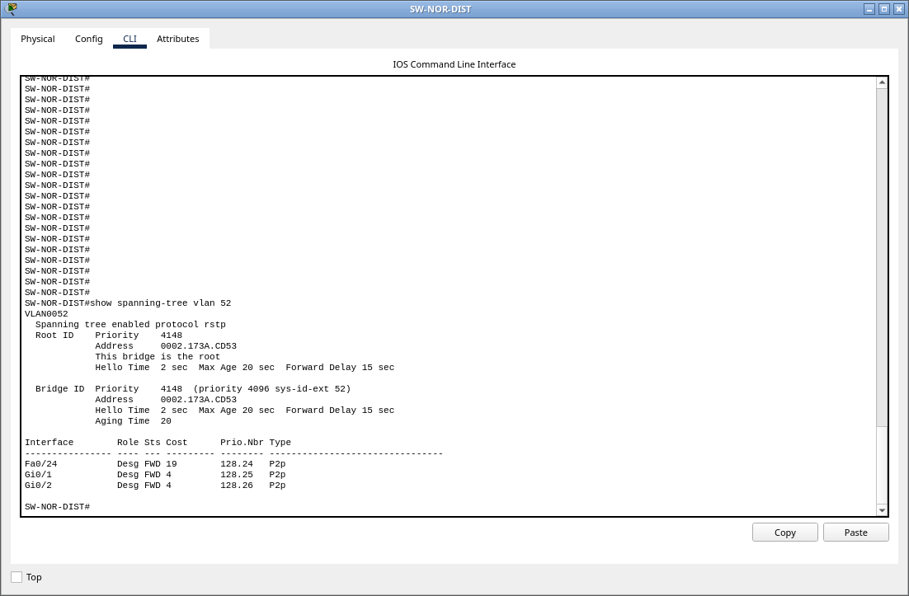

En SW-NOR-DIST, `show spanning-tree vlan 52` muestra *"This bridge is the root"* con prioridad 4148
(4096 + 52), y sus tres puertos están en `Desg FWD`.

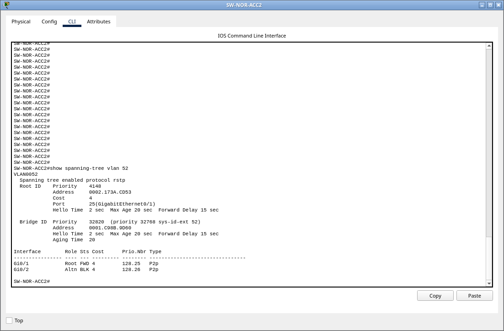

En SW-NOR-ACC2, Gi0/1 es el puerto raíz (`Root FWD`) y Gi0/2, el enlace hacia ACC1, está en
**`Altn BLK`**. Es el puerto que RSTP mantiene bloqueado para romper el bucle.

| Evidencia adicional | Captura |
|---|---|
| Subinterfaces de R-Norte y vecino EIGRP por Serial0/0/0 | [30_rnorte_subinterfaces_eigrp.png](docs/img/evidencias/30_rnorte_subinterfaces_eigrp.png) |
| VLANs con nombre en SW-NOR-DIST | [32_swnordist_vlan_brief.png](docs/img/evidencias/32_swnordist_vlan_brief.png) |
| Troncales del switch principal | [35_swnordist_trunks.png](docs/img/evidencias/35_swnordist_trunks.png) |

---

## 10. Sede Oriente — Centro Financiero Legado

### 10.1 Topología

```
            CORE-1                         CORE-2
              │ 10.76.0.16/30                │ 10.76.0.20/30
             MS1 ════ Po1 LACP (Fa0/23-24) ═══ MS2
   HSRP activo (105, track Gi0/1)     HSRP standby (100)
   Root VLAN 82/92 (4096)             STP 8192
          Fa0/1 │  ╲ Fa0/2      Fa0/1 ╱  │ Fa0/2
                │    ╲              ╱    │
                │      ╲          ╱      │
           SW-ORI-ACC1  ╲      ╱   SW-ORI-ACC2
           (Bóveda)      ╲  ╱       (Plataforma)
              Gi0/1 → MS1  ╳  Gi0/2 → MS2 en cada acceso
```

Cada switch de acceso tiene **un troncal a MS1 (Gi0/1) y otro a MS2 (Gi0/2)**. Esa es la conexión
simultánea a MS1 y MS2 que pide el enunciado.

### 10.2 Mapeo lógico

| Equipo | Rol | Troncales 802.1Q | Puertos de acceso / L3 |
|---|---|---|---|
| **MS1** | **Distribución principal**, HSRP activo, Root Bridge | Po1 (Fa0/23–24) → MS2, Fa0/1 → ACC1, Fa0/2 → ACC2 | Gi0/1 enlace routed a CORE-1; SVIs Vlan82 y Vlan92 |
| MS2 | Distribución de respaldo, HSRP standby | Po1 (Fa0/23–24) → MS1, Fa0/1 → ACC1, Fa0/2 → ACC2 | Gi0/1 enlace routed a CORE-2; SVIs Vlan82 y Vlan92 |
| SW-ORI-ACC1 | Acceso | Gi0/1 → MS1, Gi0/2 → MS2 | Fa0/1–7 VLAN 82 Bóveda |
| SW-ORI-ACC2 | Acceso | Gi0/1 → MS1, Gi0/2 → MS2 | Fa0/1–7 VLAN 92 Plataforma |

### 10.3 Justificación de la arquitectura

**Topología física.** MS1 y MS2 están **en cascada**, unidos por un EtherChannel LACP de dos enlaces, y
cada switch de acceso tiene **doble conexión**, una a cada multicapa. Así ningún usuario depende de un
solo equipo de distribución ni de un solo cable. Además, cada multicapa sube a un equipo distinto del
núcleo, por lo que la sede tampoco depende de un solo equipo del backbone.

**HSRP en estas VLANs.** Las VLANs 82 (Bóveda) y 92 (Plataforma VIP) son las críticas de la sede:
operaciones de valores y atención a clientes VIP. El requerimiento dice que no pueden perder el gateway
*"incluso si MS1 sufre un corte de energía"*. Se eligió **HSRP** en lugar de VRRP porque es el protocolo
nativo de Cisco, funciona completo en los Catalyst 3560 de Packet Tracer y permite `track` de interfaz.
Se usó la **versión 2**, que admite números de grupo mayores a 255 y usa la dirección multicast
224.0.0.102. Por claridad, el número de grupo coincide con el ID de VLAN (grupo 82 y grupo 92).

| Parámetro | MS1 | MS2 | Para qué sirve |
|---|---|---|---|
| Prioridad | **105** | 100 (por defecto) | MS1 es el activo en condiciones normales |
| `preempt` | Sí | Sí | MS1 recupera el rol activo cuando vuelve |
| `track GigabitEthernet0/1` | Sí (decremento 10) | — | Si MS1 pierde su enlace al núcleo, baja a 95 y cede el rol a MS2. Así no queda como gateway sin salida |
| STP | Root, prioridad 4096 | 8192 | El camino de capa 2 hacia el gateway activo es directo |

**Alineación de STP con HSRP.** MS1 es al mismo tiempo el gateway activo y el Root Bridge de las VLANs
82 y 92. Si la raíz fuera MS2, el tráfico de los hosts hacia el gateway activo cruzaría primero hasta
MS2 y luego por el Po1 de vuelta a MS1.

**Respuesta a la necesidad operativa.** En la sección 15.1 se apagó la interfaz de MS1 con un ping
continuo y el tráfico siguió por MS2 sin perder paquetes. En la sección 15.2 se cortó la energía de MS1
completo: se perdieron 3 paquetes mientras HSRP y RSTP convergían, y la conexión se restableció sola.

### 10.4 Extractos de configuración

**MS1: SVIs con HSRP, EtherChannel en cascada y OSPF**

```
ip routing
spanning-tree mode rapid-pvst
spanning-tree vlan 82,92 priority 4096
vlan 82
 name Boveda
vlan 92
 name Plataforma
interface GigabitEthernet0/1
 description Enlace OSPF hacia CORE-1
 no switchport
 ip address 10.76.0.18 255.255.255.252
interface range FastEthernet0/23 - 24
 description Cascada MS1-MS2 EtherChannel LACP
 switchport trunk encapsulation dot1q
 switchport mode trunk
 channel-group 1 mode active
interface Vlan82
 description Gateway Boveda (HSRP grupo 82)
 ip address 10.76.30.130 255.255.255.192
 standby version 2
 standby 82 ip 10.76.30.129
 standby 82 priority 105
 standby 82 preempt
 standby 82 track GigabitEthernet0/1
interface Vlan92
 description Gateway Plataforma (HSRP grupo 92)
 ip address 10.76.30.2 255.255.255.128
 standby version 2
 standby 92 ip 10.76.30.1
 standby 92 priority 105
 standby 92 preempt
 standby 92 track GigabitEthernet0/1
router ospf 1
 router-id 5.5.5.5
 network 10.76.0.16 0.0.0.3 area 0
 network 10.76.30.0 0.0.0.255 area 0
```

**MS2: respaldo**

```
spanning-tree vlan 82,92 priority 8192
interface Vlan82
 ip address 10.76.30.131 255.255.255.192
 standby version 2
 standby 82 ip 10.76.30.129
 standby 82 preempt
interface Vlan92
 ip address 10.76.30.3 255.255.255.128
 standby version 2
 standby 92 ip 10.76.30.1
 standby 92 preempt
router ospf 1
 router-id 6.6.6.6
 network 10.76.0.20 0.0.0.3 area 0
 network 10.76.30.0 0.0.0.255 area 0
```

### 10.5 Evidencias de la sede

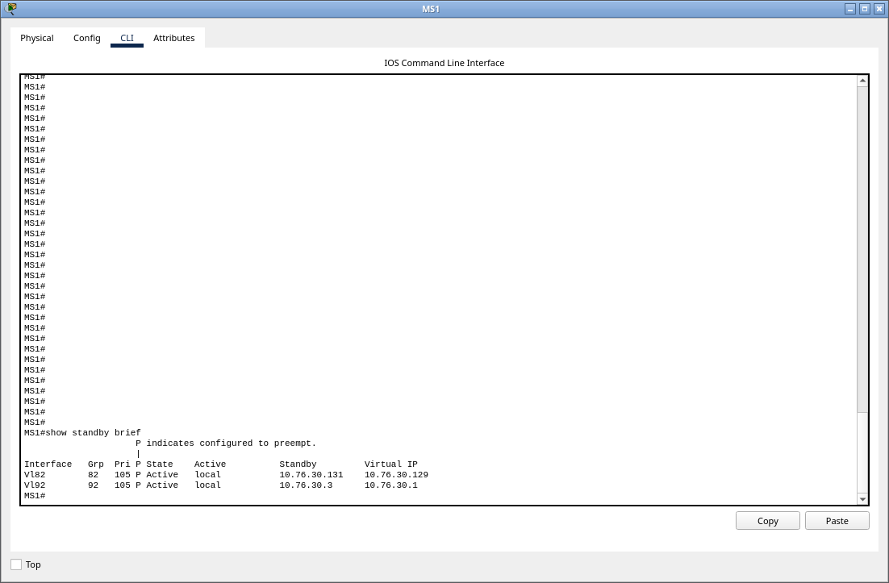

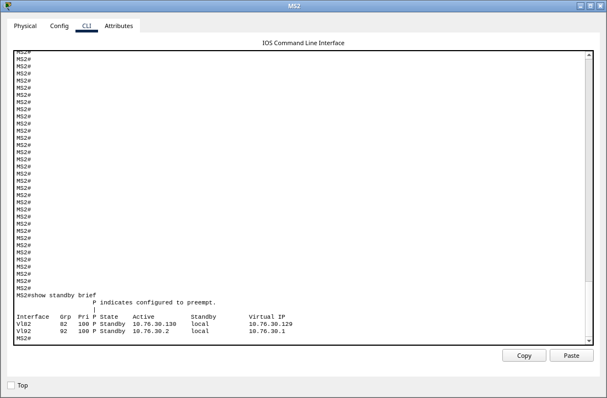

| Evidencia adicional | Captura |
|---|---|
| EtherChannel Po1 entre MS1 y MS2 (`SU`, LACP, Fa0/23 y Fa0/24 en `P`) | [42_ms1_etherchannel.png](docs/img/evidencias/42_ms1_etherchannel.png) |
| Tabla de rutas de MS1 | [43_ms1_show_ip_route.png](docs/img/evidencias/43_ms1_show_ip_route.png) |
| MS1 como Root Bridge de la VLAN 82 | [44_ms1_root_bridge.png](docs/img/evidencias/44_ms1_root_bridge.png) |

---

## 11. Data Center y Sede Central

### 11.1 Topología

```
   CORE-2 ── Gi0/0 ┐                         ┌ Gi0/0/0 ── fibra ── CORE-3
                   R-Central1  (★ estáticas → OSPF)
                        │ Gi0/1 · 10.76.0.36/30
                   R-Central2  (router de acceso · default → R-Central1)
                        │ Gi0/1 · 10.76.0.40/30
                   SW-DC-DIST  (3560 · SVIs 13/23/33 · default → R-Central2)
          Po1 ╱ (Fa0/1-2)  │ Po2 (Fa0/3-4)  ╲ Po3 (Fa0/5-6)
       SW-DC-ACC1      SW-DC-ACC2         SW-DC-ACC3
       Core_BD         Web_Apps           NOC
```

### 11.2 Mapeo lógico

| Equipo | Rol | Troncales 802.1Q | Puertos de acceso / L3 |
|---|---|---|---|
| R-Central1 | Punto de redistribución | — | Gi0/0 → CORE-2, Gi0/0/0 (fibra) → CORE-3, Gi0/1 → R-Central2 |
| R-Central2 | Router de acceso del segmento estático | — | Gi0/0 → R-Central1, Gi0/1 → SW-DC-DIST |
| **SW-DC-DIST** | **Switch de distribución** (capa 3) | Po1 (Fa0/1–2), Po2 (Fa0/3–4), Po3 (Fa0/5–6) | Gi0/1 routed → R-Central2; SVIs 13, 23 y 33 |
| SW-DC-ACC1 | Acceso a servidores Core_BD | Po1 (Fa0/23–24) | Fa0/1–7 VLAN 13 |
| SW-DC-ACC2 | Acceso a servidores Web_Apps | Po2 (Fa0/23–24) | Fa0/1–7 VLAN 23 |
| SW-DC-ACC3 | Acceso al NOC | Po3 (Fa0/23–24) | Fa0/1–7 VLAN 33 |

### 11.3 Justificación de la arquitectura

**Topología física.** Se siguió la estructura que describe el enunciado: dos routers de borde con
funciones distintas y, detrás de ellos, una **distribución de capa 3 con tres switches de acceso**, uno
por granja. Cada granja tiene su propio switch, así que una ráfaga en los servidores web no compite por
los mismos puertos que la base de datos.

**EtherChannel.** Cada switch de acceso se conecta a la distribución con un **EtherChannel LACP de 2
cables** (`channel-group N mode active` en ambos extremos). Con LACP activo en los dos lados el canal
se negocia, no se fuerza, así que un error de cableado deja el puerto suspendido en lugar de crear un
bucle. El resultado:

- **Ancho de banda sumado:** 2 × 100 Mbps por granja. Responde a la necesidad de que *"un solo cable no
  tiene el ancho de banda suficiente"*.
- **Tolerancia a fallos:** si se corta un cable, el canal sigue arriba con el otro, sin reconvergencia de
  STP, porque STP ve el Port-channel como un solo enlace lógico.

**Rutas estáticas y aislamiento.** El segmento no corre ningún protocolo dinámico:

- SW-DC-DIST tiene una ruta por defecto hacia R-Central2.
- R-Central2 conoce las tres VLANs por SW-DC-DIST y usa una ruta por defecto hacia R-Central1.
- R-Central1 tiene estáticas hacia las VLANs y las **redistribuye en OSPF**.

Ningún equipo del núcleo puede inyectar rutas dentro del Data Center, y el Data Center solo publica lo
que R-Central1 decide publicar. Además, R-Central1 tiene doble conexión al núcleo (Ethernet a CORE-2 y
fibra a CORE-3), así que el Data Center sigue alcanzable si cae uno de los dos.

**Inter-VLAN.** Se hace con **SVIs en SW-DC-DIST**, que enruta en hardware entre las tres VLANs sin
depender de un router externo. El tráfico entre la base de datos y los servidores web no sale de la
distribución.

### 11.4 Extractos de configuración

**SW-DC-DIST: SVIs, EtherChannel y ruta por defecto**

```
ip routing
vlan 13
 name Core_BD
vlan 23
 name Web_Apps
vlan 33
 name NOC
interface range FastEthernet0/1 - 2
 description EtherChannel LACP hacia SW-DC-ACC1
 switchport trunk encapsulation dot1q
 switchport mode trunk
 channel-group 1 mode active
interface range FastEthernet0/3 - 4
 description EtherChannel LACP hacia SW-DC-ACC2
 switchport trunk encapsulation dot1q
 switchport mode trunk
 channel-group 2 mode active
interface range FastEthernet0/5 - 6
 description EtherChannel LACP hacia SW-DC-ACC3
 switchport trunk encapsulation dot1q
 switchport mode trunk
 channel-group 3 mode active
interface GigabitEthernet0/1
 description Enlace hacia R-Central2
 no switchport
 ip address 10.76.0.42 255.255.255.252
interface Vlan13
 description Gateway Core_BD
 ip address 10.76.40.33 255.255.255.224
interface Vlan23
 description Gateway Web_Apps
 ip address 10.76.40.1 255.255.255.224
interface Vlan33
 description Gateway NOC
 ip address 10.76.40.65 255.255.255.240
ip route 0.0.0.0 0.0.0.0 10.76.0.41
```

**SW-DC-ACC1: extremo del EtherChannel**

```
interface range FastEthernet0/23 - 24
 description EtherChannel LACP hacia SW-DC-DIST
 switchport mode trunk
 channel-group 1 mode active
interface range FastEthernet0/1 - 7
 description Hosts VLAN 13 Core_BD
 switchport mode access
 switchport access vlan 13
 spanning-tree portfast
```

**R-Central2: rutas estáticas del segmento**

```
interface GigabitEthernet0/0
 description Enlace hacia R-Central1
 ip address 10.76.0.38 255.255.255.252
interface GigabitEthernet0/1
 description Enlace hacia SW-DC-DIST
 ip address 10.76.0.41 255.255.255.252
ip route 0.0.0.0 0.0.0.0 10.76.0.37
ip route 10.76.40.0  255.255.255.224 10.76.0.42
ip route 10.76.40.32 255.255.255.224 10.76.0.42
ip route 10.76.40.64 255.255.255.240 10.76.0.42
```

La configuración de redistribución de R-Central1 está en la sección [5.5](#55-puntos-de-redistribución).

### 11.5 Evidencias de la sede

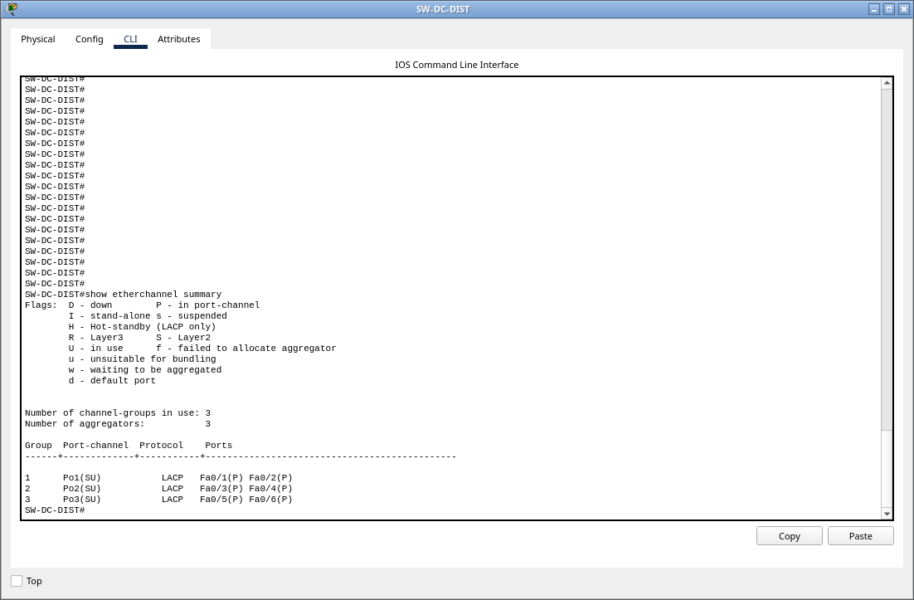

Los tres Port-channel aparecen como `SU` (capa 2, en uso), con protocolo LACP y sus dos puertos en
`P` (agregados al canal).

| Evidencia adicional | Captura |
|---|---|
| VLANs con nombre y SVIs activas | [51_swdcdist_vlans_svis.png](docs/img/evidencias/51_swdcdist_vlans_svis.png) |
| Troncales sobre los Port-channel | [52_swdcdist_trunks.png](docs/img/evidencias/52_swdcdist_trunks.png) |
| Redistribución de estáticas en R-Central1 (`show ip protocols`) | [16_rcentral1_show_ip_protocols.png](docs/img/evidencias/16_rcentral1_show_ip_protocols.png) |
| Tabla de rutas de R-Central2 (estáticas y ruta por defecto) | [17_rcentral2_show_ip_route.png](docs/img/evidencias/17_rcentral2_show_ip_route.png) |

---

## 12. Configuración común a todos los equipos

Todos los routers y switches recibieron la misma base:

```
hostname <nombre>
no ip domain-lookup
banner motd #BanTech GT - Acceso restringido. Solo personal autorizado.#
line console 0
 logging synchronous
spanning-tree mode rapid-pvst        ! en todos los switches
```

Además:

- cada interfaz en uso tiene `description` con el equipo del otro extremo;
- los puertos de hosts tienen `spanning-tree portfast`;
- la configuración se guardó con `write memory`, como se comprobó al reencender MS1 en la prueba 15.2.

Los scripts completos de configuración por equipo están en [`docs/scripts/`](docs/scripts/). Las
configuraciones en ejecución, exportadas con `show running-config`, están en
[`docs/evidencias/running-config/`](docs/evidencias/running-config/).

---

## 13. Pruebas de convergencia y conectividad

Antes de las pruebas se dejó que los protocolos convergieran. Todas las pruebas se hicieron desde el
*Command Prompt* de los dispositivos finales.

### 13.1 Ping entre sedes (de extremo a extremo)

| Origen | Destino | Resultado | Captura |
|---|---|---|---|
| PC-CAJ-04 (Occidente, VLAN 12) | SRV-WEB-01 10.76.40.2 (Data Center) | 4/4 | [61](docs/img/evidencias/61_occ_ping_entre_sedes.png) |
| PC-CAJ-04 (Occidente) | PC-ANA-04 10.76.20.5 (Norte) | 4/4 | [61](docs/img/evidencias/61_occ_ping_entre_sedes.png) |
| PC-CAJ-04 (Occidente) | PC-BOV-01 10.76.30.132 (Oriente) | 4/4 | [61](docs/img/evidencias/61_occ_ping_entre_sedes.png) |
| PC-ANA-04 (Norte, VLAN 52) | PC-NOC-04 10.76.40.69 (Data Center) | 4/4 | [63](docs/img/evidencias/63_nor_ping_intervlan.png) |
| PC-ANA-04 (Norte) | PC-CAJ-04 10.76.10.5 (Occidente) | 4/4 | [64](docs/img/evidencias/64_nor_ping_entre_sedes.png) |
| PC-ANA-04 (Norte) | LAP-PLA-01 10.76.30.4 (Oriente) | 4/4 | [64](docs/img/evidencias/64_nor_ping_entre_sedes.png) |
| PC-BOV-01 (Oriente, VLAN 82) | 10.76.10.5 / 10.76.20.5 / 10.76.40.34 | 4/4 cada uno | [66](docs/img/evidencias/66_ori_ping_entre_sedes.png) |
| PC-NOC-04 (Data Center, VLAN 33) | 10.76.10.5 / 10.76.20.69 / 10.76.30.4 | 4/4 cada uno | [68](docs/img/evidencias/68_dc_ping_entre_sedes.png) |

**Occidente → Data Center**, el ejemplo que da el enunciado. El tráfico atraviesa los cuatro dominios:
sale por RIP, cruza OSPF y entra al segmento estático.

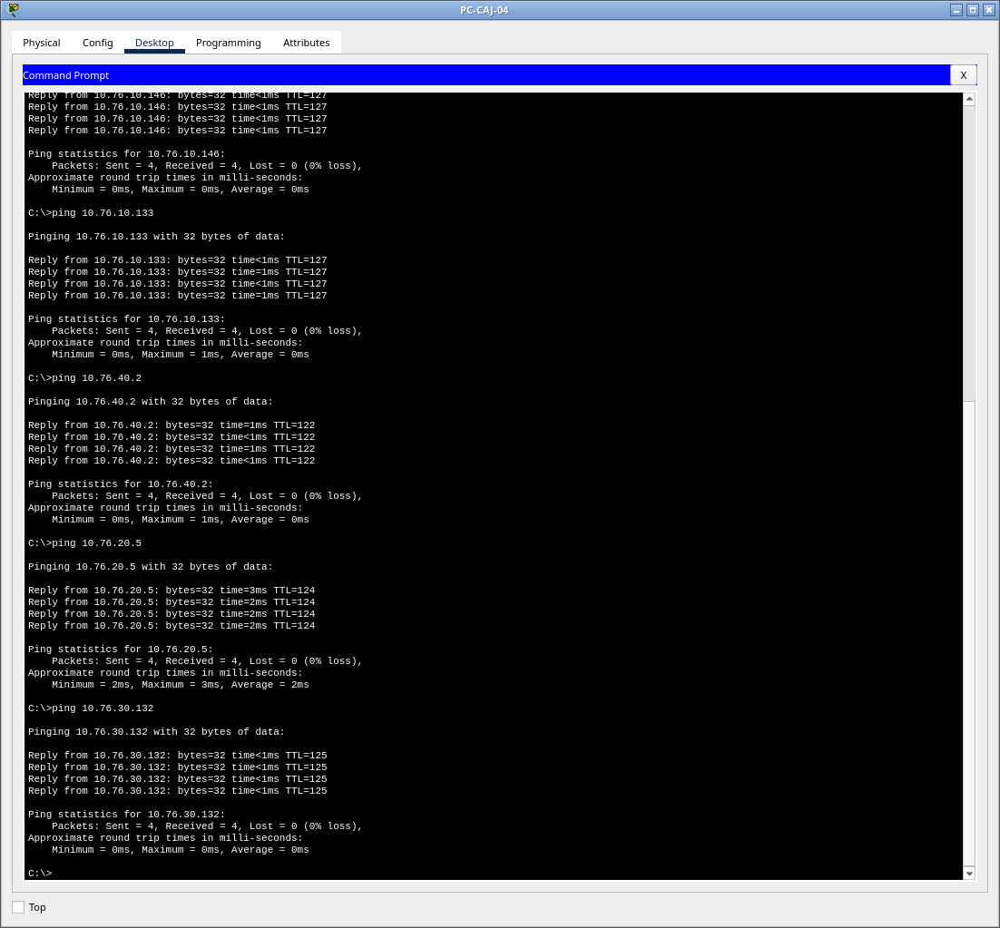

El `tracert` desde la misma PC muestra el camino salto a salto:

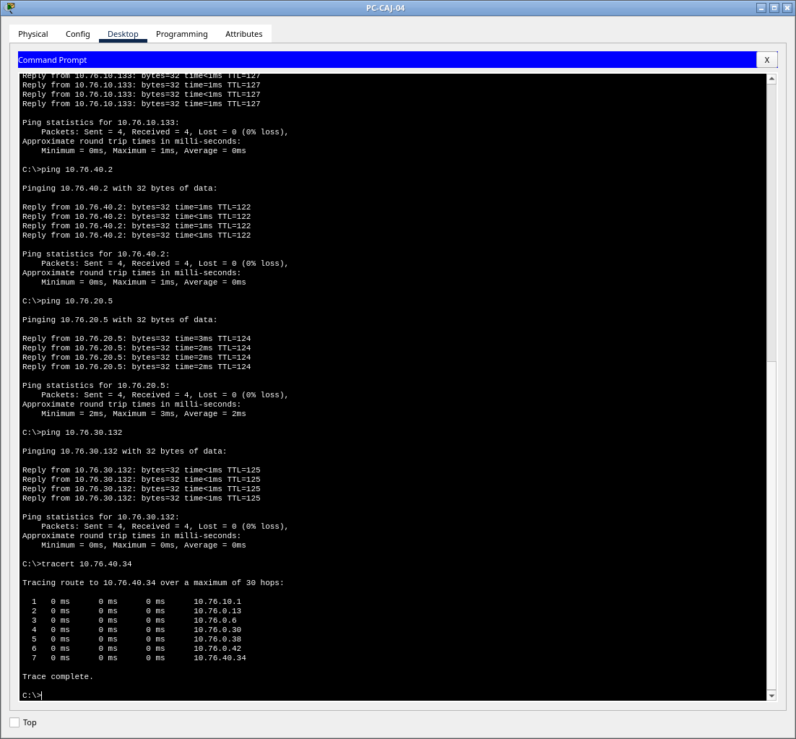

| Salto | Dirección | Equipo | Dominio |
|---:|---|---|---|
| 1 | 10.76.10.1 | R-Occidente (subinterfaz .12) | RIPv2 |
| 2 | 10.76.0.13 | CORE-1 | RIPv2 → OSPF |
| 3 | 10.76.0.6 | CORE-3 | OSPF |
| 4 | 10.76.0.30 | R-Central1, por la **fibra óptica** | OSPF → estáticas |
| 5 | 10.76.0.38 | R-Central2 | Estáticas |
| 6 | 10.76.0.42 | SW-DC-DIST | Estáticas |
| 7 | 10.76.40.34 | SRV-BD-01 | — |

Las demás capturas entre sedes:

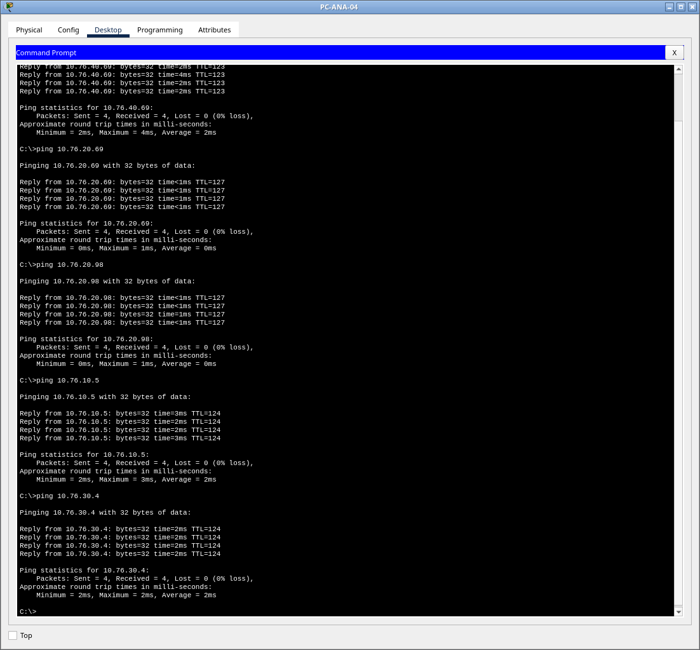

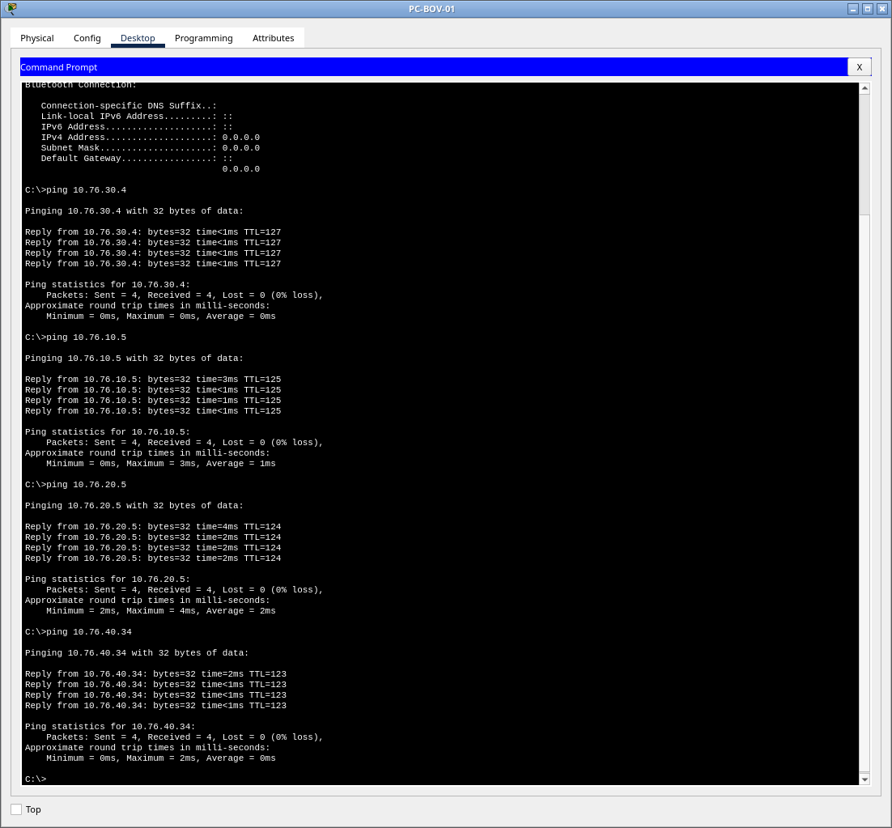

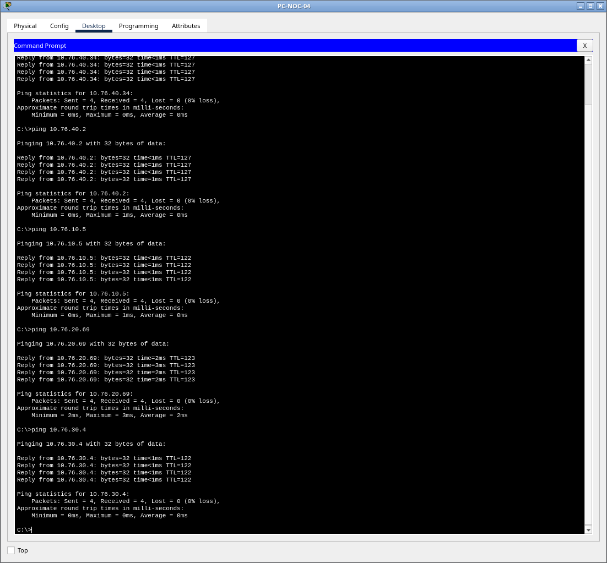

### 13.2 Ping entre VLANs de cada sede (enrutamiento inter-VLAN)

| Sede | Origen | Destinos (otras VLANs de la sede) | Método | Resultado | Captura |
|---|---|---|---|---|---|
| Occidente | PC-CAJ-04 (VLAN 12) | 10.76.10.69 (22), 10.76.10.146 (32), 10.76.10.133 (42) | Router-on-a-Stick | 4/4 cada uno | [60](docs/img/evidencias/60_occ_ping_intervlan.png) |
| Norte | PC-ANA-04 (VLAN 52) | 10.76.20.69 (62), 10.76.20.98 (72) | Router-on-a-Stick | 4/4 cada uno | [63](docs/img/evidencias/63_nor_ping_intervlan.png) |
| Oriente | PC-BOV-01 (VLAN 82) | 10.76.30.4 (92) | SVIs + HSRP | 4/4 | [65](docs/img/evidencias/65_ori_ping_intervlan.png) |
| Data Center | PC-NOC-04 (VLAN 33) | 10.76.40.34 (13), 10.76.40.2 (23) | SVIs | 4/4 cada uno | [67](docs/img/evidencias/67_dc_ping_intervlan.png) |

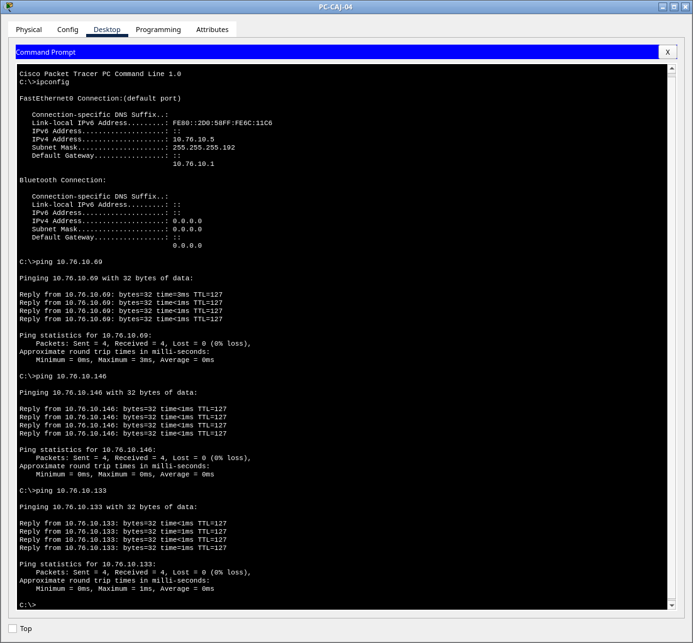

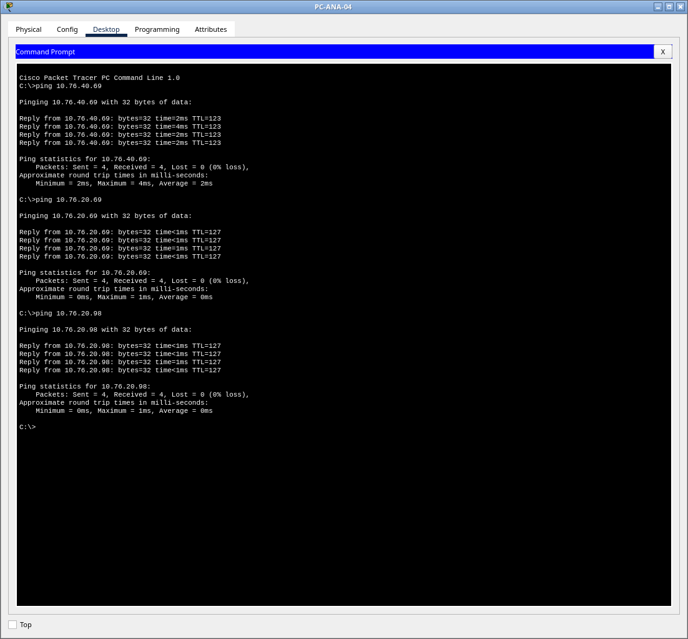

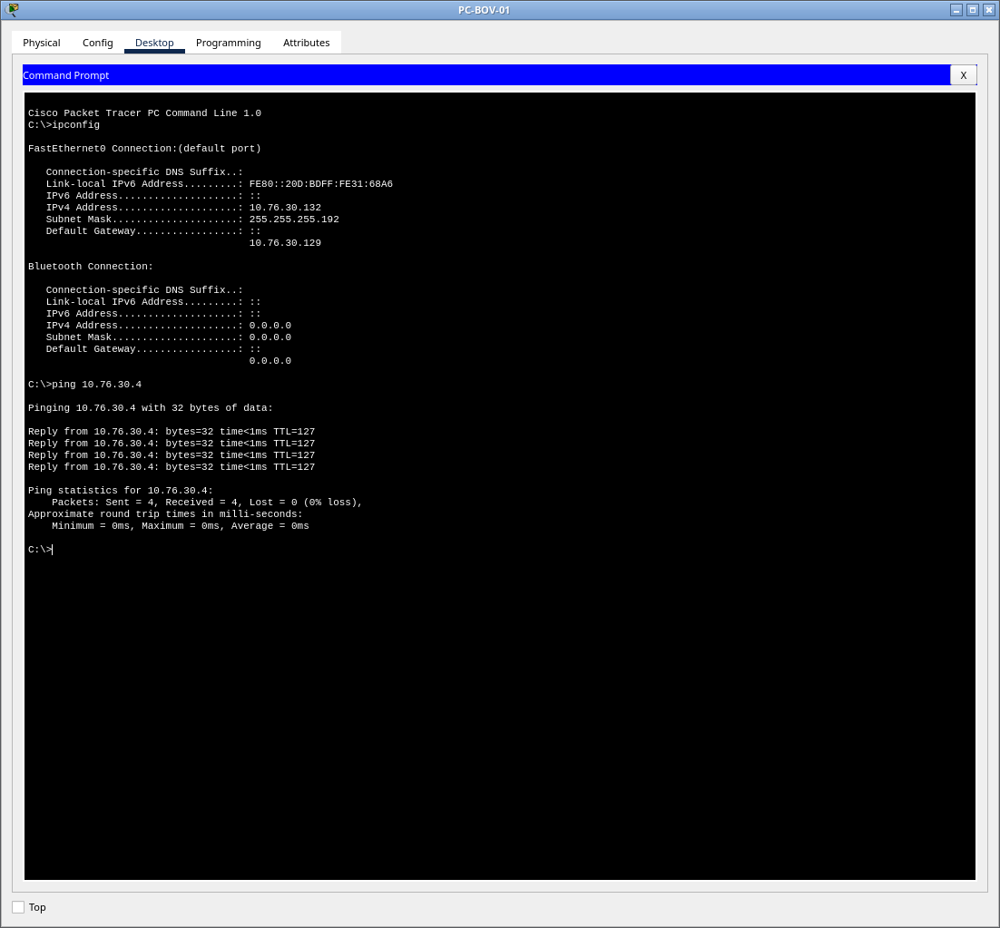

En la captura de Oriente, `ipconfig` muestra que el gateway de PC-BOV-01 es **10.76.30.129**, la IP
virtual de HSRP, y no la dirección real de MS1 ni la de MS2.

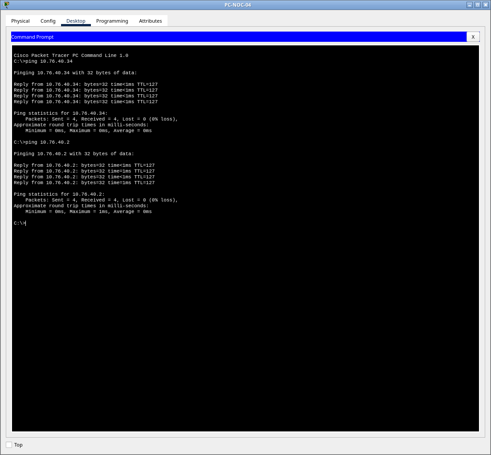

---

## 14. Tablas de enrutamiento de los routers frontera

Las tablas muestran la redistribución con los códigos de cada origen:

| Código | Significado | Ejemplo |
|---|---|---|
| `O` | Ruta OSPF interna | Enlaces del backbone, redes de Oriente |
| `O E2` | Externa tipo 2 en OSPF, **redistribuida** | Redes de Occidente (desde RIP), Norte (desde EIGRP) y Data Center (desde estáticas) |
| `R` | Ruta RIP | Redes de Occidente en CORE-1, y todo el backbone en R-Occidente |
| `D` | Ruta EIGRP interna | Redes de Norte en CORE-3 |
| `D EX` | Externa en EIGRP, **redistribuida** | Todo lo que no es Norte, visto desde R-Norte |
| `S` / `S*` | Estática / por defecto | Data Center en R-Central1 y R-Central2 |

### 14.1 CORE-1: punto de redistribución RIPv2 ↔ OSPF

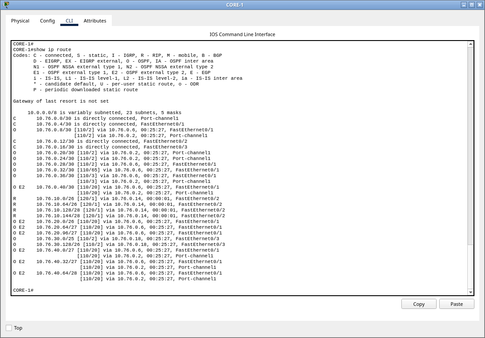

CORE-1 aprende por **`R`** las cuatro redes de Occidente (10.76.10.0/26, .64/26, .128/28, .144/28) a
través de 10.76.0.14. Las de Norte (10.76.20.x) y del Data Center (10.76.40.x) le llegan como
**`O E2`**, redistribuidas por CORE-3 y R-Central1. Varias rutas tienen dos *next-hop* de igual costo:
OSPF balancea entre el Po1 y el enlace a CORE-3.

### 14.2 CORE-3: punto de redistribución EIGRP ↔ OSPF

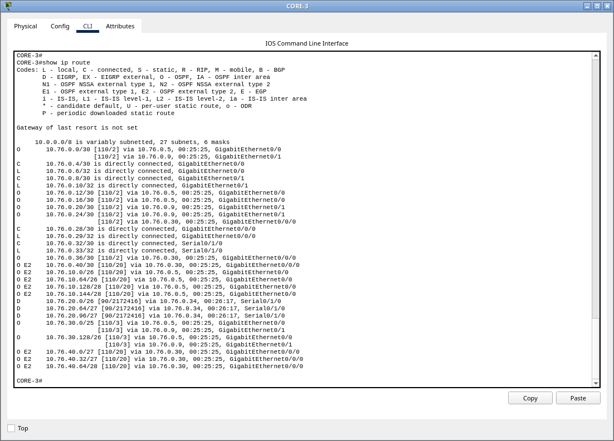

CORE-3 aprende las tres VLANs de Norte por **`D`**, vía Serial0/1/0, con métrica 2172416. Ve las de
Occidente y del Data Center como **`O E2`**.

### 14.3 R-Central1: punto de redistribución estáticas → OSPF

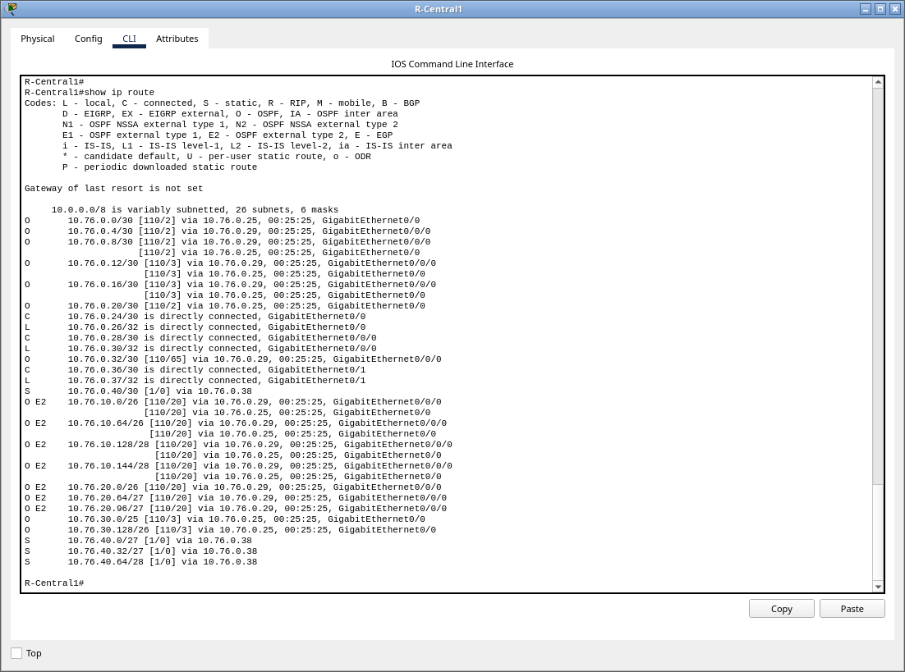

R-Central1 tiene las tres VLANs del Data Center como **`S`** vía 10.76.0.38. Recibe todo lo demás por
OSPF, en algunos casos por dos caminos: el Ethernet hacia CORE-2 y la fibra hacia CORE-3. En
`show ip protocols` aparece *"Redistributing External Routes from, static"*:

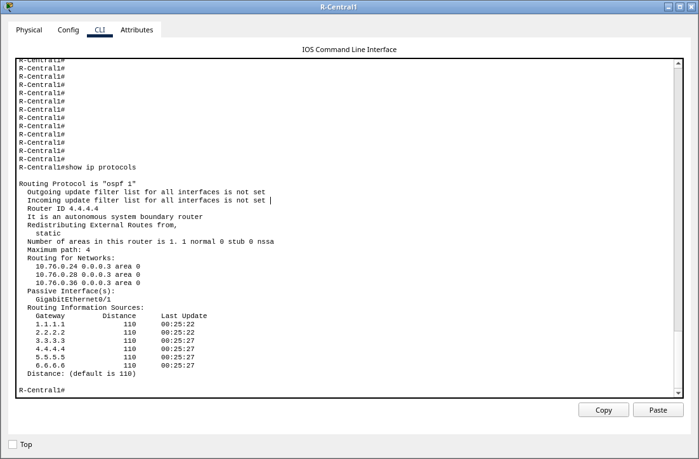

### 14.4 R-Occidente: todo el backbone visto desde RIP

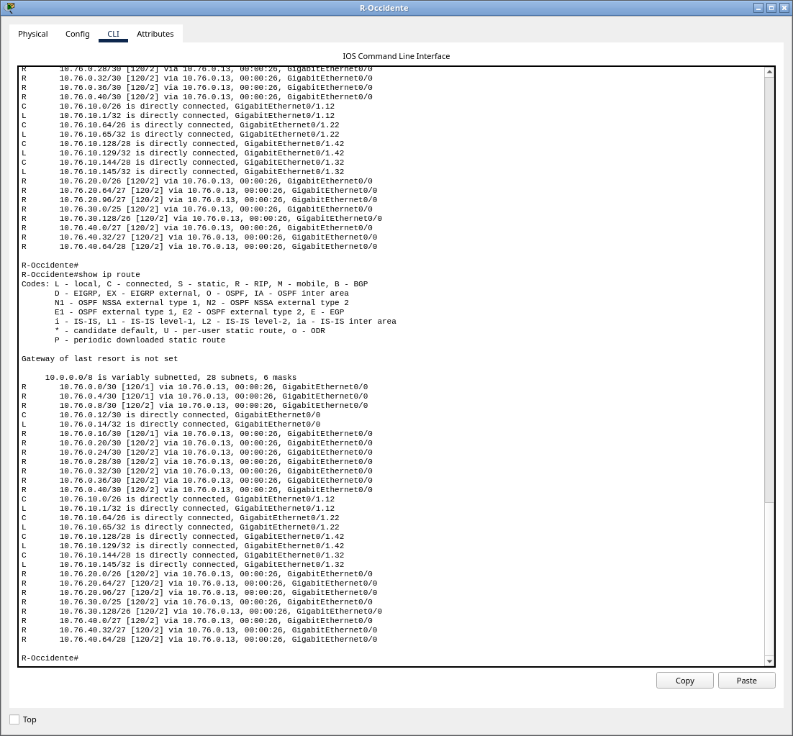

Desde R-Occidente, todas las redes externas (backbone, Norte, Oriente y Data Center) aparecen como
**`R`**. Las redistribuidas desde OSPF llegan con métrica 2, la métrica semilla que asigna CORE-1. Las
subredes conectadas directamente a CORE-1 (por ejemplo 10.76.0.0/30 y 10.76.0.4/30) llegan con
métrica 1. Las cuatro VLANs locales aparecen como
`C` en las subinterfaces Gi0/1.12, .22, .32 y .42.

### 14.5 R-Norte: todo el backbone visto desde EIGRP

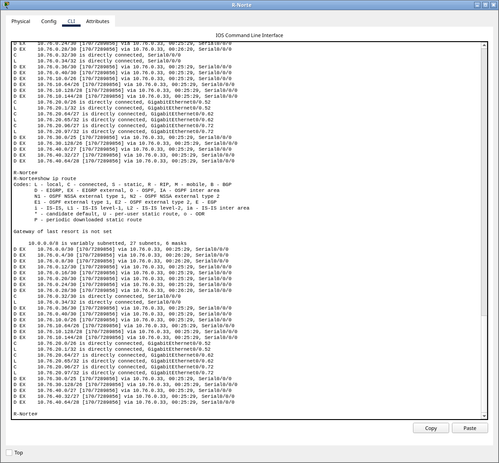

Desde R-Norte, las redes externas son **`D EX`** (EIGRP externo), con la métrica semilla de CORE-3, y
las VLANs locales son `C` en Gi0/0.52, .62 y .72.

### 14.6 Otras tablas

| Equipo | Captura |
|---|---|
| CORE-2 | [12_core2_show_ip_route.png](docs/img/evidencias/12_core2_show_ip_route.png) |
| R-Central2 | [17_rcentral2_show_ip_route.png](docs/img/evidencias/17_rcentral2_show_ip_route.png) |
| MS1 | [43_ms1_show_ip_route.png](docs/img/evidencias/43_ms1_show_ip_route.png) |
| Vecinos OSPF y EtherChannel L3 de CORE-1 | [10_core1_etherchannel_ospf.png](docs/img/evidencias/10_core1_etherchannel_ospf.png) |
| Interfaces y vecino EIGRP de CORE-3 | [13_core3_interfaces_eigrp.png](docs/img/evidencias/13_core3_interfaces_eigrp.png) |

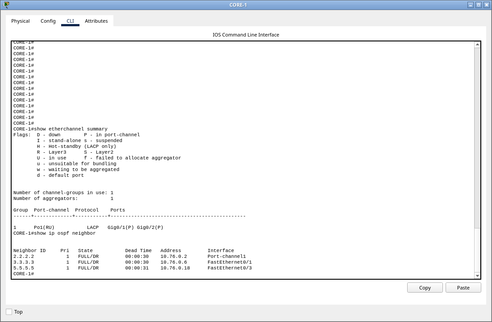

`Po1(RU)` indica un Port-channel de **capa 3** (*R = routed*) en uso, formado por Gi0/1 y Gi0/2 con
LACP. CORE-1 tiene adyacencia `FULL` con CORE-2 (por el Po1), con CORE-3 y con MS1.

---

## 15. Pruebas de conmutación por error

### 15.1 HSRP: apagado de la interfaz de MS1

Es la prueba que pide el enunciado: *"al apagar la interfaz de MS1, el tráfico viaja automáticamente
por MS2 sin que las PCs pierdan conexión"*.

**Procedimiento:**

1. Desde **PC-BOV-04** (VLAN 82) se lanzó `ping -n 60 10.76.40.34` hacia SRV-BD-01 en el Data Center.
2. Con el ping en curso, en MS1 se ejecutó:
   ```
   interface GigabitEthernet0/1
    shutdown
   ```
3. Se dejó terminar el ping y se revisó el estado de HSRP en ambos equipos.

**Resultado del ping:** **60 enviados, 60 recibidos, 0 % de pérdida**.

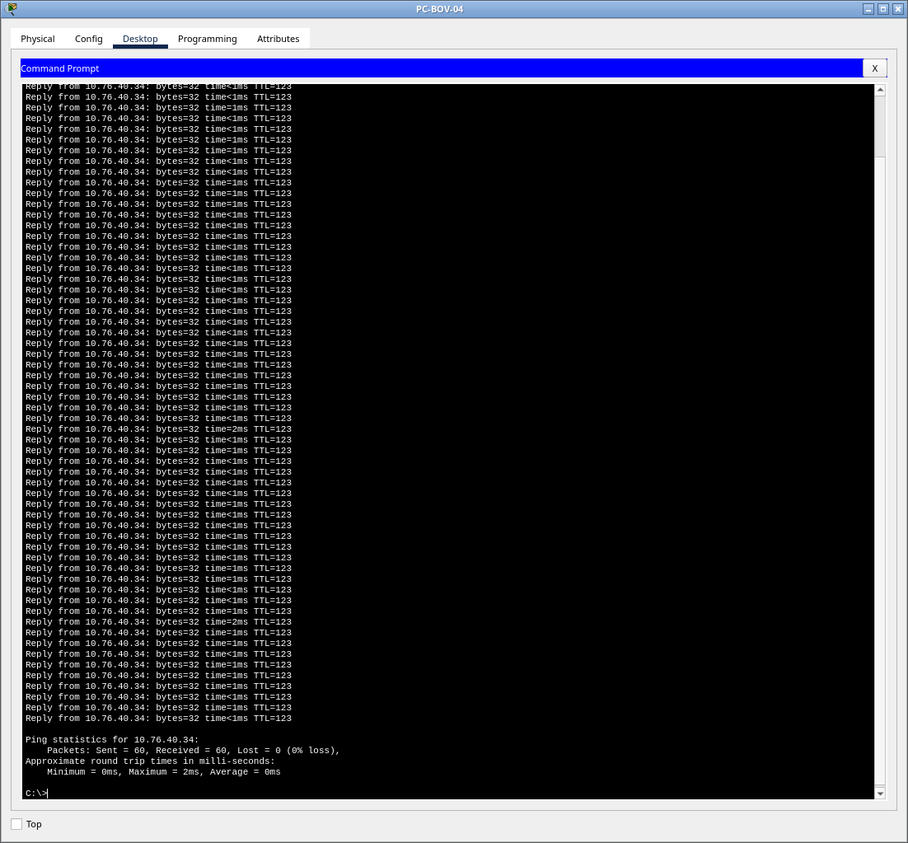

**Estado de MS1:** la interfaz quedó *administratively down*. Por el `track`, su prioridad bajó de 105 a
**95**, y como es menor que la de MS2 (100), MS1 pasó a **Standby**.

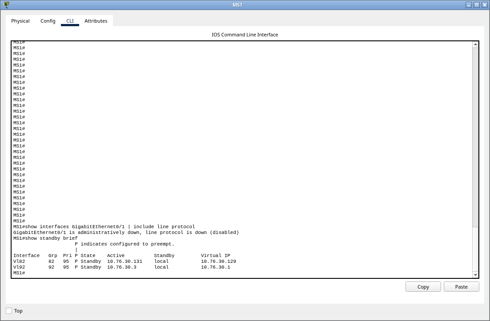

**Estado de MS2:** asumió el rol **Active** en los dos grupos y atiende las IP virtuales .129 y .1.


**Camino durante la falla.** Un `tracert` desde la misma PC confirma que el tráfico sale ahora por MS2
(10.76.30.131) y sube al núcleo por CORE-2 (10.76.0.21):

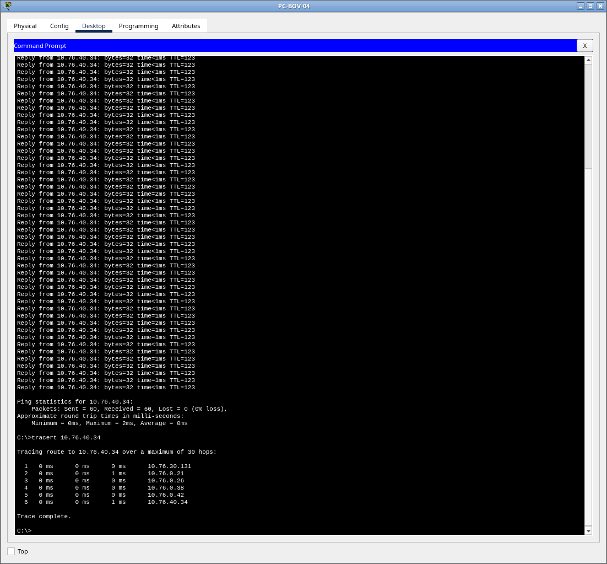

**Recuperación.** Al ejecutar `no shutdown` en Gi0/1, MS1 recuperó la prioridad 105 y, gracias a
`preempt`, volvió a ser el **Active** sin intervención manual:


### 15.2 HSRP: corte de energía de MS1

La necesidad operativa de la sede habla de un *corte de energía* de MS1, que es más severo que apagar
una interfaz: desaparecen a la vez el gateway activo, el Root Bridge de las VLANs 82 y 92, y un extremo
de cada troncal de acceso. Se probó también este caso.

**Procedimiento:** con `ping -n 60 10.76.40.34` en curso desde PC-BOV-04, se apagó MS1 desde su
interruptor de energía.

**Resultado:** **3 solicitudes sin respuesta** mientras MS2 dejaba de recibir los *hello* de HSRP y los
switches de acceso pasaban su puerto alterno hacia MS2 a *forwarding*. Después, todas las respuestas
volvieron y el ping terminó sin más pérdidas.

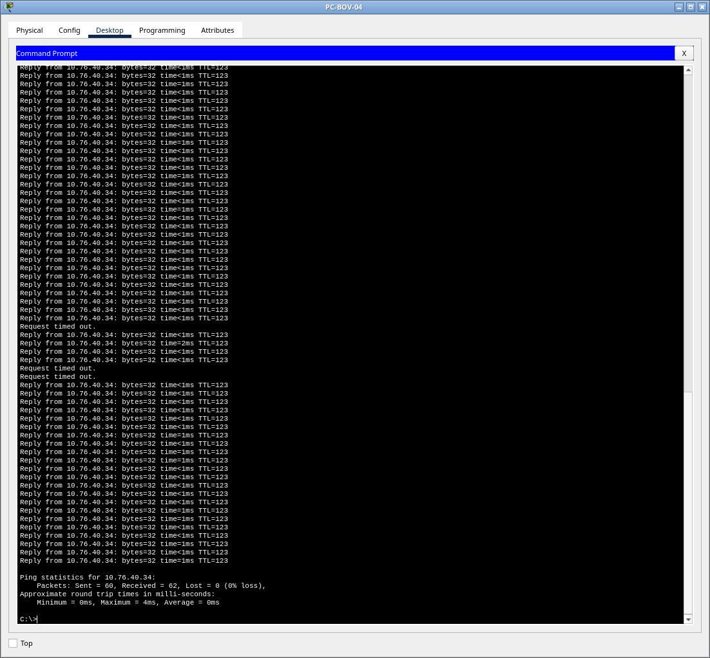

MS2 quedó como **Active** con el standby en *unknown*, porque MS1 está apagado:


Al encender MS1, arrancó con la configuración guardada, recuperó el rol **Active** por `preempt` y el
EtherChannel Po1 volvió a formarse:

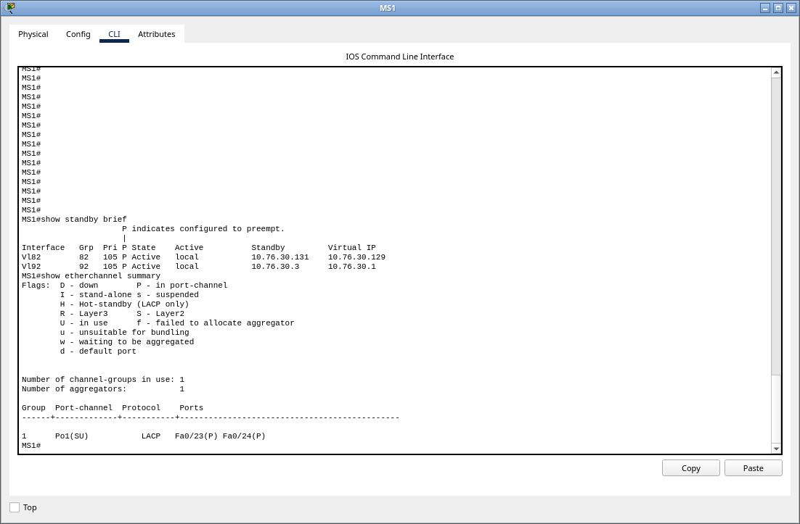

### 15.3 Rapid PVST+: caída de un enlace del anillo de la Sede Norte

**Procedimiento:**

1. Desde **PC-AUD-04** (VLAN 62, conectada a SW-NOR-ACC2) se lanzó `ping -n 60 10.76.40.34`.
2. Con el ping en curso se apagó el enlace principal de ACC2 hacia el switch principal:
   ```
   SW-NOR-DIST(config)# interface GigabitEthernet0/2
   SW-NOR-DIST(config-if)# shutdown
   ```

**Resultado:** **60 enviados, 60 recibidos, 0 % de pérdida**. Solo una respuesta tardó 183 ms, justo
durante la transición del puerto alterno, frente a los 2 ms habituales.


En SW-NOR-ACC2, el puerto **Gi0/2, que estaba en `Altn BLK`, pasó a `Root FWD`**. El costo hacia la
raíz subió de 4 a 8 porque ahora el camino pasa por ACC1:

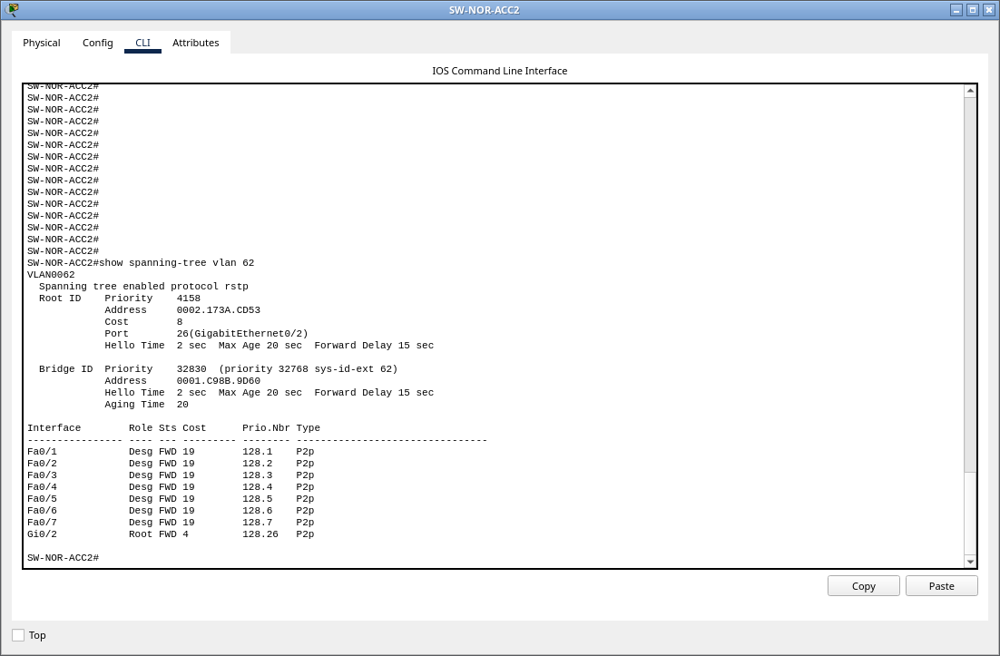

Al restaurar el enlace con `no shutdown`, Gi0/1 volvió a ser el puerto raíz y Gi0/2 regresó a
`Altn BLK`:

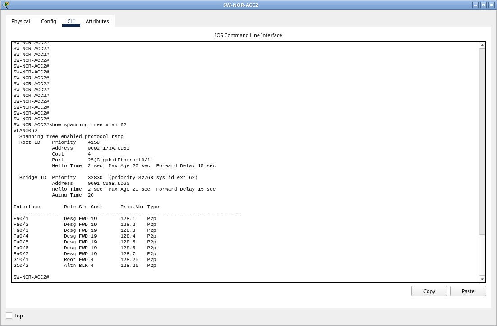

### 15.4 Resumen de las pruebas de alta disponibilidad

| Prueba | Falla provocada | Paquetes perdidos | Recuperación automática |
|---|---|---:|---|
| HSRP, interfaz | `shutdown` en MS1 Gi0/1 | **0 de 60** | Sí: MS2 activo por `track`; MS1 vuelve por `preempt` |
| HSRP, energía | MS1 apagado por completo | **3 de 60** | Sí: MS2 activo; MS1 vuelve al encenderse |
| Rapid PVST+ | `shutdown` en SW-NOR-DIST Gi0/2 | **0 de 60** | Sí: ACC2 Gi0/2 de `Altn BLK` a `Root FWD` |

---

## 16. Cumplimiento de los requerimientos

| Requerimiento del enunciado | Dónde se cumple |
|---|---|
| Núcleo redundante con al menos 3 equipos de capa 3 | CORE-1, CORE-2 y CORE-3 en triángulo (5.1) |
| Agregación de enlaces en el núcleo | Po1 L3 LACP CORE-1 ↔ CORE-2 (5.1, captura 10) |
| Dominios OSPF, EIGRP y RIPv2 y segmento estático | 5.3 |
| Al menos dos puntos de redistribución | Tres: CORE-1, CORE-3 y R-Central1 (5.5) |
| Medios físicos: fibra, Ethernet y serial | 5.2 |
| Direccionamiento /30 del backbone propuesto | 6.2 |
| Inter-VLAN en cada sede | 13.2 (Router-on-a-Stick en Occidente y Norte, SVIs en Oriente y DC) |
| Occidente: Router-on-a-Stick en R-Occidente | 8.4, captura 20 |
| Occidente: VTP `bantech76` / `cisco` con más de un switch de acceso | 8.4, capturas 22–24 |
| Norte: bucle físico intencional | Triángulo DIST–ACC1–ACC2 (9.1) |
| Norte: Rapid PVST+ y Root Bridge forzado y justificado | 9.3, capturas 33–34 |
| Oriente: acceso conectado a MS1 y MS2 a la vez | 10.1–10.2 |
| Oriente: HSRP con MS1 y MS2 como gateways virtuales | 10.3–10.4, capturas 40–41 |
| Oriente: al apagar la interfaz de MS1, el tráfico sigue por MS2 | 15.1 (0 % de pérdida) |
| DC: switches de distribución y de acceso para servidores | 11.1–11.2 |
| DC: EtherChannel de al menos 2 cables en el acceso a servidores | Po1, Po2 y Po3 con LACP (11.3, captura 50) |
| DC: R-Central2 de acceso y R-Central1 redistribuye hacia el backbone | 11.3, 5.5, capturas 15–17 |
| VLANs con `name` y todos los equipos con `hostname` | 7, 12 |
| Mapeo lógico: switch principal, troncales y puertos de acceso | 8.2, 9.2, 10.2, 11.2 |
| Justificación por sede (topología, tolerancia a fallos, contexto) | 8.3, 9.3, 10.3, 11.3 |
| Capturas: convergencia, tablas de rutas y conmutación por error | 13, 14, 15 |
| Mínimo de 7 dispositivos finales por área | 7 por VLAN, 84 en total (4.2) |
| Área de cada protocolo identificada en el simulador | Zonas de color con encabezado (3.3) |
| Tablas de subneteo, IPs asignadas y tabla de VLANs | 6 y 7 |

---
